# Extension Hooks & Cloud Governance Cookbook

> **Reference Specification**: Infor LN Extensions Development Guide (Release 10.8)  
> **Target Audience**: Infor LN Cloud Developers, Extension Engineers, and AI Coding Agents  
> **Related Guides**: [DAL Architecture & Business Logic](02_dal_architecture_and_business_logic.md) | [SQL Optimization & Transactions](03_sql_query_optimization_and_transactions.md) | [Extension Guide Index](../EXTENSIONS_INDEX.md)

---

## 1. Architectural Principles & Cloud Readiness

Infor LN Extensibility provides non-intrusive customization ("last-mile customization") without modifying standard source code. All extension components reside in customer-specific packages (conventionally `tx` or customer VRCs) and hook into standard business objects at predefined runtime extension points.

### The Cardinal Rules of Cloud Extensibility:
1. **Never Modify Standard Components**: Always use Extension Modeler (`ttext1500m000`) or Infor LN Studio extension points rather than branching standard components.
2. **Deterministic Error Handling**: Always signal business logic failures via `dal.set.error.message("@...")` and return `DALHOOKERROR`. Never display interactive UI dialogs (`message()`, `ask.enum()`) in table hooks.
3. **Comply with Cloud Governance**: Extensions run in a sandboxed runtime subject to execution time limits, query quotas, and trusted function restrictions.

---

## 2. Table Extension Hook Lifecycle & Execution Order

Table extensions extend the Data Access Layer (DAL) of standard or custom tables. Even if the standard table does not implement a DAL or bypasses it via Runtime Layer operations (`db.insert()` / `db.update()` / `db.delete()`), table extension hooks are guaranteed to execute—**with critical differences in `mode` values and old-value availability**.

### 2.1 Complete CRUD Lifecycle Flow

```mermaid
flowchart TD
    subgraph INSERT ["Insert Operation (DAL_NEW / -DAL_NEW)"]
        I1["before.open.object.set()"] --> I2["set.object.defaults()"]
        I2 --> I3["Field Logic: <field>.update()"]
        I3 --> I4["Field Validation: <field>.check.input() / is.valid()"]
        I4 --> I5["Extension before.save.object(mode)"]
        I5 --> I6["Standard DAL before.save.object(mode)"]
        I6 --> I7["Database INSERT"]
        I7 --> I8["Extension after.save.object(mode)"]
        I8 --> I9["Standard DAL after.save.object(mode)"]
    end

    subgraph UPDATE ["Update Operation (DAL_UPDATE / -DAL_UPDATE)"]
        U1["before.read.object()"] --> U2["Field Change: <field>.update()"]
        U2 --> U3["Field Validation: <field>.is.valid()"]
        U3 --> U4["Extension before.save.object(mode)"]
        U4 --> U5["Standard DAL before.save.object(mode)"]
        U5 --> U6["Database UPDATE"]
        U6 --> U7["Extension after.save.object(mode)"]
        U7 --> U8["Standard DAL after.save.object(mode)"]
    end

    subgraph DELETE ["Delete Operation (DAL_DESTROY)"]
        D1["method.is.allowed(DAL_DESTROY)"] --> D2["Extension before.destroy.object()"]
        D2 --> D3["Standard DAL before.destroy.object()"]
        D3 --> D4["Database DELETE"]
        D4 --> D5["Extension after.destroy.object()"]
        D5 --> D6["Standard DAL after.destroy.object()"]
    end
```



### 2.2 Runtime Layer Negative Mode Constants (`-DAL_NEW`, `-DAL_UPDATE`)

> [!CAUTION]
> **Silent Hook Skip Hazard (`EXT004`)**:
> Standard Infor LN modules (such as Warehousing, Manufacturing, and background batch jobs) frequently update tables via the **Runtime Layer (`db.insert()` / `db.update()` bypassing DAL)** for performance. When a Table Extension is invoked from the Runtime Layer, the bshell passes **negated** mode values to `before.save.object` and `after.save.object`:
> - **DAL Save**: `DAL_NEW` (`1`), `DAL_UPDATE` (`2`)
> - **Runtime Layer Save**: `-DAL_NEW` (`-1`), `-DAL_UPDATE` (`-2`)
>
> Checking only `case DAL_NEW:` / `case DAL_UPDATE:` causes the Table Extension to **silently skip** all Runtime Layer updates! (By contrast, `method.is.allowed(long method)` is only called by the DAL engine with positive constants.)

Always handle both positive and negative modes in `before.save.object`, `after.save.object`, and any helper functions they call:
```baan
l.is.new    = (i.mode = DAL_NEW or i.mode = -DAL_NEW)
l.is.update = (i.mode = DAL_UPDATE or i.mode = -DAL_UPDATE)
```
Or normalize once at hook entry before dispatching: `l.norm.mode = abs(mode)`.

### 2.3 Execution Ordering Between Extension and Standard DAL

By default, Table Extension hooks execute **before** the corresponding standard DAL hook:
- `before.save.object`: Extension runs first. If the extension returns `DALHOOKERROR`, the standard DAL hook and the database write are aborted.
- `after.save.object`: Extension runs first, followed by the standard DAL `after.save.object`.
- **Calling `table.super()`**: If the extension requires standard DAL logic to complete before executing custom logic, the extension must explicitly call `table.super()`.

### 2.4 Safe Hook Signature, Argument Order, and Pre-Save Value Capture (`EXT004`, `DAL006`)

When writing `before.save.object` and `after.save.object` in Table Extensions, enforce these three rules:

1. **Read `get.long.arg(1)` BEFORE `table.super()` (`EXT004`)**:
   Calling `table.super()` executes the standard DAL hook, which may trigger nested operations or re-enter hooks on the same table. Always extract `mode` via `get.argc()` / `get.long.arg(1)` **before** calling `table.super()`.
2. **Never Call `with.old.object.values.do()` inside `after.save.object()` (`DAL006`)**:
   `with.old.object.values.do()` is only supported in field hooks and `before.save.object()`. Inside `after.save.object()`—especially after `table.super()` or during Runtime Layer (`-DAL_UPDATE`) saves where DAL old-object buffering is absent—`with.old.object.values.do()` fails silently and leaves old values zero/empty.
3. **Capture Pre-Save Values in `before.save.object()` Using an Isolated Table Alias**:
   Query the committed pre-save row in `before.save.object(long mode)` (when `mode = DAL_UPDATE or mode = -DAL_UPDATE`) using an **isolated table alias** (`from <table> old_rec`) bound to **local host variables**, storing the snapshot in global extension state with a `boolean g.old.captured` flag. Reset `g.old.captured = false` for non-updates and at exit of `after.save.object`.

```baan
#context_on "declarations"
#include <bic_dam>
domain  tcmcs.str50  g.old.city
boolean              g.old.captured
#context_off

#context_on "functions"
function capture.old.values()
{
    domain  tccom.cadr   l.cadr
    domain  tcmcs.str50  l.old.city

    g.old.city = ""
    g.old.captured = false
    l.cadr = tcmcs004.cadr

    |* Isolated table alias + local variable binding preserves current table buffer
    select  old004.city:l.old.city
    from    tcmcs004 old004
    where   old004.cadr = :l.cadr
    as set with 1 rows
    selectdo
        g.old.city = l.old.city
        g.old.captured = true
    selectempty
        |* New or missing record in DB
    endselect
}
#context_off

#context_on "before.save"
function extern long before.save.object(long mode)
{
    if mode = DAL_UPDATE or mode = -DAL_UPDATE then
        capture.old.values()
    else
        g.old.city = ""
        g.old.captured = false
    endif
    return(0)
}
#context_off

#context_on "after.save"
function extern long after.save.object(...)
{
    static long mode
    static long ret

    mode = 0
    ret = 0
    |* 1. Extract mode BEFORE calling table.super()
    if get.argc() >= 1 then
        mode = get.long.arg(1)
    endif

    |* 2. Invoke standard DAL hook
    table.super()

    |* 3. Handle both DAL (positive) and Runtime Layer (negative) modes
    if mode = DAL_NEW or mode = -DAL_NEW then
        |* Custom logic for newly inserted record
    else
        if mode = DAL_UPDATE or mode = -DAL_UPDATE then
            if not g.old.captured or tcmcs004.city <> g.old.city then
                ret = txcomdll0001.log.city.change(g.old.city, tcmcs004.city)
            endif
        endif
    endif

    g.old.captured = false
    if ret <> 0 then
        dal.set.error.message("@txcom0002")
        return(DALHOOKERROR)
    endif
    return(0)
}
#context_off
```

### 2.5 Standard-Flow Bypass & Target Creation Timing Watchpoints

When designing Table Extensions that synchronize downstream tables on status or date transitions:
- **Check Auto-Process Bypass Paths**: Standard LN workflows may auto-advance a header status (e.g., auto-completing an order directly via `db.update` on the header table) without passing through manual line-level confirmation. Replacing a line-level extension with a header-only extension breaks partial updates (where header status has not yet reached the final state). Use a **Hybrid Line + Header Extension** architecture when both partial line updates and auto-completed header transitions exist, guarding target writes idempotently (`target.field <> new_value`).
- **Group & Aggregate Child Lines Deterministically**: When a header `after.save.object` aggregates child lines, `order by` the business line key + sequence and aggregate (e.g. `max` timestamp per line) so earlier sequences never overwrite later ones.
- **Verify Target Row Creation Order**: Confirm in a live trace/debugger that the downstream target row already exists when `after.save.object` executes. If a standard process inserts the target row *after* the source save completes, `selectempty` occurs and a complementary hook on the target table is required.

---

## 3. Standardized Error Handling Convention

When an extension validation fails or a business constraint is violated, the extension must notify the 4GL Engine / UI layer cleanly without crashing the bshell.

### 3.1 Syntax & Conventions

```baan
|* 1. Using a predefined message code (Recommended)
dal.set.error.message("@txcom0001", tdsls400.orno)
return(DALHOOKERROR)

|* 2. Using inline message text (Prototyping / Internal)
dal.set.error.message("@%s: Order %s exceeds credit limit", "Order Validation", tdsls400.orno)
return(DALHOOKERROR)
```

### 3.2 Error Handling Best Practices
- **Always return `DALHOOKERROR`**: Returning negative integers other than `DALHOOKERROR` (-1) can lead to unhandled bshell runtime warnings.
- **Never Call Interactive Dialogs**: Do not call `message()`, `ask.enum()`, or `box()` in table hooks. Background processes, BOD exchanges, and REST APIs calling the DAL will hang or crash if an interactive dialog is invoked.
- **Automatic Rollback**: Returning `DALHOOKERROR` causes the current transaction to be aborted (`abort.transaction()`) by the DAL framework automatically.

---

## 4. Customer Defined Field (CDF) Logic Hooks Cookbook

Customer Defined Fields (`<table>.cdf_<name>`) are added via `ttadv4291m000`. Their business behavior is governed by 5 primary logic hooks:

### 4.1 `<cdf>.is.applicable(long mode)`
Controls whether the field is enabled on the form. If `false`, the field is disabled (greyed out) and its value is cleared.

```baan
function extern boolean tdsls400.cdf_pror.is.applicable(long mode)
{
    |* Only applicable for Sales Orders of type Express (EXP)
    if tdsls400.sotp = "EXP" then
        return(true)
    endif
    return(false)
}
```

### 4.2 `<cdf>.is.mandatory(long mode)`
Forces the field to contain a non-blank, non-zero value before the record can be saved.

```baan
function extern boolean tdsls400.cdf_rdat.is.mandatory(long mode)
{
    |* Requested Delivery Date CDF is mandatory if priority > 5
    if tdsls400.prio > 5 then
        return(true)
    endif
    return(false)
}
```

### 4.3 `<cdf>.is.readonly(long mode)`
Controls whether the field is view-only in the UI. Unlike `is.derived()`, the user cannot edit it, but the field retains its value.

```baan
function extern boolean tdsls400.cdf_auth.is.readonly(long mode)
{
    |* Authorization code is read-only once order is Approved
    return(tdsls400.hdst = tdsls.hdst.approved)
}
```

### 4.4 `<cdf>.make.valid(long mode)`
Automatically adjusts or normalizes user input prior to validation (e.g. uppercase conversion, rounding, stripping formatting).

```baan
function extern long tdsls401.cdf_disc.make.valid(long mode)
{
    |* Ensure discount percentage is rounded to 2 decimal places
    tdsls401.cdf_disc = round(tdsls401.cdf_disc, 2, 1)
    return(0)
}
```

### 4.5 `<cdf>.is.valid(long mode)`
Executes custom validation logic against the database or external rules. Returns `true` if valid, or calls `dal.set.error.message` and returns `false`.

```baan
function extern boolean tdsls400.cdf_auth.is.valid(long mode)
{
    select  txcom050.auth
    from    txcom050
    where   txcom050.auth = :tdsls400.cdf_auth
        and txcom050.actv = tcyesno.yes
    as set with 1 rows
    selectdo
        return(true)
    endselect

    dal.set.error.message("@txcom0050", tdsls400.cdf_auth)
    |* Message txcom0050: "Authorization code %1$s is invalid or inactive."
    return(false)
}
```

### 4.6 `<cdf>.update(long mode)`
Calculates or defaults the CDF value based on changes to standard fields or other CDFs. Dependencies are registered automatically by the bshell.

```baan
function extern tdsls401.cdf_tval.update(long mode)
{
    |* Recalculate total line CDF: (Quantity * Price) - Discount
    tdsls401.cdf_tval = (tdsls401.qoor * tdsls401.pric) - tdsls401.cdf_disc
}
```

---

## 5. Standard Field Logic Overrides

Table extensions can override standard table fields to apply stricter business validations without modifying standard DAL code.

> [!NOTE]
> Extension field hooks can only make rules **stricter** (e.g. making an optional field mandatory, or adding extra validations). They cannot override standard DAL restrictions that already reject an operation.

```baan
|* Make standard delivery date mandatory for overseas customers
function extern boolean tdsls400.ddat.is.mandatory(long mode)
{
    if tdsls400.osyn = tcyesno.yes then
        return(true)
    endif
    return(false)
}

|* Restrict standard order status enum values for specific user roles
function extern boolean tdsls400.hdst.approved.is.applicable(long mode)
{
    if not txcomdll001.user_has_approval_role(logname$) then
        return(false)  |* Hides "Approved" option in drop-down list
    endif
    return(true)
}
```

---

## 6. Session Extension Hooks

Session extensions modify standard UI session behavior (`ttext1500m000` -> Session Extension Point).

### 6.1 `before.context.send()`
Used to dynamically push contextual information, modify session title, or initialize custom session variables before the UI is rendered:

```baan
function extern void before.context.send()
{
    string title_suffix(60)

    if tdsls400.hdst = tdsls.hdst.closed then
        title_suffix = " [ARCHIVED ORDER]"
        change.window.title(trim$(get.window.title$()) & title_suffix)
    endif
}
```

### 6.2 Session Field Hooks (`when.field.changes` / `check.input`)

```baan
function extern boolean field.tdsls400.cdf_cust.when.field.changes()
{
    |* Auto-populate customer credit status on field change
    tdsls400.cdf_csts = txcomdll002.get_credit_status(tdsls400.cdf_cust)
    display("tdsls400.cdf_csts")
    return(true)
}
```

---

## 7. Infor Cloud Extensibility Governance Limits

Infor LN Cloud multi-tenant environments enforce strict runtime governors to prevent runaway scripts and security breaches:

| Governor | Limit | Consequence of Breach |
|---|---|---|
| **Max Execution Time** (`governor_elapsed_time`) | `5,000 ms` (5 seconds) per hook | Bshell terminates with runtime governor fault |
| **Max File Output** (`governor_write_file_quotum`) | `5,000,000 bytes` (5 MB) per transaction | File write operation aborted |
| **Untrusted Function Calls** | Prohibited | Compile error or runtime exception |
| **Filesystem Access** | Restricted to `$BSE/tmp` and registered tenant storage | Access denied (`EACCES`) |

### Untrusted Functions to Avoid in Extensions:
- `run.prog()` / `run.baan.prog()`: Untrusted OS process execution.
- `hostname$()`: Infrastructure exposure risk.
- Direct file manipulation outside `$BSE/tmp` (`seq.open` to system paths).
- Standard session automation via `stpapi.*` (AFS is only allowed for custom `tx*` sessions in Cloud).

---

## 8. Extension Modeler Non-Context Standard Code Boundary & Anti-Tamper (`EXT003` - ADR 0020)

Raw extension scripts copied from Infor LN Studio contain two distinct partitions:
1. **Non-Context Standard Section (Strictly Read-Only / Immutable)**:
   - Header comments and SCM metadata warnings.
   - Standard declarations under `| Additional generated declarations` (e.g. `table <tbl>`, `#include <bic_dal2>`, `#include <bic_tableext>`, `#include <bic_sessionext>`, `#include <bic_text>`).
   - Standard framework functions generated by Extension Modeler (`get.extension.point.version()`, `ext.is.cdfs.of.ref.tables.selected()`, `ext.get.form.fields()`, `ext.get.session.indices()`, `ext.get.command.extensions()`, `ext.get.report.extensions()`).
2. **Context Hook Blocks (Developer-Authored & Editable)**:
   - Discrete hook blocks wrapped in `#context_on "<hook>"` ... `#context_off`.

### 8.1 Non-Context Immutability & Anti-Tamper Rules

- **Automatic Extension Detection**: Any 4GL script containing `#context_on` or `#context_off` directives is automatically recognized as an Extension Modeler script.
- **Strict Read-Only Boundary**: Never modify, delete, reformat, or insert code outside `#context_on` ... `#context_off`. Standard framework functions must never be deleted, modified, or wrapped inside `#context`.
- **Strict No-Relocation Policy**: Never move standard `table` or `#include` lines from `| Additional generated declarations` into `#context_on "declarations"`. Never move custom declarations outside `#context`.
- **Refined Rule `EXT001`**: Standard generated includes under `| Additional generated declarations` (`<bic_dal2>`, `<bic_tableext>`, `<bic_sessionext>`, `<bic_text>`, `<bic_interface>`, `<bic_dam>`) are recognized as valid standard boilerplate and not flagged. Any **custom** `#include` placed outside `#context_on "declarations"` is flagged with `EXT001 [ERROR]`.
- **Anti-Tamper Rule `EXT003`**: Flags any deletion, modification, or context-wrapping of standard framework functions, unmatched or unclosed `#context_on`/`#context_off` directives, and custom functions or declarations placed outside `#context`.
- **Runtime Mode & Save-Hook Lifecycle (`EXT004` & `DAL006`)**:
  - `EXT004` flags `table.super()` invoked before `get.long.arg()` in variadic hooks, and Table Extension save hooks/helpers checking `DAL_NEW`/`DAL_UPDATE` without handling Runtime Layer negative modes (`-DAL_NEW`/`-DAL_UPDATE`).
  - `DAL006` flags direct or transitive calls to `with.old.object.values.do()` inside `after.save.object()`.
- **Dual-Mode Delivery**:
  1. Maintain the full-fidelity cohesive `.4gl` file in the project with all standard boilerplate preserved.
  2. Deliver clean hook blocks in chat (stripped of `#context` tags) for 1-click pasting into LN UI (`ttext1500m000`).

