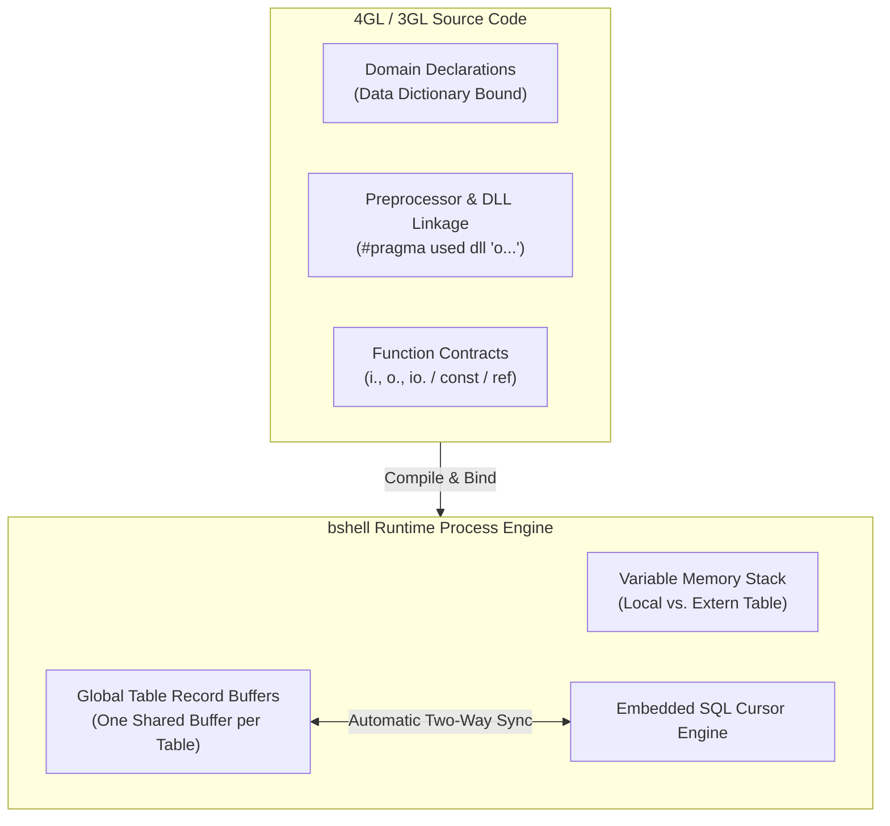
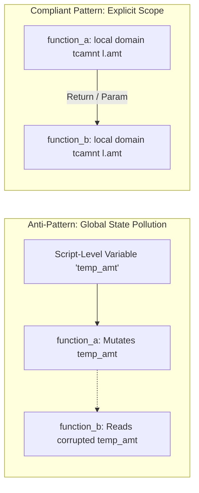

# Pillars 1–3: Domains, Scopes, DLL Linkage & Function Contracts

> **Hub**: [4GL Coding Standards & Caveats Hub](06_4gl_coding_standards_and_caveats.md)

---

## 1. Architectural Overview & Engineering Principles

The Infor ERP LN 4GL execution engine (**bshell**) compiles 4GL and 3GL source code into portable object files executed within a stateful, event-driven virtual runtime. While 4GL provides deep native integration with the database catalog and session forms, its execution architecture has fundamental characteristics that distinguish it from general-purpose languages:



### The Six Pillars of Defensive 4GL Engineering:
1. **Strict Domain Typing**: Bind all business and database-interfacing variables to Data Dictionary domains to eliminate silent data truncation.
2. **Deterministic Preprocessor Linkage**: Link libraries with explicit object prefixes (`o`) and segregate system vs. application header imports.
3. **Explicit Parameter Contracts**: Document and enforce data flow direction (`i.`, `o.`, `io.`), parameter immutability (`const`), and output reference semantics (`ref`).
4. **Table Buffer Collision Protection**: Prevent accidental UI form data corruption by isolating queries into local variables or explicit table aliases.
5. **1-Based Array Indexing Discipline**: Guard against bshell memory access violations by enforcing 1-based indexing and explicit dimension passing.
6. **Robust Runtime Precision & Transaction Boundaries**: Eliminate floating-point comparison errors using epsilon functions (`double.cmp()`), eliminate nested transaction commits in subroutines/DAL hooks, and enforce strict error rollback handling.

---

## 2. Pillar 1: Domain, Variable, and Scope Declaration

### 2.1 Data Dictionary Domains vs. Primitive Types

In Infor LN, table columns and business entity attributes are bound to centralized **Domains** defined in the Application Data Dictionary (`ttadv4500m000`). Domains define data types, byte storage sizes, decimal positions, display formatting masks, and validation expressions.

#### The Truncation Hazard:
When a developer declares a variable using primitive language types (such as `long`, `double`, or a fixed-length `string`), the variable is decoupled from the centralized data dictionary. If an enterprise increases a field length (e.g., order numbers expanding from 9 to 12 characters, or item codes expanding from 30 to 47 characters), compiled code using primitive types will silently truncate strings or overflow numeric limits during runtime assignments and SQL binding.

| Data Category | Forbidden Primitive Declaration | Mandatory Domain Declaration | Purpose |
|---|---|---|---|
| Sales Order Number | `string orno(9)` | `domain tcorno orno` | Adapts to enterprise key length alterations |
| Order Line Position | `long pono` | `domain tcpono pono` | Guarantees alignment with table key indexing |
| Currency Amount | `double amt` | `domain tcamnt amt` | Enforces standard monetary precision & rounding |
| Business Partner Code | `string bp(9)` | `domain tccom.bpid bp` | Prevents truncation of enterprise master partner IDs |
| Item Code | `string item(30)` | `domain tcitem item` | Aligns with extended item code definitions |
| Generic Text / Remarks | `string desc(30)` | `domain tcdsca desc` | Preserves international multilingual text sizes |

> [!IMPORTANT]
> Primitive types (`long`, `double`, `string`) are permissible **only** for transient technical counters (e.g., `long i`, `long ret`), system file pointers (`long fp`), or generic low-level scratch buffers (e.g., `string buffer(1024)`). Every variable holding business data or database column values **must** use a `domain` declaration.

#### Anti-Pattern vs. Compliant Pattern:
```baan
|* ========================================================================
|* ANTI-PATTERN: Hardcoded primitives cause silent data truncation on upgrade
|* ========================================================================
function void calculate_discount()
{
    string  order_number(9)     |* DANGEROUS: Will truncate if tcorno expands
    long    line_sequence       |* DANGEROUS: Decoupled from tcpono domain rules
    double  line_amount         |* DANGEROUS: May lose precision vs tcamnt domain
    string  cust_name(30)       |* DANGEROUS: Infor LN standard name domain is tcnm35

    order_number = tdsls400.orno
    line_amount  = tdsls401.amnt
}

|* ========================================================================
|* COMPLIANT PATTERN: Centralized domain binding with zero truncation risk
|* ========================================================================
function void calculate_discount()
{
    domain tcorno       order_number
    domain tcpono       line_sequence
    domain tcamnt       line_amount
    domain tcnm35       cust_name

    order_number = tdsls400.orno
    line_sequence = tdsls401.pono
    line_amount  = tdsls401.amnt
}
```

---

### 2.2 Enumeration and Set Domain Binding

In Infor LN, discrete business states and multi-option configurations are modeled using **List Domains** (`ttadv4501m000`) and **Set Domains** (`ttadv4502m000`).

#### 1. List Domains (Single-Choice Enumerations):
List domains represent mutually exclusive states (e.g. `tdsls.hdst.created`, `tdsls.hdst.approved`, `tcyesno.yes`, `tcyesno.no`).
- **Never use raw integer literals** (e.g., `1`, `2`) or string flags (`"Y"`, `"N"`).
- Always declare host variables using the specific List Domain name.
- Always evaluate states against symbolic domain constants.

#### 2. Set Domains (Multi-Choice Bitmask Sets):
Set domains store multiple simultaneously active options in a single integer column (e.g. document output destinations, processing option sets).
- Declare host variables with the set domain name: `domain <set_domain> l.active_options`.
- Use the 4GL `in` operator to test for element membership: `if <set_constant> in l.active_options then ... endif`.
- Never use raw bit shifts (`l.opts & 4`) or independent boolean flags.

```baan
|* ========================================================================
|* ANTI-PATTERN: Magic numbers, primitive flags, and bitwise manipulation
|* ========================================================================
function long check_order_options(domain tcorno i.orno)
{
    long status                     |* WRONG: Primitive integer used for enum
    long print_flags                |* WRONG: Primitive integer used for set

    select tdsls400.hdst, tdsls400.prnt
    from   tdsls400
    where  tdsls400.orno = :i.orno
    selectdo
        status = tdsls400.hdst
        print_flags = tdsls400.prnt
        if status == 1 then         |* WRONG: Magic number instead of domain constant
            if (print_flags & 2) != 0 then |* WRONG: Low-level bitmask arithmetic
                return(0)
            endif
        endif
    endselect
    return(-1)
}

|* ========================================================================
|* COMPLIANT PATTERN: List & Set domain constants with safe local binding
|* ========================================================================
function long check_order_options(
    const domain tcorno i.orno,
    ref   boolean       o.is_printable)
{
    domain tdsls.hdst   l.order_status
    domain tdsls.prnt   l.print_options

    o.is_printable = false
    l.order_status = tdsls.hdst.created
    l.print_options = 0

    select tdsls400.hdst:l.order_status,
           tdsls400.prnt:l.print_options
    from   tdsls400
    where  tdsls400.orno = :i.orno
    as set with 1 rows
    selectdo
        |* Evaluate List Domain via symbolic constant
        if l.order_status = tdsls.hdst.approved then
            |* Evaluate Set Domain via 4GL 'in' operator
            if tdsls.prnt.invoice in l.print_options then
                o.is_printable = true
                return(0)
            endif
        endif
    selectempty
        o.is_printable = false
        return(-1)
    endselect

    return(0)
}
```

---

### 2.3 Function-Local Scope Confinement

4GL allows variables to be declared outside of functions at the top of a script. Unless marked with `extern`, these variables have script-level global scope. 

#### Scope Confinement Rules:
1. **Enforce Local Scope**: All scratch variables, calculation accumulators, loop indices, and intermediate state must be declared **inside the function body**.
2. **Prevent Global Leakage**: Never rely on script-level variables to pass state between helper subroutines. Global state leakage introduces non-reentrant logic, concurrency race conditions, and side effects across nested function calls.



---

### 2.4 Prescriptive Criteria for `extern` Variables

The `extern` storage class declares that a variable resides in the bshell process's external symbol table. 

#### Permitted Use Cases for `extern`:
1. **UI Form Field Binding**: Variables displayed on dynamic session forms or prompts that do not map directly to a database table field (`form.field`).
2. **Report Layout Binding**: Variables passed into 4GL report layouts to be rendered in headers, details, or footers.
3. **Cross-Session IPC (`import()` / `export()`)**: Variables exchanged across separate bshell process instances via `export("var.name", val)` and `import("var.name", val)`.
4. **Table Record Declarations**: Tables declared via `table tt<pkg><mod><seq>` are implicitly external symbols shared across the session.

#### Prohibited Use Cases for `extern`:
- Never declare `extern` variables in shared business library DLLs (`tccomdll...`, `tdslsdll...`).
- Never declare `extern` variables as calculation temps, loop counters, or function-internal accumulators.
- Never use `extern` to avoid declaring formal function parameters.

---

## 3. Pillar 2: DLL Linkage, Preprocessor Directives, and Macros

### 3.1 External Shared Library Linkage (`#pragma used dll`)

In Infor LN, shared business logic is compiled into 3GL/4GL shared dynamic link libraries (DLLs). To enable compile-time symbol resolution and runtime dynamic linking, calling scripts must declare the library dependency using `#pragma used dll`.

#### The Mandatory Object Prefix Rule:
In the LN runtime filesystem, compiled library object files are stored with a lowercase `o` prefix before the library code (e.g., source library `tdsls0001` compiles to object `otdsls0001`).

```baan
|* ========================================================================
|* ANTI-PATTERN: Missing 'o' prefix causes runtime unresolved DLL errors
|* ========================================================================
#pragma used dll "tdsls0001"     |* FATAL: bshell looks for 'tdsls0001', fails to load!

|* ========================================================================
|* COMPLIANT PATTERN: Explicit 'o' prefix for object resolution
|* ========================================================================
#pragma used dll "otdsls0001"    |* CORRECT: Links to compiled bshell object otdsls0001
#pragma used dll "otccom0010"    |* CORRECT: Links to Business Partner shared DLL
```

> [!WARNING]
> Omitting the `o` prefix may allow compilation in some legacy environments if symbols are loosely linked, but will trigger runtime fatal errors (`Error: Cannot load dynamic library`) when executed in modern Infor LN Cloud environments.

---

### 3.2 System vs. Application Header Include Directives

4GL distinguishes between standard system platform headers and application-specific header files:

| Syntax | Target Category | Resolution Path | Examples |
|---|---|---|---|
| `#include <header>` | System / Platform Runtime Headers | Standard bshell system include directories (`$BSE/include`) | `#include <bic_dam>`<br/>`#include <bic_text>`<br/>`#include <bic_desktop>` |
| `#include "header"` | Application & Data Dictionary Includes | Application package include directories (`$BSE/application/...`) | `#include "itdsls400"`<br/>`#include "itccom001"`<br/>`#include "otxxyzcommon"` |

#### Rules:
1. Always wrap standard bshell API headers in angle brackets: `<bic_dam>`, `<bic_cmf>`, `<bic_audit>`.
2. Always wrap application table definition includes or custom customer headers in double quotes: `"itdsls400"`, `"itdpur001"`.
3. Never mix the two syntaxes or specify absolute operating system paths.

---

### 3.3 Macro Hygiene and Reserved Keyword Protection

Constants declared via `#define` perform lexical token replacement prior to compilation. Poor macro naming causes catastrophic compilation errors and subtle AST mutations.

#### Rules for Macro Definitions:
1. **Mandatory Uppercase**: All macro identifiers must be uppercase alphanumeric with underscores: `#define MAX_RETRY_COUNT 5`.
2. **Strict Reserved Word Avoidance**: Never define macros that match or shadow 4GL keywords, predefined bshell variables, choice sections, or common domain names.
3. **Wrap Replacement Expressions**: Always parenthesize mathematical or logical expressions in macro definitions: `#define CALC_TOTAL(a, b) ((a) + (b))`.

```baan
|* ========================================================================
|* ANTI-PATTERN: Lowercase macros colliding with 4GL reserved keywords
|* ========================================================================
#define status      1           |* FATAL: Corrupts variable names and table fields!
#define date        20261022    |* FATAL: Shadows predefined variable 'date'
#define commit      0           |* FATAL: Collides with 4GL statement 'commit.transaction()'
#define add(x, y)   x + y * 2   |* DANGEROUS: Unparenthesized expression causes operator precedence bugs

|* ========================================================================
|* COMPLIANT PATTERN: Scoped, capitalized, protected macro definitions
|* ========================================================================
#define C_STATUS_INITIAL    1
#define C_DEFAULT_RUN_DATE  20261022
#define C_COMMIT_BATCH_SIZE 50
#define CALC_WEIGHTED(x, y) (((x) + (y)) * 2)
```

---

## 4. Pillar 3: Function Architecture and Parameter Passing

Modern Infor LN 4GL functions require explicit parameter contracts to ensure data flow transparency, caller safety, and deterministic error propagation.

### 4.1 Directional Hungarian Parameter Notation

Because 4GL functions often process complex business data across library boundaries, every formal parameter must indicate its data flow direction using standard prefixes:

| Prefix | Semantic Flow | Mutability & Lifetime | Responsibility |
|---|---|---|---|
| `i.` | **Input parameter** | Read-only (`const`) | Supplied by caller; must never be modified by the callee. |
| `o.` | **Output parameter** | Write-only reference (`ref`) | Calculated or populated by the callee; returned to caller. |
| `io.` | **Input/Output parameter** | Mutable reference (`ref`) | Initialized by caller, modified or transformed in-place by callee. |

---

### 4.2 Immutability Enforcement with `const`

To guarantee that a subroutine does not accidentally overwrite input arguments passed from calling business logic, decorate all input parameters (`i.`) with the `const` keyword.

- `const` instructs the 4GL compiler to disallow assignments to the parameter within the function body.
- It prevents side-effect mutations on variables passed by reference from caller scopes.

---

### 4.3 Reference Semantics with `ref`

In 4GL, primitive and domain arguments are passed **by value** by default unless the receiving signature specifies `ref`. 
- If an output parameter (`o.`) or in-place parameter (`io.`) omits `ref`, the callee only mutates a local copy on the stack, and the caller's variable remains unchanged upon return.
- Always declare all `o.` and `io.` parameters with `ref`.

---

### 4.4 Standardized Return Status Conventions

Functions that perform operations, validations, or state mutations must return a status of type `long`. Standardize on the following uniform convention across all libraries and scripts:

| Return Code | Meaning | Action / Interpretation |
|---|---|---|
| `0` | **Success / OK** | Operation completed successfully with zero validation errors. |
| `< 0` | **Error / Failure** | Standard negative failure code (e.g. `-1` generic error, `-2` not found, or `DALHOOKERROR`). Caller must abort or rollback. |
| `> 0` | **Count / Metric** | (Optional) Number of records processed or positive handle identifier. |

> [!CAUTION]
> Never design functions where `1` indicates failure and `0` indicates success inconsistently. Standardizing strictly on `0 = SUCCESS` and `< 0 = ERROR` ensures reliable integration with DAL hooks and bshell runtime checks.

#### Anti-Pattern vs. Compliant Pattern:
```baan
|* ========================================================================
|* ANTI-PATTERN: Undefined directions, mutable inputs, missing ref, ad-hoc status
|* ========================================================================
function int calc_tax(orno, discount, final_amt)    |* DANGEROUS: Untyped, no directions
    string orno(9)                                  |* DANGEROUS: Primitives
    double discount
    double final_amt
{
    discount = discount + 5.0                       |* BUG: Caller's discount is mutated!
    final_amt = 100.0 - discount                    |* BUG: Without 'ref', caller sees 0!
    return(1)                                       |* AMBIGUOUS: Does 1 mean success or error?
}

|* ========================================================================
|* COMPLIANT PATTERN: Strict directional contracts, const/ref, standard status
|* ========================================================================
function long calc_tax(
    const domain tcorno  i.orno,
    const domain tcamnt  i.discount,
    ref   domain tcamnt  o.final_amt)
{
    domain tcamnt l.base_amount

    if isspace(i.orno) then
        return(-1)                                  |* Standard negative error code
    endif

    l.base_amount = get_order_base_amount(i.orno)
    if l.base_amount <= 0.0 then
        return(-2)                                  |* Specific validation failure
    endif

    o.final_amt = l.base_amount - i.discount
    return(0)                                       |* Standard 0 for SUCCESS
}
```
