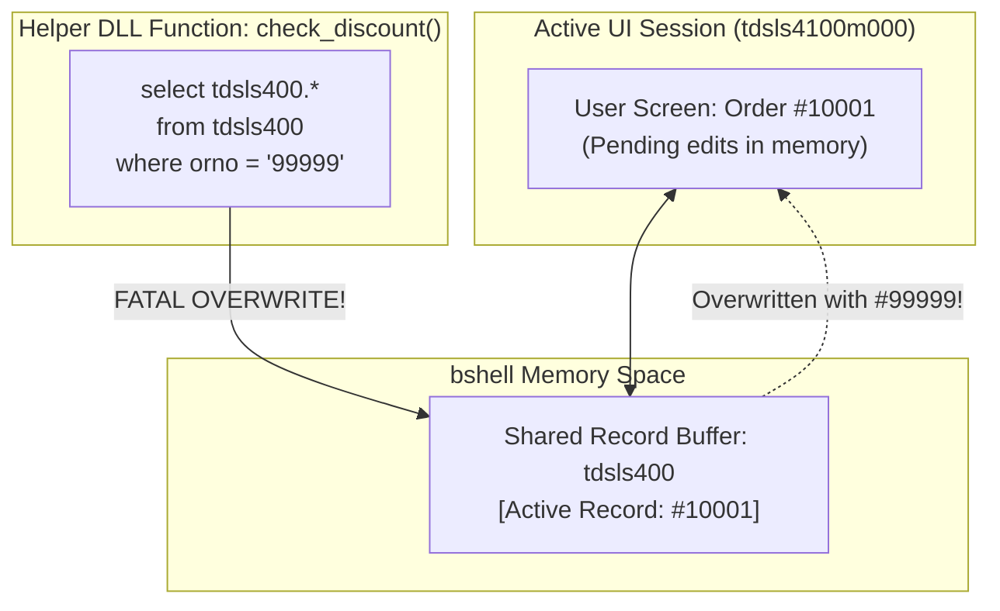

# Pillar 4: Embedded SQL & Table Record Buffer Protection

> **Hub**: [4GL Coding Standards & Caveats Hub](06_4gl_coding_standards_and_caveats.md)

---

## 5. Pillar 4: Embedded SQL & Table Record Buffer Protection

### 5.1 The Shared Table Record Buffer Overwrite Vulnerability

In the bshell architecture, when a script declares a table (e.g. `table ttdsls400`), the engine allocates **exactly one shared memory record buffer** for that table across the entire process:



#### The Catastrophe:
When a user is modifying Order `#10001` on screen, the shared `tdsls400` buffer holds `#10001`. If a form event or helper function executes:
```baan
select tdsls400.* from tdsls400 where tdsls400.orno = :other.orno selectdo ...
```
The bshell query engine **silently overwrites** the active `tdsls400` buffer with Order `#99999`. When the user clicks "Save", bshell writes `#99999` over Order `#10001`, or fails with concurrency conflicts. **This is one of the most severe data-corruption bugs in 4GL development.**

---

### 5.2 Column-to-Local Host Variable Binding

To read database fields in subroutines, batch loops, or helper functions without corrupting the table record buffer, bind the queried columns directly into **local host variables**:

```baan
|* ========================================================================
|* ANTI-PATTERN: Overwrites global tdsls400 table record buffer
|* ========================================================================
function long get_order_type(
    const domain tcorno i.orno,
    ref   domain tcsotp o.sotp)
{
    select tdsls400.sotp
    from   tdsls400
    where  tdsls400.orno = :i.orno
    selectdo
        return(tdsls400.sotp)   |* FATAL: Overwrites active session tdsls400 buffer!
    endselect
    return("")
}

|* ========================================================================
|* COMPLIANT PATTERN: Direct local variable binding (Buffer Safe)
|* ========================================================================
function long get_order_type(
    const domain tcorno i.orno,
    ref   domain tcsotp o.sotp)
{
    domain tcsotp l.sotp

    l.sotp = ""
    select tdsls400.sotp:l.sotp
    from   tdsls400
    where  tdsls400.orno = :i.orno
    as set with 1 rows
    selectdo
        o.sotp = l.sotp
        return(0)
    selectempty
        o.sotp = ""
        return(-1)
    endselect

    return(0)
}
```

---

### 5.3 Cursor Isolation via Table Aliases

When multiple records from the same table must be inspected simultaneously (e.g., self-joins or secondary lookups), use a **Table Alias**. An alias instructs bshell to allocate an isolated query cursor:

```baan
|* ========================================================================
|* COMPLIANT PATTERN: Table Alias isolates cursor and buffer
|* ========================================================================
function long find_parent_order(
    const domain tcorno i.child_orno,
    ref   domain tcorno o.parent_orno)
{
    domain tcorno l.parent_orno

    l.parent_orno = ""
    select parent_sls.orno:l.parent_orno
    from   tdsls400 parent_sls
    where  parent_sls.orno in (
        select tdsls401.orno
        from   tdsls401
        where  tdsls401.corn = :i.child_orno
    )
    as set with 1 rows
    selectdo
        o.parent_orno = l.parent_orno
        return(0)
    selectempty
        o.parent_orno = ""
        return(-1)
    endselect

    return(0)
}
```

---

### 5.4 Point Lookup Optimization (`as set with 1 rows`)

When retrieving a single record by its unique primary key or unique index, always append `as set with 1 rows`.
- Informs the query optimizer that at most one record matches.
- Closes the cursor immediately upon fetching the single row, preventing cursor leaks and minimizing database network round trips.

---

### 5.5 Explicit Field Predicates vs. Legacy Index Identifiers

Legacy 4GL scripts occasionally used index references in where clauses: `where tdsls400._index1 = {:i.orno}`.
- **Rule**: Always write explicit field names in query filters: `where tdsls400.orno = :i.orno`.
- Explicit predicates guarantee that if Data Dictionary indices are reconfigured, restructured, or expanded, the query semantics remain 100% stable.

---

### 5.6 DAL Delegation over Raw Database Mutations

Under modern Infor LN Cloud architecture, direct database write statements (`db.insert()`, `db.update()`, `db.delete()`) are strictly prohibited in session scripts and business subroutines.

#### Why Raw `db.*` is Forbidden:
1. Bypasses Data Access Layer (DAL 2) property checks and business validations (`is.valid()`, `check.input()`).
2. Bypasses Table Extension hooks (`before.save.object()`, `after.save.object()`).
3. Bypasses Infor ION Business Object Document (BOD) event generation and enterprise audit logging.

```baan
|* ========================================================================
|* ANTI-PATTERN: Raw database update bypassing business rules and DAL
|* ========================================================================
function void approve_order(domain tcorno i.orno)
{
    db.retry.point()
    select tdsls400.*
    from   tdsls400 for update
    where  tdsls400.orno = :i.orno
    as set with 1 rows
    selectdo
        tdsls400.hdst = tdsls.hdst.approved
        db.update(ttdsls400, db.retry)   |* FORBIDDEN: Bypasses DAL, audit, & hooks!
        commit.transaction()
    endselect
}

|* ========================================================================
|* COMPLIANT PATTERN: DAL 2 Object Mutation
|* ========================================================================
function long approve_order(const domain tcorno i.orno)
{
    long ret

    ret = dal.change.object("tdsls400")
    if ret != 0 then
        return(-1)
    endif

    dal.set.field("tdsls400.orno", i.orno)
    dal.set.field("tdsls400.hdst", tdsls.hdst.approved)

    ret = dal.save.object("tdsls400")
    if ret != 0 then
        dal.reset.object("tdsls400")
        return(-2)
    endif

    return(0)
}
```

---

### 5.7 No Array Subscripts in SQL Host Variables (Rule SQL008)

In Embedded Baan SQL, 4GL host variables are referenced with a colon (`:variable`). The Baan SQL precompiler only supports **scalar host variables**.

#### The Subscript Hazard (`SQLState 42I03: Unknown column 'i' (error 302)`):
When referencing an indexed array directly inside a SQL query, such as:
```baan
where tfacr500.ttyp = :mark_ttyp(i)
```
or for string arrays:
```baan
where tfacr500.ttyp = :mark_ttyp(1, i)
```
The Baan SQL precompiler strips `:mark_ttyp` as the host variable identifier and treats `(i)` as an SQL column or table qualifier in the query abstract syntax tree. Because the queried table does not contain a column named `i`, the query fails with:
`SQLState 42I03: Unknown column 'i' (error 302)`.

#### Mandatory Compliant Pattern: Scalar Local Staging
Before executing any embedded SQL statement, extract the array elements into local scalar host variables, and bind only those scalar variables in the query:

```baan
|* ========================================================================
|* ANTI-PATTERN: Array subscripts in SQL host variables (triggers error 302)
|* ========================================================================
select tfacr500.*
from   tfacr500 for update
where  tfacr500.fcom = :comp.num
and    tfacr500.ttyp = :mark_ttyp(1, i)  |* FORBIDDEN: Error 302!
and    tfacr500.ninv = :mark_ninv(i)     |* FORBIDDEN: Error 302!
selectdo
    ...
endselect

|* ========================================================================
|* COMPLIANT PATTERN: Scalar Local Staging (Rule SQL008)
|* ========================================================================
domain tfgld.ttyp l_ttyp
domain tfgld.docn l_ninv

|* 1. Stage array elements into local scalar variables
l_ttyp = mark_ttyp(1, i)
l_ninv = mark_ninv(i)

|* 2. Bind scalar variables as host parameters in Embedded SQL
select tfacr500.*
from   tfacr500 for update
where  tfacr500.fcom = :comp.num
and    tfacr500.ttyp = :l_ttyp
and    tfacr500.ninv = :l_ninv
selectdo
    ...
endselect
```
