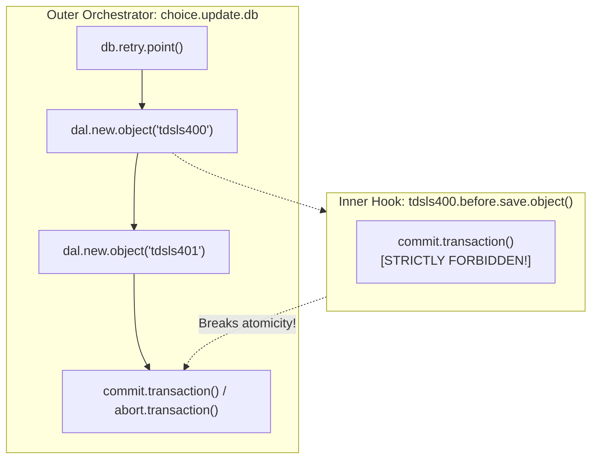

# Pillars 6–7: Syntax Caveats, Anti-Patterns & Runtime Guards (ADR 0017)

> **Hub**: [4GL Coding Standards & Caveats Hub](06_4gl_coding_standards_and_caveats.md)

---

## 7. Pillar 6: Critical Syntax Caveats & Anti-Patterns

### 7.1 Precision-Safe Floating-Point Comparisons (`double.cmp`)

Due to IEEE 754 binary floating-point representation, numbers with decimal fractions (such as `0.1` or `0.05`) cannot be represented exactly in machine registers. Consequently, evaluating equality with `==` or `!=` on `double`, `domain tcamnt`, or `domain tcqoor` produces intermittent, machine-dependent logical errors.

#### The Built-in `double.cmp()` Function:
Always use the built-in 4GL routine:
```baan
long double.cmp(double val1, double val2, double epsilon)
```
- Returns `-1` if `val1 < val2 - epsilon`
- Returns `0` if `|val1 - val2| <= epsilon` (values are equal within tolerance)
- Returns `1` if `val1 > val2 + epsilon`
- Returns `-2` if an error occurs.

Standard recommended epsilon value for currency and quantity amounts is `0.0001` (or domain-specific rounding precision).

```baan
|* ========================================================================
|* ANTI-PATTERN: Direct floating-point equality check
|* ========================================================================
function boolean is_balance_cleared(const domain tcamnt i.balance)
{
    if i.balance == 0.0 then            |* FATAL: 0.000000000000001 fails equality!
        return(true)
    endif
    return(false)
}

|* ========================================================================
|* COMPLIANT PATTERN: Precision-safe epsilon comparison via double.cmp()
|* ========================================================================
#define C_AMOUNT_EPSILON 0.0001

function boolean is_balance_cleared(const domain tcamnt i.balance)
{
    if double.cmp(i.balance, 0.0, C_AMOUNT_EPSILON) = 0 then
        return(true)                    |* ACCURATE: Within enterprise decimal tolerance
    endif
    return(false)
}
```

---

### 7.2 Outer-Boundary Transaction Orchestration

Infor LN enforces strict atomic transaction control. A transaction begins with `db.retry.point()` and concludes with either `commit.transaction()` or `abort.transaction()`.

#### The Nested Commit Violation:
- **Transactions must be orchestrated exclusively at outer application boundaries** (such as session command buttons `choice.update.db`, scheduled batch orchestrators, or integration API endpoints).
- **STRICT PROHIBITION**: Never execute `commit.transaction()` or `db.retry.point()` inside:
  - Table Extension hooks (`before.save.object()`, `after.save.object()`)
  - DAL property hooks or method hooks
  - Reusable helper DLL subroutines
- **Why**: The session engine and DAL already execute inside an ambient transaction. Calling `commit.transaction()` inside a hook commits an incomplete unit of work prematurely, destroys the caller's ability to rollback on later errors, and triggers fatal bshell error: `Commit transaction without transaction started` or leaves orphan records.



---

### 7.3 4GL Reserved Keywords Reference

Never declare local variables, function arguments, macro names, or custom table fields that match Baan 4GL reserved tokens or predefined system identifiers. Doing so causes compiler parse failures or shadows system state.

#### Core 4GL Reserved Words Checklist:
- **SQL Clauses**: `select`, `from`, `where`, `order`, `by`, `group`, `having`, `as`, `set`, `with`, `rows`, `selectdo`, `selectempty`, `selecterror`, `selecteos`, `endselect`
- **Data Types & Scopes**: `domain`, `table`, `extern`, `global`, `local`, `const`, `ref`, `fixed`, `static`, `void`, `long`, `string`, `double`
- **Control Flow**: `if`, `then`, `else`, `endif`, `case`, `when`, `default`, `endcase`, `while`, `do`, `endwhile`, `repeat`, `until`, `for`, `to`, `step`, `endfor`, `break`, `continue`, `return`, `goto`
- **Transaction Commands**: `commit`, `abort`, `transaction`, `retry`, `point`
- **Predefined System Identifiers**: `date`, `time`, `pid`, `status`, `error`, `record`, `message`, `prompt`, `zoom`, `choice`, `fatconn`, `curr.key`

```baan
|* ========================================================================
|* ANTI-PATTERN: Shadowing reserved words and predefined variables
|* ========================================================================
function void update_data()
{
    long    status          |* FATAL: Collides with predefined variable 'status'
    long    date            |* FATAL: Collides with predefined variable 'date'
    string  table(20)       |* FATAL: Collides with 4GL keyword 'table'
    long    commit          |* FATAL: Collides with transaction statement 'commit'
}

|* ========================================================================
|* COMPLIANT PATTERN: Clear, prefixed, semantic identifiers
|* ========================================================================
function void update_data()
{
    long            l.status_code
    domain tcdate   l.order_date
    string          l.table_name(20)
    long            l.commit_flag
}
```

---

### 7.4 Mandatory `selectempty` State Handling

When querying the database for a point record or subset, queries that return zero rows do not execute `selectdo`. Omitting `selectempty` causes local variables to retain stale values from previous loop iterations or uninitialized defaults, leading to phantom data processing.

```baan
|* ========================================================================
|* ANTI-PATTERN: Missing selectempty leaves variables in stale state
|* ========================================================================
function long get_bp_name(
    const domain tccom.bpid i.bpid,
    ref   domain tcnm35     o.nama)
{
    domain tcnm35 l.nama

    |* If BP does not exist, l.nama is NOT cleared or handled!
    select tccom100.nama:l.nama
    from   tccom100
    where  tccom100.bpid = :i.bpid
    as set with 1 rows
    selectdo
        |* Found
    endselect

    return(l.nama)  |* BUG: Returns undefined or previous memory value!
}

|* ========================================================================
|* COMPLIANT PATTERN: Mandatory selectempty with deterministic fallback
|* ========================================================================
function long get_bp_name(
    const domain tccom.bpid i.bpid,
    ref   domain tcnm35     o.nama)
{
    domain tcnm35 l.nama

    l.nama = ""
    select tccom100.nama:l.nama
    from   tccom100
    where  tccom100.bpid = :i.bpid
    as set with 1 rows
    selectdo
        |* Found
        o.nama = l.nama
        return(0)
    selectempty
        o.nama = ""
        log_warning("Business partner not found: " & i.bpid)
        return(-1)
    endselect

    return(0)
}
```

---

### 7.5 Elimination of Unstructured `goto` Statements

The `goto` statement is strictly prohibited in modern 4GL engineering. Unstructured jumping produces unmaintainable spaghetti logic, circumvents local variable cleanups, and introduces subtle control flow bugs.

#### Refactoring Rules:
1. Replace forward jumps with structured `if/else` branching or early function `return(status)`.
2. Replace backward loops with standard `for`, `while`, or `repeat/until` constructs.
3. Replace error jump blocks with standardized negative return codes and error propagation.

---

### 7.6 Scoped Row-Locking Windows and Rollbacks

When updating records using `select ... for update`, database engines place exclusive row-level locks on the selected records.

#### Locking Best Practices:
1. **Minimize Lock Window**: Execute all external API calls, complex calculations, and text formatting **before** acquiring the lock. Never perform long-running operations inside a `for update` loop.
2. **Hierarchical Locking**: Always acquire locks in parent-then-child sequence (e.g. `tdsls400` header before `tdsls401` line) to avoid cross-session deadlocks.
3. **Immediate Abort on Error**: If any calculation or update fails while holding locks, immediately execute `abort.transaction()` to release locks.

```baan
|* ========================================================================
|* COMPLIANT PATTERN: Minimal lock window and deterministic error rollback
|* ========================================================================
function long execute_order_approval_orchestrator(const domain tcorno i.orno)
{
    domain tcamnt l.calculated_discount
    long ret

    |* STEP 1: Compute all complex logic and external integrations OUTSIDE the transaction
    ret = compute_order_discounts(i.orno, l.calculated_discount)
    if ret != 0 then
        return(-1)
    endif

    |* STEP 2: Outer transaction boundary orchestrator
    db.retry.point()

    |* STEP 3: Delegate mutation to DAL 2 (never use raw db.update)
    ret = dal.change.object("tdsls400")
    if ret != 0 then
        abort.transaction()             |* IMMEDIATE ROLLBACK: Releases all locks
        return(-2)
    endif

    dal.set.field("tdsls400.orno", i.orno)
    dal.set.field("tdsls400.hdst", tdsls.hdst.approved)

    ret = dal.save.object("tdsls400")
    if ret != 0 then
        dal.reset.object("tdsls400")
        abort.transaction()             |* IMMEDIATE ROLLBACK: Prevents dirty state
        return(-3)
    endif

    |* STEP 4: Commit transaction immediately after mutation completes
    commit.transaction()                |* FREES LOCKS IMMEDIATELY
    return(0)
}
```

---

## 8. Pillar 7: Runtime Error Prevention, Datatype Boundaries & Defensive Guards (ADR 0017)

Following production retrospectives on Infor LN Cloud Multi-Tenant, developers and agents must adhere to strict datatype boundaries to prevent fatal bshell crashes and silent data corruption:

### 8.1 Julian Day (`Date 4`) vs. Unix Epoch UTC Timestamps (`DMN002`)
In Infor LN, table columns and domains of type Date (e.g. `tfgld.date`, `tcdate`, Ecore native datatype `9`) store a **Julian Day Number** (the count of days elapsed since 01/01/0001, e.g. ~739,925 for Nov 2026).
- **The Fatal Crash (Error 205)**: Built-in `date.to.utc()` and `utc.num()` produce a Unix Epoch timestamp in **seconds** (~1,793,800,000+). Attempting to insert 1.79 billion into a 4-byte Julian Date column causes the database driver to throw `Fatal Error 205: Value is out of range` (`ENOTINRANGE` / SQL `22008`).
- **Defensive Standard**:
  - Always assign Julian Dates directly from source table date fields or using `date.num()`:
    ```baan
    txcmg010.docd = tfacr500.docd
    txcmg010.dued = tfacr500.dued
    ```
  - Use defensive zero-guards for uninitialized date fields:
    ```baan
    if tfacr500.docd <= 0 then
        txcmg010.docd = date.num()
    else
        txcmg010.docd = tfacr500.docd
    endif
    ```
  - Reserve `utc.num()` and `date.to.utc()` strictly for UTC timestamp domains (such as `tcmcs.long` or fields named `*clld`, `*time`, `*utc`).

### 8.2 Mandatory Numeric Fields and the Zero Constraint (`TBL003`)
In Infor LN Data Dictionary / bshell runtime semantics, **any numeric field marked Mandatory: Yes strictly rejects value 0** (treating `0` as an empty, unentered state).
- **The Fatal Crash (Error 205)**: In Accounts Receivable (`tfacr500`) and standard open items, document header records naturally have line number `line = 0`. If a temporary or staging table (e.g. `txcmg010`) defines `line` as `Mandatory: Yes`, executing `db.insert()` with `line = 0` immediately aborts with `Fatal Error 205 (Value is out of range)`.
- **Defensive Standard**:
  - In table design, line and sequence number fields (`line`, `lino`, `seqn`) must be defined as `Mandatory: No` (`isMandatory: false`) whenever line `0` is possible (such as invoice header items).
  - Normal entity tables where line numbers start from 10, 20 can remain `Mandatory: Yes`.

### 8.3 Enum Domain Safety & Value Space Collisions (`DMN003`)
The bshell compiler maps enumeration symbols directly into integer literals without compile-time domain type enforcement.
- **The Silent Inversion**: Comparing an enum column against a constant from another domain (e.g. `tfacr500.cdf_stdd <> tfcmg.stdd.selected`) when `cdf_stdd` uses domain `txbsta` causes catastrophic logical errors if `txbsta.not.applic = 1` and `tfcmg.stdd.selected = 1`. All valid unbilled records are discarded, and already-billed records are erroneously selected.
- **Defensive Standard**:
  - Always compare enum columns against symbols of their own declared domain (`txbsta.docn.selected`).
  - Never compare enum columns against hardcoded non-zero integer literals (`cdf_stdd == 1` is strictly forbidden).
  - Comparing against `0` is allowed only as an uninitialized check, with an advisory note to verify if the domain defines an explicit default symbol (e.g. `txbsta.not.applic`).

### 8.4 Cloud Single Sign-On (SSO) Username Slicing (`STR001`)
In Infor LN Cloud environments, Single Sign-On (`logname$`) returns email addresses, AD UPNs, or UUIDs that routinely exceed 16 characters.
- **The Vulnerability**: Direct assignment `<table>.user = logname$` targeting domain `tfgld.user` (16 characters) triggers string truncation or buffer overflow errors.
- **Defensive Standard**:
  - Always slice usernames to 16 characters:
    ```baan
    curr_user = strip$(shiftl$(logname$))(1; 16)
    txcmg010.user = curr_user
    ```

### 8.5 Ephemeral Debug Message Cleanup (`DBG001`)
Interactive modal popups like `message("...")` halt headless automated background processing and batch execution.
- **Defensive Standard**:
  - In DAL scripts and batch sessions (`type 4`), raw `message()` is strictly forbidden (`ERROR`).
  - In interactive UI scripts, temporary debugging `message()` calls must be cleaned up prior to production check-in (`WARNING`).

### 8.6 Message-Code `@` Prefix Literal-Text Trap (`DAL007`)
In `dal.set.error.message()`, prefixing a string with `@` instructs the bshell to display the remaining text literally instead of looking up a Data Dictionary message code (`ERROR`).
- Pass message codes without `@`: `dal.set.error.message("txinr0001")`.
- Reserve `@` strictly for literal human-readable strings (containing spaces).

### 8.7 UTF-8 BOM File Mode (`STR002`) & Local Export Time (`DMN004`)
- **UTF-8 BOM Mode (`STR002`, `ERROR`)**: When writing raw UTF-8 BOM bytes (`chr$(239) & chr$(187) & chr$(191)`), open the file in binary mode (`seq.open(path, "wb")`) rather than text mode (`"wt"`). Use porting-set built-ins `utf8.export()` / `utf8.import()` directly for TSS <-> UTF-8 conversion (no `<bic_utf8>` include header exists in Baan 4GL).
- **Local Export Time (`DMN004`, `WARNING`)**: `utc.to.date()` converts UTC epochs in UTC rather than the user's local timezone shown in UI `%u002 %U002` grids; wrap with `utc.to.local()` (or use `num.to.date()`) before formatting user-facing exports.

### 8.8 Direct Double Comparisons (`CAV004`)
Comparing `double` variables or Data Dictionary `Double` columns (`tcqiv1`, etc.) directly with `=`, `<>`, or `!=` risks floating-point precision drift (`ERROR`). Always use `double.cmp(lhs, rhs, epsilon) = 0` or `<> 0`.

## 9. Summary: Quick Reference Checklist

| Pillar | DO (Mandatory Standard) | DON'T (Strictly Forbidden) |
|---|---|---|
| **1. Domains & Scope** | Declare variables with Data Dictionary `domain <name> <var>`. Use list domain constants (`tdsls.hdst.created`). Confine scratch variables inside functions. | Never use raw primitives (`long`, `string`) for database data. Never use magic integers for enums. Never leak scratch variables into script globals. |
| **2. Preprocessor & DLLs** | Link shared libraries via `#pragma used dll "o<pkg><mod><seq>"`. Use `<...>` for system headers and `"..."` for application headers. Capitalize macros. | Never omit the `"o"` prefix in DLL pragmas. Never use lowercase macros or keywords in `#define`. |
| **3. Function Contracts** | Use directional notation (`i.`, `o.`, `io.`). Decorate inputs with `const`. Decorate outputs with `ref`. Standardize on `0 = OK`, `< 0 = ERROR`. | Never mutate input parameters in-place without `io.`. Never omit `ref` on outputs. Never use ambiguous ad-hoc return status codes. |
| **4. Buffer Protection** | Bind query columns into local variables (`table.field:l.var`). Use table aliases for secondary queries. Use `as set with 1 rows`. Mutate via DAL 2. | Never execute `select table.*` in helper functions (overwrites UI form record buffer). Never use raw `db.update` in UI session scripts. |
| **5. Array Dimensions** | Use 1-based indexing (`1..N`). Use empty `()` or `fixed` in function parameters. Pass array symbol without brackets. | Never access index `0` (causes stack corruption or crash). Never iterate with `for i = 0 to N-1`. |
| **6. Runtime Caveats** | Compare floats with `double.cmp(v1, v2, epsilon) = 0`. Manage transactions at outer orchestrator. Handle `selectempty`. Eliminate `goto`. Keep locks minimal. | Never use `==` or `!=` on floating-point values. Never call `commit.transaction()` inside DAL hooks or DLL helpers. Never use `goto`. |
| **7. Defensive Datatypes** | Use Julian Day (`date.num()`) for dates. Keep line columns non-mandatory when 0 is valid. Use matching domain enum symbols (`txbsta.not.applic`). Slice SSO `logname$` to 16 chars. | Never assign `date.to.utc()` or `utc.num()` to Date fields (triggers Error 205). Never set `mandatory: yes` on line fields holding 0. Never cross-compare enum domains or use raw integer literals on enums. |
