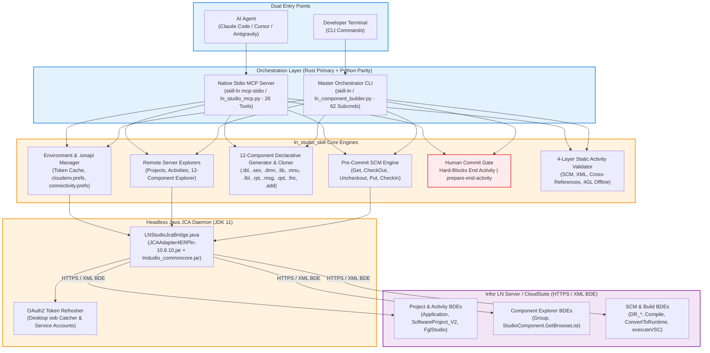

[⬅️ Back to Skill_LN Main Repository](../../../README.md)

---

# Infor LN Studio Automation Toolset & Assistant Skill (`ln_studio_skill`)

[](https://www.infor.com)
[](#5-stage-lifecycle-matrix)
[](#overview--modern-architecture)
[](#12-component-archetype-matrix)

> **Self-contained, production-grade intelligence, headless HTTP/JCA connectivity, declarative 12-component modeling, Single-Line TDE XML & label parity, pre-commit SCM automation, and native Model Context Protocol (MCP) servers (`skill-ln mcp-stdio` in Rust + Python fallback) for Infor LN Studio 10.8 (Build 0640, April 2026 tree, Eclipse RCP).**

---

## Table of Contents

- [Overview & Modern Architecture](#overview--modern-architecture)
- [Headless JCA Architecture](#headless-jca-architecture)
- [AI Agent Configuration Matrix (Claude Desktop, Cursor, Antigravity)](#ai-agent-configuration-matrix)
- [5-Stage Lifecycle Matrix (26 MCP Tools & 62 CLI Subcommands)](#5-stage-lifecycle-matrix)
- [12-Component Archetype Matrix & Declarative Modeling](#12-component-archetype-matrix)
- [Enterprise Safety Guardrails & Callouts](#enterprise-safety-guardrails)
  - [Extension Modeler Cloud UI Boundary (ADR 0006)](#extension-modeler-boundary)
  - [Strict Human-in-the-Loop Commit Gate (ADR 0007)](#human-commit-gate)
- [Master CLI Reference (Categorized)](#master-cli-reference)
- [Automated Test Suite](#automated-test-suite)
- [Directory Layout](#directory-layout)

---

## Overview & Modern Architecture

Historically, developing applications and extensions in Infor LN Studio required repetitive manual clicks across heavy Eclipse RCP wizards, modal dialogs, and fragile UI keystrokes. 

`ln_studio_skill` transforms Infor LN Studio into a **headless-capable, automated developer and AI agent ecosystem** powered by a pure-Rust single binary (`skill-ln`) with Python orchestration parity (`tools/`):

1. **Pure-Rust Single Binary (`skill-ln`) & Headless JCA Bridge**: Direct BDE XML communication over HTTPS via native Rust (`ln-jca` / `ln-scm` / `ln-model`) or BYOJ Java bridge (`LNStudioJcaBridge.java`, zero proprietary JARs tracked in Git). Supports workspace auto-inference from `--activity` or CWD with fast fail when ambiguous ([ADR 0021](../../../docs/adr/0021-native-rust-skill-ln-single-binary-architecture.md)).
2. **3-Tier Automated OAuth2 Token Lifecycle (`ln-auth`, `ln_env_manager.py`)**: Persistent per-workspace token cache at `~/.ln_studio/tokens/<workspace>.json` with a 5-minute safety buffer, silent `refresh_token` renewal in `login --status` / `ln_login`, `cloudenv.prefs` fallback, `connectivity.prefs` sync, Service Account (`saak`/`sask`), and interactive browser / `--manual-auth` fallback.
3. **Remote Server Explorers & Workspace Reference Sync (`ln_component_explorer.py`, `explorer.rs`)**: Browse remote Applications, Software Projects, Activities, and Components across all 12 types with activity `context_xml` and `*` -> `%` filters, inspect components in-memory, or pull Read-Only copies into `.reference/<type>/` (`sync-reference`) indexing `.tbl`/`.dmn` into `.ln_dd_cache.json`.
4. **Complete 12-Component Single-Line TDE XML Modeling & Label Parity ([ADR 0023](../../../docs/adr/0023-label-xml-parity-cloud-scm-and-vrc-sync-hardening.md))**: Declarative generation for `.tbl`, `.ses`, `.dmn`, `.lib`, `.mnu`, `.lbl`, `.rpt`, `.msg`, `.qst`/`.que`, `.fnc`/`.fun`, `.add`, and `.bus` with `standalone="no"` Single-Line TDE XML, CDATA-safe compaction, `<LabelVariant><context>` (`1`/`2`/`10`), session `<fieldLabel>` prefix stripping, and cross-package label probing.
5. **Pre-Commit SCM Engine, `deploy-test`, `prepare-end-activity` & `sync-activity`**: Recognizes Activity-Based Cloud SCM (`.indexes/properties.index`), automatically runs `DR_Create -> CheckOut -> Put/CheckIn` for new components, executes `VSC.executeVSC` (`<packageCombination>` + `ValidateDevelopmentActivity`), supports `--mode compile-only|schema-crdd`, and refreshes server-committed VRC components post-commit via `sync-activity` without overwriting local `CheckedOut`/`Dirty` edits.
6. **Strict Human-in-the-Loop Commit Gate ([ADR 0007](../../../docs/adr/0007-headless-jca-connectivity-scm-and-mcp-server.md))**: Hard-blocks `End Activity` / `CloseTask` / `FinalizeActivity` in CLI, MCP, and Java protocol layers.
7. **26-Tool Stdio MCP Server (`skill-ln mcp-stdio` & `ln_studio_mcp.py`)**: Exposes 4 consolidated high-efficiency tools (`ln_project_activity`, `ln_code_intelligence`, `ln_version_diff`, `ln_adhoc_compile`) + 22 granular tools via JSON-RPC 2.0 stdio.

---

## Headless JCA Architecture



---

## AI Agent Configuration Matrix

Connect your AI Coding Agent directly to Infor LN Studio via native Stdio MCP. Choose your environment below and copy the snippet into your client configuration:

### 1. Native Rust MCP Registration (Recommended)
```bash
skill-ln mcp-setup --client claude --apply   # or cursor | antigravity | generic
```

### 2. Claude Desktop (`%APPDATA%\Claude\claude_desktop_config.json`)
```json
{
  "mcpServers": {
    "infor-ln-studio": {
      "command": "skill-ln",
      "args": ["mcp-stdio"]
    }
  }
}
```

### 3. Python Fallback (`.cursor/mcp.json` / Generic Stdio)
```json
{
  "mcpServers": {
    "infor-ln-studio": {
      "command": "python",
      "args": [
        "<repo_root>/.agents/skills/ln_studio_skill/tools/ln_studio_mcp.py"
      ],
      "env": {
        "PYTHONIOENCODING": "utf-8"
      }
    }
  }
}
```

---

## 5-Stage Lifecycle Matrix

All 26 MCP tools (4 consolidated high-efficiency + 22 granular tools; see [MCP Tools Reference](references/MCP_TOOLS_REFERENCE.md)) and 62 `skill-ln` CLI subcommands (see [CLI Reference](references/CLI_REFERENCE.md)) map across 5 lifecycle phases:

| Stage / Lifecycle | MCP Tool Name | CLI Subcommand (`skill-ln`) | Description & Safety Guardrail |
|---|---|---|---|
| **1. Environment & Auth** | `ln_list_environments` | `environments`, `workspace` | List workspaces, tenant IDs, and gateway connectivity |
| | `ln_login` | `login --status` | Verify OAuth2 token, trigger silent refresh, or launch SSO |
| | `ln_connect` | `connect --ionapi <file>` | Import `.ionapi`, authenticate OAuth2, sync `cloudenv`/`connectivity.prefs` |
| **2. Remote Exploration** | `ln_explore_projects`, `ln_project_activity` | `project`, `project-info`, `activity`, `new-activity`, `open-activity` | Browse projects, create/open activities, clean locks |
| | `ln_explore_components` | `explorer --type <type>` | Query server components across 12 types with `context_xml` & wildcards |
| **3. Modeling & Cloning** | `ln_create_component` | `table`, `session`, `component`, ... | Generate Single-Line TDE XML for all 12 component archetypes |
| | `ln_clone_component` | `clone-component` | Clone server component into renamed custom activity component |
| | `ln_get_component`, `ln_sync_reference` | `get-component`, `sync-reference` | Fetch components Read-Only, export scripts, or sync `.reference/` + DD cache |
| **4. SCM & Cloud Testing** | `ln_checkout_component`, `ln_uncheckout_component` | `checkout-component`, `uncheckout-component` | Check out/revert on server (**Hard-blocks `tx*` extensions**) |
| | `ln_checkin_component`, `ln_deploy_test` | `checkin-component`, `deploy-test` | Auto `DR_Create -> CheckOut` for new objects; `Put -> Compile -> VSC -> CheckIn` |
| | `ln_version_diff`, `ln_code_intelligence`, `ln_adhoc_compile` | `revisions`, `diff-component`, `compile-source`, `search-server` | Server revision diffs, call hierarchy, ad-hoc bic6.2 compilation |
| **5. Verification & Gate** | `ln_validate_activity` | `validate [--strict] [--fix] [--online]` | 4-layer validation (`.admin`, Single-Line XML, labels/`.reference/`, 4GL) |
| | `ln_prepare_end_activity`, `ln_sync_activity` | `prepare-end-activity [--skip-vsc]`, `sync-activity` | Server `ValidateDevelopmentActivity` + `VSC`; post-End-Activity VRC refresh |
| | `ln_end_activity` | `end-activity` | **Hard-Blocked Safety Gate**: Enforces human review in LN Studio UI |

---

## 12-Component Archetype Matrix

`ln_studio_skill` supports high-fidelity declarative XML generation matching official Infor LN Studio Build 0640 schemas across all 12 component archetypes:

| Component Type | Extension | Ecore Datatype ID | CLI Generator Flag | CLI Command Example |
|---|---|---|---|---|
| **Table** | `.tbl` | Ecore Model 1-14 | `table` | `python .agents/skills/ln_studio_skill/tools/ln_component_builder.py table --spec schema.yaml` |
| **Session** | `.ses` | Type 1-4, MMT | `session` | `python .agents/skills/ln_studio_skill/tools/ln_component_builder.py session --spec schema.yaml` |
| **Domain** | `.dmn` | Byte, Long, String, Enum | `domain` | `python .agents/skills/ln_studio_skill/tools/ln_component_builder.py domain --spec schema.yaml` |
| **Library** | `.lib` | DLL / Extension | `library` | `python .agents/skills/ln_studio_skill/tools/ln_component_builder.py library --spec schema.yaml` |
| **Menu** | `.mnu` | Menu Hierarchy | `menu` | `python .agents/skills/ln_studio_skill/tools/ln_component_builder.py menu --spec schema.yaml` |
| **Label** | `.lbl` | Multi-language | `label` | `python .agents/skills/ln_studio_skill/tools/ln_component_builder.py label --code txcmg011.lbl --desc "Batch"` |
| **Report** | `.rpt` | Layout & Data Source | `report` / `clone-component` | `python .agents/skills/ln_studio_skill/tools/ln_component_builder.py clone-component --source-type report ...` |
| **Message** | `.msg` | Severity Levels | `message` | `python .agents/skills/ln_studio_skill/tools/ln_component_builder.py message --code txcmg0001 --desc "Invalid"` |
| **Question** | `.qst` | Yes/No/Cancel | `question` | `python .agents/skills/ln_studio_skill/tools/ln_component_builder.py question --code txcmg0002 --desc "Proceed?"` |
| **Function** | `.fnc` | Reusable Include | `function` | `python .agents/skills/ln_studio_skill/tools/ln_component_builder.py function --code txcmgfnc01 --desc "Calc"` |
| **Additional File** | `.add` | Text / Binary Asset | `additional` | `python .agents/skills/ln_studio_skill/tools/ln_component_builder.py additional --code txcmgcfg --desc "Config"` |
| **MMT Controller** | `.ses` | Type 2 MMT | `session` | `python .agents/skills/ln_studio_skill/tools/ln_component_builder.py session --spec mmt_spec.yaml` |

### Consolidated Declarative YAML Specification (`schema.yaml`)

```yaml
version_id: B61O_a_ext
application: PROJ_CUSTOM_01

tables:
  - code: txcmg011
    description: Billing Batch Header
    package: tx
    module: cmg
    fields:
      - name: btno
        domain: tcmcs.long
        type: long
        mandatory: true
      - name: bild
        domain: tfgld.date
        type: date
      - name: tamt
        domain: tcamnt
        type: amount
      - name: stat
        domain: txcmg.stat
        type: enum
    indices:
      - id: 1
        columns: [btno]
        primary_key: true

sessions:
  - code: txcmg0110m100
    description: Billing Batch Maintenance
    type: mmt_controller
    table: txcmg011
    satellites: [txcmg0510m000]
    form_commands:
      - name: exec.user.0
        function: generate.billing
        label_code: txcmg0110m100.cmd1
        description: Generate Billing
```

<details>
<summary><b>View Specialized MMT Controller & Satellite Schema Details</b></summary>

```yaml
# MMT Satellite Session Definition
sessions:
  - code: txcmg0510m000
    description: Billing Batch Lines
    type: standard_maintenance
    table: txcmg051
    satellite_relationship:
      controller_session: txcmg0110m100
      foreign_keys:
        - parent_column: btno
          child_column: btno
```
</details>

---

## Enterprise Safety Guardrails

> [!IMPORTANT]
> <a id="extension-modeler-boundary"></a>
> ### Extension Modeler Boundary (Cloud UI Workflow)
> In Infor LN CloudSuite, **Extension Modeler objects** (`ttext1500m000`, components named `tx*` in `ess`, `est`, `esb`, `esm`, `esr`) **cannot be checked out or checked in via Eclipse Studio SCM**. Attempting to do so corrupts server-side repository locks.  
> 
> `ln_studio_skill` enforces the **Agent Guide-and-Paste Protocol**:
> 1. Writes to Extension Modeler components are intercepted with `ReadOnlyComponentError`.
> 2. Use `new-extension` to scaffold cohesive 4GL extension scripts locally.
> 3. Use `import-extension` to pull standard extension hooks read-only.
> 4. Use `extension-hooks --copy-to-clipboard` to extract `#context_on` blocks into your clipboard.
> 5. **Paste and compile the code directly into the Infor LN UI Web client (`ttext1500m000`)**.

> [!WARNING]
> <a id="human-commit-gate"></a>
> ### Strict Human-in-the-Loop Commit Gate ([ADR 0007](../../../docs/adr/0007-headless-jca-connectivity-scm-and-mcp-server.md))
> To protect enterprise environments against accidental or automated delivery closures:
> - Calling `end-activity` in CLI, MCP, or Java bridge raises `PreCommitBoundaryError` and is **hard-blocked**.
> - Automated agents must run `prepare-end-activity` to verify activity readiness, synchronize `.project` and `.admin`, and generate a structured commit handoff report.
> - **A human developer must perform the final review inside Infor LN Studio and click "End Activity"**.

---

## Master CLI Reference

```bash
# -------------------------------------------------------------
# 1. Environment & Workspace Management
# -------------------------------------------------------------
python .agents/skills/ln_studio_skill/tools/ln_component_builder.py environments
python .agents/skills/ln_studio_skill/tools/ln_component_builder.py connect --ionapi credentials/PRD_ENV.ionapi --workspace PRD_ENV
python .agents/skills/ln_studio_skill/tools/ln_component_builder.py workspace --list-workspaces

# -------------------------------------------------------------
# 2. Remote Server Explorers
# -------------------------------------------------------------
python .agents/skills/ln_studio_skill/tools/ln_component_builder.py project --list
python .agents/skills/ln_studio_skill/tools/ln_component_builder.py activity --list --project PROJ_CUSTOM_01
python .agents/skills/ln_studio_skill/tools/ln_component_builder.py activity --create ACT_DEV_001 --project PROJ_CUSTOM_01 --desc "New Feature" --bootstrap
python .agents/skills/ln_studio_skill/tools/ln_component_builder.py clean-activity --project PROJ_CUSTOM_01 --activity-id ACT_DEV_001
python .agents/skills/ln_studio_skill/tools/ln_component_builder.py explorer --type table --filter "tx*" --project PROJ_CUSTOM_01

# -------------------------------------------------------------
# 3. Declarative Component Modeling & Cloning
# -------------------------------------------------------------
python .agents/skills/ln_studio_skill/tools/ln_component_builder.py table --spec schema.yaml --output-dir .
python .agents/skills/ln_studio_skill/tools/ln_component_builder.py session --spec schema.yaml --output-dir .
python .agents/skills/ln_studio_skill/tools/ln_component_builder.py clone-component --source-type report --source-name tdsls440101000 --target-name txsls440101000 --activity ACT_DEV_001

# -------------------------------------------------------------
# 4. SCM, Reference Sync & Automated deploy-test Pipeline
# -------------------------------------------------------------
python .agents/skills/ln_studio_skill/tools/ln_component_builder.py sync-reference --type table --name "tdsls40*" --workspace PRD_ENV
python .agents/skills/ln_studio_skill/tools/ln_component_builder.py checkout-component --type table --name txcmg011 --activity ACT_DEV_001 --comment "Modify batch"
python .agents/skills/ln_studio_skill/tools/ln_component_builder.py checkin-component --type table --name txcmg011 --activity ACT_DEV_001 --comment "Updated"

# Safe Script-Only Deploy & Test (Default: Put -> Compile -> VSC -> CheckIn):
python .agents/skills/ln_studio_skill/tools/ln_component_builder.py deploy-test --type table --name txcmg011 --activity ACT_DEV_001 --mode compile-only --comment "Deploy script"

# Full Schema Reconfiguration (Put -> Compile -> CRDD -> CreateTables -> VSC -> CheckIn):
python .agents/skills/ln_studio_skill/tools/ln_component_builder.py deploy-test --type table --name txcmg011 --activity ACT_DEV_001 --mode schema-crdd --dry-run
python .agents/skills/ln_studio_skill/tools/ln_component_builder.py deploy-test --type table --name txcmg011 --activity ACT_DEV_001 --mode schema-crdd --comment "Deploy schema"

# -------------------------------------------------------------
# 5. Verification, Pre-Commit Gates & Post-Commit VRC Sync
# -------------------------------------------------------------
skill-ln validate ACT_DEV_001 --strict --fix --online
skill-ln prepare-end-activity --activity ACT_DEV_001
skill-ln sync-activity --activity ACT_DEV_001
```

---

## Automated Test Suite

Run the unified repository checks (Python syntax, layout compliance, markdown lint, **363 Python tests**, **174 Rust tests**, and `skill-ln.exe` smoke test):

```bash
python scripts/run_checks.py --sync-skill
```

Or run `ln_studio_skill` Python tests individually:

```bash
python -m unittest discover -s .agents/skills/ln_studio_skill/tools/tests -p "test_*.py"
```

---

## Directory Layout

```text
ln_studio_skill/
├── SKILL.md                          # AI agent skill definition (<= 80 lines)
├── README.md                         # Dedicated toolset & MCP documentation
├── references/                       # CLI, MCP, Schema, XML, DAL2 & UI Script guides
└── tools/
    ├── ln_component_builder.py       # Python Master CLI (57 subcommands)
    ├── ln_studio_mcp.py              # Python Stdio MCP Server (26 tools)
    ├── ln_env_manager.py             # .ionapi, cloudenv/connectivity.prefs & OAuth2 refresh
    ├── ln_server_client.py           # Headless JCA client & MockJcaTransport
    ├── ln_project_activity_manager.py# Software Projects & Activity Explorer manager
    ├── ln_component_explorer.py      # 12-component explorer, get, inspect, clone
    ├── ln_scm_engine.py              # Pre-Commit SCM Engine (DR_Create, CheckOut, Put, CheckIn)
    ├── ln_build_pipeline.py          # Remote build, VSC, CRDD, deploy-test, sync-activity
    ├── ln_extension_manager.py       # Extension Modeler local project workflow (ADR 0006)
    ├── validate_ln_activity.py       # 4-Layer static/online activity validator & safe --fix
    ├── check_4gl_script.py           # Offline 4GL script syntax inspector
    ├── scm_guardrails.py             # Read-Only, Extension & Activity Cloud SCM guardrails
    ├── admin_sync.py                 # 12-extension .admin SCM cache synchronizer
    ├── generate_ln_*.py              # 12-Component Single-Line TDE XML generators
    └── tests/                        # 323 Python unit tests
```
