# Skill_LN: Infor ERP LN Developer Skill & Studio Automation Toolchain

[](https://www.infor.com)
[](#installation--agent-configuration)
[-FF6F00?style=for-the-badge&logo=json&logoColor=white)](ln_studio_skill#native-stdio-mcp-server-ln_studio_mcppy)
[-795548?style=for-the-badge&logo=openjdk&logoColor=white)](ln_studio_skill#headless-jca-architecture)
[](erp-ln-progguide#standalone-4gl--dal-audit-engine-audit_4glpy)
[](#automated-test-suite)
[](#credits--maintainer)

> **A unified, production-grade intelligence, headless JCA modeling, pre-commit SCM automation, and static verification ecosystem for Infor ERP LN and Infor LN Studio 10.8 Build 0640 (April 2026 tree, Eclipse RCP).**

---

## Table of Contents

- [Core Pillars of Skill_LN](#core-pillars-of-skill_ln)
- [End-to-End System Architecture](#end-to-end-system-architecture)
- [What's New in Recent Major Updates](#whats-new-in-recent-major-updates)
- [Feature Matrix: Eclipse GUI vs Skill_LN Headless](#feature-matrix-eclipse-gui-vs-skill_ln-headless)
- [Pillar 1: Infor LN Studio Automation & MCP Skill (`ln_studio_skill`)](#pillar-1-infor-ln-studio-automation--mcp-skill-ln_studio_skill)
  - [Key Capabilities](#key-capabilities)
  - [Native Stdio MCP Server (16 Tools)](#native-stdio-mcp-server-16-tools)
  - [Master CLI Reference (37 Subcommands)](#master-cli-reference-37-subcommands)
- [Pillar 2: Programmer's Guide, Dev Tools & Audit Engine (`erp-ln-progguide`)](#pillar-2-programmers-guide-dev-tools--audit-engine-erp-ln-progguide)
  - [Key Capabilities](#key-capabilities-1)
  - [Grep-Friendly Function Index & Cloud Trust](#grep-friendly-function-index--cloud-trust)
  - [Standalone 4GL & DAL Audit Engine (`audit_4gl.py`)](#standalone-4gl--dal-audit-engine-audit_4glpy)
  - [6 Architectural Best Practices Cookbooks](#6-architectural-best-practices-cookbooks)
- [Pillar 3: VS Code Extension Assets Package (`export/vscode`)](#pillar-3-vs-code-extension-assets-package-exportvscode)
- [Quick Start Guide](#quick-start-guide)
- [Installation & Agent Configuration](#installation--agent-configuration)
- [Automated Test Suite](#automated-test-suite)
- [Directory Layout](#directory-layout)
- [Credits & Maintainer](#credits--maintainer)

---

## Core Pillars of Skill_LN

Skill_LN solves the high complexity, friction, and fragility of customizing **Infor ERP LN** by providing three interconnected pillars:

```
+--------------------------------------------------------------------------------------------------------+
|                                              Skill_LN                                                  |
+-----------------------------------+------------------------------------+-------------------------------+
| 1. ln_studio_skill                | 2. erp-ln-progguide                | 3. export/vscode/             |
| Headless Studio Automation & MCP  | Knowledge Base & Standalone Auditor| VS Code Extension Assets      |
| • Headless JCA 1.6 Connector      | • 5,700+ Pages Converted Markdown  | • TextMate Syntax Grammar     |
| • .ionapi & OAuth2 Token Cache    | • 2,266 Bshell Functions (Build 0640)| • 19 Official 4GL Snippets  |
| • Remote Server Explorers         | • Cloud Multi-Tenant Trust Ratings | • Language Configuration      |
| • 12-Component Declarative Model  | • Zero-Dep Static Auditor (11 Rules)| • 2,491 Symbol Completions   |
| • Pre-Commit SCM & deploy-test    | • 6 Prescriptive Cookbooks (DAL2)  | • Ready to Package into VSIX  |
| • Native Stdio MCP Server (16 Tls)| • 13 Development Tools Chapters    |                               |
+-----------------------------------+------------------------------------+-------------------------------+
```

1. **[Infor LN Studio Automation Toolset & Native MCP Server](ln_studio_skill/README.md)** (`ln_studio_skill/`):
   Self-contained reverse-engineered CLI toolchain (`ln_component_builder.py` with 37 subcommands) and native JSON-RPC 2.0 Stdio MCP Server (`ln_studio_mcp.py` with 16 tools). Communicates directly with Infor LN servers via headless JCA 1.6 BDE calls on JDK 11, automating multi-environment `.ionapi` credentials, remote explorers, 12-component declarative XML generation, SCM check-out/check-in, `deploy-test` on Activity VRC, and 4-layer static verification with human-in-the-loop commit gates (ADR 0006 & 0007).
2. **[Baan 4GL Programmer's Guide, Dev Tools & Standalone Audit Engine](erp-ln-progguide/README.md)** (`erp-ln-progguide/`):
   Over 5,700 converted Markdown reference pages covering **2,266 authoritative bshell functions** from Studio Build 0640 with Cloud Multi-Tenant Trust ratings, 1,833 public interfaces / process extensions, AFS `stpapi.*` primitives, 13 chapters of Infor LN Development Tools (2016), a 6-part architectural Best Practices Cookbook suite, official Studio script templates, and a zero-dependency **Standalone 4GL & DAL Audit Engine** (`scripts/audit_4gl.py`).
3. **[VS Code Extension Production-Ready Assets](export/vscode/README.md)** (`export/vscode/`):
   Production-grade TextMate grammar (`tmLanguage.json`), 19 rich code snippets (`.code-snippets`), language configuration, and hover/completion catalog covering 2,491 symbols, ready for immediate packaging into VS Code extensions or language servers.

---

## End-to-End System Architecture

```mermaid
flowchart TD
    subgraph Clients["Entry Interfaces"]
        USER["Developer\n(Terminal / CLI)"]
        AGENT["AI Coding Agent\n(Claude Code / Cursor / Antigravity)"]
    end

    subgraph EntryLayers["Dual Entry Points (Single Testing Seam)"]
        CLI["Master CLI Orchestrator\n(ln_component_builder.py - 37 Subcmds)"]
        MCP["Native Stdio MCP Server\n(ln_studio_mcp.py - 16 Tools)"]
    end

    subgraph StudioToolchain["Pillar 1: ln_studio_skill (Self-Contained)"]
        ENV["Environment & .ionapi Manager\n(OAuth2 Token Cache + cloudenv.prefs)"]
        EXPLORERS["Remote Server Explorers\n(Software Projects, Activities, 12-Type Components)"]
        GEN12["12-Component Declarative Generator & Cloner\n(.tbl .ses .dmn .lib .mnu .lbl .rpt .msg .qst .fnc .add)"]
        SCM["Pre-Commit SCM Engine & deploy-test\n(Get, CheckOut, Put, Compile, CRDD, CheckIn)"]
        GATE["Human Commit Gate (ADR 0007)\nHard-Blocks End Activity | prepare-end-activity"]
        VAL4["4-Layer Static Activity Validator\n(SCM, XML, Cross-References, 4GL Offline)"]
    end

    subgraph KnowledgeAuditor["Pillar 2: erp-ln-progguide"]
        FINDEX["FUNCTION_INDEX.md\nSingle-line Grep Catalog"]
        FDB["functions_db.json\n2,266 Bshell Functions + Cloud Trust"]
        COOKBOOKS["6 Architectural Cookbooks\nDAL2, SoC, SQL, Domains, MMT, Caveats"]
        DEVTOOLS["13 Development Tools Chapters\nData Dictionaries, crdd, SCM, PMC"]
        AUDITOR["Standalone 4GL Audit Engine\n(scripts/audit_4gl.py - Zero Dependencies)"]
    end

    subgraph JcaBridgeDaemon["Headless JCA Bridge Daemon (JDK 11)"]
        JCA["LNStudioJcaBridge.java\n(JCAAdapter4ERPln-10.8.10.jar)"]
        OAUTH["OAuth2 Token Refresher\n(Desktop oob Catcher & Service Accounts)"]
    end

    subgraph InforServer["Infor LN CloudSuite / Enterprise Server"]
        BDE_PROJ["Project & Activity BDEs"]
        BDE_COMP["Component Explorer BDEs"]
        BDE_BUILD["SCM, Build & Compile BDEs (DR_*)"]
    end

    USER --> CLI
    AGENT --> MCP

    CLI --> ENV
    CLI --> EXPLORERS
    CLI --> GEN12
    CLI --> SCM
    CLI --> GATE
    CLI --> VAL4

    MCP --> ENV
    MCP --> EXPLORERS
    MCP --> GEN12
    MCP --> SCM
    MCP --> GATE
    MCP --> VAL4

    AGENT -. "Grep Lookup" .-> FINDEX
    AGENT -. "Read Rules" .-> COOKBOOKS
    VAL4 -. "Invoke Rules" .-> AUDITOR
    USER -. "Offline Audit" .-> AUDITOR

    ENV --> JCA
    EXPLORERS --> JCA
    SCM --> JCA
    JCA --> OAUTH

    JCA -- "HTTPS / XML BDE" --> BDE_PROJ
    JCA -- "HTTPS / XML BDE" --> BDE_COMP
    JCA -- "HTTPS / XML BDE" --> BDE_BUILD

    classDef blue fill:#e3f2fd,stroke:#1e88e5,stroke-width:2px;
    classDef orange fill:#fff3e0,stroke:#fb8c00,stroke-width:2px;
    classDef purple fill:#f3e5f5,stroke:#8e24aa,stroke-width:2px;
    classDef green fill:#e8f5e9,stroke:#43a047,stroke-width:2px;
    classDef red fill:#ffebee,stroke:#e53935,stroke-width:2px;

    class Clients,EntryLayers blue;
    class StudioToolchain orange;
    class GATE red;
    class KnowledgeAuditor green;
    class JcaBridgeDaemon,InforServer purple;
```



---

## What's New in Recent Major Updates

### 🚀 Batch 3: Headless JCA Connectivity, Explorers, 12-Component Generators, Pre-Commit SCM & MCP Server (ADR 0007)
- **Headless JCA 1.6 Engine (`ln_server_client.py`)**: Direct BDE XML protocol over HTTPS via bundled Eclipse JARs (`JCAAdapter4ERPln-10.8.10.jar`) and JDK 11. No Eclipse GUI required!
- **`.ionapi` Environment Manager (`ln_env_manager.py`)**: Multi-tenant credential management (`SCS_TST`, `DNT_TRN`, `RDT_TST`, etc.), OAuth2 token caching, Desktop `oob://localhost/lnstudio` callback interception, and Service Account support (`saak`/`sask`).
- **Remote Explorers (`ln_project_activity_manager.py`, `ln_component_explorer.py`)**: Query Software Projects, Activities, and Components across all 12 types over HTTPS.
- **Complete 12-Component Declarative Generators**: Full Ecore modeling for `.tbl`, `.ses`, `.dmn`, `.lib`, `.mnu`, `.lbl`, `.rpt`/`.rptdsrc`, `.msg`, `.que`, `.fnc`/`.fun`, and `.add`, plus `clone-component`.
- **Pre-Commit SCM Engine & `deploy-test`**: Automated composite testing (`Put` -> `Compile` -> `CRDD` -> `CreateTables` -> `VSC` -> `CheckIn`) live on Activity VRC (`ext`).
- **Hard-Blocked Human Commit Gate**: Calling `end-activity` is hard-blocked to prevent AI agents from accidentally finalizing deliveries. `prepare-end-activity` outputs complete commit handoff notes for human review.
- **Native Stdio MCP Server (`ln_studio_mcp.py`)**: 16 standard MCP tools exposing the entire toolset to Claude Desktop, Cursor, and Antigravity.

### 🛡️ Batch 2: Extension Modeler Boundary & Local Hook Workflow (ADR 0006)
- **Extension SCM Interception**: Intercepts writes to Extension Modeler components (`tx*` in `ess`, `est`, `esb`, `esm`, `esr`) with authoritative `ReadOnlyComponentError`, protecting developers from corrupting Studio SCM.
- **Local Project Extension Workflow**: Scaffolding (`new-extension`), Studio "Get" ingestion (`import-extension`), and 1-click clipboard extraction (`extension-hooks`) for `#context_on` 4GL hooks.

### 📚 Batch 1: Studio Build 0640 Dictionaries, Cloud Governance & Standalone Auditor (ADR 0005)
- **Official Dictionaries**: Extracted 2,266 authoritative bshell functions, keywords, SQL operators, sections, and DAL hooks directly from Studio Build 0640 JARs.
- **Standalone 4GL & DAL Audit Engine (`audit_4gl.py`)**: Zero-dependency Python CLI tool enforcing 11 static rules (block balance, section header typos, DAL contracts, SoC violation, cloud trust, float equality, nested transactions).
- **VS Code Extension Package (`export/vscode/`)**: TextMate grammar, 19 snippets, language configuration, and completions.

---

## Feature Matrix: Eclipse GUI vs Skill_LN Headless

| Capability / Workflow | Traditional Infor LN Studio (Eclipse GUI) | Skill_LN Headless Ecosystem |
|---|---|---|
| **User Interface** | Heavy Eclipse RCP GUI (~1GB RAM, modal wizards) | Headless CLI & Native Stdio MCP Server (<50MB RAM) |
| **Authentication** | Manual browser login prompt on every session | Automatic OAuth2 token caching & silent refresh (`.ionapi`) |
| **Component Creation** | Multi-step modal wizard clicking field-by-field | 1-line declarative YAML / MCP call for all 12 types |
| **Component Cloning** | Manual copy-paste, renaming XML, manual `.admin` edit | 1-line `clone-component` with automatic reference updates |
| **Compilation & Test Loop** | Manual `Put`, `Ctrl+B`, `crdd` wizard, `CheckIn` clicks | Single automated command: `deploy-test` |
| **Compiler Error Diagnosis** | Reading binary `.markers` file in Eclipse GUI | Line-accurate errors parsed directly from server XML response |
| **Safety & SCM Gate** | Accidental activity closure without verification | Hard-blocked `end-activity` with `prepare-end-activity` handoff |
| **Extension Modeler Hooks** | Confusing SCM error when checking out extensions | Authoritative guardrails (ADR 0006) & local hook extractor |
| **Code Validation** | Only compiler errors visible at build time | 4-layer static activity validation & standalone 4GL auditor |
| **AI Agent Integration** | Not possible (no API or headless automation) | Native JSON-RPC 2.0 MCP server with 16 tools |

---

## Pillar 1: Infor LN Studio Automation & MCP Skill (`ln_studio_skill`)

Located in [`ln_studio_skill/`](ln_studio_skill/README.md).

### Key Capabilities
- **Headless JCA 1.6 Connectivity**: Connects directly to Infor LN Enterprise Server / CloudSuite via BDE XML protocol.
- **All 12 Component Types Supported**: High-fidelity Ecore generation matching official Build 0640 XML schemas.
- **Pre-Commit SCM Engine**: Check-Out, Uncheckout, Put, Check-In, and `deploy-test` composite testing.
- **Four-Layer Static Activity Verification**: Audits `.admin`, XML schema facets, `.lbl` cross-references, and 4GL script syntax with safe `--fix` missing labels.

### Native Stdio MCP Server (16 Tools)

The server (`ln_studio_mcp.py`) exposes 16 tools:
- `ln_list_environments`: List configured customer workspaces and cloud environments.
- `ln_connect`: Import `.ionapi` credentials and sync Eclipse preferences.
- `ln_explore_projects`: Browse remote Applications and Software Projects.
- `ln_explore_activities`: Query open activities and tasks under a project.
- `ln_explore_components`: Browse server components across all 12 types with wildcard filters.
- `ln_create_activity`: Create a remote Activity and bootstrap local workspace metadata.
- `ln_clean_activity`: Recover stuck locks or workareas on server.
- `ln_get_component`: Fetch component (inspect in memory or download Read-Only).
- `ln_checkout_component`: Check out component on server (hard-blocks Extension Modeler `tx*` objects).
- `ln_uncheckout_component`: Revert component lock on server and restore local Read-Only copy.
- `ln_checkin_component`: Check in component with comment for live testing in LN UI Cloud.
- `ln_create_component`: Declaratively create any of the 12 LN Studio components.
- `ln_clone_component`: Clone server component into renamed custom activity component.
- `ln_validate_activity`: Run 4-layer static activity validation.
- `ln_deploy_test`: Automated composite deployment (`Put` -> `Compile` -> `CRDD` -> `Tables` -> `VSC` -> `CheckIn`).
- `ln_prepare_end_activity`: Pre-commit readiness verifier and human commit handoff report.
- `ln_end_activity`: Hard-blocked safety gate enforcing human review in LN Studio (ADR 0007).

### Master CLI Reference (37 Subcommands)

```bash
# Explore environments & servers:
python ln_studio_skill/tools/ln_component_builder.py environments
python ln_studio_skill/tools/ln_component_builder.py connect --ionapi SCS_TST.ionapi --workspace SCS_TST
python ln_studio_skill/tools/ln_component_builder.py project --list
python ln_studio_skill/tools/ln_component_builder.py explorer --type table --filter "tx*" --project EXTce01107

# Generate components:
python ln_studio_skill/tools/ln_component_builder.py table --spec schema.yaml
python ln_studio_skill/tools/ln_component_builder.py session --spec schema.yaml
python ln_studio_skill/tools/ln_component_builder.py report --code txcmg041101000 --desc "Billing Report" --activity <act>

# Deploy & test on Cloud Activity VRC:
python ln_studio_skill/tools/ln_component_builder.py deploy-test --type table --name txcmg011 --activity <act> --comment "Ready for test"
python ln_studio_skill/tools/ln_component_builder.py prepare-end-activity --activity <act>
```

👉 *See the full [ln_studio_skill README](ln_studio_skill/README.md) for detailed CLI commands, schema specifications, and MCP configuration.*

---

## Pillar 2: Programmer's Guide, Dev Tools & Audit Engine (`erp-ln-progguide`)

Located in [`erp-ln-progguide/`](erp-ln-progguide/README.md).

### Key Capabilities
- **5,700+ Reference Pages**: Comprehensive Markdown reference covering bshell functions, SQL, Extension Modeler, public interfaces, and dev tools.
- **2,266 Authoritative Bshell Functions**: Complete Build 0640 runtime catalog with Cloud Multi-Tenant Trust ratings.
- **Standalone 4GL & DAL Audit Engine (`scripts/audit_4gl.py`)**: Zero-dependency static analyzer.
- **6 Actionable Architectural Cookbooks**: Prescriptive best practices for enterprise development.

### Grep-Friendly Function Index & Cloud Trust
Located in [`references/FUNCTION_INDEX.md`](erp-ln-progguide/references/FUNCTION_INDEX.md), each function is indexed on a strict single physical line:
```markdown
- **Json.getString** | [Cloud: Trusted] [Scope: all] [Inc: <bic_json>] | `string Json.getString( ... )` -> `references/guide/...`
- **cmf.create** | [Cloud: Untrusted] [Scope: all] [Inc: <bic_cmf>] | `long cmf.create( )` -> `references/guide/...`
- **dal.set.error.message** | [Cloud: Trusted] [Scope: all] [Inc: <bic_dal>] | `void dal.set.error.message( ... )` -> `references/guide/...`
```

### Standalone 4GL & DAL Audit Engine (`audit_4gl.py`)
Run static verification on any 4GL/DAL/UEDLL script without running Eclipse:
```bash
python erp-ln-progguide/scripts/audit_4gl.py <target_path> [--mode dal2|uedll|general] [--cloud] [--strict]
```

Enforces 11 static rules:
- `SYN001`: Unbalanced block statements (`select/endselect`, `if/endif`, `for/endfor`, etc.)
- `SYN002`: Misspelled 4GL section headers with official dictionary suggestions
- `DAL001`: Rejection of interactive dialogs (`message()`, `ask.enum()`) in DAL2 and Extensions
- `DAL002`: Enforcement of DAL field hook signatures (`long i.mode`, `long has_changed`)
- `DAL003`: Validation of hook return types
- `DAL004`: Prohibition of direct database mutations (`db.insert`, `db.update`, `db.delete`) in UI scripts (SoC Violation)
- `CLD001`: Rejection of untrusted bshell functions in Cloud Multi-Tenant mode (`--cloud`)
- `CLD002`: Warnings on deprecated bshell functions
- `INC001`: Verification of required header includes (`#include <...>`)
- `CAV001`: Direct float equality comparisons (`== 0.0`); recommends `double.cmp()`
- `CAV003`: Nested transaction detection in DAL hooks

### 6 Architectural Best Practices Cookbooks
1. [`01_extension_hooks_cookbook.md`](erp-ln-progguide/references/best_practices/01_extension_hooks_cookbook.md): Table/Session hook lifecycles, CDF recipes, `DALHOOKERROR`, Cloud governance.
2. [`02_dal_architecture_and_business_logic.md`](erp-ln-progguide/references/best_practices/02_dal_architecture_and_business_logic.md): Separation of Concerns (SoC), DAL 1 vs 2, business methods.
3. [`03_sql_query_optimization_and_transactions.md`](erp-ln-progguide/references/best_practices/03_sql_query_optimization_and_transactions.md): Embedded Baan SQL, index alignment, array fetching, `db.retry.point()`.
4. [`04_data_model_and_domain_design.md`](erp-ln-progguide/references/best_practices/04_data_model_and_domain_design.md): Domain modeling, referential integrity, safe 2-step `crdd` table reconfiguration.
5. [`05_session_and_mmt_patterns.md`](erp-ln-progguide/references/best_practices/05_session_and_mmt_patterns.md): Session types 1-4, MMT Controller & Satellite synchronization.
6. [`06_4gl_coding_standards_and_caveats.md`](erp-ln-progguide/references/best_practices/06_4gl_coding_standards_and_caveats.md): Domains vs primitives, buffer collision prevention, float equality caveats (`double.cmp`), 1-based arrays.

👉 *See the full [erp-ln-progguide README](erp-ln-progguide/README.md) for detailed reference documentation and audit engine usage.*

---

## Pillar 3: VS Code Extension Assets Package (`export/vscode`)

Located in [`export/vscode/`](export/vscode/README.md). Ready-to-use artifacts for authoring modern VS Code extensions:

- **TextMate Grammar** ([`syntaxes/baan4gl.tmLanguage.json`](export/vscode/syntaxes/baan4gl.tmLanguage.json)): Complete syntax highlighting covering 80 keywords, 92 SQL operators, section headers, DAL hooks, pipe comments, and bshell functions.
- **Code Snippets** ([`snippets/baan4gl.code-snippets`](export/vscode/snippets/baan4gl.code-snippets)): 19 rich code snippets for official Studio templates, modern DAL2 hooks, and retry-point transactions.
- **Language Configuration** ([`language-configuration.json`](export/vscode/language-configuration.json)): Comment rules (`|`), bracket pairs, quote auto-closing, and 4GL block folding.
- **Hover & Completion Dataset** ([`completions.json`](export/vscode/completions.json)): 2,491 structured completion proposals covering bshell functions, predefined variables, and DAL hooks.

---

## Quick Start Guide

### 1. Register the MCP Server in Your AI Agent
Run the automatic setup command:
```bash
python ln_studio_skill/tools/ln_component_builder.py mcp-setup --target claude-desktop
# or
python ln_studio_skill/tools/ln_component_builder.py mcp-setup --target cursor
```

### 2. Connect to an Infor LN Environment
```bash
python ln_studio_skill/tools/ln_component_builder.py connect --ionapi credentials/SCS_TST.ionapi --workspace SCS_TST
```

### 3. Generate, Validate, and Deploy a Component
```bash
# 1. Generate table and session from YAML:
python ln_studio_skill/tools/ln_component_builder.py table --spec schema.yaml --output-dir .

# 2. Statically audit 4GL business logic:
python erp-ln-progguide/scripts/audit_4gl.py txcmg011.dal --mode dal2 --cloud

# 3. Deploy to Cloud Activity VRC for immediate testing in LN UI:
python ln_studio_skill/tools/ln_component_builder.py deploy-test --type table --name txcmg011 --activity "dev_natt_101 [EXTce01107]" --comment "Deploy billing batch"
```

---

## Installation & Agent Configuration

Copy or link the skill folders to your agent's configuration directory:

| Agent Platform | Reference & Audit Skill (`erp-ln-progguide`) | Studio Assistant Skill (`ln_studio_skill`) |
|---|---|---|
| **Claude Code** | `~/.claude/skills/erp-ln-progguide/` | `~/.claude/skills/ln_studio_skill/` |
| **OpenClaw** | `~/.openclaw/skills/erp-ln-progguide/` | `~/.openclaw/skills/ln_studio_skill/` |
| **Cursor** | `.cursor/skills/erp-ln-progguide/` | `.cursor/skills/ln_studio_skill/` |
| **Gemini CLI / Antigravity** | `~/.gemini/skills/erp-ln-progguide/` | `~/.gemini/skills/ln_studio_skill/` |

---

## Automated Test Suite

The repository includes a comprehensive automated test suite with **166 passing unit tests**:

```bash
# 1. Run Studio Toolchain, Headless JCA & MCP Tests (158 tests)
python -m unittest discover -s ln_studio_skill/tools/tests

# 2. Run Standalone 4GL & DAL Audit Engine Tests (8 tests)
python -m unittest discover -s erp-ln-progguide/tests
```

```text
# Studio Toolchain Test Output:
Ran 158 tests in 7.825s
OK (skipped=1)

# Audit Engine Test Output:
Ran 8 tests in 0.264s
OK
```

Validate documentation integrity & relative link consistency:
```bash
python ln_studio_skill/tools/validate_skill.py --skill-dir erp-ln-progguide
python ln_studio_skill/tools/validate_skill.py --skill-dir ln_studio_skill
```
```text
validate_skill (erp-ln-progguide): PASS (5010 pages, 0 broken)
validate_skill (ln_studio_skill): PASS (17 pages, 0 broken)
```

---

## Directory Layout

```text
Skill_LN/
├── README.md                         # Main repository documentation (this file)
├── GLOSSARY.md                       # Infor LN terminology, domains, and concepts
├── Tickets.md                        # Task tickets & batch dependency graphs
│
├── ln_studio_skill/                  # PILLAR 1: Infor LN Studio Automation & MCP Skill
│   ├── README.md                     # Dedicated toolset & MCP documentation
│   ├── SKILL.md                      # AI agent skill definition & instructions
│   ├── references/                   # Distilled LN Studio Application Development Guide
│   └── tools/                        # 37 CLI subcommands, 16 MCP tools, 158 unit tests
│
├── erp-ln-progguide/                 # PILLAR 2: Programmer's Guide & Audit Engine
│   ├── README.md                     # Dedicated knowledge base & audit engine documentation
│   ├── SKILL.md                      # AI agent skill definition & instructions
│   ├── index/                        # 2,266 bshell functions database (functions_db.json)
│   ├── references/                   # 5,700+ MD pages, 6 cookbooks, 13 dev tools ch
│   ├── templates/                    # 9 official Studio script templates
│   ├── scripts/                      # audit_4gl.py (static auditor) & search.py
│   └── tests/                        # 8 unit tests for audit engine rules
│
├── export/vscode/                    # PILLAR 3: VS Code Extension Production Assets
│   ├── README.md                     # VS Code package wiring guide
│   ├── syntaxes/                     # TextMate grammar (baan4gl.tmLanguage.json)
│   ├── snippets/                     # 19 official Baan 4GL code snippets
│   ├── language-configuration.json   # Bracket, comment, and folding rules
│   └── completions.json              # 2,491 hover and completion proposals
│
└── docs/                             # Architecture Decision Records (ADRs) & Specs
    ├── SPEC_HEADLESS_JCA_CONNECTIVITY_SCM_AND_MCP.md
    └── adr/
        ├── 0005-progguide-studio-dictionaries-and-audit-engine.md
        ├── 0006-ln-studio-extension-readonly-and-lnui-workflow.md
        └── 0007-headless-jca-connectivity-scm-and-mcp-server.md
```

---

## Credits & Maintainer

**Created and Maintained by:**
- **Natthaphon Srikasem** — Lead Developer & Senior ERP Technical Consultant
- **Reinvention Co., Ltd.** — Company

Dedicated to advancing autonomous, high-velocity, and safe enterprise development on Infor ERP LN and Infor LN Studio.
