# Skill_LN: Modern Infor ERP LN Developer Platform & Toolchain

[](https://www.infor.com)
[](#installation--agent-configuration)
[-FF6F00?style=for-the-badge&logo=json&logoColor=white)](ln_studio_skill#native-stdio-mcp-server-ln_studio_mcppy)
[-795548?style=for-the-badge&logo=openjdk&logoColor=white)](ln_studio_skill#headless-jca-architecture)
[](erp-ln-progguide#standalone-4gl--dal-audit-engine-audit_4glpy)
[](#automated-test-suite)
[](https://github.com/VerginEvil/Skill_LN/actions/workflows/ci.yml)
[](https://github.com/VerginEvil/Skill_LN/releases)
[](LICENSE)
[](#credits--maintainer)

> **Unshackle Infor ERP LN Development from the Heavy Eclipse GUI — Built for Terminal & AI Agents.**  
> A unified, production-grade intelligence, headless JCA 1.6 modeling, pre-commit SCM automation, and static verification ecosystem for Infor ERP LN & CloudSuite (Studio 10.8 Build 0640, April 2026 tree, Eclipse RCP).

---

### 📦 Pre-Packaged Release Bundles
Download standalone zip packages ready for immediate import without cloning the full repository:  
[📚 **Guide & Auditor (ZIP)**](https://github.com/VerginEvil/Skill_LN/releases/latest/download/erp-ln-progguide.zip) • 
[🛠 **Studio Automation & MCP (ZIP)**](https://github.com/VerginEvil/Skill_LN/releases/latest/download/ln_studio_skill.zip) • 
[🎨 **VS Code Grammar (ZIP)**](https://github.com/VerginEvil/Skill_LN/releases/latest/download/skill-ln-vscode.zip) • 
[🏷️ **All Release Notes**](CHANGELOG.md)

---

### ⚡ Quick Navigation
[⚡ 60-Second Quick Start](#-60-second-quick-start) • 
[🛠 Pillar 1: Studio MCP Skill](ln_studio_skill/README.md) • 
[📚 Pillar 2: 4GL Audit & Guide](erp-ln-progguide/README.md) • 
[🎨 Pillar 3: VS Code Assets](export/vscode/README.md) • 
[⚖️ Feature Matrix](#feature-matrix-eclipse-gui-vs-skill_ln-headless) • 
[📖 Architecture Docs & ADRs](docs/)

---

## Core Pillars of Skill_LN

Skill_LN solves the high complexity, friction, and fragility of developing on **Infor ERP LN** by establishing three interconnected, enterprise-hardened pillars:

| 🛠 [Pillar 1: Studio Automation & MCP](ln_studio_skill/README.md) | 📚 [Pillar 2: Knowledge Base & Linter](erp-ln-progguide/README.md) | 🎨 [Pillar 3: VS Code Assets](export/vscode/README.md) |
|---|---|---|
| **Headless JCA & AI Agent Orchestration** | **5,700+ Pages Reference & Static Linter** | **Production IDE Language Pack** |
| • Headless JCA 1.6 Connector (JDK 11) | • 5,700+ Pages Converted Markdown | • TextMate Syntax Grammar (`.tmLanguage.json`) |
| • `.ionapi` OAuth2 Token Cache & Refresh | • 2,266 Bshell Functions with Cloud Trust | • 19 Official Baan 4GL & DAL2 Snippets |
| • Remote Server Explorers (Projects/Tasks) | • Zero-Dependency Static Linter (`audit_4gl.py`) | • Language Configuration (Folding/Pairs) |
| • 12-Component Declarative XML Generators | • 14 AST, Semantic & Cloud Governance Rules | • 2,491 Symbol Completions & Hovers |
| • Pre-Commit SCM Engine & `deploy-test` | • 6 Architectural Cookbooks (DAL2, SoC) | • Ready to Package into VSIX / Language Server |
| • Native Stdio MCP Server (16 Tools) | • Token-Efficient Single-Line Grep Index | • Full Preprocessor & Embedded SQL Support |

1. **[Infor LN Studio Automation Toolset & Native MCP Server](ln_studio_skill/README.md)** (`ln_studio_skill/`):  
   Self-contained reverse-engineered CLI toolchain (`ln_component_builder.py` with 37 subcommands) and native JSON-RPC 2.0 Stdio MCP Server (`ln_studio_mcp.py` with 16 tools). Communicates directly with Infor LN servers via headless JCA 1.6 BDE calls on JDK 11, automating multi-environment `.ionapi` credentials, remote explorers, 12-component declarative XML generation, SCM check-out/check-in, `deploy-test` on Activity VRC, and 4-layer static verification with human-in-the-loop commit gates ([ADR 0006](docs/adr/0006-ln-studio-extension-readonly-and-lnui-workflow.md), [ADR 0007](docs/adr/0007-headless-jca-connectivity-scm-and-mcp-server.md)).
2. **[Baan 4GL Programmer's Guide, Dev Tools & Standalone Audit Engine](erp-ln-progguide/README.md)** (`erp-ln-progguide/`):  
   Over 5,700 converted Markdown reference pages covering **2,266 authoritative bshell functions** from Studio Build 0640 with Cloud Multi-Tenant Trust ratings, 1,833 public interfaces / process extensions, AFS `stpapi.*` primitives, 13 chapters of Infor LN Development Tools (2016), a 6-part architectural Best Practices Cookbook suite, official Studio script templates, and a zero-dependency **Standalone 4GL & DAL Audit Engine** (`scripts/audit_4gl.py`) enforcing 14 static rules ([ADR 0005](docs/adr/0005-progguide-studio-dictionaries-and-audit-engine.md), [ADR 0008](docs/adr/0008-semantic-ast-auditor-oauth-dd-cache-and-byoj-hardening.md)).
3. **[VS Code Extension Production-Ready Assets](export/vscode/README.md)** (`export/vscode/`):  
   Production-grade TextMate grammar (`tmLanguage.json`), 19 rich code snippets (`.code-snippets`), language configuration, and hover/completion catalog covering 2,491 symbols, ready for immediate packaging into VS Code extensions or language servers.

---

## End-to-End System Architecture

```mermaid
flowchart TD
    subgraph Clients["Entry Interfaces"]
        USER["Developer\n(Terminal / CLI)"]
        AGENT["AI Coding Agent\n(Claude Code / Cursor / Antigravity)"]
    end

    subgraph EntryLayers["Dual Entry Points (Single Testing Seam)"]
        CLI["Master CLI Orchestrator\n(ln_component_builder.py - 37 Subcmds)"]
        MCP["Native Stdio MCP Server\n(ln_studio_mcp.py - 16 Tools)"]
    end

    subgraph StudioToolchain["Pillar 1: ln_studio_skill (Self-Contained)"]
        ENV["Environment & .ionapi Manager\n(OAuth2 Token Cache + cloudenv.prefs)"]
        EXPLORERS["Remote Server Explorers\n(Software Projects, Activities, 12-Type Components)"]
        GEN12["12-Component Declarative Generator & Cloner\n(.tbl .ses .dmn .lib .mnu .lbl .rpt .msg .qst .fnc .add)"]
        SCM["Pre-Commit SCM Engine & deploy-test\n(Get, CheckOut, Put, Compile, CRDD, CheckIn)"]
        GATE["Human Commit Gate\nHard-Blocks End Activity | prepare-end-activity"]
        VAL4["4-Layer Static Activity Validator\n(SCM, XML, Cross-References, 4GL Offline)"]
    end

    subgraph KnowledgeAuditor["Pillar 2: erp-ln-progguide"]
        FINDEX["FUNCTION_INDEX.md\nSingle-line Grep Catalog"]
        FDB["functions_db.json\n2,266 Bshell Functions + Cloud Trust"]
        COOKBOOKS["6 Architectural Cookbooks\nDAL2, SoC, SQL, Domains, MMT, Caveats"]
        DEVTOOLS["13 Development Tools Chapters\nData Dictionaries, crdd, SCM, PMC"]
        AUDITOR["Standalone 4GL Audit Engine\n(scripts/audit_4gl.py - Zero Dependencies)"]
    end

    subgraph JcaBridgeDaemon["Headless JCA Bridge Daemon (JDK 11)"]
        JCA["LNStudioJcaBridge.java\n(JCAAdapter4ERPln-10.8.10.jar)"]
        OAUTH["OAuth2 Token Refresher\n(Desktop oob Catcher & Service Accounts)"]
    end

    subgraph InforServer["Infor LN CloudSuite / Enterprise Server"]
        BDE_PROJ["Project & Activity BDEs"]
        BDE_COMP["Component Explorer BDEs"]
        BDE_BUILD["SCM, Build & Compile BDEs (DR_*)"]
    end

    USER --> CLI
    AGENT --> MCP

    CLI --> ENV
    CLI --> EXPLORERS
    CLI --> GEN12
    CLI --> SCM
    CLI --> GATE
    CLI --> VAL4

    MCP --> ENV
    MCP --> EXPLORERS
    MCP --> GEN12
    MCP --> SCM
    MCP --> GATE
    MCP --> VAL4

    AGENT -. "Grep Lookup" .-> FINDEX
    AGENT -. "Read Rules" .-> COOKBOOKS
    VAL4 -. "Invoke Rules" .-> AUDITOR
    USER -. "Offline Audit" .-> AUDITOR

    ENV --> JCA
    EXPLORERS --> JCA
    SCM --> JCA
    JCA --> OAUTH

    JCA -- "HTTPS / XML BDE" --> BDE_PROJ
    JCA -- "HTTPS / XML BDE" --> BDE_COMP
    JCA -- "HTTPS / XML BDE" --> BDE_BUILD

    classDef blue fill:#e3f2fd,stroke:#1e88e5,stroke-width:2px;
    classDef orange fill:#fff3e0,stroke:#fb8c00,stroke-width:2px;
    classDef purple fill:#f3e5f5,stroke:#8e24aa,stroke-width:2px;
    classDef green fill:#e8f5e9,stroke:#43a047,stroke-width:2px;
    classDef red fill:#ffebee,stroke:#e53935,stroke-width:2px;

    class Clients,EntryLayers blue;
    class StudioToolchain orange;
    class GATE red;
    class KnowledgeAuditor green;
    class JcaBridgeDaemon,InforServer purple;
```



---

## Feature Matrix: Eclipse GUI vs Skill_LN Headless

| Capability / Workflow | Traditional Infor LN Studio (Eclipse GUI) | Skill_LN Headless Ecosystem |
|---|---|---|
| **User Interface & Resource Overhead** | ❌ Heavy Eclipse RCP GUI (~1GB RAM, modal wizards) | ✅ Headless CLI & Native Stdio MCP Server (~150MB RAM total) |
| **Authentication Lifecycle** | ❌ Manual browser login prompt on every session | ✅ Automatic OAuth2 token caching & silent refresh (`.ionapi`) |
| **Component Creation** | ❌ Multi-step modal wizard clicking field-by-field | ✅ 1-line declarative YAML or MCP tool call for all 12 types |
| **Component Cloning** | ❌ Manual copy-paste, renaming XML, manual `.admin` edit | ✅ 1-line `clone-component` with automatic reference updates |
| **Compilation & Test Loop** | ❌ Manual `Put`, `Ctrl+B`, `crdd` wizard, `CheckIn` clicks | ✅ Single automated composite command: `deploy-test` |
| **Compiler Error Diagnosis** | ❌ Reading binary `.markers` file in Eclipse GUI | ✅ Line-accurate errors parsed directly from server XML response |
| **Safety & SCM Gate** | ❌ Accidental activity closure without verification | ✅ Hard-blocked `end-activity` with `prepare-end-activity` handoff |
| **Extension Modeler Boundary** | ❌ Confusing SCM error when checking out extensions | ✅ Authoritative guardrails ([ADR 0006](docs/adr/0006-ln-studio-extension-readonly-and-lnui-workflow.md)) & local hook extractor |
| **Code Validation** | ❌ Only compiler errors visible at server build time | ✅ 4-layer static activity validation & standalone 4GL linter |
| **AI Agent Integration** | ❌ Not possible (no API or headless automation) | ✅ Native JSON-RPC 2.0 MCP server with 16 tools |

---

## ⚡ 60-Second Quick Start

Experience Skill_LN immediately through a three-step progressive onboarding path:

### Step 1: Instant Static Audit (Zero Setup, Offline Python)
Lint any Baan 4GL, DAL2, or User Exit script offline with zero dependencies:
```bash
python erp-ln-progguide/scripts/audit_4gl.py <script_path>.4gl --mode dal2 --cloud
```
*Detects syntax mismatches, direct database mutations in UI scripts (`DAL004`), float equality hazards (`CAV001`), and untrusted cloud functions.*

### Step 2: Headless Infor LN Connectivity (One-Liner)
Import your `.ionapi` credentials and establish an authenticated workspace with token caching:
```bash
python ln_studio_skill/tools/ln_component_builder.py connect --ionapi credentials/PRD_ENV.ionapi --workspace PRD_ENV
```
*Automatically validates HTTPS BDE connectivity, tests OAuth2 tokens, and caches credentials at `~/.ln_studio/tokens/`.*

### Step 3: Launch Native AI Agent MCP Server
Connect your favorite AI Coding Agent (Claude Desktop, Cursor, Antigravity) to Infor LN:
```bash
python ln_studio_skill/tools/ln_component_builder.py mcp-setup --target claude-desktop
# or
python ln_studio_skill/tools/ln_component_builder.py mcp-setup --target cursor
```
👉 *See the [AI Agent Configuration Matrix](ln_studio_skill/README.md#ai-agent-configuration-matrix) for ready-to-copy JSON configuration blocks.*

---

## What's New in Recent Major Updates

- **v1.0.0 Production Release**: Headless JCA 1.6 connector, Bring-Your-Own-Jar (BYOJ) architecture, complete 12-component declarative generator, pre-commit SCM engine, 2,266 bshell function database, standalone 4GL linter, and native 16-tool Stdio MCP Server.
- **Enterprise Safety Hardening**: Authoritative Extension Modeler read-only guardrails ([ADR 0006](docs/adr/0006-ln-studio-extension-readonly-and-lnui-workflow.md)) and hard-blocked human commit gates ([ADR 0007](docs/adr/0007-headless-jca-connectivity-scm-and-mcp-server.md)).

<details>
<summary><b>View Release Highlights (Batches 1 - 3)</b></summary>

### 🚀 Batch 3: Headless JCA Connectivity, Explorers, Generators & MCP Server
- **Headless JCA 1.6 Engine**: Direct BDE XML protocol over HTTPS via bundled Eclipse JARs (`JCAAdapter4ERPln-10.8.10.jar`) and JDK 11. No Eclipse GUI required!
- **`.ionapi` Environment Manager**: Multi-tenant credential management (`PRD_ENV`, `DEV_ENV`, `TRN_ENV`), OAuth2 token caching, and Service Account support (`saak`/`sask`).
- **Remote Explorers**: Query Software Projects, Activities, and Components across all 12 types over HTTPS.
- **Complete 12-Component Declarative Generators**: Full Ecore modeling for `.tbl`, `.ses`, `.dmn`, `.lib`, `.mnu`, `.lbl`, `.rpt`, `.msg`, `.qst`, `.fnc`, and `.add`, plus `clone-component`.
- **Pre-Commit SCM Engine & `deploy-test`**: Automated composite testing (`Put` -> `Compile` -> `CRDD` -> `CreateTables` -> `VSC` -> `CheckIn`) live on Activity VRC (`ext`).
- **Hard-Blocked Human Commit Gate**: Calling `end-activity` is hard-blocked to prevent AI agents from accidentally finalizing deliveries.
- **Native Stdio MCP Server**: 16 standard MCP tools exposing the entire toolset to AI agents.

### 🛡️ Batch 2: Extension Modeler Boundary & Local Hook Workflow
- **Extension SCM Interception**: Intercepts writes to Extension Modeler components (`tx*` in `ess`, `est`, `esb`, `esm`, `esr`) with authoritative `ReadOnlyComponentError`, protecting developers from corrupting Studio SCM.
- **Local Project Extension Workflow**: Scaffolding (`new-extension`), Studio "Get" ingestion (`import-extension`), and 1-click clipboard extraction (`extension-hooks`) for `#context_on` 4GL hooks.

### 📚 Batch 1: Studio Build 0640 Dictionaries, Cloud Governance & Standalone Auditor
- **Official Dictionaries**: Extracted 2,266 authoritative bshell functions, keywords, SQL operators, sections, and DAL hooks directly from Studio Build 0640 JARs.
- **Standalone 4GL & DAL Audit Engine**: Zero-dependency Python CLI tool enforcing static rules (block balance, section header typos, DAL contracts, SoC violation, cloud trust, float equality).
- **VS Code Extension Package**: TextMate grammar, 19 snippets, language configuration, and completions.

👉 *Read the full history in [`CHANGELOG.md`](CHANGELOG.md).*
</details>

---

## Pillar 1: Infor LN Studio Automation & MCP Skill (`ln_studio_skill`)

Located in [`ln_studio_skill/`](ln_studio_skill/README.md).

### Key Capabilities
- **Headless JCA 1.6 Connectivity**: Connects directly to Infor LN Enterprise Server / CloudSuite via BDE XML protocol on JDK 11.
- **All 12 Component Types Supported**: High-fidelity Ecore XML generation matching official Build 0640 schemas.
- **Pre-Commit SCM Engine**: Automated Check-Out, Uncheckout, Put, Check-In, and `deploy-test` composite testing on Activity VRC.
- **Four-Layer Static Activity Verification**: Audits `.admin`, XML schema facets, `.lbl` cross-references, and 4GL script syntax with safe `--fix`.
- **Native Stdio MCP Server (16 Tools)**: Full parity with CLI operations, returning unified JSON tool envelopes.

<details>
<summary><b>View 16 Native MCP Tools & CLI Command Summary</b></summary>

### 16 Registered MCP Tools
| MCP Tool Name | Lifecycle Phase | Action Description |
|---|---|---|
| `ln_list_environments` | 1. Environment & Auth | List configured customer workspaces and cloud environments |
| `ln_connect` | 1. Environment & Auth | Import `.ionapi` credentials and sync Eclipse preferences |
| `ln_explore_projects` | 2. Remote Exploration | Browse remote Applications and Software Projects |
| `ln_explore_activities` | 2. Remote Exploration | Query open activities and tasks under a project |
| `ln_explore_components` | 2. Remote Exploration | Browse server components across all 12 types with wildcard filters |
| `ln_create_activity` | 2. Remote Exploration | Create a remote Activity and bootstrap local workspace metadata |
| `ln_clean_activity` | 2. Remote Exploration | Recover stuck locks or workareas on server |
| `ln_create_component` | 3. Modeling & Cloning | Declaratively create any of the 12 LN Studio components |
| `ln_clone_component` | 3. Modeling & Cloning | Clone server component into renamed custom activity component |
| `ln_get_component` | 3. Modeling & Cloning | Fetch component (inspect in memory or download Read-Only) |
| `ln_sync_reference` | 3. Modeling & Cloning | Pull read-only server references & auto-index `.ln_dd_cache.json` |
| `ln_checkout_component` | 4. SCM & Cloud Testing | Check out component on server (hard-blocks Extension Modeler `tx*` objects) |
| `ln_uncheckout_component` | 4. SCM & Cloud Testing | Revert component lock on server and restore local Read-Only copy |
| `ln_checkin_component` | 4. SCM & Cloud Testing | Check in component with comment for live testing in LN UI Cloud |
| `ln_deploy_test` | 4. SCM & Cloud Testing | Automated composite deployment (`Put` -> `Compile` -> `CRDD` -> `Tables` -> `VSC` -> `CheckIn`) |
| `ln_validate_activity` | 5. Verification & Gate | Run 4-layer static activity validation |
| `ln_prepare_end_activity` | 5. Verification & Gate | Pre-commit readiness verifier and human commit handoff report |
| `ln_end_activity` | 5. Verification & Gate | Hard-blocked safety gate enforcing human review in LN Studio ([ADR 0007](docs/adr/0007-headless-jca-connectivity-scm-and-mcp-server.md)) |

### Quick CLI Examples (Sanitized)
```bash
# Explore environments & servers:
python ln_studio_skill/tools/ln_component_builder.py environments
python ln_studio_skill/tools/ln_component_builder.py connect --ionapi PRD_ENV.ionapi --workspace PRD_ENV
python ln_studio_skill/tools/ln_component_builder.py explorer --type table --filter "tx*" --project PROJ_CUSTOM_01

# Declaratively generate components:
python ln_studio_skill/tools/ln_component_builder.py table --spec schema.yaml
python ln_studio_skill/tools/ln_component_builder.py clone-component --type report --source tdsls440101000 --target txsls440101000 --activity ACT_DEV_001

# Deploy & test on Cloud Activity VRC:
python ln_studio_skill/tools/ln_component_builder.py deploy-test --type table --name txcmg011 --mode compile-only --activity ACT_DEV_001 --comment "Ready for test"
python ln_studio_skill/tools/ln_component_builder.py prepare-end-activity --activity ACT_DEV_001
```

👉 *See the full [ln_studio_skill README](ln_studio_skill/README.md) for detailed CLI commands, schema specifications, and MCP configuration.*
</details>

---

## Pillar 2: Programmer's Guide, Dev Tools & Audit Engine (`erp-ln-progguide`)

Located in [`erp-ln-progguide/`](erp-ln-progguide/README.md).

### Key Capabilities
- **5,700+ Reference Pages**: Comprehensive Markdown reference covering bshell functions, SQL, Extension Modeler, public interfaces, and dev tools.
- **2,266 Authoritative Bshell Functions**: Complete Build 0640 runtime catalog with Cloud Multi-Tenant Trust ratings.
- **Standalone 4GL & DAL Audit Engine (`scripts/audit_4gl.py`)**: Zero-dependency static analyzer enforcing 14 rules.
- **6 Actionable Architectural Cookbooks**: Prescriptive best practices for enterprise development.
- **Single-Line Grep Index**: `FUNCTION_INDEX.md` designed specifically for AI agent token efficiency.

<details>
<summary><b>View 14 Static Audit Rules & Architectural Cookbooks</b></summary>

### 14 Static Audit Engine Rules
| Rule ID | Category | Severity | Description & Impact |
|---|---|---|---|
| `TBL001` | Semantic | `ERROR` [Exit 1] | Enforces `table t<tablename>` declaration in `declaration:` for all referenced tables |
| `TBL002` | Schema | `ERROR` [Exit 1] | Verifies `<table>.<field>` references against `.ln_dd_cache.json` (with server fallback) |
| `DMN001` | Schema | `ERROR` [Exit 1] | Verifies `domain <domain_name>` declarations against `.ln_dd_cache.json` |
| `SYN001` | Syntax | `ERROR` [Exit 1] | Recursive-Descent AST block balance (`select/endselect`, `if/endif`, `#define`) |
| `SYN002` | Syntax | `WARNING` [Exit 0] | Misspelled 4GL section headers with official dictionary suggestions |
| `DAL001` | Contract | `ERROR` [Exit 1] | Rejection of interactive dialogs (`message()`, `ask.enum()`) in DAL2 and Extensions |
| `DAL002` | Contract | `ERROR` [Exit 1] | Enforcement of DAL field hook signatures (`long i.mode`, `long has_changed`) |
| `DAL003` | Contract | `ERROR` [Exit 1] | Validation of hook return types |
| `DAL004` | Architecture | `ERROR` [Exit 1] | Prohibition of direct database mutations (`db.insert`, `db.update`) in UI scripts (SoC Violation) |
| `CLD001` | Governance | `ERROR` [Exit 1] | Rejection of untrusted bshell functions in Cloud Multi-Tenant mode (`--cloud`) |
| `CLD002` | Governance | `WARNING` [Exit 0] | Warnings on deprecated bshell functions |
| `INC001` | Semantic | `ERROR` [Exit 1] | Verification of required header includes (`#include <...>`) |
| `CAV001` | Caveat | `WARNING` [Exit 0] | Direct float equality comparisons (`== 0.0`); recommends `double.cmp()` |
| `CAV003` | Caveat | `ERROR` [Exit 1] | Intra-file Call Graph detection of direct and transitive nested transactions |

### 6 Architectural Best Practices Cookbooks
1. [`01_extension_hooks_cookbook.md`](erp-ln-progguide/references/best_practices/01_extension_hooks_cookbook.md): Table/Session hook lifecycles, CDF recipes, `DALHOOKERROR`, Cloud governance.
2. [`02_dal_architecture_and_business_logic.md`](erp-ln-progguide/references/best_practices/02_dal_architecture_and_business_logic.md): Separation of Concerns (SoC), DAL 1 vs 2, business methods.
3. [`03_sql_query_optimization_and_transactions.md`](erp-ln-progguide/references/best_practices/03_sql_query_optimization_and_transactions.md): Embedded Baan SQL, index alignment, array fetching, `db.retry.point()`.
4. [`04_data_model_and_domain_design.md`](erp-ln-progguide/references/best_practices/04_data_model_and_domain_design.md): Domain modeling, referential integrity, safe 2-step `crdd` table reconfiguration.
5. [`05_session_and_mmt_patterns.md`](erp-ln-progguide/references/best_practices/05_session_and_mmt_patterns.md): Session types 1-4, MMT Controller & Satellite synchronization.
6. [`06_4gl_coding_standards_and_caveats.md`](erp-ln-progguide/references/best_practices/06_4gl_coding_standards_and_caveats.md): Domains vs primitives, buffer collision prevention, float equality caveats (`double.cmp`), 1-based arrays.

👉 *See the full [erp-ln-progguide README](erp-ln-progguide/README.md) for detailed reference documentation and audit engine usage.*
</details>

---

## Pillar 3: VS Code Extension Assets Package (`export/vscode`)

Located in [`export/vscode/`](export/vscode/README.md). Ready-to-use artifacts for authoring modern VS Code extensions:

- **TextMate Grammar** ([`syntaxes/baan4gl.tmLanguage.json`](export/vscode/syntaxes/baan4gl.tmLanguage.json)): Complete syntax highlighting covering 80 keywords, 92 SQL operators, section headers, DAL hooks, pipe comments, and bshell functions.
- **Code Snippets** ([`snippets/baan4gl.code-snippets`](export/vscode/snippets/baan4gl.code-snippets)): 19 rich code snippets for official Studio templates, modern DAL2 hooks, and retry-point transactions.
- **Language Configuration** ([`language-configuration.json`](export/vscode/language-configuration.json)): Comment rules (`|`), bracket pairs, quote auto-closing, and 4GL block folding.
- **Hover & Completion Dataset** ([`completions.json`](export/vscode/completions.json)): 2,491 structured completion proposals covering bshell functions, predefined variables, and DAL hooks.

---

## Installation & Agent Configuration

Copy or link the skill folders to your agent's configuration directory:

| Agent Platform | Reference & Audit Skill (`erp-ln-progguide`) | Studio Assistant Skill (`ln_studio_skill`) |
|---|---|---|
| **Claude Code** | `~/.claude/skills/erp-ln-progguide/` | `~/.claude/skills/ln_studio_skill/` |
| **OpenClaw** | `~/.openclaw/skills/erp-ln-progguide/` | `~/.openclaw/skills/ln_studio_skill/` |
| **Cursor** | `.cursor/skills/erp-ln-progguide/` | `.cursor/skills/ln_studio_skill/` |
| **Gemini CLI / Antigravity** | `~/.gemini/skills/erp-ln-progguide/` | `~/.gemini/skills/ln_studio_skill/` |

---

## Automated Test Suite

The repository includes a comprehensive automated test suite with **291 passing unit tests**:

```bash
# Run the unified repository checks (AST syntax compilation, layout compliance, full test suite):
python scripts/run_checks.py
```

```text
=== [1/3] Checking Python Syntax Compilation ===
[PASS] Python syntax clean.

=== [2/3] Checking Single-XML TDE Layout Compliance ===
[PASS] Single-XML layout compliance clean.

=== [3/3] Running Unit Test Suite ===
Ran 291 tests in 184.332s
OK (skipped=1)

=======================================================
 [ALL CHECKS PASSED] Repository is ready for delivery! 
=======================================================
```

---

## Directory Layout

```text
Skill_LN/
├── README.md                         # Main repository documentation (Executive Developer Portal)
├── CHANGELOG.md                      # Release notes & version history (Keep a Changelog)
├── LICENSE                           # Open source MIT license
├── AGENTS.md                         # AI agent behavioral & testing guardrails
│
├── ln_studio_skill/                  # PILLAR 1: Infor LN Studio Automation & MCP Skill
│   ├── README.md                     # Modern DevOps & AI Agent Toolkit documentation
│   ├── SKILL.md                      # AI agent skill definition & instructions
│   ├── references/                   # Distilled LN Studio Application Development Guide
│   └── tools/                        # 37 CLI subcommands, 16 MCP tools, 283 unit tests
│
├── erp-ln-progguide/                 # PILLAR 2: Programmer's Guide & Static Linter
│   ├── README.md                     # Static Linter & Knowledge Base platform documentation
│   ├── SKILL.md                      # AI agent skill definition & instructions
│   ├── index/                        # 2,266 bshell functions database (functions_db.json)
│   ├── references/                   # 5,700+ MD pages, 6 cookbooks, 13 dev tools ch
│   ├── templates/                    # 9 official Studio script templates
│   ├── scripts/                      # audit_4gl.py (static auditor) & search.py
│   └── tests/                        # Unit tests & samples for audit engine (8 tests)
│
├── export/vscode/                    # PILLAR 3: VS Code Extension Production Assets
│   ├── README.md                     # VS Code package wiring guide
│   ├── syntaxes/                     # TextMate grammar (baan4gl.tmLanguage.json)
│   ├── snippets/                     # 19 official Baan 4GL code snippets
│   ├── language-configuration.json   # Bracket, comment, and folding rules
│   └── completions.json              # 2,491 hover and completion proposals
│
├── scripts/                          # CI/CD and developer automation scripts
│   ├── run_checks.py                 # Unified checks gateway (syntax, layout, unittests)
│   ├── package_release.py            # Automated packaging for GitHub Release ZIP assets
│   └── developer/                    # Knowledge extraction & syntax generation utilities
│
├── docs/                             # Architecture Decision Records (ADRs) & Knowledge
│   ├── glossary/GLOSSARY.md          # Infor LN terminology, domains, and concepts
│   ├── adr/                          # Architecture Decision Records (ADR 0001 - 0016)
│   ├── agents/                       # AI Agent domain & issue tracking guidelines
│   ├── plans/                        # Implementation plans, tickets, and specs
│   └── MAINTENANCE_GUIDE.md          # Long-term maintenance and release runbook
│
└── .github/workflows/                # GitHub Actions Workflows
    ├── ci.yml                        # Automated PR & main quality gate
    └── release.yml                   # Semantic release packaging on git tag push
```

---

## Credits & Maintainer

**Created and Maintained by:**
- **Natthaphon Srikasem** — Lead Developer & Senior ERP Technical Consultant
- **Reinvention Co., Ltd.** — Enterprise Cloud & AI Engineering

Dedicated to advancing autonomous, high-velocity, and safe enterprise development on Infor ERP LN and Infor LN Studio.
