# Skill_LN: Modern Infor ERP LN Developer Platform & Toolchain

[](https://github.com/VerginEvil/Skill_LN/actions/workflows/ci.yml)
[](https://github.com/VerginEvil/Skill_LN/releases)
[](https://www.infor.com)
[](.agents/skills/ln_studio_skill/README.md#5-stage-lifecycle-matrix)
[](#end-to-end-system-architecture)
[](LICENSE)

> **Unshackle Infor ERP LN Development from the Heavy Eclipse GUI — Built for Terminal & AI Agents.**  
> A unified, pure-Rust single binary (`skill-ln`) and Python automation toolchain delivering bshell intelligence, headless JCA 1.6 modeling, Single-Line TDE XML parity, pre-commit SCM automation, VRC sync, and 4GL/DAL static verification for Infor ERP LN & CloudSuite (Studio 10.8 Build 0640, April 2026 tree).

---

### 📦 Pre-Packaged Release Bundles
Download standalone zip packages ready for immediate import without cloning the full repository:  
[📚 **Guide & Auditor (ZIP)**](https://github.com/VerginEvil/Skill_LN/releases/latest/download/erp-ln-progguide.zip) • 
[🛠 **Studio Automation & MCP (ZIP)**](https://github.com/VerginEvil/Skill_LN/releases/latest/download/ln_studio_skill.zip) • 
[🎨 **VS Code Grammar (ZIP)**](https://github.com/VerginEvil/Skill_LN/releases/latest/download/skill-ln-vscode.zip) • 
[🏷️ **All Release Notes**](CHANGELOG.md)

---

### ⚡ Quick Navigation
[⚡ 60-Second Quick Start](#-60-second-quick-start) • 
[🛠 Pillar 1: Studio MCP Skill](.agents/skills/ln_studio_skill/README.md) • 
[📚 Pillar 2: 4GL Audit & Guide](.agents/skills/erp-ln-progguide/README.md) • 
[🎨 Pillar 3: VS Code Assets](export/vscode/README.md) • 
[⚖️ Feature Matrix](#feature-matrix-eclipse-gui-vs-skill_ln-headless) • 
[📖 Architecture Docs & ADRs](docs/)

---

## Core Pillars of Skill_LN

Skill_LN solves the high complexity, friction, and fragility of developing on **Infor ERP LN** by establishing three interconnected, enterprise-hardened pillars:

| 🛠 [Pillar 1: Studio Automation & MCP](.agents/skills/ln_studio_skill/README.md) | 📚 [Pillar 2: Knowledge Base & Linter](.agents/skills/erp-ln-progguide/README.md) | 🎨 [Pillar 3: VS Code Assets](export/vscode/README.md) |
|---|---|---|
| **Headless JCA & AI Agent Orchestration** | **5,700+ Pages Reference & Static Linter** | **Production IDE Language Pack** |
| • Native Rust `skill-ln` CLI (62 subcmds) + Python parity | • 5,700+ Pages Converted Markdown | • TextMate Syntax Grammar (`.tmLanguage.json`) |
| • `.ionapi` OAuth2 Cache, Silent Refresh & Prefs Sync | • 2,266 Bshell Functions with Cloud Trust | • 19 Official Baan 4GL & DAL2 Snippets |
| • Remote Server Explorers & `.reference/` DD Sync | • Static Linter (`skill-ln audit-4gl` / `audit_4gl.py`) | • Language Configuration (Folding/Pairs) |
| • 12-Component Single-Line TDE XML Generators | • 25+ AST, Semantic, Extension & Cloud Rules | • 2,491 Symbol Completions & Hovers |
| • Pre-Commit SCM, `deploy-test`, `VSC`, `sync-activity` | • 6 Architectural Cookbooks (DAL2, SoC) | • Ready to Package into VSIX / Language Server |
| • Native Stdio MCP Server (26 Tools) | • Token-Efficient Single-Line Grep Index | • Full Preprocessor & Embedded SQL Support |

1. **[Infor LN Studio Automation Toolset & Native MCP Server](.agents/skills/ln_studio_skill/README.md)** (`.agents/skills/ln_studio_skill/` & `rust/`):  
   Native Rust CLI/MCP single binary (`skill-ln`, 62 subcommands, 26 Stdio MCP tools) with full Python orchestration parity (`ln_component_builder.py`, `ln_studio_mcp.py`). Automates workspace discovery, `.ionapi` OAuth2 silent refresh, remote explorers (`context_xml` + `*`->`%`), 12-component Single-Line TDE XML generation & `<LabelVariant>` context parity, Cloud SCM `DR_Create -> CheckOut -> Put/CheckIn`, `deploy-test`, `VSC.executeVSC`, post-End-Activity `sync-activity`, and 4-layer static/online validation ([ADR 0006](docs/adr/0006-ln-studio-extension-readonly-and-lnui-workflow.md), [ADR 0007](docs/adr/0007-headless-jca-connectivity-scm-and-mcp-server.md), [ADR 0021](docs/adr/0021-native-rust-skill-ln-single-binary-architecture.md), [ADR 0023](docs/adr/0023-label-xml-parity-cloud-scm-and-vrc-sync-hardening.md)).
2. **[Baan 4GL Programmer's Guide, Dev Tools & Standalone Audit Engine](.agents/skills/erp-ln-progguide/README.md)** (`.agents/skills/erp-ln-progguide/`):  
   Over 5,700 converted Markdown reference pages covering **2,266 authoritative bshell functions** from Studio Build 0640 with Cloud Multi-Tenant Trust ratings, 1,833 public interfaces / process extensions, AFS `stpapi.*` primitives, 13 chapters of Infor LN Development Tools (2016), a 6-part architectural Best Practices Cookbook suite, official Studio script templates, and a zero-dependency **Standalone 4GL & DAL Audit Engine** (`skill-ln audit-4gl` / `scripts/audit_4gl.py`) enforcing 25+ static rules ([ADR 0005](docs/adr/0005-progguide-studio-dictionaries-and-audit-engine.md), [ADR 0008](docs/adr/0008-semantic-ast-auditor-oauth-dd-cache-and-byoj-hardening.md), [ADR 0020](docs/adr/0020-extension-modeler-non-context-std-boundary-and-anti-tamper-guardrails.md)).
3. **[VS Code Extension Production-Ready Assets](export/vscode/README.md)** (`export/vscode/`):  
   Production-grade TextMate grammar (`tmLanguage.json`), 19 rich code snippets (`.code-snippets`), language configuration, and hover/completion catalog covering 2,491 symbols, ready for immediate packaging into VS Code extensions or language servers.

---

## End-to-End System Architecture

```mermaid
flowchart TD
    subgraph Clients["Entry Interfaces"]
        USER["Developer\n(Terminal / CLI)"]
        AGENT["AI Coding Agent\n(Claude Code / Cursor / Antigravity)"]
    end

    subgraph EntryLayers["Dual Entry Points (Rust Primary + Python Parity)"]
        CLI["Master CLI Orchestrator\n(skill-ln / ln_component_builder.py)"]
        MCP["Native Stdio MCP Server\n(skill-ln mcp-stdio / ln_studio_mcp.py - 26 Tools)"]
    end

    subgraph StudioToolchain["Pillar 1: ln_studio_skill (Self-Contained)"]
        ENV["Environment & .ionapi Manager\n(OAuth2 Token Cache + cloudenv.prefs)"]
        EXPLORERS["Remote Server Explorers\n(Software Projects, Activities, 12-Type Components)"]
        GEN12["12-Component Declarative Generator & Cloner\n(.tbl .ses .dmn .lib .mnu .lbl .rpt .msg .qst .fnc .add)"]
        SCM["Pre-Commit SCM Engine & deploy-test\n(Get, CheckOut, Put, Compile, CRDD, CheckIn)"]
        GATE["Human Commit Gate\nHard-Blocks End Activity | prepare-end-activity"]
        VAL4["4-Layer Static Activity Validator\n(SCM, XML, Cross-References, 4GL Offline)"]
    end

    subgraph KnowledgeAuditor["Pillar 2: erp-ln-progguide"]
        FINDEX["FUNCTION_INDEX.md\nSingle-line Grep Catalog"]
        FDB["functions_db.json\n2,266 Bshell Functions + Cloud Trust"]
        COOKBOOKS["6 Architectural Cookbooks\nDAL2, SoC, SQL, Domains, MMT, Caveats"]
        DEVTOOLS["13 Development Tools Chapters\nData Dictionaries, crdd, SCM, PMC"]
        AUDITOR["Standalone 4GL Audit Engine\n(scripts/audit_4gl.py - Zero Dependencies)"]
    end

    subgraph JcaBridgeDaemon["Headless JCA Bridge Daemon (JDK 11)"]
        JCA["LNStudioJcaBridge.java\n(JCAAdapter4ERPln-10.8.10.jar)"]
        OAUTH["OAuth2 Token Refresher\n(Desktop oob Catcher & Service Accounts)"]
    end

    subgraph InforServer["Infor LN CloudSuite / Enterprise Server"]
        BDE_PROJ["Project & Activity BDEs"]
        BDE_COMP["Component Explorer BDEs"]
        BDE_BUILD["SCM, Build & Compile BDEs (DR_*)"]
    end

    USER --> CLI
    AGENT --> MCP

    CLI --> ENV
    CLI --> EXPLORERS
    CLI --> GEN12
    CLI --> SCM
    CLI --> GATE
    CLI --> VAL4

    MCP --> ENV
    MCP --> EXPLORERS
    MCP --> GEN12
    MCP --> SCM
    MCP --> GATE
    MCP --> VAL4

    AGENT -. "Grep Lookup" .-> FINDEX
    AGENT -. "Read Rules" .-> COOKBOOKS
    VAL4 -. "Invoke Rules" .-> AUDITOR
    USER -. "Offline Audit" .-> AUDITOR

    ENV --> JCA
    EXPLORERS --> JCA
    SCM --> JCA
    JCA --> OAUTH

    JCA -- "HTTPS / XML BDE" --> BDE_PROJ
    JCA -- "HTTPS / XML BDE" --> BDE_COMP
    JCA -- "HTTPS / XML BDE" --> BDE_BUILD

    classDef blue fill:#e3f2fd,stroke:#1e88e5,stroke-width:2px;
    classDef orange fill:#fff3e0,stroke:#fb8c00,stroke-width:2px;
    classDef purple fill:#f3e5f5,stroke:#8e24aa,stroke-width:2px;
    classDef green fill:#e8f5e9,stroke:#43a047,stroke-width:2px;
    classDef red fill:#ffebee,stroke:#e53935,stroke-width:2px;

    class Clients,EntryLayers blue;
    class StudioToolchain orange;
    class GATE red;
    class KnowledgeAuditor green;
    class JcaBridgeDaemon,InforServer purple;
```



---

## Feature Matrix: Eclipse GUI vs Skill_LN Headless

| Capability / Workflow | Traditional Infor LN Studio (Eclipse GUI) | Skill_LN Headless Ecosystem |
|---|---|---|
| **User Interface & Resource Overhead** | ❌ Heavy Eclipse RCP GUI (~1GB RAM, modal wizards) | ✅ Headless CLI & Native Stdio MCP Server (~150MB RAM total) |
| **Authentication Lifecycle** | ❌ Manual browser login prompt on every session | ✅ Automatic OAuth2 token caching & silent refresh (`.ionapi`) |
| **Component Creation** | ❌ Multi-step modal wizard clicking field-by-field | ✅ 1-line declarative YAML or MCP tool call for all 12 types |
| **Component Cloning** | ❌ Manual copy-paste, renaming XML, manual `.admin` edit | ✅ 1-line `clone-component` with automatic reference updates |
| **Compilation & Test Loop** | ❌ Manual `Put`, `Ctrl+B`, `crdd` wizard, `CheckIn` clicks | ✅ Single automated composite command: `deploy-test` |
| **Compiler Error Diagnosis** | ❌ Reading binary `.markers` file in Eclipse GUI | ✅ Line-accurate errors parsed directly from server XML response |
| **Safety & SCM Gate** | ❌ Accidental activity closure without verification | ✅ Hard-blocked `end-activity` with `prepare-end-activity` handoff |
| **Extension Modeler Boundary** | ❌ Confusing SCM error when checking out extensions | ✅ Authoritative guardrails ([ADR 0006](docs/adr/0006-ln-studio-extension-readonly-and-lnui-workflow.md)) & local hook extractor |
| **Code Validation** | ❌ Only compiler errors visible at server build time | ✅ 4-layer static/online activity validation & 25+ rule 4GL linter |
| **Post-Commit VRC Sync** | ❌ Manual re-fetch risking overwrite of local edits | ✅ `sync-activity` refreshes committed files keeping `Dirty`/`CheckedOut` edits |
| **AI Agent Integration** | ❌ Not possible (no API or headless automation) | ✅ Native JSON-RPC 2.0 MCP server with 26 tools (`skill-ln mcp-stdio`) |

---

## ⚡ 60-Second Quick Start

Experience Skill_LN immediately through a three-step progressive onboarding path:

### Step 1: Instant Static Audit (Zero Setup)
Lint any Baan 4GL, DAL2, or User Exit script offline:
```bash
skill-ln audit-4gl <script_path>.4gl --mode dal2 --cloud
# or offline Python fallback:
python .agents/skills/erp-ln-progguide/scripts/audit_4gl.py <script_path>.4gl --mode dal2 --cloud
```
*Detects syntax mismatches, direct database mutations in UI scripts (`DAL004`), float equality hazards (`CAV001`), runtime DAL bugs (`EXT004`/`DAL006`), and untrusted cloud functions.*

### Step 2: Headless Infor LN Connectivity (One-Liner)
Import your `.ionapi` credentials and verify OAuth2 tokens (`--workspace` can be inferred from `--activity` or CWD):
```bash
skill-ln connect --ionapi credentials/PRD_ENV.ionapi --workspace PRD_ENV
skill-ln login --workspace PRD_ENV --status
```
*Validates HTTPS BDE connectivity, refreshes OAuth2 tokens silently when possible, syncs Eclipse `cloudenv`/`connectivity.prefs`, and caches credentials at `~/.ln_studio/tokens/`.*

### Step 3: Launch Native AI Agent MCP Server
Connect your AI Coding Agent (Claude Desktop, Cursor, Antigravity) to Infor LN via 26 Stdio MCP tools:
```bash
skill-ln mcp-setup --client claude --apply
# or
skill-ln mcp-setup --client cursor --apply
```
👉 *See the [AI Agent Configuration Matrix](.agents/skills/ln_studio_skill/README.md#ai-agent-configuration-matrix) for ready-to-copy JSON configuration blocks.*

---

## What's New in Recent Major Updates

- **Pure-Rust Single Binary (`skill-ln`) & Home Repo Architecture ([ADR 0021](docs/adr/0021-native-rust-skill-ln-single-binary-architecture.md), [ADR 0022](docs/adr/0022-home-repo-pattern-and-antigravity-layout.md))**: Native Rust CLI (`62 subcommands`) + `26-tool` MCP server across 9 workspace crates (`ln-auth`, `ln-daemon`, `ln-eclipse-compat`, `ln-jca`, `ln-kb`, `ln-linter`, `ln-model`, `ln-scm`, `ln-verify`) with Antigravity global skill sync (`--sync-skill`).
- **Label Parity, Cloud SCM & VRC Sync Hardening ([ADR 0023](docs/adr/0023-label-xml-parity-cloud-scm-and-vrc-sync-hardening.md))**: Single-Line TDE XML invariant, parameterized `<LabelVariant><context>` (`1`/`2`/`10`), session `<fieldLabel>` stripping, Activity-Based Cloud SCM detection, seamless `DR_Create -> CheckOut -> Put/CheckIn`, `VSC.executeVSC`, and post-End-Activity `sync-activity`.
- **Enterprise Safety Hardening**: Authoritative Extension Modeler read-only guardrails ([ADR 0006](docs/adr/0006-ln-studio-extension-readonly-and-lnui-workflow.md), [ADR 0020](docs/adr/0020-extension-modeler-non-context-std-boundary-and-anti-tamper-guardrails.md)) and hard-blocked human commit gates ([ADR 0007](docs/adr/0007-headless-jca-connectivity-scm-and-mcp-server.md)).

<details>
<summary><b>View Release Highlights (Batches 1 - 3)</b></summary>

### 🚀 Batch 3: Headless JCA Connectivity, Explorers, Generators & MCP Server
- **Headless JCA 1.6 Engine**: Direct BDE XML protocol over HTTPS via bundled Eclipse JARs (`JCAAdapter4ERPln-10.8.10.jar`) and JDK 11. No Eclipse GUI required!
- **`.ionapi` Environment Manager**: Multi-tenant credential management (`PRD_ENV`, `DEV_ENV`, `TRN_ENV`), OAuth2 token caching, and Service Account support (`saak`/`sask`).
- **Remote Explorers**: Query Software Projects, Activities, and Components across all 12 types over HTTPS.
- **Complete 12-Component Declarative Generators**: Full Ecore modeling for `.tbl`, `.ses`, `.dmn`, `.lib`, `.mnu`, `.lbl`, `.rpt`, `.msg`, `.qst`, `.fnc`, and `.add`, plus `clone-component`.
- **Pre-Commit SCM Engine & `deploy-test`**: Automated composite testing (`Put` -> `Compile` -> `CRDD` -> `CreateTables` -> `VSC` -> `CheckIn`) live on Activity VRC (`ext`).
- **Hard-Blocked Human Commit Gate**: Calling `end-activity` is hard-blocked to prevent AI agents from accidentally finalizing deliveries.
- **Native Stdio MCP Server**: 16 standard MCP tools exposing the entire toolset to AI agents.

### 🛡️ Batch 2: Extension Modeler Boundary & Local Hook Workflow
- **Extension SCM Interception**: Intercepts writes to Extension Modeler components (`tx*` in `ess`, `est`, `esb`, `esm`, `esr`) with authoritative `ReadOnlyComponentError`, protecting developers from corrupting Studio SCM.
- **Local Project Extension Workflow**: Scaffolding (`new-extension`), Studio "Get" ingestion (`import-extension`), and 1-click clipboard extraction (`extension-hooks`) for `#context_on` 4GL hooks.

### 📚 Batch 1: Studio Build 0640 Dictionaries, Cloud Governance & Standalone Auditor
- **Official Dictionaries**: Extracted 2,266 authoritative bshell functions, keywords, SQL operators, sections, and DAL hooks directly from Studio Build 0640 JARs.
- **Standalone 4GL & DAL Audit Engine**: Zero-dependency Python CLI tool enforcing static rules (block balance, section header typos, DAL contracts, SoC violation, cloud trust, float equality).
- **VS Code Extension Package**: TextMate grammar, 19 snippets, language configuration, and completions.

👉 *Read the full history in [`CHANGELOG.md`](CHANGELOG.md).*
</details>

---

## Pillar 1: Infor LN Studio Automation & MCP Skill (`ln_studio_skill`)

Located in [`.agents/skills/ln_studio_skill/`](.agents/skills/ln_studio_skill/README.md).

### Key Capabilities
- **Headless JCA 1.6 Connectivity**: Connects directly to Infor LN Enterprise Server / CloudSuite via BDE XML protocol on JDK 11.
- **All 12 Component Types Supported**: High-fidelity Ecore XML generation matching official Build 0640 schemas.
- **Pre-Commit SCM Engine**: Automated Check-Out, Uncheckout, Put, Check-In, and `deploy-test` composite testing on Activity VRC.
- **Four-Layer Static Activity Verification**: Audits `.admin`, XML schema facets, `.lbl` cross-references, and 4GL script syntax with safe `--fix`.
- **Native Stdio MCP Server (26 Tools)**: Full parity between `skill-ln mcp-stdio` and `ln_studio_mcp.py`, returning unified JSON tool envelopes.

<details>
<summary><b>View 26 Native MCP Tools & CLI Command Summary</b></summary>

### 26 Registered MCP Tools (4 Consolidated + 22 Detailed)
| MCP Tool Name | Lifecycle Phase | Action Description |
|---|---|---|
| `ln_project_activity` | Consolidated | Project info, list/create/open/clean activities, move/clean components |
| `ln_code_intelligence` | Consolidated | Server search, call hierarchy, jump-to-declaration, compile source, report gen |
| `ln_version_diff` | Consolidated | Revision history lookup & structural XML + 4GL script diff |
| `ln_adhoc_compile` | Consolidated | Ad-hoc `FglStudio.compileSource` check without SCM checkout |
| `ln_list_environments` | 1. Environment & Auth | List configured workspaces and cloud environments |
| `ln_login` | 1. Environment & Auth | Verify token status, silent `refresh_token`, or trigger SSO URL |
| `ln_connect` | 1. Environment & Auth | Import `.ionapi` credentials and sync Eclipse preferences |
| `ln_explore_projects` | 2. Remote Exploration | Browse remote Applications and Software Projects |
| `ln_explore_activities` | 2. Remote Exploration | Query open activities and tasks under a project |
| `ln_explore_components` | 2. Remote Exploration | Browse server components across 12 types with `context_xml` & wildcards |
| `ln_create_activity` | 2. Remote Exploration | Create a remote Activity and bootstrap local workspace metadata |
| `ln_clean_activity` | 2. Remote Exploration | Recover stuck locks or workareas on server |
| `ln_create_component` | 3. Modeling & Cloning | Declaratively create any of the 12 Single-Line TDE XML components |
| `ln_clone_component` | 3. Modeling & Cloning | Clone server component into renamed custom activity component |
| `ln_get_component` | 3. Modeling & Cloning | Fetch component (inspect in memory, download Read-Only, export `.cln`) |
| `ln_sync_reference` | 3. Modeling & Cloning | Pull read-only server references & auto-index `.ln_dd_cache.json` |
| `ln_checkout_component` | 4. SCM & Cloud Testing | Check out component on server (hard-blocks Extension Modeler `tx*` objects) |
| `ln_uncheckout_component` | 4. SCM & Cloud Testing | Revert component lock on server and restore local Read-Only copy |
| `ln_checkin_component` | 4. SCM & Cloud Testing | Put/CheckIn (auto `DR_Create -> CheckOut` for new objects) |
| `ln_checkout_activity`, `ln_checkin_activity` | 4. SCM & Cloud Testing | Bulk activity-wide CheckOut / CheckIn ordered by dependency |
| `ln_deploy_test` | 4. SCM & Cloud Testing | Composite deployment (`Put` -> `Compile` -> `CRDD` -> `Tables` -> `VSC` -> `CheckIn`) |
| `ln_validate_activity` | 5. Verification & Gate | Run 4-layer static/online activity validation with safe `--fix` |
| `ln_prepare_end_activity` | 5. Verification & Gate | Pre-commit verifier (`ValidateDevelopmentActivity` + `VSC.executeVSC`) |
| `ln_sync_activity` | 5. Verification & Gate | Post-End-Activity VRC sync keeping local `CheckedOut`/`Dirty` edits safe |
| `ln_end_activity` | 5. Verification & Gate | Hard-blocked safety gate enforcing human review in LN Studio ([ADR 0007](docs/adr/0007-headless-jca-connectivity-scm-and-mcp-server.md)) |

### Quick CLI Examples (Sanitized)
```bash
# Explore environments & servers:
python .agents/skills/ln_studio_skill/tools/ln_component_builder.py environments
python .agents/skills/ln_studio_skill/tools/ln_component_builder.py connect --ionapi PRD_ENV.ionapi --workspace PRD_ENV
python .agents/skills/ln_studio_skill/tools/ln_component_builder.py explorer --type table --filter "tx*" --project PROJ_CUSTOM_01

# Declaratively generate components:
python .agents/skills/ln_studio_skill/tools/ln_component_builder.py table --spec schema.yaml
python .agents/skills/ln_studio_skill/tools/ln_component_builder.py clone-component --type report --source tdsls440101000 --target txsls440101000 --activity ACT_DEV_001

# Deploy & test on Cloud Activity VRC:
python .agents/skills/ln_studio_skill/tools/ln_component_builder.py deploy-test --type table --name txcmg011 --mode compile-only --activity ACT_DEV_001 --comment "Ready for test"
python .agents/skills/ln_studio_skill/tools/ln_component_builder.py prepare-end-activity --activity ACT_DEV_001
```

👉 *See the full [ln_studio_skill README](.agents/skills/ln_studio_skill/README.md) for detailed CLI commands, schema specifications, and MCP configuration.*
</details>

---

## Pillar 2: Programmer's Guide, Dev Tools & Audit Engine (`erp-ln-progguide`)

Located in [`.agents/skills/erp-ln-progguide/`](.agents/skills/erp-ln-progguide/README.md).

### Key Capabilities
- **5,700+ Reference Pages**: Comprehensive Markdown reference covering bshell functions, SQL, Extension Modeler, public interfaces, and dev tools.
- **2,266 Authoritative Bshell Functions**: Complete Build 0640 runtime catalog with Cloud Multi-Tenant Trust ratings.
- **Standalone 4GL & DAL Audit Engine (`scripts/audit_4gl.py`)**: Zero-dependency static analyzer enforcing 14 rules.
- **6 Actionable Architectural Cookbooks**: Prescriptive best practices for enterprise development.
- **Single-Line Grep Index**: `FUNCTION_INDEX.md` designed specifically for AI agent token efficiency.

<details>
<summary><b>View 14 Static Audit Rules & Architectural Cookbooks</b></summary>

### 14 Static Audit Engine Rules
| Rule ID | Category | Severity | Description & Impact |
|---|---|---|---|
| `TBL001` | Semantic | `ERROR` [Exit 1] | Enforces `table t<tablename>` declaration in `declaration:` for all referenced tables |
| `TBL002` | Schema | `ERROR` [Exit 1] | Verifies `<table>.<field>` references against `.ln_dd_cache.json` (with server fallback) |
| `DMN001` | Schema | `ERROR` [Exit 1] | Verifies `domain <domain_name>` declarations against `.ln_dd_cache.json` |
| `SYN001` | Syntax | `ERROR` [Exit 1] | Recursive-Descent AST block balance (`select/endselect`, `if/endif`, `#define`) |
| `SYN002` | Syntax | `WARNING` [Exit 0] | Misspelled 4GL section headers with official dictionary suggestions |
| `DAL001` | Contract | `ERROR` [Exit 1] | Rejection of interactive dialogs (`message()`, `ask.enum()`) in DAL2 and Extensions |
| `DAL002` | Contract | `ERROR` [Exit 1] | Enforcement of DAL field hook signatures (`long i.mode`, `long has_changed`) |
| `DAL003` | Contract | `ERROR` [Exit 1] | Validation of hook return types |
| `DAL004` | Architecture | `ERROR` [Exit 1] | Prohibition of direct database mutations (`db.insert`, `db.update`) in UI scripts (SoC Violation) |
| `CLD001` | Governance | `ERROR` [Exit 1] | Rejection of untrusted bshell functions in Cloud Multi-Tenant mode (`--cloud`) |
| `CLD002` | Governance | `WARNING` [Exit 0] | Warnings on deprecated bshell functions |
| `INC001` | Semantic | `ERROR` [Exit 1] | Verification of required header includes (`#include <...>`) |
| `CAV001` | Caveat | `WARNING` [Exit 0] | Direct float equality comparisons (`== 0.0`); recommends `double.cmp()` |
| `CAV003` | Caveat | `ERROR` [Exit 1] | Intra-file Call Graph detection of direct and transitive nested transactions |

### 6 Architectural Best Practices Cookbooks
1. [`01_extension_hooks_cookbook.md`](.agents/skills/erp-ln-progguide/references/best_practices/01_extension_hooks_cookbook.md): Table/Session hook lifecycles, CDF recipes, `DALHOOKERROR`, Cloud governance.
2. [`02_dal_architecture_and_business_logic.md`](.agents/skills/erp-ln-progguide/references/best_practices/02_dal_architecture_and_business_logic.md): Separation of Concerns (SoC), DAL 1 vs 2, business methods.
3. [`03_sql_query_optimization_and_transactions.md`](.agents/skills/erp-ln-progguide/references/best_practices/03_sql_query_optimization_and_transactions.md): Embedded Baan SQL, index alignment, array fetching, `db.retry.point()`.
4. [`04_data_model_and_domain_design.md`](.agents/skills/erp-ln-progguide/references/best_practices/04_data_model_and_domain_design.md): Domain modeling, referential integrity, safe 2-step `crdd` table reconfiguration.
5. [`05_session_and_mmt_patterns.md`](.agents/skills/erp-ln-progguide/references/best_practices/05_session_and_mmt_patterns.md): Session types 1-4, MMT Controller & Satellite synchronization.
6. [`06_4gl_coding_standards_and_caveats.md`](.agents/skills/erp-ln-progguide/references/best_practices/06_4gl_coding_standards_and_caveats.md): Domains vs primitives, buffer collision prevention, float equality caveats (`double.cmp`), 1-based arrays.

👉 *See the full [erp-ln-progguide README](.agents/skills/erp-ln-progguide/README.md) for detailed reference documentation and audit engine usage.*
</details>

---

## Pillar 3: VS Code Extension Assets Package (`export/vscode`)

Located in [`export/vscode/`](export/vscode/README.md). Ready-to-use artifacts for authoring modern VS Code extensions:

- **TextMate Grammar** ([`syntaxes/baan4gl.tmLanguage.json`](export/vscode/syntaxes/baan4gl.tmLanguage.json)): Complete syntax highlighting covering 80 keywords, 92 SQL operators, section headers, DAL hooks, pipe comments, and bshell functions.
- **Code Snippets** ([`snippets/baan4gl.code-snippets`](export/vscode/snippets/baan4gl.code-snippets)): 19 rich code snippets for official Studio templates, modern DAL2 hooks, and retry-point transactions.
- **Language Configuration** ([`language-configuration.json`](export/vscode/language-configuration.json)): Comment rules (`|`), bracket pairs, quote auto-closing, and 4GL block folding.
- **Hover & Completion Dataset** ([`completions.json`](export/vscode/completions.json)): 2,491 structured completion proposals covering bshell functions, predefined variables, and DAL hooks.

---

## Installation & Agent Configuration

Copy or link the skill folders to your agent's configuration directory:

| Agent Platform | Reference & Audit Skill (`erp-ln-progguide`) | Studio Assistant Skill (`ln_studio_skill`) |
|---|---|---|
| **Claude Code** | `~/.claude/skills/erp-ln-progguide/` | `~/.claude/skills/ln_studio_skill/` |
| **OpenClaw** | `~/.openclaw/skills/erp-ln-progguide/` | `~/.openclaw/skills/ln_studio_skill/` |
| **Cursor** | `.cursor/skills/erp-ln-progguide/` | `.cursor/skills/ln_studio_skill/` |
| **Antigravity (Global Cache)** | `~/.gemini/config/skills/erp-ln-progguide/` | `~/.gemini/config/skills/ln_studio_skill/` |
| **Antigravity (Home Repo Workspace)** | `.agents/skills/erp-ln-progguide/` | `.agents/skills/ln_studio_skill/` |

---

## Automated Test Suite

The repository includes an automated verification suite with **537 passing unit & integration tests** (**363 Python tests** + **174 Rust workspace tests**):

```bash
# Run unified repository checks (syntax, layout, <=80-line skill lint, Python + Rust tests, smoke check) and sync skills:
python scripts/run_checks.py --sync-skill
```

```text
=== [1/4] Checking Python Syntax Compilation ===
[PASS] Python syntax clean across all tools and scripts.

=== [2/4] Checking Single-XML TDE Layout Compliance ===
[PASS] Single-XML layout compliance clean.

=== [3/4] Checking Skill Markdown Lint Gate (ADR 0018, <= 80 lines) ===
[PASS] Skill markdown lint clean (ln_studio_skill, erp-ln-progguide <= 80 lines).

=== [4/4] Running Unit Test Suite (40 + 323 Python tests, 174 Rust tests) & Anti-Stub Smoke Check ===
[PASS] Full test suite across all skills passed cleanly.

=======================================================
 [ALL CHECKS PASSED] Repository is ready for delivery! 
=======================================================
```

---

## Directory Layout

```text
Skill_LN/
├── README.md                         # Main repository documentation (Executive Developer Portal)
├── CHANGELOG.md                      # Release notes & version history (Keep a Changelog)
├── LICENSE                           # Open source MIT license
├── AGENTS.md                         # Home Repo steering & verification guidelines
├── CLAUDE.md                         # Claude Code pointer (@AGENTS.md)
│
├── rust/                             # Native Rust single binary (`skill-ln`) & workspace crates
│   ├── crates/                       # ln-auth, ln-daemon, ln-eclipse-compat, ln-jca, ln-kb, ln-linter, ln-model, ln-scm, ln-verify
│   └── bins/skill-ln/                # Native CLI (62 subcommands) & Stdio MCP server (26 tools)
│
├── .agents/                          # Antigravity-first workspace rules & canonical skills
│   ├── rules/                        # Modular progressive-disclosure rules (always_on / model_decision)
│   └── skills/
│       ├── ln_studio_skill/          # PILLAR 1: Infor LN Studio Automation & MCP Skill
│       │   ├── README.md             # Toolset & MCP documentation
│       │   ├── SKILL.md              # AI agent skill definition (<= 80 lines)
│       │   ├── references/           # CLI, MCP, Schema, XML, DAL2 & UI Script guides
│       │   └── tools/                # 57 Python CLI subcommands, 26 MCP tools, 323 unit tests
│       └── erp-ln-progguide/         # PILLAR 2: Programmer's Guide & Static Linter
│           ├── README.md             # Static Linter & Knowledge Base platform documentation
│           ├── SKILL.md              # AI agent skill definition (<= 80 lines)
│           ├── index/                # 2,266 bshell functions database (functions_db.json)
│           ├── references/           # 5,700+ MD pages, 6 cookbooks, 13 dev tools ch
│           ├── templates/            # Official Studio script templates
│           ├── scripts/              # audit_4gl.py (static auditor) & search.py
│           └── tests/                # 40 unit tests & samples for audit engine
│
├── export/vscode/                    # PILLAR 3: VS Code Extension Production Assets
│   ├── README.md                     # VS Code package wiring guide
│   ├── syntaxes/                     # TextMate grammar (baan4gl.tmLanguage.json)
│   ├── snippets/                     # 19 official Baan 4GL code snippets
│   ├── language-configuration.json   # Bracket, comment, and folding rules
│   └── completions.json              # 2,491 hover and completion proposals
│
├── scripts/                          # CI/CD and developer automation scripts
│   ├── run_checks.py                 # Unified checks gateway (syntax, layout, lint, Python + Rust tests, --sync-skill)
│   ├── package_release.py            # Automated packaging for GitHub Release ZIP assets
│   └── developer/                    # Knowledge extraction & syntax generation utilities
│
├── docs/                             # Architecture Decision Records (ADRs) & Knowledge
│   ├── glossary/GLOSSARY.md          # Infor LN terminology, domains, and concepts
│   ├── adr/                          # Architecture Decision Records (ADR 0001 - 0023)
│   ├── agents/                       # AI Agent domain & issue tracking guidelines
│   ├── plans/                        # Architecture & implementation plans
│   └── MAINTENANCE_GUIDE.md          # Long-term maintenance and release runbook
│
└── .github/workflows/                # GitHub Actions Workflows
    ├── ci.yml                        # Automated PR & main quality gate
    └── release.yml                   # Semantic release packaging on git tag push
```

---

## Credits & Maintainer

**Created and Maintained by:**
- **Natthaphon Srikasem** — Lead Developer & Senior ERP Technical Consultant
- **Reinvention Co., Ltd.** — Enterprise Cloud & AI Engineering

Dedicated to advancing autonomous, high-velocity, and safe enterprise development on Infor ERP LN and Infor LN Studio.
