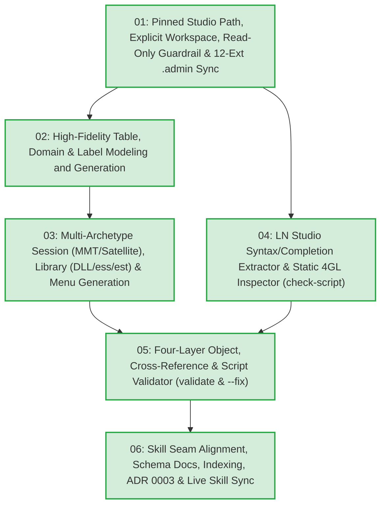

# Task Tickets: LN Studio Object Modeling, SCM Guardrails & Static Verification Engine

- **Specification**: [`docs/SPEC_LN_STUDIO_OBJECT_AND_VALIDATION.md`](docs/SPEC_LN_STUDIO_OBJECT_AND_VALIDATION.md)
- **Prior Architecture Decision Records**:
  - [`docs/adr/0001-plan-skill-update-and-coding-best-practices.md`](docs/adr/0001-plan-skill-update-and-coding-best-practices.md)
  - [`docs/adr/0002-ln-studio-skill-self-contained-toolchain.md`](docs/adr/0002-ln-studio-skill-self-contained-toolchain.md)
  - [`docs/adr/0003-ln-studio-object-modeling-and-static-verification.md`](docs/adr/0003-ln-studio-object-modeling-and-static-verification.md)
- **Domain Glossary**: [`GLOSSARY.md`](GLOSSARY.md)
- **Local Issues Directory**: [`.scratch/ln-studio-object-validation/issues/`](.scratch/ln-studio-object-validation/issues/)

---

## Dependency Graph

---

## Ticket Roster

| ID | Title | Blocked by | Status | Ticket File |
|---|---|---|---|---|
| **01** | Pinned Studio Path, Explicit Workspace Resolution, Read-Only Guardrails & 12-Extension `.admin` Sync | *None* | `done` | [`01-workspace-scm-guardrails-and-admin-sync.md`](.scratch/ln-studio-object-validation/issues/01-workspace-scm-guardrails-and-admin-sync.md) |
| **02** | High-Fidelity Table, Domain & Label Modeling and Generation | **01** | `done` | [`02-table-domain-label-fidelity-and-generation.md`](.scratch/ln-studio-object-validation/issues/02-table-domain-label-fidelity-and-generation.md) |
| **03** | Multi-Archetype Session, MMT Controller/Satellite, Library & Menu Generation | **02** | `done` | [`03-session-mmt-library-and-menu-generation.md`](.scratch/ln-studio-object-validation/issues/03-session-mmt-library-and-menu-generation.md) |
| **04** | LN Studio Syntax Highlighting & Code Completion Extractor + Static 4GL Inspector | **01** | `done` | [`04-studio-syntax-completion-extractor-and-script-checker.md`](.scratch/ln-studio-object-validation/issues/04-studio-syntax-completion-extractor-and-script-checker.md) |
| **05** | Four-Layer Object, Cross-Reference & Script Validator (`validate` & `--fix`) | **03, 04** | `done` | [`05-four-layer-object-and-workspace-validator.md`](.scratch/ln-studio-object-validation/issues/05-four-layer-object-and-workspace-validator.md) |
| **06** | Skill Seam Alignment, XML Schema Reference Expansion, Indexing & Live Deployment Sync | **05** | `done` | [`06-skill-seam-reference-indexing-and-live-sync.md`](.scratch/ln-studio-object-validation/issues/06-skill-seam-reference-indexing-and-live-sync.md) |
