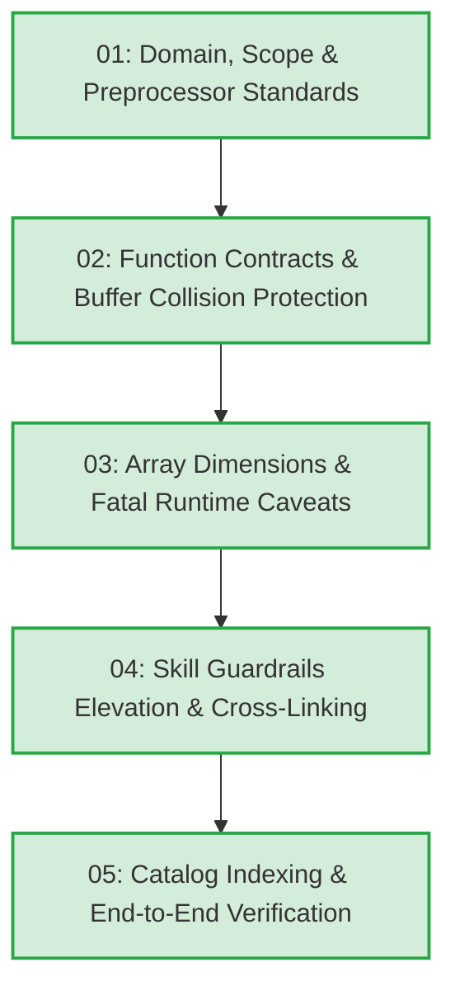

# Task Tickets: Baan 4GL Coding Standards, Anti-Patterns & Runtime Caveats

- **Specification**: [`docs/SPEC_4GL_CODING_STANDARDS_AND_CAVEATS.md`](docs/SPEC_4GL_CODING_STANDARDS_AND_CAVEATS.md)
- **Implementation Plan**: [`docs/PLAN_4GL_CODING_STANDARDS_AND_CAVEATS.md`](docs/PLAN_4GL_CODING_STANDARDS_AND_CAVEATS.md)
- **Architecture Decision Records**:
  - [`docs/adr/0001-plan-skill-update-and-coding-best-practices.md`](docs/adr/0001-plan-skill-update-and-coding-best-practices.md)
  - [`docs/adr/0002-ln-studio-skill-self-contained-toolchain.md`](docs/adr/0002-ln-studio-skill-self-contained-toolchain.md)
  - [`docs/adr/0003-ln-studio-object-modeling-and-static-verification.md`](docs/adr/0003-ln-studio-object-modeling-and-static-verification.md)
  - [`docs/adr/0004-4gl-coding-standards-and-caveats.md`](docs/adr/0004-4gl-coding-standards-and-caveats.md)
- **Wayfinder Map**: [`.scratch/4gl-coding-standards-and-caveats/MAP.md`](.scratch/4gl-coding-standards-and-caveats/MAP.md)
- **Local Issues Directory**: [`.scratch/4gl-coding-standards-and-caveats/issues/`](.scratch/4gl-coding-standards-and-caveats/issues/)

---

## Dependency Graph

---

## Active Ticket Roster

| ID | Title | Blocked by | Status | Ticket File |
|---|---|---|---|---|
| **01** | Domain, Scope & Preprocessor Standards | *None* | `done` | [`01-domain-scope-and-preprocessor-standards.md`](.scratch/4gl-coding-standards-and-caveats/issues/01-domain-scope-and-preprocessor-standards.md) |
| **02** | Function Contracts & Buffer Collision Protection | **01** | `done` | [`02-function-contracts-and-buffer-collision-protection.md`](.scratch/4gl-coding-standards-and-caveats/issues/02-function-contracts-and-buffer-collision-protection.md) |
| **03** | Array Dimensions & Fatal Runtime Caveats | **02** | `done` | [`03-array-dimensions-and-fatal-runtime-caveats.md`](.scratch/4gl-coding-standards-and-caveats/issues/03-array-dimensions-and-fatal-runtime-caveats.md) |
| **04** | Skill Guardrails Elevation & Cross-Linking | **03** | `done` | [`04-skill-guardrails-elevation-and-cross-linking.md`](.scratch/4gl-coding-standards-and-caveats/issues/04-skill-guardrails-elevation-and-cross-linking.md) |
| **05** | Catalog Indexing & End-to-End Verification | **04** | `done` | [`05-catalog-indexing-and-search-verification.md`](.scratch/4gl-coding-standards-and-caveats/issues/05-catalog-indexing-and-search-verification.md) |

---

## Archive / Completed Batches

<b>Batch: LN Studio Object Modeling, SCM Guardrails & Static Verification Engine (Completed)</b>

- **Specification**: [`docs/SPEC_LN_STUDIO_OBJECT_AND_VALIDATION.md`](docs/SPEC_LN_STUDIO_OBJECT_AND_VALIDATION.md)
- **Local Issues Directory**: [`.scratch/ln-studio-object-validation/issues/`](.scratch/ln-studio-object-validation/issues/)

| ID | Title | Status | Ticket File |
|---|---|---|---|
| **01** | Pinned Studio Path, Explicit Workspace Resolution, Read-Only Guardrails & 12-Extension `.admin` Sync | `done` | [`01-workspace-scm-guardrails-and-admin-sync.md`](.scratch/ln-studio-object-validation/issues/01-workspace-scm-guardrails-and-admin-sync.md) |
| **02** | High-Fidelity Table, Domain & Label Modeling and Generation | `done` | [`02-table-domain-label-fidelity-and-generation.md`](.scratch/ln-studio-object-validation/issues/02-table-domain-label-fidelity-and-generation.md) |
| **03** | Multi-Archetype Session, MMT Controller/Satellite, Library & Menu Generation | `done` | [`03-session-mmt-library-and-menu-generation.md`](.scratch/ln-studio-object-validation/issues/03-session-mmt-library-and-menu-generation.md) |
| **04** | LN Studio Syntax Highlighting & Code Completion Extractor + Static 4GL Inspector | `done` | [`04-studio-syntax-completion-extractor-and-script-checker.md`](.scratch/ln-studio-object-validation/issues/04-studio-syntax-completion-extractor-and-script-checker.md) |
| **05** | Four-Layer Object, Cross-Reference & Script Validator (`validate` & `--fix`) | `done` | [`05-four-layer-object-and-workspace-validator.md`](.scratch/ln-studio-object-validation/issues/05-four-layer-object-and-workspace-validator.md) |
| **06** | Skill Seam Alignment, XML Schema Reference Expansion, Indexing & Live Deployment Sync | `done` | [`06-skill-seam-reference-indexing-and-live-sync.md`](.scratch/ln-studio-object-validation/issues/06-skill-seam-reference-indexing-and-live-sync.md) |

