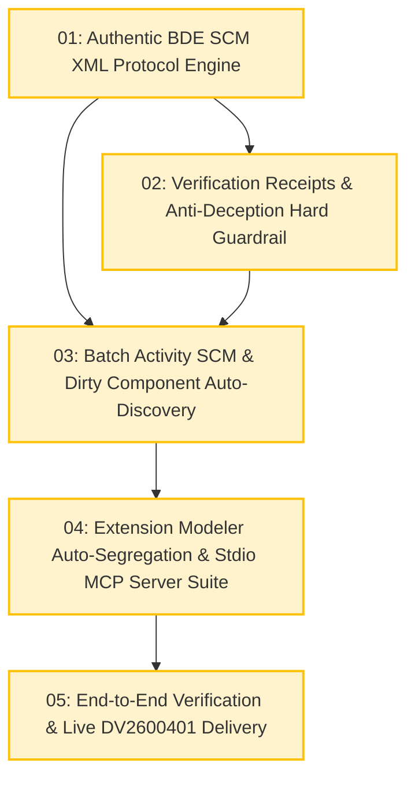

# Task Tickets: Automated BDE SCM Check-Out / Check-In Engine, Protocol Recovery & Batch Automation

- **Active Specification**: [`docs/SPEC_AUTOMATED_SCM_CHECKIN_CHECKOUT.md`](docs/SPEC_AUTOMATED_SCM_CHECKIN_CHECKOUT.md)
- **Active Implementation Plan**: [`docs/PLAN_AUTOMATED_SCM_CHECKIN_CHECKOUT.md`](docs/PLAN_AUTOMATED_SCM_CHECKIN_CHECKOUT.md)
- **Architecture Decision Record**: [`docs/adr/0011-automated-scm-engine-refactoring-and-protocol-recovery.md`](docs/adr/0011-automated-scm-engine-refactoring-and-protocol-recovery.md)
- **Target Skill**: `ln_studio_skill`

---

## Active Batch Dependency Graph (`Batch: Automated SCM Engine Refactoring & DV2600401 Delivery`)

---

## Active Ticket Roster

- **Local Issues Directory**: [`.scratch/scm-protocol-recovery-and-batch-automation/issues/`](.scratch/scm-protocol-recovery-and-batch-automation/issues/)

| ID | Title | Blocked by | Status | Ticket File |
|---|---|---|---|---|
| **01** | Authentic BDE SCM XML Protocol Engine | *None* | `ready-for-agent` | [`01-authentic-bde-scm-protocol-engine.md`](.scratch/scm-protocol-recovery-and-batch-automation/issues/01-authentic-bde-scm-protocol-engine.md) |
| **02** | Verification Receipts & Anti-Deception Hard Guardrail | **01** | `ready-for-agent` | [`02-verification-receipts-and-anti-deception-guardrail.md`](.scratch/scm-protocol-recovery-and-batch-automation/issues/02-verification-receipts-and-anti-deception-guardrail.md) |
| **03** | Batch Activity SCM & Dirty Component Auto-Discovery | **01, 02** | `ready-for-agent` | [`03-batch-activity-scm-and-dirty-auto-discovery.md`](.scratch/scm-protocol-recovery-and-batch-automation/issues/03-batch-activity-scm-and-dirty-auto-discovery.md) |
| **04** | Extension Modeler Auto-Segregation & Stdio MCP Server Suite | **03** | `ready-for-agent` | [`04-extension-modeler-segregation-and-mcp-suite.md`](.scratch/scm-protocol-recovery-and-batch-automation/issues/04-extension-modeler-segregation-and-mcp-suite.md) |
| **05** | End-to-End Verification & Live DV2600401 Delivery | **04** | `ready-for-agent` | [`05-end-to-end-verification-and-dv2600401-delivery.md`](.scratch/scm-protocol-recovery-and-batch-automation/issues/05-end-to-end-verification-and-dv2600401-delivery.md) |
