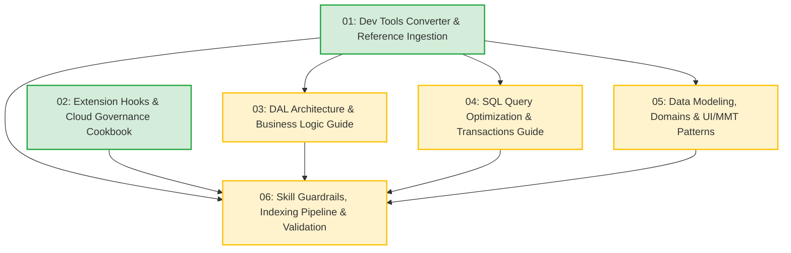

# Task Tickets: Infor ERP LN Skill Enhancement & Coding Best Practices

- **Specification**: [`docs/SPEC_SKILL_UPDATE_BEST_PRACTICES.md`](file:///c:/Users/nutdo/OneDrive/Documents/Gitlab/Skill_LN/docs/SPEC_SKILL_UPDATE_BEST_PRACTICES.md)
- **Architecture Decision Record**: [`docs/adr/0001-plan-skill-update-and-coding-best-practices.md`](file:///c:/Users/nutdo/OneDrive/Documents/Gitlab/Skill_LN/docs/adr/0001-plan-skill-update-and-coding-best-practices.md)
- **Domain Glossary**: [`GLOSSARY.md`](file:///c:/Users/nutdo/OneDrive/Documents/Gitlab/Skill_LN/GLOSSARY.md)
- **Local Issues Directory**: [`.scratch/skill-update-best-practices/issues/`](file:///c:/Users/nutdo/OneDrive/Documents/Gitlab/Skill_LN/.scratch/skill-update-best-practices/issues/)

---

## Dependency Graph

---

## Ticket Roster

| ID | Title | Blocked by | Status | Ticket File |
|---|---|---|---|---|
| **01** | Dev Tools Converter Tooling & Reference Ingestion | *None* | `completed` | [`01-dev-tools-converter-and-reference.md`](file:///c:/Users/nutdo/OneDrive/Documents/Gitlab/Skill_LN/.scratch/skill-update-best-practices/issues/01-dev-tools-converter-and-reference.md) |
| **02** | Extension Hooks & Cloud Governance Cookbook | *None* | `completed` | [`02-extension-hooks-cookbook.md`](file:///c:/Users/nutdo/OneDrive/Documents/Gitlab/Skill_LN/.scratch/skill-update-best-practices/issues/02-extension-hooks-cookbook.md) |
| **03** | DAL Architecture & Business Logic Guide | **01** | `completed` | [`03-dal-architecture-guide.md`](file:///c:/Users/nutdo/OneDrive/Documents/Gitlab/Skill_LN/.scratch/skill-update-best-practices/issues/03-dal-architecture-guide.md) |
| **04** | SQL Query Optimization & Transaction Management Guide | **01** | `completed` | [`04-sql-optimization-and-transactions.md`](file:///c:/Users/nutdo/OneDrive/Documents/Gitlab/Skill_LN/.scratch/skill-update-best-practices/issues/04-sql-optimization-and-transactions.md) |
| **05** | Data Modeling, Domains & UI/MMT Patterns Guides | **01** | `completed` | [`05-data-modeling-and-mmt-patterns.md`](file:///c:/Users/nutdo/OneDrive/Documents/Gitlab/Skill_LN/.scratch/skill-update-best-practices/issues/05-data-modeling-and-mmt-patterns.md) |
| **06** | Skill Definition Guardrails, Indexing Pipeline & Complete Validation | **01, 02, 03, 04, 05** | `completed` | [`06-skill-guardrails-and-indexing-validation.md`](file:///c:/Users/nutdo/OneDrive/Documents/Gitlab/Skill_LN/.scratch/skill-update-best-practices/issues/06-skill-guardrails-and-indexing-validation.md) |

---

## Detailed Tickets

### [01: Dev Tools Converter Tooling & Reference Ingestion](file:///c:/Users/nutdo/OneDrive/Documents/Gitlab/Skill_LN/.scratch/skill-update-best-practices/issues/01-dev-tools-converter-and-reference.md)
- **What to build:** Standalone Python conversion script `tools/convert_txt_dev_tools.py` that processes `update/Infor LN Development Tools 2016.txt`, strips form feeds (`\x0c`), recurring headers, footers, and page numbers, and outputs 13 cleanly formatted Markdown files into `erp-ln-progguide/references/dev_tools/` (`ch01_...md` to `ch13_...md`) alongside master index `DEV_TOOLS_INDEX.md`.
- **Blocked by:** None (can start immediately).
- **Acceptance Criteria:**
  - [x] `tools/convert_txt_dev_tools.py` parses `update/Infor LN Development Tools 2016.txt` cleanly.
  - [x] Strips all `\x0c` characters and header/footer artifacts.
  - [x] Outputs 13 chapter markdown files into `erp-ln-progguide/references/dev_tools/`.
  - [x] Generates `erp-ln-progguide/references/DEV_TOOLS_INDEX.md` mapping all chapters and sections.
  - [x] All generated files use UTF-8 encoding and relative Markdown links.

---

### [02: Extension Hooks & Cloud Governance Cookbook](file:///c:/Users/nutdo/OneDrive/Documents/Gitlab/Skill_LN/.scratch/skill-update-best-practices/issues/02-extension-hooks-cookbook.md)
- **What to build:** Comprehensive guide `erp-ln-progguide/references/best_practices/01_extension_hooks_cookbook.md` synthesizing extension development knowledge from *Infor LN Extensions Development Guide 10.8*. Delivers concrete hook lifecycle sequences, standardized error handling with `dal.set.error.message("@...")` and `return(DALHOOKERROR)`, Customer Defined Field (CDF) logic hooks (`is.applicable`, `is.mandatory`, `is.readonly`, `make.valid`, `update`), standard field hook overrides, and Infor Cloud governance constraints.
- **Blocked by:** None (can start immediately).
- **Acceptance Criteria:**
  - [x] Synthesize `references/best_practices/01_extension_hooks_cookbook.md` with full code examples for Table, Session, and Process hooks.
  - [x] Document the exact execution order during table insert/update/delete operations.
  - [x] Provide standardized recipes for all 5 major CDF logic hooks.
  - [x] Document Cloud Extensibility governance limits (execution time, query limits, untrusted sandbox rules).
  - [x] Update `references/EXTENSIONS_INDEX.md` to link to this cookbook.

---

### [03: DAL Architecture & Business Logic Guide](file:///c:/Users/nutdo/OneDrive/Documents/Gitlab/Skill_LN/.scratch/skill-update-best-practices/issues/03-dal-architecture-guide.md)
- **What to build:** Dedicated architectural guide `erp-ln-progguide/references/best_practices/02_dal_architecture_and_business_logic.md` codifying the Separation of Concerns in Infor LN. Details structural differences between DAL 1 and DAL 2, enforces the cardinal rule prohibiting database updates in UI scripts, details object set hooks (`before.open.object.set`, `set.object.defaults`), business methods, and method authorization (`method.is.allowed()`).
- **Blocked by:** 01
- **Acceptance Criteria:**
  - [x] Synthesize `references/best_practices/02_dal_architecture_and_business_logic.md`.
  - [x] Detail architectural separation between 4GL UI scripts and Data Access Layer (DAL).
  - [x] Compare DAL 1 vs DAL 2 with migration recommendations.
  - [x] Document property hooks, object sets, and business methods with 4GL code patterns.
  - [x] Cross-link with `references/dev_tools/ch02_overview_of_software_components.md` and `ch05_software_development_procedures.md`.

---

### [04: SQL Query Optimization & Transaction Management Guide](file:///c:/Users/nutdo/OneDrive/Documents/Gitlab/Skill_LN/.scratch/skill-update-best-practices/issues/04-sql-optimization-and-transactions.md)
- **What to build:** Dedicated performance and concurrency guide `erp-ln-progguide/references/best_practices/03_sql_query_optimization_and_transactions.md`. Establishes Embedded Baan SQL syntax (`select ... selectdo ... selecteos ... endselect`), index matching rules to avoid full table scans, set-oriented fetching (`as set with <N> rows`), cursor lifecycle management, query extensions (`query.extend.*`), and transaction/locking boundaries (`db.retry.point()`, `commit.transaction()`, `abort.transaction()`, `for update`).
- **Blocked by:** 01
- **Acceptance Criteria:**
  - [x] Synthesize `references/best_practices/03_sql_query_optimization_and_transactions.md`.
  - [x] Detail Embedded Baan SQL best practices and index alignment requirements.
  - [x] Document array fetching (`as set with ... rows`) and memory/cursor efficiency.
  - [x] Document `query.extend.select/from/where` usage patterns.
  - [x] Detail transaction control, deadlock prevention, and retry point mechanics.
  - [x] Cross-link with `references/sql/progguide/` and `references/dev_tools/ch02_overview_of_software_components.md`.

---

### [05: Data Modeling, Domains & UI/MMT Patterns Guides](file:///c:/Users/nutdo/OneDrive/Documents/Gitlab/Skill_LN/.scratch/skill-update-best-practices/issues/05-data-modeling-and-mmt-patterns.md)
- **What to build:** Two complementary architectural guides:
  1. `erp-ln-progguide/references/best_practices/04_data_model_and_domain_design.md`: Domain design (data types, formats, list domains, combined domains), table definitions, primary keys, reference integrity modes, and table reconfiguration (`crdd`) procedures.
  2. `erp-ln-progguide/references/best_practices/05_session_and_mmt_patterns.md`: Session types 1 to 4, Multi-Main Table (MMT) Controller and Satellite synchronization architecture, form layouts, commands, and multi-language/label best practices.
- **Blocked by:** 01
- **Acceptance Criteria:**
  - [x] Synthesize `references/best_practices/04_data_model_and_domain_design.md` covering domains, tables, and `crdd`.
  - [x] Synthesize `references/best_practices/05_session_and_mmt_patterns.md` covering session types, MMT, form commands, and labels.
  - [x] Cross-link both guides with corresponding chapters in `references/dev_tools/`.

---

### [06: Skill Definition Guardrails, Indexing Pipeline & Complete Validation](file:///c:/Users/nutdo/OneDrive/Documents/Gitlab/Skill_LN/.scratch/skill-update-best-practices/issues/06-skill-guardrails-and-indexing-validation.md)
- **What to build:** The final integration and verification slice:
  1. Update `erp-ln-progguide/SKILL.md` with explicit "Coding Standards & Architectural Guardrails" and quick-reference navigation tables for `dev_tools/` and `best_practices/`.
  2. Update `tools/generate_indices.py` to scan and index all files in `references/dev_tools/` and `references/best_practices/` into `index/INDEX.tsv`.
  3. Update `tools/validate_skill.py` and `erp-ln-progguide/scripts/search.py` to recognize the new directories and flags (`--dir dev_tools`, `--dir best_practices`).
  4. Execute `python tools/validate_skill.py` to verify that all links, file paths, and index entries resolve with zero errors.
  5. Execute CLI searches using `search.py` to verify searchability across new content.
- **Blocked by:** 01, 02, 03, 04, 05
- **Acceptance Criteria:**
  - [x] `erp-ln-progguide/SKILL.md` updated with strict coding standards, anti-pattern rules, and new guide links.
  - [x] `tools/generate_indices.py` updated and executed; `index/INDEX.tsv` includes all new pages.
  - [x] `tools/validate_skill.py` passes with zero broken links or orphaned index paths.
  - [x] `scripts/search.py` successfully returns ranked hits across `--dir dev_tools` and `--dir best_practices`.

