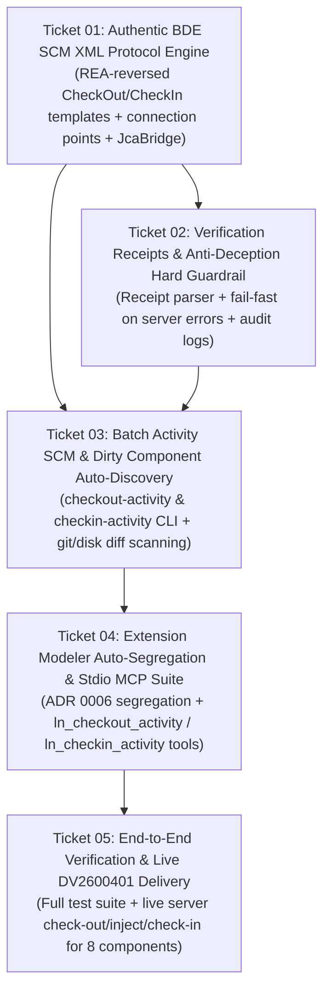

# Implementation Plan: Automated BDE SCM Check-Out / Check-In Engine, Protocol Recovery & Batch Automation

- **Document ID**: `PLAN-2026-0011`
- **Related Spec**: [`docs/SPEC_AUTOMATED_SCM_CHECKIN_CHECKOUT.md`](SPEC_AUTOMATED_SCM_CHECKIN_CHECKOUT.md)
- **Related ADR**: [`docs/adr/0011-automated-scm-engine-refactoring-and-protocol-recovery.md`](adr/0011-automated-scm-engine-refactoring-and-protocol-recovery.md)
- **Target Skill**: `ln_studio_skill`

---

## 1. Phased Execution Roadmap (Tracer-Bullet Vertical Slices)

---

## 2. Tracer-Bullet Ticket Breakdown

| Ticket | Title | Blocked By | End-to-End Deliverable |
|---|---|---|---|
| **01** | Authentic BDE SCM XML Protocol Engine | *None* | Implement REA-reversed `CmCheckOut` and `CmCheckIn` XML templates in `ln_scm_engine.py` and `LNStudioJcaBridge.java`, pass true `cmElementContext` and connection point (`EXTce01107_dev`), and verify via offline BDE test harness. |
| **02** | Verification Receipts & Anti-Deception Hard Guardrail | **01** | Implement server response XML receipt verification; raise unsuppressible `ServerSCMExecutionError` on any ERP rejection; strictly prevent silent local `.admin` fallbacks; produce structured Verification Receipts. |
| **03** | Batch Activity SCM & Dirty Component Auto-Discovery | **01, 02** | Add `checkout-activity` and `checkin-activity` subcommands with git/disk diff auto-discovery of modified components, atomic per-component status tracking, and non-reverting fail-fast behavior. |
| **04** | Extension Modeler Auto-Segregation & Stdio MCP Server Suite | **03** | Automatically route standard components to BDE SCM and segregate Extension Modeler scripts (`txess*`, `txest*`) to Guide-and-Paste Markdown; expose `ln_checkout_activity` and `ln_checkin_activity` tools on `ln_studio_mcp.py`. |
| **05** | End-to-End Verification & Live DV2600401 Delivery | **04** | Execute unit and integration tests; run live Check-Out, code injection from Git `SCS_Custimuzation`, and Check-In with comment for all 8 components of DV2600401 on `SCS_TST`; verify LN Studio F5 refresh and LN UI readiness. |
