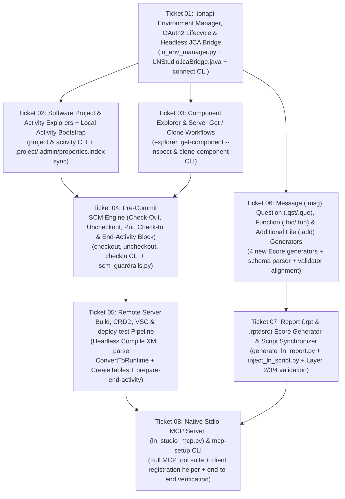

# Implementation Plan: Headless JCA Connectivity, Remote Explorers, 12-Component Generation, Pre-Commit SCM & Stdio MCP Server

- **Document ID**: `PLAN-2026-0007`
- **Related Spec**: [`docs/SPEC_HEADLESS_JCA_CONNECTIVITY_SCM_AND_MCP.md`](SPEC_HEADLESS_JCA_CONNECTIVITY_SCM_AND_MCP.md)
- **Related ADR**: [`docs/adr/0007-headless-jca-connectivity-scm-and-mcp-server.md`](adr/0007-headless-jca-connectivity-scm-and-mcp-server.md)
- **Target Skill**: `ln_studio_skill`

---

## 1. Phased Execution Roadmap (Tracer-Bullet Vertical Slices)

---

## 2. Tracer-Bullet Ticket Breakdown

| Ticket | Title | Blocked By | End-to-End Deliverable |
|---|---|---|---|
| **01** | `.ionapi` Environment Manager, OAuth2 Lifecycle & Headless JCA Bridge | *None* | Import `.ionapi`, sync Eclipse `cloudenv.prefs` & `connectivity.prefs`, acquire/refresh OAuth2 token, and execute live/mocked JCA `ping` & `Application.List` via `LNStudioJcaBridge.java` |
| **02** | Software Project & Activity Explorers + Local Activity Bootstrap | **01** | Browse Applications, Software Projects (`SoftwareProject_V2`), and Activities; create or open an Activity on the server and initialize `<taskId> [<projectName>]` locally with `.project`, `.admin`, and `properties.index` |
| **03** | Component Explorer & Server `Get` / `Clone` Workflows | **01** | Browse server packages/modules (`StudioComponent.GetBrowseList`), fetch any standard/custom component via `get-component` (Read-Only Activity file or `--inspect` stdout/JSON), and clone components into `tx*` via `clone-component` |
| **04** | Pre-Commit SCM Engine (`Check-Out`, `Uncheckout`, `Put`, `Check-In` & Hard-Blocked `End Activity`) | **02, 03** | Lock components into an Activity via `checkout-component`, revert via `uncheckout-component`, upload via `checkin-component`, preserve `tx*` Extension `Get-Only` guardrail (ADR 0006), and hard-block `End Activity` |
| **05** | Remote Server Build (`Compile`, `CRDD`, `CreateTables`, `VSC`), `deploy-test` & `prepare-end-activity` | **04** | Replace Win32 `Ctrl+B` default with headless JCA `Compile` (line/column XML error diagnostics), `ConvertToRuntime`, `CreateTables`, `executeVSC`, composite `deploy-test` for LN UI Cloud testing, and `prepare-end-activity` pre-commit check |
| **06** | Message (`.msg`), Question (`.qst`/`.que`), Function (`.fnc`/`.fun`) & Additional File (`.add`) Generators | **01** | Generate Ecore-compliant `.msg`, `.qst` (and `.que`), `.fnc` (and `.fun`), and `.add` XML components from YAML/CLI, sync `.admin` for both canonical and legacy extensions, and validate across all 4 layers |
| **07** | Report (`.rpt` & `.rptdsrc`) Ecore Generator & Script Synchronizer | **06** | Generate `<DR_Report>` `.rpt` XML (input fields, sort modes, header/detail layouts, base64 layout text, output fields, specials, page setup), bidirectional 4GL report script injection/extraction, and 4-layer validation |
| **08** | Native Stdio MCP Server (`ln_studio_mcp.py`), `mcp-setup` CLI & Documentation Sync | **05, 07** | Expose all connectivity, explorer, 12-component creation, cloning, SCM, and `deploy-test` capabilities via Stdio MCP Server, provide `mcp-setup` registration CLI, and update `SKILL.md` / `README.md` / `INDEX.tsv` |
