# Implementation Plan: Infor LN Extension Modeler Boundary: LN Studio Read-Only "Get" Mode and Local Project Hook Workflow

- **Document ID**: `PLAN-2026-0006`
- **Related Spec**: [`docs/SPEC_LN_STUDIO_EXTENSION_READONLY_AND_LNUI_WORKFLOW.md`](SPEC_LN_STUDIO_EXTENSION_READONLY_AND_LNUI_WORKFLOW.md)
- **Related ADR**: [`docs/adr/0006-ln-studio-extension-readonly-and-lnui-workflow.md`](adr/0006-ln-studio-extension-readonly-and-lnui-workflow.md)
- **Target Skills**: `ln_studio_skill` and `erp-ln-progguide`

---

## 1. Phased Execution Roadmap

```mermaid
flowchart LR
    P1["Phase 1: SCM Guardrails & Interception\n(scm_guardrails.py + inject_ln_script.py)"]
    P2["Phase 2: Extension Templates & Scaffolding\n(templates/ + new-extension CLI)"]
    P3["Phase 3: Studio Ingestion & Hook Parsing\n(import-extension + extension-hooks CLI)"]
    P4["Phase 4: Static Verification Engine\n(check_4gl_script.py + audit_4gl.py)"]
    P5["Phase 5: Activity Validator Realignment\n(validate_ln_activity.py GET_ONLY)"]
    P6["Phase 6: Testing & Quality Gate\n(test_extension_workflow.py)"]
    P7["Phase 7: Skill Documentation & Protocol\n(SKILL.md, README.md, GLOSSARY.md)"]

    P1 --> P2
    P2 --> P3
    P3 --> P4
    P4 --> P5
    P5 --> P6
    P6 --> P7
```

---

## 2. Work Breakdown Structure & Tickets

### Ticket 01: SCM Guardrails & Extension Write Interception
- **Target Files**:
  - `ln_studio_skill/tools/scm_guardrails.py`
  - `ln_studio_skill/tools/inject_ln_script.py`
  - `ln_studio_skill/tools/generate_ln_library.py`
- **Tasks**:
  1. Add detection for extension components (`tx*`, `ess`, `est`, `esb`, `esm`, `esr`) in `assert_file_writable`.
  2. Raise authoritative exception mimicking LN Studio:
     `Failure checking-out the component: Action on "<comp>" is not allowed. Use session ttext1500m000 to process extensions.`
  3. Update `generate_ln_library.py` to disallow generating XML for `session_extension` and `table_extension` into activity workspaces, redirecting to `new-extension`. Keep `--type dll` intact.

### Ticket 02: Extension Templates & Project Scaffolding CLI (`new-extension`)
- **Target Files**:
  - `ln_studio_skill/templates/table_extension_template.4gl`
  - `ln_studio_skill/templates/session_extension_template.4gl`
  - `ln_studio_skill/tools/ln_extension_manager.py` (New module)
  - `ln_studio_skill/tools/ln_component_builder.py`
- **Tasks**:
  1. Author official starter templates containing standard `#context_on` blocks (`declarations`, `functions`, lifecycle hooks) and complete docstrings.
  2. Implement `new-extension` command in `ln_extension_manager.py` to scaffold new extension files in the local project repository (defaulting to `extensions/<type>/<component>_ext.4gl`).
  3. Register `new-extension` subcommand in `ln_component_builder.py`.

### Ticket 03: Studio Ingestion & Hook Extraction CLI (`import-extension` & `extension-hooks`)
- **Target Files**:
  - `ln_studio_skill/tools/ln_extension_manager.py`
  - `ln_studio_skill/tools/ln_component_builder.py`
- **Tasks**:
  1. Implement `import-extension`: Ingest `.lib` or `.4gl` from LN Studio activity workspace (pulled via "Get"), extract the 4GL code, normalize `#context_on` blocks, and write to local project.
  2. Implement `extension-hooks`:
     - `--list`: List all `#context_on` hook blocks present in the file.
     - `--hook <name>`: Print the exact code for that hook with `#context_on` stripped.
     - `--copy`: Copy stripped hook code to Windows system clipboard (via `tkinter` or PowerShell clipboard fallback) for 1-click paste into LN UI.
  3. Register `import-extension` and `extension-hooks` subcommands in `ln_component_builder.py`.

### Ticket 04: Static Verification Engine for Extension Hooks
- **Target Files**:
  - `ln_studio_skill/tools/check_4gl_script.py`
  - `erp-ln-progguide/scripts/audit_4gl.py`
- **Tasks**:
  1. Enhance parser to validate `#context_on` / `#context_off` pairs and prohibit nesting.
  2. Verify hook signatures for standard table and session extension points.
  3. Enforce Cloud Governance rules:
     - Error if interactive dialog functions (`message`, `box`, `ask.enum`) are called in Table Extension hooks.
     - Error if transaction controls (`commit.transaction`, `db.retry.point`) are called inside DAL hooks.

### Ticket 05: Activity Validator Realignment (`validate_ln_activity.py`)
- **Target Files**:
  - `ln_studio_skill/tools/validate_ln_activity.py`
  - `ln_studio_skill/tools/admin_sync.py`
- **Tasks**:
  1. In Layer 1 validation, identify `tx*` components in activity folders and mark them as `[GET_ONLY_EXTENSION]`.
  2. Suppress SCM check-out warnings and do not attempt auto-repair for read-only extension components.

### Ticket 06: Test Suite, Verification & Skill Documentation
- **Target Files**:
  - `ln_studio_skill/tools/tests/test_extension_workflow.py` (New test suite)
  - `ln_studio_skill/SKILL.md`
  - `ln_studio_skill/README.md`
  - `erp-ln-progguide/SKILL.md`
  - `GLOSSARY.md`
- **Tasks**:
  1. Build automated test suite covering:
     - SCM guardrail blocking workspace extension edits.
     - `new-extension` scaffolding.
     - `import-extension` parsing.
     - `extension-hooks` extraction and hook stripping.
     - Static validation of valid vs invalid extension files.
     - Activity validator treating `tx*` as `[GET_ONLY_EXTENSION]`.
  2. Update `SKILL.md` and `README.md` in both skills with the "Guide-and-Paste" protocol and LN Studio Read-Only rules.
