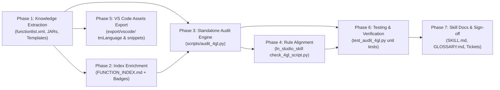

# Implementation Plan: Infor LN Studio Build 0640 Dictionaries Extraction, Cloud Governance & Standalone 4GL Audit Engine

- **Document ID**: `PLAN-2026-0005`
- **Related Spec**: [`docs/SPEC_PROGGUIDE_STUDIO_EXTRACTION_AND_AUDIT.md`](SPEC_PROGGUIDE_STUDIO_EXTRACTION_AND_AUDIT.md)
- **Related ADR**: [`docs/adr/0005-progguide-studio-dictionaries-and-audit-engine.md`](adr/0005-progguide-studio-dictionaries-and-audit-engine.md)
- **Target Skills**: `erp-ln-progguide` (Primary), `ln_studio_skill` (Rule Alignment)
- **Roster File**: [`Tickets.md`](../Tickets.md) (Tickets 01 through 06)

---

## 1. Phased Execution Roadmap

---

## 2. Work Breakdown Structure & Ticket Roster

### Ticket 01: Multi-Tier Knowledge Extractor (`tools/extract_studio_knowledge.py`)
- **Owner**: `erp-ln-progguide`
- **Goal**: Build and run an extraction script targeting `d:\LN Studio\April-2026\InforLNStudio_10_8_0_build0640-x86_64`.
- **Tasks**:
  1. Parse `com.infor.ln.studio.apps.progguide_10.8.0.0614/help/index/functionlist.xml`:
     - Extract all 2,274 functions with attributes (`Trusted`, `Deprecated`, `Internal`, `include`), `<Syntax>`, `<ScriptType>`, `<Description>`, and `<HelpID>`.
     - Map `HelpID` to local markdown documentation in `erp-ln-progguide/references/guide/progguide/...`.
     - Write formatted JSON database to `erp-ln-progguide/index/functions_db.json`.
  2. Extract Studio Editor Dictionaries from `lnstudio_commonui.jar`:
     - Reflectively extract `KEYWORDS` (80), `SQL_KEYWORDS` (92), Program/Sub/Choice/Report Sections, Predefined Variables (176), Standard Defines (49), and `DAL_OBJECT_HOOKS` (15).
     - Extract `DAL_FIELD_HOOK_SUFFIXES` (10 hook definitions with arguments and return types).
     - Save to `erp-ln-progguide/references/studio_syntax_completion.json` and generate `erp-ln-progguide/references/STUDIO_SYNTAX_COMPLETION.md`.
  3. Extract Official Templates from `com.infor.ln.studio.common.core_*.jar` (`ScriptTemplates/`) and `DefaultFourglTemplates.xml`:
     - Save templates to `erp-ln-progguide/templates/` (`DalTwo.dal`, `UIDatabase.cln`, `UserExitDLL.ue`, etc.).
- **Deliverables**:
  - `tools/extract_studio_knowledge.py`
  - `erp-ln-progguide/index/functions_db.json`
  - `erp-ln-progguide/references/studio_syntax_completion.json`
  - `erp-ln-progguide/references/STUDIO_SYNTAX_COMPLETION.md`
  - `erp-ln-progguide/templates/*.cln`, `*.dal`, `*.ue`

---

### Ticket 02: Enriched Grep-Friendly Function Index (`FUNCTION_INDEX.md`)
- **Owner**: `erp-ln-progguide`
- **Blocked By**: Ticket 01
- **Goal**: Rebuild `erp-ln-progguide/references/FUNCTION_INDEX.md` with Cloud Governance badges and Include headers.
- **Tasks**:
  1. Generate enriched index entries for all functions:
     `- **<name>** | [Cloud: Trusted|Untrusted] [Deprecated] [Scope: <type>] [Inc: <header>] | <signature> -> <relative_link>`
  2. Enforce strict single-line physical formatting per function for high-speed grep execution.
  3. Alphabetize and group by function module prefix.
  4. Verify discoverability and grep accuracy across common bshell libraries (`dal.*`, `db.*`, `json.*`, `cmf.*`, `stpapi.*`).
- **Deliverables**:
  - `erp-ln-progguide/references/FUNCTION_INDEX.md`

---

### Ticket 03: Standalone 4GL & DAL Audit Engine (`scripts/audit_4gl.py`)
- **Owner**: `erp-ln-progguide`
- **Blocked By**: Ticket 01, Ticket 02
- **Goal**: Implement zero-dependency, high-performance static 4GL auditor in Python.
- **Tasks**:
  1. Implement CLI argument parsing:
     - Target path (file or directory recursion).
     - `--mode [general|dal2|uedll]` (auto-detected if omitted).
     - `--cloud` (enforce Cloud Multi-Tenant rules).
     - `--format [text|json]` (ANSI colored human output vs machine JSON).
     - `--severity [error|warning|info]`.
     - `--strict` (exit code control).
  2. Implement Rule Checkers:
     - **Block balance**: `select/endselect`, `if/endif`, `for/endfor`, `while/endwhile`, `case/endcase`, `{}`.
     - **Section validator**: Validates section headers against official Studio dictionaries.
     - **DAL2 Contract**: Enforces hook method suffixes, parameter lists (`long i.mode`, `long has_changed`), prohibits interactive UI (`message()`, `ask.enum()`).
     - **Cloud Governance**: Rejects untrusted functions (`Trusted="no"`) in `--cloud` mode.
     - **Include Verifier**: Flags functions missing `#include <header>`.
     - **Anti-patterns**: Flags direct float equality `==`, primitive variable types on table columns, nested commits.
- **Deliverables**:
  - `erp-ln-progguide/scripts/audit_4gl.py`

---

### Ticket 04: Synchronized Rule Alignment with `ln_studio_skill`
- **Owner**: `ln_studio_skill`
- **Blocked By**: Ticket 01, Ticket 03
- **Goal**: Align `ln_studio_skill/tools/check_4gl_script.py` with the newly extracted dictionaries and audit engine.
- **Tasks**:
  1. Update `check_4gl_script.py` to reference `functions_db.json` and `studio_syntax_completion.json`.
  2. Incorporate missing `#include` and Cloud trusted function checks into Layer 4 static verification.
  3. Ensure identical diagnostics and error codes are emitted whether code is audited from `erp-ln-progguide` or validated via `ln_component_builder.py check-script`.
- **Deliverables**:
  - `ln_studio_skill/tools/check_4gl_script.py`

---

### Ticket 05: Export VS Code Extension Assets Package (`export/vscode/`)
- **Owner**: `erp-ln-progguide`
- **Blocked By**: Ticket 01
- **Goal**: Generate production-ready TextMate grammar and snippet assets for future VS Code extension development.
- **Tasks**:
  1. Generate `export/vscode/syntaxes/baan4gl.tmLanguage.json`:
     - TextMate grammar mapping keywords, SQL statements, section headers, DAL hooks, comments (`|`), strings, numbers, domains, and bshell functions.
  2. Generate `export/vscode/snippets/baan4gl.code-snippets`:
     - Rich snippets for DAL2 hooks, 4GL control structures, SQL queries, and header templates.
  3. Generate `export/vscode/language-configuration.json`:
     - Comment symbols (`|`), bracket pairs, auto-closing quotes.
  4. Generate `export/vscode/completions.json`:
     - Completion dataset with Markdown docs, signatures, and cloud badges.
  5. Add `export/vscode/README.md` documenting how to link or drop these assets into a future VS Code extension package.
- **Deliverables**:
  - `export/vscode/syntaxes/baan4gl.tmLanguage.json`
  - `export/vscode/snippets/baan4gl.code-snippets`
  - `export/vscode/language-configuration.json`
  - `export/vscode/completions.json`
  - `export/vscode/README.md`

---

### Ticket 06: Test Suite, Documentation & Catalog Indexing
- **Owner**: Workspace
- **Blocked By**: Ticket 03, Ticket 04, Ticket 05
- **Goal**: Full unit test coverage, documentation elevation, and catalog registration.
- **Tasks**:
  1. Implement test suite `erp-ln-progguide/tests/test_audit_4gl.py` covering all positive and negative test cases.
  2. Update `erp-ln-progguide/SKILL.md`:
     - Document `scripts/audit_4gl.py` usage and options under "How to answer questions".
     - Add Cloud Governance rules and DAL2 hook contracts to "Architectural Guardrails".
  3. Update `erp-ln-progguide/index/INDEX.tsv` registering new templates and references.
  4. Update `GLOSSARY.md` and archive active tickets in `Tickets.md`.
- **Deliverables**:
  - `erp-ln-progguide/tests/test_audit_4gl.py`
  - `erp-ln-progguide/SKILL.md`
  - `erp-ln-progguide/index/INDEX.tsv`
  - `GLOSSARY.md`
  - `Tickets.md`
