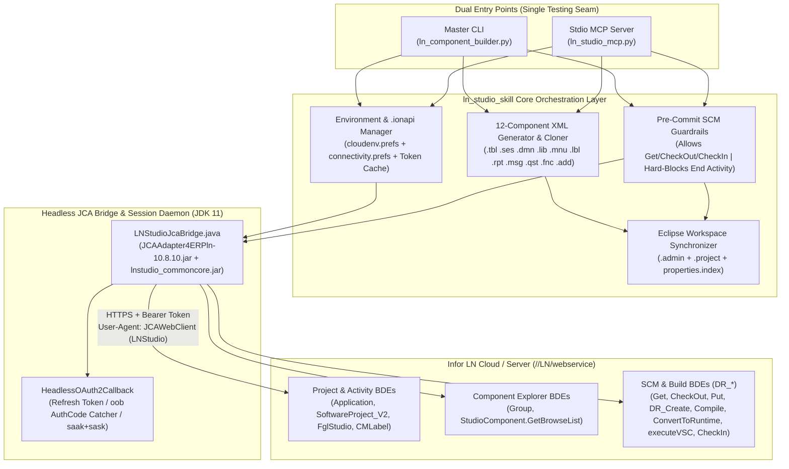

# Technical Specification: Headless JCA Connectivity, Remote Explorers, 12-Component Generation, Pre-Commit SCM & Stdio MCP Server

- **Document ID**: `SPEC-2026-0007`
- **Related ADR**: [`docs/adr/0007-headless-jca-connectivity-scm-and-mcp-server.md`](adr/0007-headless-jca-connectivity-scm-and-mcp-server.md)
- **Related Plan**: [`docs/PLAN_HEADLESS_JCA_CONNECTIVITY_SCM_AND_MCP.md`](PLAN_HEADLESS_JCA_CONNECTIVITY_SCM_AND_MCP.md)
- **Target Skill**: `ln_studio_skill`
- **Status**: `ready-for-agent`

---

## Problem Statement

Developing and customizing applications in **Infor ERP LN (10.8 / CloudSuite)** using the Eclipse-based **Infor LN Studio (`10.8.0 build 0640`)** requires slow, repetitive manual UI interaction across multiple views and modal wizards:
1. **Multi-Environment Connection Friction**: Developers working across multiple customer tenants and workspaces (`SCS_TST`, `DNT_TRN`, `DNT_TST`, `RDT_TST`, `RPA_REIN`, `Team`, `Team_TST`, `ZAP`, `ZAP_TST`) must manually import `.ionapi` credentials, configure Cloud Environments, create `ProjectServer` and shared `<Project>_dev`/`<Project>_rt` JCA connection points, and repeatedly authenticate.
2. **Slow Explorer Navigation & SCM Clicking**: Browsing the **Software Project Explorer**, **Activity Explorer**, and **Component Explorer** to inspect standard or custom components (`Get`), create activities, check out components (`Check-Out`), or upload changes (`Put` / `Check-In`) previously required human clicks inside the Eclipse workbench.
3. **Fragile UI Keystroke Compilation**: Previously, `ln_studio_skill` relied on Win32 window focus (`F5` + `Ctrl+B`) and binary `.markers` files to compile code, requiring the heavy Eclipse UI to remain open and focused.
4. **Incomplete Component Generation (`Create New Component`)**: Only 6 of the 12 LN Studio component types (`.tbl`, `.ses`, `.dmn`, `.lib`, `.mnu`, `.lbl`) had generators. Developers still had to open LN Studio and click field-by-field to create Reports (`.rpt`/`.rptdsrc`), Messages (`.msg`), Questions (`.qst`/`.que`), Include Functions (`.fnc`/`.fun`), or Additional Files (`.add`), or to clone existing components from the server into custom `tx` packages.

---

## Solution

Transform `ln_studio_skill` into a complete, headless-capable replacement for Infor LN Studio's day-to-day workflow—available as both **CLI subcommands** and a **native Stdio MCP Server**—by leveraging LN Studio's pure-Java JCA 1.6 connector (`JCAAdapter4ERPln-10.8.10.jar`) and Ecore model libraries (`lnstudio_commoncore.jar`) directly on the bundled JDK (`jdk-11.0.16.1`):

1. **`.ionapi` Cloud Environment & Connection Manager**: Import `.ionapi` files, manage OAuth2 Bearer/Refresh tokens (supporting both Desktop `oob://localhost/lnstudio` login with silent auto-refresh and headless `saak`/`sask` Service Accounts), and synchronize 100% with Eclipse's `cloudenv.prefs` and workspace `connectivity.prefs`.
2. **Headless JCA Server Explorers**: Query **Software Project Explorer** (`Application`, `SoftwareProject_V2`), **Activity Explorer** (`ShowSoftwareTaskV2`, `MaintainSoftwareTaskV2`), and **Component Explorer** (`Group`, `StudioComponent.GetBrowseList`) directly over HTTPS/XML BDE calls.
3. **Automated Pre-Commit SCM & `deploy-test` Pipeline**: Automate **Get** (Read-Only activity download or `--inspect` memory mode), **Create/Open Activity**, **Check-Out**, **Undo Check-Out**, **Put / DR_Create**, **Remote Compile** (returning line-accurate XML errors), **Convert to Runtime (`crdd`) / Create Tables**, **VSC Verification**, and **Check-In (with comment)** for immediate testing on the Activity VRC (`ext`) in LN UI Cloud.
4. **Strict Human-in-the-Loop Commit Gate**: Hard-block `End Activity` / `Commit Activity` (`CloseTask` / `FinalizeActivity`) in both CLI and MCP, providing `prepare-end-activity` to validate the activity and sync Eclipse workspace metadata (`.project`, `.admin`, `properties.index`) so the developer only opens LN Studio for final review and Activity Commit.
5. **Full 12-Component Generation & Server Cloning**: Add high-fidelity Ecore XML generators for Reports (`.rpt`/`.rptdsrc`), Messages (`.msg`), Questions (`.qst`/`.que`), Include Functions (`.fnc`/`.fun`), and Additional Files (`.add`), plus `clone-component` to copy and rename any server component into a custom `tx` activity.



---

## User Stories

1. **As an LN developer**, I want to import a customer `.ionapi` file (such as `SCS_TST.ionapi` or `DNT_TRN.ionapi`) and bind it to a workspace in `workspace_lnstudio`, so that both `ln_studio_skill` and Eclipse LN Studio share the exact same Cloud Environment (`cloudenv.prefs`) and JCA Connection Points (`connectivity.prefs`).
2. **As an LN developer**, I want to list all configured customer workspaces (`SCS_TST`, `DNT_TRN`, `DNT_TST`, `RDT_TST`, `RPA_REIN`, `Team`, `Team_TST`, `ZAP`, `ZAP_TST`) and verify their Tenant ID, Gateway URL, and Dev/RT connection points from the CLI or MCP, so that I always target the right customer environment.
3. **As an LN developer**, I want the first login to a Desktop `.ionapi` (`dt="11"`) environment to capture the `oob://localhost/lnstudio?code=...` redirect automatically and cache the `access_token` and `refresh_token` securely outside Git, so that all subsequent CLI and MCP commands authenticate silently without repeated login popups.
4. **As an LN developer**, I want `.ionapi` profiles containing Service Account credentials (`saak` and `sask`) to authenticate 100% headlessly via OAuth2 password grant, so that automated pipelines can run with zero browser interaction.
5. **As an AI agent or developer**, I want to maintain a persistent JCA connection session (`conid` + session cookies + shared `<Project>_dev`/`<Project>_rt` channels), so that consecutive explorer, SCM, and compile calls execute in milliseconds without re-handshaking on every command.
6. **As an LN developer**, I want to browse the **Software Project Explorer** (`Application.List`, `Application.Show`, `SoftwareProject_V2.List`, `SoftwareProject_V2.Show`) via CLI or MCP, so that I can inspect applications, VRC hierarchies (`workSet`, `baseVRC`), and linked development/runtime environments without opening Eclipse.
7. **As an LN developer**, I want to browse the **Activity Explorer** to list all open activities under a Software Project (`EXTce01107`, etc.) and see their task IDs, UUIDs, owners, and modified components, so that I can pick or resume an activity immediately.
8. **As an LN developer**, I want to create a new Activity (`SoftwareProject_V2.Change` with `<Tasks action="create">`) and open it locally in `<Workspace>/<taskId> [<projectName>]` with complete `.project`, `.admin`, and Eclipse `properties.index` metadata, so that I can start customizing without clicking through the New Activity wizard in Eclipse.
9. **As an LN developer**, I want to clean or recover a corrupted Activity (`FglStudio.CleanActivity` / `CleanComponents`) via CLI or MCP, so that stuck server workarea locks can be cleared quickly.
10. **As an AI agent or developer**, I want to browse the **Component Explorer** (`Group.GetList`, `StudioComponent.GetBrowseList`) filtered by package (`tc`, `td`, `wh`, `tf`, `tx`), component type (`table`, `session`, `library`, `report`, `domain`, `label`, `message`, `question`, `function`, `additional`, `menu`), and name range, so that I can discover existing server objects before writing code.
11. **As an AI agent**, I want to run `get-component --inspect` (`DR_*.Get`) on any standard or custom component (e.g., `tdsls400`, `whwmd4300m000`, `tcibd001`) to read its columns, indices, form fields, or 4GL/DAL source code directly from the server without polluting my local Activity folder, so that I can write accurate queries, DAL calls, and extensions.
12. **As an LN developer**, I want to run `get-component` to download a read-only copy of a server component into my local Activity folder and register it in `.admin`, so that it is available locally for reference or Eclipse debugging just like clicking "Get" in LN Studio.
13. **As an LN developer**, I want to run `checkout-component` (`DR_*.CheckOut`) to lock an existing component into my current Activity on the server, download its XML to the Activity directory, clear the OS Read-Only flag, and update `.admin`, so that I or the AI agent can modify it immediately without opening Eclipse.
14. **As an LN developer**, I want to run `uncheckout-component` (`DR_*.UndoCheckOut`) to revert local changes, release the server lock on a component, and update `.admin`, so that accidental check-outs can be rolled back cleanly.
15. **As an LN developer**, I want to generate a **Report (`.rpt` / `.rptdsrc`)** component (`<DR_Report>`) with input fields, sort modes, header/detail layouts (`<ReportOutputField>`, `<ReportSpecial>`, `<ReportLayoutText>`), page setup, and 4GL report script from declarative YAML or MCP parameters, so that I don't have to click through the Report Editor field by field.
16. **As an LN developer**, I want to generate **Message (`.msg`, `<DR_Message>`)** and **Question (`.qst`/`.que`, `<DR_Question>`)** components with severity levels, domains (`tcyesno`), default answers, and multi-language translations in bulk from YAML or MCP, so that custom `tx` error messages and user prompts are created in seconds.
17. **As an LN developer**, I want to generate **Include Function (`.fnc`/`.fun`, `<DR_Module><type>function</type>`)** and **Additional File (`.add`, `<DR_AdditionalFile>`)** components from YAML or MCP, so that shared `#include` 4GL functions and resource payloads are managed alongside tables and sessions.
18. **As an LN developer**, I want a `clone-component` command/tool that fetches an existing server component (`table`, `session`, `report`, `library`, `domain`, `menu`) via `Get`, renames its package/module/component identifier and label references to a new target name (e.g. `tx...`), and registers it in the active Activity (`DR_Create`), so that I can customize based on standard LN templates effortlessly.
19. **As an LN developer or AI agent**, I want a single `deploy-test` command/tool that executes `Put` (or `DR_Create` for new components) -> `Compile` -> `ConvertToRuntime` (`crdd`) / `CreateTables` -> `executeVSC` -> `CheckIn` (with a check-in comment), so that my changes are immediately live on the Activity VRC (`ext`) for testing in LN UI Cloud.
20. **As an AI agent**, I want `Compile` and `deploy-test` to parse `<CompileResponseError>` and `<CompileResponseWarning>` directly from the server's XML response (returning exact line numbers, columns, error states, and messages), so that I can self-correct 4GL syntax or DAL errors in a tight loop without needing Eclipse `.markers` or Win32 `Ctrl+B`.
21. **As an LN developer**, I want the toolchain and MCP server to **hard-block** `End Activity` and `Commit Activity` (`CloseTask` / `FinalizeActivity`), so that no AI agent or script can permanently close or deliver an Activity without my explicit manual action in LN Studio.
22. **As an LN developer**, I want a `prepare-end-activity` command/tool that runs `DR_Solution.ValidateDevelopmentActivity` and `ExecuteVSC` on the server, verifies that `.admin`, `.project`, and Eclipse `properties.index` are 100% synchronized, and outputs a complete Activity change summary and commit note, so that I only need to open LN Studio and click End Activity when everything is verified.
23. **As an LN developer**, I want Extension Modeler components (`tx*` in `ess`, `est`, `esr`, `esb`, `esm`) to remain strictly **Get-Only** in the Studio SCM workflow (preserving ADR 0006), so that the toolchain never attempts an invalid Studio Check-Out on `ttext1500m000` extensions.
24. **As an AI agent user**, I want an `mcp-setup` command that registers `ln_studio_mcp.py` into my MCP client configuration, so that I can invoke all LN Studio capabilities as native MCP tools inside Antigravity, Claude Code, or Cursor.

---

## Implementation Decisions

### 1. Testing Seam & Module Architecture
- **Primary Seam**: The CLI command dispatcher (`ln_component_builder.py`) and the MCP tool dispatcher (`ln_studio_mcp.py`), both delegating to a unified Python service facade (`ln_server_client.py` + `ln_env_manager.py` + component generators) backed by a pluggable **JCA Transport Interface**.
- In production, the JCA Transport invokes the headless Java bridge (`LNStudioJcaBridge`) over stdio/JSON-RPC using Studio's bundled JDK 11 and `JCAAdapter4ERPln-10.8.10.jar`. In automated unit/integration tests, the JCA Transport seam accepts deterministic recorded/mocked BDE XML responses, enabling 100% offline verification of every explorer, SCM, build, and generator workflow alongside live smoke tests against `workspace_lnstudio`.

### 2. Headless Java JCA Bridge (`LNStudioJcaBridge`)
- Compiled and executed using `D:\LN Studio\jdk-11.0.16.1\bin\java.exe` (with fallback to system JDK).
- Classpath binds directly to the pinned Studio 10.8 build 0640 JARs:
  - `com.infor.erpln.jca.connectivity_10.8.12.v0-20250703-1423/lib/JCAAdapter4ERPln-10.8.10.jar`
  - Sibling `lib/*.jar` (`geronimo-j2ee-connector_1.6_spec-1.0.jar`, `jakarta.xml.bind-api-2.3.3.jar`, `jaxb-impl-2.3.3.jar`, `activation-1.1.1.jar`, `log4j-api-2.24.3.jar`, `log4j-core-2.24.3.jar`, `esapi-2.5.3.1.jar`, `json-simple-1.1.1.jar`, `jna-3.3.0.jar`, `platform-3.4.0.jar`)
  - `lnstudio_commoncore.jar` (for `.admin` `AdministrationComponent` serialization and TDE model constants)
- Supports both **single-shot CLI execution** and a **background session daemon mode** (listening on localhost loopback with a per-user token or keeping the JCA `conid` and shared `<Project>_dev`/`<Project>_rt` connections warm).
- Always sets `ConnectionSpecImpl.setApplication("LNStudio")` to satisfy the `User-Agent: JCAWebClient (LNStudio)` contract.

### 3. `.ionapi` Import, OAuth2 Lifecycle & Eclipse Preference Sync
- `ln_env_manager.py` reads and writes:
  1. Customer `.ionapi` JSON files (`ti`, `cn`, `dt`, `ci`, `cs`, `iu`, `pu`, `oa`, `ot`, `or`, `sc`, `saak`, `sask`).
  2. Global Eclipse Cloud Environments (`configuration/.settings/com.infor.erpln.jca.connectivity.cloudenv.prefs`).
  3. Per-workspace JCA Connection Points (`<Workspace>/.metadata/.plugins/org.eclipse.core.runtime/.settings/com.infor.erpln.jca.connectivity.prefs`).
- Token cache is stored at `<skill_root>/.cache/tokens/<env_name>.json` (strictly excluded via `.gitignore`).
- Token acquisition state machine:
  1. Valid cached `access_token` -> use immediately.
  2. Expired `access_token` + valid `refresh_token` -> `POST <pu>token.oauth2` (`grant_type=refresh_token`).
  3. `.ionapi` has `saak` & `sask` -> `POST <pu>token.oauth2` (`grant_type=password`).
  4. Desktop `.ionapi` (`dt="11"`) without `refresh_token` -> launch lightweight embedded browser/dialog to `<pu>authorization.oauth2?...&redirect_uri=oob://localhost/lnstudio`, intercept `code`, and exchange at `<pu>token.oauth2` (`grant_type=authorization_code`).

### 4. Server Explorer & SCM BDE Contracts
All BDE calls use `JcaBdeManager.doBdeCall(bdeName, methodName, requestXml, ...)` against either `ProjectServer` (for project/activity metadata) or `<Project>_dev` (shared connection with `Environment=<dev_bse>`):

```yaml
# Canonical BDE Dispatch Map (Verified from LN Studio 10.8 build 0640)
SoftwareProjectExplorer:
  list_applications:    { conn: ProjectServer, bde: Application,        method: List }
  show_application:     { conn: ProjectServer, bde: Application,        method: Show }
  list_projects:        { conn: ProjectServer, bde: SoftwareProject,    method: List }
  show_project:         { conn: ProjectServer, bde: SoftwareProject_V2, method: Show }

ActivityExplorer:
  list_activities:      { conn: ProjectServer, bde: SoftwareProject_V2, method: Show }
  create_activity:      { conn: ProjectServer, bde: SoftwareProject_V2, method: Change } # <Tasks action="create">
  get_modified_list:    { conn: ProjectServer, bde: CMLabel,            method: GetModifiedComponents }
  clean_activity:       { conn: <Project>_dev, bde: FglStudio,          method: CleanActivity }
  validate_activity:    { conn: <Project>_dev, bde: DR_Solution,        method: ValidateDevelopmentActivity }
  end_activity:         BLOCKED_BY_GUARDRAIL # CloseTask (<End/> / <Deliver/>) & FinalizeActivity prohibited

ComponentExplorer:
  list_groups:          { conn: <Project>_dev, bde: Group,              method: GetList }
  list_subgroups:       { conn: <Project>_dev, bde: Group,              method: ListDynamicSubGroups }
  browse_components:    { conn: <Project>_dev, bde: StudioComponent,    method: GetBrowseList }

SCM_and_Build (DR_* = DR_Table | DR_Controller | DR_Module | DR_Report | DR_Domain | DR_Label | DR_Message | DR_Question | DR_Menu | DR_AdditionalFile):
  get_component:        { conn: <Project>_dev, bde: <DR_*>,             method: Get }
  checkout_component:   { conn: <Project>_dev, bde: <DR_*>,             method: CheckOut }
  uncheckout_component: { conn: <Project>_dev, bde: <DR_*>,             method: UndoCheckOut }
  create_component:     { conn: <Project>_dev, bde: <DR_*>,             method: DR_Create }
  put_component:        { conn: <Project>_dev, bde: <DR_*>,             method: Put }
  checkin_component:    { conn: <Project>_dev, bde: <DR_*>,             method: CheckIn }
  delete_component:     { conn: <Project>_dev, bde: <DR_*>,             method: DR_Delete }
  compile_component:    { conn: <Project>_dev, bde: <DR_*>,             method: Compile }
  convert_to_runtime:   { conn: <Project>_dev, bde: <DR_*>,             method: ConvertToRuntime }
  create_tables:        { conn: <Project>_dev, bde: DR_Table,           method: CreateTables }
  execute_vsc:          { conn: <Project>_dev, bde: <DR_*>,             method: executeVSC }
```

### 5. Complete 12-Component Ecore XML Generation & Dual Extension Support
- Add dedicated generator modules (and declarative YAML sections in `ln_schema_parser.py`) for:
  1. `generate_ln_report.py` -> `.rpt` (`<DR_Report>`) and `.rptdsrc` support
  2. `generate_ln_message.py` -> `.msg` (`<DR_Message>`)
  3. `generate_ln_question.py` -> `.qst` (`<DR_Question>`, also accepting `.que` alias)
  4. `generate_ln_function.py` -> `.fnc` (`<DR_Module><type>function</type>`, also accepting `.fun` alias)
  5. `generate_ln_additional.py` -> `.add` (`<DR_AdditionalFile>`)
- Update `admin_sync.py`, `AdminSyncHelper.java`, and `validate_ln_activity.py` so both canonical Studio extensions (`.qst`, `.fnc`) and legacy aliases (`.que`, `.fun`) are recognized seamlessly.

### 6. Eclipse Workspace Metadata Synchronization (`properties.index`, `.project`, `.admin`)
When an Activity is created or opened, or when components are checked out/created/checked in via CLI/MCP:
- Maintain `<ActivityFolder>/.project` with `com.infor.ln.studio.apps.core.fourglStudio` nature and `com.infor.ln.studio.apps.core.bic` builder.
- Synchronize `<ActivityFolder>/.admin` (`HashMap<String, AdministrationComponent>`) with the exact server `revision`, `variantId`, `baseVersion`, `status` (CheckedOut / Created / CheckedIn / Get), and `hasChanged` flags.
- Maintain Eclipse `IProject` persistent properties (`properties.index`) so opening the workspace in Eclipse LN Studio immediately binds the project to its remote Activity UUID and `<Project>_dev`/`<Project>_rt` connections.

---

## Testing Decisions

1. **High-Level Behavioral Seam Testing**:
   - Tests exercise the public CLI entry points (`ln_component_builder.py`) and MCP tool handlers (`ln_studio_mcp.py`) end-to-end, asserting observable outputs: generated XML files, updated `.prefs` / `.admin` files, parsed JSON/Markdown explorer tables, compiler error diagnostics, and guardrail exceptions.
   - A mockable `JcaTransport` fixture replays authentic LN Studio 10.8 BDE XML responses (`SoftwareProject_V2`, `StudioComponent`, `DR_Table`, `CompileResponse`, `ValidateDevelopmentActivity`), ensuring deterministic offline CI execution.
2. **Modules Under Test**:
   - `ln_env_manager.py` (`.ionapi` parsing, `cloudenv.prefs` & `connectivity.prefs` round-trip sync, token refresh lifecycle).
   - `ln_jca_bridge.py` & `LNStudioJcaBridge.java` (BDE XML construction, response parsing, error handling).
   - Explorer & SCM workflows (`project`, `activity`, `explorer`, `get`, `checkout`, `uncheckout`, `checkin`, `deploy-test`, `prepare-end-activity`, and hard-blocking of `end-activity` and `tx*` extension check-outs).
   - New component generators (`generate_ln_report.py`, `generate_ln_message.py`, `generate_ln_question.py`, `generate_ln_function.py`, `generate_ln_additional.py`, and `clone-component`) + 4-layer activity validator (`validate_ln_activity.py`).
   - `ln_studio_mcp.py` (JSON-RPC 2.0 `tools/list` and `tools/call` verification across all exposed MCP tools).
3. **Prior Art**:
   - Follows the existing `unittest` architecture in `ln_studio_skill/tools/tests/` (`test_generators.py`, `test_validator.py`, `test_extension_workflow.py`).

---

## Out of Scope

1. **Automated `End Activity` / `Commit Activity` / `Deliver Activity`**: By explicit governance design (ADR 0007), closing or delivering an activity (`FglStudio.CloseTask` / `FinalizeActivity`) is out of scope and hard-blocked so a human developer always performs final delivery approval in LN Studio.
2. **Checking Out Extension Modeler (`ttext1500m000`) Components in Studio**: Per ADR 0006, `tx*` Extension Modeler components (`ess`, `est`, `esr`, `esb`, `esm`) cannot be checked out via Studio SCM and remain strictly **Get-Only** in Studio (authored locally in `extensions/*.4gl` and pasted into LN UI `ttext1500m000`).
3. **Graphical Report Layout Drag-and-Drop WYSIWYG**: Report `.rpt` generation covers declarative YAML/JSON layout grids, input fields, sort sequences, and 4GL report scripts (plus cloning existing server reports); interactive pixel drag-and-drop remains in Eclipse/SSRS if needed.

---

## Further Notes

- **Pinned Runtime**: Validated against `d:\LN Studio\April-2026\InforLNStudio_10_8_0_build0640-x86_64` and `D:\LN Studio\jdk-11.0.16.1\bin\java.exe`.
- **Customer Workspaces Ready for Immediate Binding**: `SCS_TST`, `DNT_TRN`, `DNT_TST`, `RDT_TST`, `RPA_REIN`, `Team`, `Team_TST`, `ZAP`, `ZAP_TST` under `c:\Users\nutdo\OneDrive\Documents\workspace_lnstudio`.
