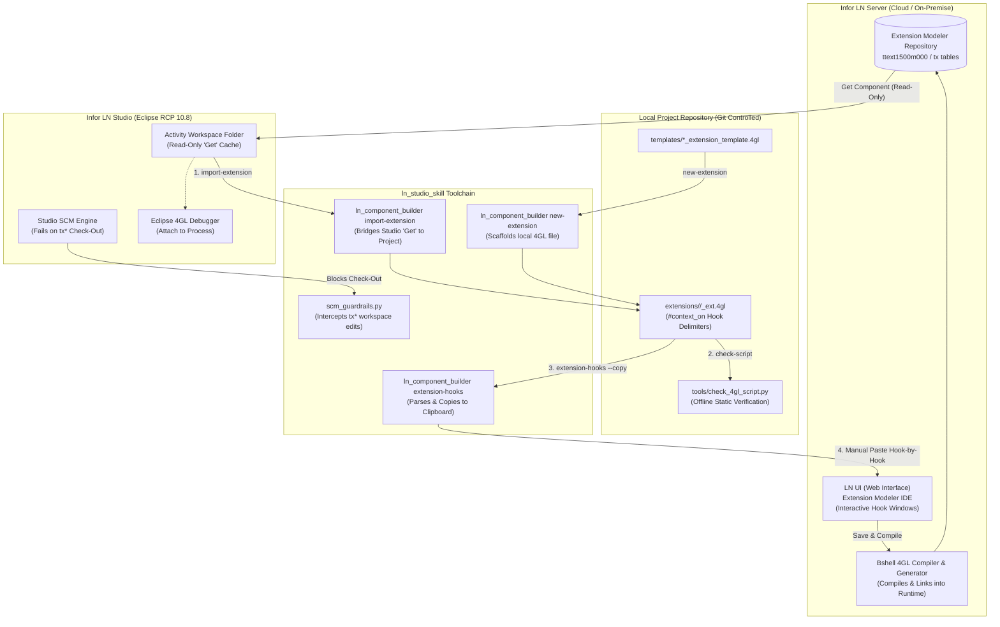

# Technical Specification: Infor LN Extension Modeler Boundary: LN Studio Read-Only "Get" Mode and Local Project Hook Workflow

- **Document ID**: `SPEC-2026-0006`
- **Related ADR**: [`docs/adr/0006-ln-studio-extension-readonly-and-lnui-workflow.md`](adr/0006-ln-studio-extension-readonly-and-lnui-workflow.md)
- **Target Skills**: `ln_studio_skill` and `erp-ln-progguide`
- **Status**: Approved

---

## 1. Architectural Overview & Workflow Diagram



---

## 2. Infor LN Studio SCM Boundary & Error Interception

### 2.1 Authoritative System Constraint
Infor LN Studio does not permit SCM actions (check-out, edit, check-in) on Extension Modeler components (`tx*`, `ess`, `est`, `esb`, `esm`, `esr`). Attempting to check out an extension produces:
```text
Failure checking-out the component
Action on "txesswmd4300m0" is not allowed.
Use session ttext1500m000 to process extensions.
```

### 2.2 SCM Guardrail Interception (`scm_guardrails.py`)
`assert_file_writable` and related SCM utilities must detect extension components:
- If file name starts with `tx` or directory path contains `/library/ess/`, `/library/est/`, `/library/esb/`, `/library/esm/`, `/library/esr/`:
  - Abort immediately with `ReadOnlyComponentError`:
    ```python
    raise ReadOnlyComponentError(
        f"[ERROR] Failure checking-out the component. "
        f"Action on '{component_name}' is not allowed in LN Studio. "
        f"Use session ttext1500m000 in LN UI to process extensions."
    )
    ```

### 2.3 Activity Validator Alignment (`validate_ln_activity.py`)
When `validate` scans an activity directory containing imported `tx*` components:
- Treat `tx*` files as `[GET_ONLY_EXTENSION]`.
- Do not flag untracked/missing check-out SCM violations for them.
- Do not attempt to auto-repair or modify them during `--fix`.

---

## 3. Local Extension File Format Specification

Local extension files reside in the project repository (e.g., `extensions/table/` or `extensions/session/`) as unified `.4gl` files.

### 3.1 Syntax Structure
Each hook block is enclosed by native Infor LN `#context_on` and `#context_off` directives:

```baan4gl
|*******************************************************************************
|* Extension Script for Table whwmd400 (Warehouse Items)
|* Author: Antigravity / Developer
|* Generated: 2026-10-26
|*******************************************************************************

| Hook declarations
#context_on "declarations"
table   twhwmd400
#include <bic_dal2>
#include <bic_tableext>

long    g_sample_counter
#context_off

| Hook functions
#context_on "functions"
function extern boolean validate_custom_business_rule(domain tcitem item)
{
    if isspace(item) then
        return(false)
    endif
    return(true)
}
#context_off

| Hook before.save.object
#context_on "before.save.object"
function extern long before.save.object(long mode)
{
    if not validate_custom_business_rule(whwmd400.item) then
        dal.set.error.message("@Item code is invalid")
        return(DALHOOKERROR)
    endif
    return(0)
}
#context_off
```

### 3.2 Standard Hook Context Identifiers
- Common: `"declarations"`, `"functions"`
- Table Extension (DAL 2): `"before.save.object"`, `"after.save.object"`, `"before.destroy.object"`, `"after.destroy.object"`, `"method.is.allowed"`, `<field>.is.valid`, `<field>.is.mandatory`, `<field>.is.readonly`, `<field>.after.change`
- Session Extension: `function.<command>.is.enabled`, `function.<command>.before.command`, `function.<command>.after.command`

---

## 4. CLI Tooling Specification

### 4.1 `new-extension` Subcommand
Scaffolds a clean local extension 4GL file from official templates.
```bash
python tools/ln_component_builder.py new-extension \
    --type table \
    --target whwmd400 \
    --output extensions/table/whwmd400_ext.4gl
```

### 4.2 `import-extension` Subcommand
Imports an extension script pulled into LN Studio activity workspace via "Get".
```bash
python tools/ln_component_builder.py import-extension \
    --source "C:/Users/.../dev_act/library/est/txestwmd400m000" \
    --output extensions/table/whwmd400_ext.4gl
```
- Extracts `<expression>` from `.lib` XML or reads `.4gl` script.
- Cleans and normalizes `#context_on` blocks into standard formatting.

### 4.3 `extension-hooks` Subcommand
Inspects, parses, and exports hooks for copy-pasting into LN UI.
```bash
# List all hooks in the extension file
python tools/ln_component_builder.py extension-hooks extensions/table/whwmd400_ext.4gl --list

# Display clean code for a specific hook (stripped of #context_on)
python tools/ln_component_builder.py extension-hooks extensions/table/whwmd400_ext.4gl --hook "before.save.object"

# Copy clean hook code directly to the OS clipboard for Ctrl+V into LN UI
python tools/ln_component_builder.py extension-hooks extensions/table/whwmd400_ext.4gl --hook "before.save.object" --copy
```

---

## 5. Offline Static Verification Specification (`check_4gl_script.py`)

When running `check-script` against a local extension `.4gl` file:
1. **Context Block Integrity**:
   - Verify every `#context_on "<name>"` has a matching `#context_off`.
   - Disallow nested `#context_on` directives.
2. **Hook Signature Verification**:
   - `before.save.object`: must return `long` and accept `long mode`.
   - `after.save.object`: must return `void` or `long`.
   - `method.is.allowed`: must return `boolean` and accept `long method`.
   - `<field>.is.valid`: must return `boolean`.
3. **Cloud Governance Rules**:
   - Flag forbidden interactive UI functions (`message()`, `ask.enum()`, `box()`) inside Table Extension hooks; require `dal.set.error.message()`.
   - Flag transaction boundaries (`commit.transaction()`, `abort.transaction()`, `db.retry.point()`) inside Table Extension hooks.

---

## 6. Agent "Guide-and-Paste" Protocol

When an AI agent is requested to write or modify an Infor LN Extension:
1. **Local Authoring**: Create or update the extension file under the project `extensions/` directory.
2. **Offline Verification**: Run `check_4gl_script.py` to ensure 0 syntax errors and full Cloud Governance compliance.
3. **Interactive Step-by-Step Delivery**: In chat, output structured Markdown with:
   - Target Session: `ttext1500m000` (Extensions)
   - Component Selection: E.g., Table Extension for `whwmd400`
   - For each modified Hook:
     - Header specifying the Hook / Field
     - Clean, copy-pasteable code block (no `#context_on` wrappers)
4. **Studio Warning**: Explicitly remind the user not to attempt checking out or editing the component in LN Studio.
