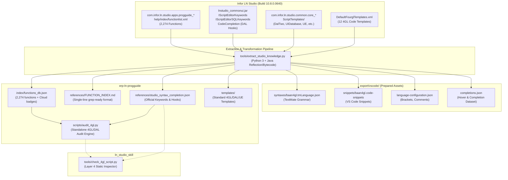

# Technical Specification: Infor LN Studio Build 0640 Dictionaries Extraction, Cloud Governance & Standalone 4GL Audit Engine

- **Document ID**: `SPEC-2026-0005`
- **Related ADR**: [`docs/adr/0005-progguide-studio-dictionaries-and-audit-engine.md`](adr/0005-progguide-studio-dictionaries-and-audit-engine.md)
- **Target Skills**: `erp-ln-progguide` (Primary), `ln_studio_skill` (Synchronized Rule Consumer)
- **Source Artifacts**: `d:\LN Studio\April-2026\InforLNStudio_10_8_0_build0640-x86_64`

---

## 1. Architectural Overview & Component Diagram



---

## 2. Detailed Extraction Specifications

### 2.1 Function Catalog Extraction (`functions_db.json`)
The source file `com.infor.ln.studio.apps.progguide_10.8.0.0614/help/index/functionlist.xml` contains 2,274 `<Function>` nodes.

Each function must be parsed and stored as an entry in `erp-ln-progguide/index/functions_db.json` with the following schema:
```json
{
  "function_name": {
    "name": "cmf.create",
    "syntax": "long cmf.create( )",
    "return_type": "long",
    "script_type": "all",
    "trusted": false,
    "deprecated": false,
    "internal": false,
    "include": "bic_cmf",
    "description": "Creates a new Infor LN eMessage Connector message object.",
    "help_id": "/progguide/emessage_connector/cmf.create",
    "doc_path": "references/guide/progguide/emessage_connector/cmf.create.md"
  }
}
```

#### Field Derivations:
- `trusted`: `true` if attribute `Trusted="yes"`, else `false`.
- `deprecated`: `true` if attribute `Deprecated="yes"`, else `false`.
- `internal`: `true` if attribute `Internal="yes"`, else `false`.
- `include`: Attribute `include` value (normalized, e.g. `bic_dal`, `bic_json`, `bic_curl`).
- `script_type`: Text of child `<ScriptType>` (`all`, `DAL`, `4GL`, `UEDLL`, `3GL`, `SPT`).
- `doc_path`: Maps `HelpID` to the corresponding markdown file in `references/guide/progguide/...` if present on disk; otherwise `null`.

### 2.2 Studio Syntax & Completion Dictionaries (`studio_syntax_completion.json`)
Extracted from `lnstudio_commonui.jar` classes:
- `IScriptEditorKeywords.KEYWORDS`: 80 keywords
- `IScriptEditorSQLKeywords.SQL_KEYWORDS`: 92 SQL keywords
- `IScriptEditorProgramSections.PROGRAM_SECTIONS`: 9 program section headers
- `IScriptEditorSubSections.SUB_SECTIONS`: 43 subsections
- `IScriptEditorChoiceSections.CHOICE_SECTIONS`: 60 choice sections
- `IScriptEditorReportSections.REPORT_SECTIONS`: 9 report sections
- `IScriptEditorPredefinedVariables.PREDEFINED_VARIABLES`: 176 bshell predefined variables
- `IScriptEditorStandardDefines.STANDARD_DEFINES`: 49 standard defines
- `CodeCompletion.DAL_OBJECT_HOOKS`: 15 object-level hooks
- `CodeCompletion.DAL_FIELD_HOOK_SUFFIXES`: 10 property-level hook objects:
  - `.is.never.applicable`: `extern boolean <field>.is.never.applicable()`
  - `.is.applicable`: `extern boolean <field>.is.applicable()`
  - `.is.readonly`: `extern boolean <field>.is.readonly()`
  - `.is.derived`: `extern boolean <field>.is.derived()`
  - `.is.mandatory`: `extern boolean <field>.is.mandatory()`
  - `.is.valid`: `extern boolean <field>.is.valid()`
  - `.update`: `extern void <field>.update(long i.mode)`
  - `.make.valid`: `extern boolean <field>.make.valid()`
  - `.check`: `extern long <field>.check(long has_changed)`
  - `.set.defaults`: `extern void <field>.set.defaults()`

### 2.3 Official Script Templates
Extracted from:
- `com.infor.ln.studio.common.core_*.jar` under `ScriptTemplates/`:
  - `Bol`, `Dal`, `DalTwo`, `Function`, `Integration`, `Report`, `ThreeGL`, `UIDatabase`, `UserExitDLL`
- Saved to `erp-ln-progguide/templates/` with standardized `.cln`, `.dal`, `.ue` extensions.

---

## 3. Enriched `FUNCTION_INDEX.md` Format Specification

Replaces the plain signature index in `erp-ln-progguide/references/FUNCTION_INDEX.md`.

### Format Syntax:
```markdown
- **<name>** | `[Cloud: <Trusted|Untrusted>]` `[Deprecated]` `[Scope: <type>]` `[Inc: <<header>>]` | `<normalized_signature>` -> `<relative_md_link>`
```

### Examples:
- `- **dal.set.error.message** | [Cloud: Trusted] [Scope: DAL] [Inc: <bic_dal>] | function void dal.set.error.message( string msg.id, ... ) -> references/guide/progguide/functions_dal/dal.set.error.message.md`
- `- **cmf.addobjecttomessage** | [Cloud: Untrusted] [Deprecated] [Scope: all] [Inc: <bic_cmf>] | function long cmf.addobjecttomessage( long oid, long mid, string class(100) ) -> references/guide/progguide/emessage_connector/cmf.addobjecttomessage.md`
- `- **json.get.string** | [Cloud: Trusted] [Scope: all] [Inc: <bic_json>] | function long json.get.string( long node, string path, ref string value ) -> references/guide/progguide/functions_json/json.get.string.md`

Rules:
1. Every entry MUST reside on exactly one single physical line for high-speed grep execution.
2. Grouped alphabetically by function prefix (same as current index layout).
3. If no markdown doc exists, the arrow points to `index/functions_db.json#<name>`.

---

## 4. Standalone 4GL & DAL Audit Engine Specification (`scripts/audit_4gl.py`)

### 4.1 CLI Interface
```bash
python <skill_dir>/scripts/audit_4gl.py <target_path> [options]

Arguments:
  target_path             Path to a 4GL file (.cln, .dalsrc, .lib, etc.) or directory

Options:
  --mode [general|dal2|uedll]   Enforce specific script archetype rules (default: auto-detected from filename/extension)
  --cloud                       Enforce Infor LN CloudSuite Multi-Tenant restrictions (prohibit untrusted functions)
  --format [text|json]          Output format: colored text summary table or JSON diagnostics (default: text)
  --severity [error|warning|info] Minimum severity level to report (default: info)
  --strict                      Exit with non-zero status code if ANY warning or error is found
```

### 4.2 Audit Rule Catalog

| Rule Code | Severity | Description | Condition / Detection |
|---|---|---|---|
| **SYN001** | `ERROR` | Unbalanced Block Statement | Mismatched `select/endselect`, `if/endif`, `for/endfor`, `while/endwhile`, `case/endcase`, `{}` |
| **SYN002** | `ERROR` | Unknown Section Header | Section declaration outside standard `IScriptEditorProgramSections` or `IScriptEditorChoiceSections` |
| **DAL001** | `ERROR` | Interactive UI in DAL/Table Extension | Calling `message()`, `ask.enum()`, `box()`, `input.string()` inside DAL2 or Table Extension (`est`) |
| **DAL002** | `ERROR` | Invalid DAL Field Hook Signature | DAL hook missing required arguments (e.g. `<field>.update` without `long i.mode`, `<field>.check` without `long has_changed`) |
| **DAL003** | `ERROR` | Invalid DAL Return Statement | Hook returning invalid status type (e.g. boolean hook returning numeric non-0/1, or missing `DALHOOKERROR`) |
| **DAL004** | `ERROR` | Raw Database Mutation in UI Script | Direct `db.insert`, `db.update`, `db.delete`, `db.write` inside UI script (violates SoC) |
| **CLD001** | `WARNING/ERROR` | Untrusted Function in Cloud Mode | Calling bshell function flagged `Trusted="no"` when `--cloud` flag is set |
| **CLD002** | `WARNING` | Deprecated Function Invocation | Calling bshell function flagged `Deprecated="yes"` in `functions_db.json` |
| **INC001** | `WARNING` | Missing Required Header Include | Calling library functions (e.g. `json.*`, `cmf.*`, `curl.*`) without corresponding `#include <bic_...>` |
| **CAV001** | `WARNING` | Direct Floating-Point Equality | Direct comparison `double_var == ...` instead of epsilon check or tolerance range |
| **CAV002** | `INFO` | Primitive Declaration instead of Domain | Using raw `long`, `string(X)` for database table column keys instead of Data Dictionary Domains |
| **CAV003** | `WARNING` | Nested Transaction in Subroutine | Calling `db.retry.point()` or `commit.transaction()` inside DAL hooks or reusable subroutines |

### 4.3 JSON Diagnostic Output Schema
When `--format json` is provided, `audit_4gl.py` outputs:
```json
{
  "summary": {
    "total_files": 1,
    "error_count": 1,
    "warning_count": 2,
    "info_count": 0,
    "status": "FAILED"
  },
  "diagnostics": [
    {
      "file": "path/to/myscript.dalsrc",
      "line": 42,
      "column": 5,
      "severity": "ERROR",
      "code": "DAL001",
      "message": "Interactive dialog 'message()' is prohibited in DAL scripts; use 'dal.set.error.message()' instead.",
      "snippet": "message(\"Validation failed\");"
    }
  ]
}
```

---

## 5. Synchronized Rule Alignment with `ln_studio_skill`

To prevent rule drift between skills:
1. `ln_studio_skill/tools/check_4gl_script.py` will import or reference `studio_syntax_completion.json` and `functions_db.json`.
2. The Layer 4 script verification in `ln_studio_skill` will execute the exact same AST/token inspection rules for DAL2 hooks, header includes, and block balance.

---

## 6. VS Code Extension Assets Package (`export/vscode/`)

Ready-to-use artifacts exported for future VS Code extension development:

### 6.1 `syntaxes/baan4gl.tmLanguage.json`
- `$schema`: `https://raw.githubusercontent.com/martinring/tmlanguage/master/tmlanguage.json`
- `scopeName`: `source.baan4gl`
- Token categories:
  - `keyword.control.4gl`: `if`, `then`, `else`, `while`, `for`, `case`, `repeat`, `until`, `break`, `continue`, `return`, `goto`
  - `keyword.section.4gl`: `declaration:`, `before.program:`, `functions:`, `choice.*:`, `field.*:`, `main.table.io:`
  - `keyword.operator.sql.4gl`: `select`, `from`, `where`, `order by`, `as prepared set`, `as set with 1 rows`, `selectdo`, `selectempty`, `endselect`
  - `storage.type.4gl`: `domain`, `long`, `string`, `double`, `boolean`, `table`, `extern`, `global`, `fixed`, `const`, `ref`
  - `comment.line.pipe.4gl`: `\|\.*$`
  - `support.function.bshell.4gl`: 2,274 functions from `functions_db.json`
  - `variable.language.predefined.4gl`: 176 predefined variables

### 6.2 `snippets/baan4gl.code-snippets`
- Common 4GL snippets: `case`, `for`, `while`, `selectdo`, `dllusage`, `functionusage`
- DAL2 hook snippets:
  - `dal.hook.is.applicable`
  - `dal.hook.is.readonly`
  - `dal.hook.update`
  - `dal.hook.check`
  - `dal.hook.before.save.object`
  - `dal.hook.after.save.object`

### 6.3 `language-configuration.json`
- `comments`: `{ "lineComment": "|" }`
- `brackets`: `[["{", "}"], ["(", ")"], ["[", "]"]]`
- `autoClosingPairs`: quotes and brackets
- `surroundingPairs`: quotes and brackets

### 6.4 `completions.json`
- JSON array of completion proposals for 2,274 functions with Markdown parameter docs, return types, and cloud badges.

---

## 7. Test Suite Specification (`erp-ln-progguide/tests/test_audit_4gl.py`)

A comprehensive unit test suite executing via `python -m unittest discover -s erp-ln-progguide/tests`:
1. `test_valid_dal2_script`: Asserts 0 errors and 0 warnings on fully compliant DAL2 script.
2. `test_dal_interactive_dialog_rejection`: Asserts `DAL001` triggered when `message()` or `ask.enum()` is present.
3. `test_dal_hook_signature_validation`: Asserts `DAL002` triggered when `.update` lacks `long i.mode` or `.check` lacks `long has_changed`.
4. `test_cloud_untrusted_function`: Asserts `CLD001` triggered in `--cloud` mode on untrusted function call.
5. `test_missing_include_header`: Asserts `INC001` triggered when calling `json.get.string()` without `#include <bic_json>`.
6. `test_anti_pattern_double_equality`: Asserts `CAV001` triggered on `if double_val == 100.0`.
7. `test_unbalanced_block_detection`: Asserts `SYN001` triggered on unclosed `select` or `if`.
8. `test_json_output_format`: Asserts schema compliance of `--format json` output.
