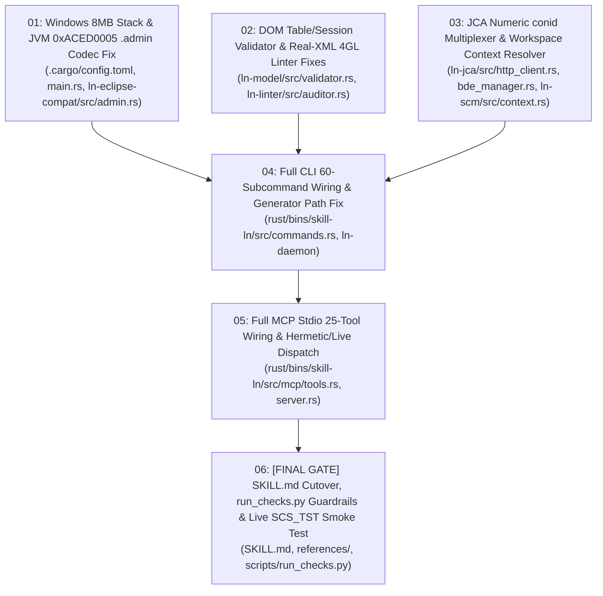

# Task Tickets: 100% Native Rust Single-Binary Architecture (`skill-ln` — ADR 0021)

- **Active Phase 6 Specification**: [`docs/plans/SPEC_RUST_SKILL_LN_PRODUCTION_HARDENING.md`](SPEC_RUST_SKILL_LN_PRODUCTION_HARDENING.md) ([`.scratch/rust-skill-ln-production-hardening/spec.md`](../../.scratch/rust-skill-ln-production-hardening/spec.md))
- **Active Phase 6 Implementation Plan**: [`docs/plans/rust-skill-ln-production-hardening-plan.md`](rust-skill-ln-production-hardening-plan.md)
- **Active Phase 6 Wayfinder Map**: [`.scratch/rust-skill-ln-production-hardening/map.md`](../../.scratch/rust-skill-ln-production-hardening/map.md)
- **Parent Architecture Spec (Phases 1–5)**: [`docs/plans/SPEC_NATIVE_RUST_SKILL_LN.md`](SPEC_NATIVE_RUST_SKILL_LN.md) ([`.scratch/native-rust-skill-ln/spec.md`](../../.scratch/native-rust-skill-ln/spec.md))
- **Architecture Decision Record**: [`docs/adr/0021-native-rust-skill-ln-single-binary-architecture.md`](../adr/0021-native-rust-skill-ln-single-binary-architecture.md)
- **Target Skills**: `erp-ln-progguide`, `ln_studio_skill`
- **Target Model for Execution**: `flash` (Gemini 3.8 Flash High)

---

## Active Batch: Phase 6 Production Hardening & Live CloudSuite Integration (`SCS_TEST` / `dev_natt_v01108-1`)

### Phase 6 Ticket Roster (6 Self-Contained Tracer-Bullet Slices)

- **Local Issues Directory**: [`.scratch/rust-skill-ln-production-hardening/issues/`](../../.scratch/rust-skill-ln-production-hardening/issues/)

| ID | Phase | Title | Blocked by | What It Delivers | Status | Ticket File |
|---|---|---|---|---|---|---|
| **01** | Phase 6 | Windows 8MB Main Thread Stack & JVM `0xACED0005` `.admin` Serialization Handle Fix | *None (can start immediately)* | Configures `/STACK:8388608` (`8 MB`) in `rust/.cargo/config.toml` + `main.rs`, fixes `TC_CLASSDESC`/`TC_OBJECT` handle allocation order (`0x007E0000`–`0x007E0005`) and `TC_REFERENCE`/`TC_STRING` `m_path` handling in `ln-eclipse-compat/src/admin.rs`, and verifies against real `dev_natt_v01108-1/.admin` | `open` | [`01-windows-stack-and-java-admin-serialization-fix.md`](../../.scratch/rust-skill-ln-production-hardening/issues/01-windows-stack-and-java-admin-serialization-fix.md) |
| **02** | Phase 6 | DOM-Based `.tbl`/`.ses` XML Validator (`roxmltree`) & Real-Workspace 4GL Linter (`ln-linter`) Fixes | *None (can start immediately)* | Replaces naive regexes in `ln-model/src/validator.rs` with `roxmltree` direct-child `<Column><name>` and `<IndexColumn><column>` traversal, adds Single-XML `<expression>` extraction/unescaping + `ext.get.*` `long` return whitelist (`EXT003`) + dotted `.return.` boundary fix (`DAL003`) in `ln-linter/src/auditor.rs`, and verifies 0 false positives on `dev_natt_v01108-1` | `open` | [`02-roxmltree-table-validator-and-linter-real-xml-fixes.md`](../../.scratch/rust-skill-ln-production-hardening/issues/02-roxmltree-table-validator-and-linter-real-xml-fixes.md) |
| **03** | Phase 6 | JCA Numeric `conid` Session Multiplexer (`ln-jca`) & Workspace Context Resolver (`ln-scm`) | *None (can start immediately)* | Adds `ConnectionRegistry` to `HttpClient` resolving `"ProjectServer"` $\rightarrow$ primary `<conid>` from `connect()` (`0`) and repo addresses (`"EXTce01108_dev"`) $\rightarrow$ shared `<conid>` from `share()` (`1`), enforces numeric `conid` in mock JCA servers, and implements `ln_scm::context::WorkspaceContext` (`.prefs`, `.project`, `Pre-Fetch-Auth-Gate`) | `open` | [`03-jca-conid-session-resolver-and-workspace-discovery.md`](../../.scratch/rust-skill-ln-production-hardening/issues/03-jca-conid-session-resolver-and-workspace-discovery.md) |
| **04** | Phase 6 | Full CLI 60-Subcommand Wiring (`commands.rs`), Single-XML Generator Path Fix & Daemon Integration | **01, 02, 03** | Fixes `message`, `question`, `function`, `additional`, `report` to use `ln_model::generators::*` and `resolve_component_path` (`{pkg}/emess/`, etc.), wires all 30+ server/SCM/code-intel/daemon subcommands in `commands.rs` to `WorkspaceContext`, `ln-scm`, and `ln-daemon`, and verifies via stateful mock JCA tests | `open` | [`04-daemon-and-cli-60-subcommands-full-wiring.md`](../../.scratch/rust-skill-ln-production-hardening/issues/04-daemon-and-cli-60-subcommands-full-wiring.md) |
| **05** | Phase 6 | Full MCP Stdio 25-Tool Wiring (`mcp/tools.rs`) & Hermetic/Live Dispatch | **04** | Wires all 25 MCP tools in `rust/bins/skill-ln/src/mcp/tools.rs` to async `ln-scm`, `ln-model`, `ln-linter`, `ln-auth`, and `ln-daemon` (preserving hermetic test mode when offline), fixes `ln_create_component` for all 12 component types, and tests child-process `mcp-stdio` against stateful mock JCA | `open` | [`05-mcp-stdio-25-tools-full-wiring.md`](../../.scratch/rust-skill-ln-production-hardening/issues/05-mcp-stdio-25-tools-full-wiring.md) |
| **06** | Phase 6 | **[FINAL GATE]** `SKILL.md` Cutover (`<= 80` Lines), `run_checks.py` Guardrails & Live `SCS_TST` Verification | **05** | Updates `ln_studio_skill/SKILL.md` & `erp-ln-progguide/SKILL.md` (`<= 80` lines) + `references/` to invoke `skill-ln`, adds Suite 4d anti-stub & process-level binary check to `scripts/run_checks.py`, rebuilds release zip, and runs live end-to-end verification on `SCS_TST` (`EXTce01108` / `dev_natt_v01108-1`) | `open` | [`06-skill-markdown-cutover-and-live-scs-test-verification.md`](../../.scratch/rust-skill-ln-production-hardening/issues/06-skill-markdown-cutover-and-live-scs-test-verification.md) |

---

## Completed Foundation Roster (Phases 1–5 — 15 Tracer-Bullet Vertical Slices)

- **Local Issues Directory**: [`.scratch/native-rust-skill-ln/issues/`](../../.scratch/native-rust-skill-ln/issues/)

| ID | Phase | Title | Blocked by | What It Delivers | Status | Ticket File |
|---|---|---|---|---|---|---|
| **01** | Phase 1 | Cargo Workspace Scaffold & `ln-eclipse-compat` Binary Codecs | *None* | Initializes `rust/` Cargo Workspace and pure-Rust `.admin` (`0xACED0005` `AdministrationComponent` `serialVersionUID=2L`), `properties.index` (`PropertyBucket` v1), `.markers` (`MarkerReader_3` v3), and `.metadata/.lock` detector | `resolved` | [`01-cargo-workspace-and-eclipse-binary-codecs.md`](../../.scratch/native-rust-skill-ln/issues/01-cargo-workspace-and-eclipse-binary-codecs.md) |
| **02** | Phase 1 | `ln-auth` 3-Tier OAuth2 Lifecycle, `.ionapi` & `Pre-Fetch-Auth-Gate` | **01** | Implements `.ionapi` & Eclipse `.prefs` parsers, 3-Tier OAuth2 token lifecycle (`~/.ln_studio/tokens/<workspace>.json`), local loopback OOB listener (`oob://localhost/lnstudio`), and `Pre-Fetch-Auth-Gate` | `resolved` | [`02-oauth2-lifecycle-and-ionapi-auth.md`](../../.scratch/native-rust-skill-ln/issues/02-oauth2-lifecycle-and-ionapi-auth.md) |
| **03** | Phase 1 | `ln-jca` Clean-Room JCA HTTP/1.1 Wire Client & 5-Mode `JcaBdeManager` | **01, 02** | Implements `HttpClient` (`connect`, `share`, `bdecall`, `ping`, `disconnect`), all 5 `BdeManager` modes (`LIST`, `SHOW`, `BDE`, `SPECIALLIST`, `BROWSELIST`), 250-item `<iteratorID>` pagination, `ControllingAttributes`, `rustls-tls-native-certs`, and `EndActivity`/`CloseTask` hard-block | `resolved` | [`03-jca-http-wire-protocol-and-5-mode-bdemanager.md`](../../.scratch/native-rust-skill-ln/issues/03-jca-http-wire-protocol-and-5-mode-bdemanager.md) |
| **04** | Phase 1 | **[CHECKPOINT 1]** `ln-daemon` Single-Leader Native Daemon & Phase 1 Gate | **01, 02, 03** | Implements per-workspace Single-Leader daemon (`daemon_<workspace_hash>.lock`), Sequential FIFO Command Queue (`Pool Size = 1` `bshell`), token hot-swap, keepalive timer, and clears Phase 1 Gate | `resolved` | [`04-checkpoint-1-single-leader-daemon-and-phase-1-gate.md`](../../.scratch/native-rust-skill-ln/issues/04-checkpoint-1-single-leader-daemon-and-phase-1-gate.md) |
| **05** | Phase 2 | `ln-kb` Zero-Copy Embedded Knowledge Base (`rkyv`) & Search | **01** | Embeds `functions_db.json` (2,266 bshell functions), `studio_syntax_completion.json`, and doc index at compile time (`0 ms` startup parse) and delivers `< 1 ms` `fn-search` and `doc-search` | `resolved` | [`05-zero-copy-knowledge-base-and-search.md`](../../.scratch/native-rust-skill-ln/issues/05-zero-copy-knowledge-base-and-search.md) |
| **06** | Phase 2 | `ln-linter` Part 1: Baan 4GL Lexer, AST & 15 Core Syntax/Cloud/DAL Rules | **05** | Implements 4GL lexer, AST block parser, and 15 rules (`SYN001`–`002`, `INC001`, `ARR002`, `SQL008`, `STR001`, `CAV001`, `DBG001`, `CLD001`–`002`, `DAL001`–`005`) with differential parity tests against `audit_4gl.py` | `resolved` | [`06-4gl-lexer-ast-parser-and-core-syntax-dal-rules.md`](../../.scratch/native-rust-skill-ln/issues/06-4gl-lexer-ast-parser-and-core-syntax-dal-rules.md) |
| **07** | Phase 2 | **[CHECKPOINT 2]** `ln-linter` Part 2: Call Graph, DD Cache, `EXT001`–`003` & Phase 2 Gate | **06** | Completes all 25 lint rules (`CAV003`, `TBL001`–`003`, `DMN001`–`003`, `EXT001`–`003`), `.ln_dd_cache.json` integration, `rayon` parallel auditing, and clears Phase 2 100% Parity Gate against `audit_4gl.py` | `resolved` | [`07-checkpoint-2-call-graph-dd-cache-ext-rules-and-phase-2-gate.md`](../../.scratch/native-rust-skill-ln/issues/07-checkpoint-2-call-graph-dd-cache-ext-rules-and-phase-2-gate.md) |
| **08** | Phase 3 | Bytecode-to-JSON TDE Schema Extractor (`tde_schema_0640.json`) | **01** | Extracts all 129 `model.tde.*` classes, `.model.additional.*`, 39 `owtemplates/*.xml`, and 9 `ScriptTemplates/` from Build 0640 JARs into `rust/schemas/tde_schema_0640.json` and `build_0640_manifest.json` | `resolved` | [`08-tde-bytecode-schema-extractor-and-owtemplates-bundle.md`](../../.scratch/native-rust-skill-ln/issues/08-tde-bytecode-schema-extractor-and-owtemplates-bundle.md) |
| **09** | Phase 3 | `ln-model` Part 1: 12-Component XML Generators & Declarative YAML | **08** | Implements XML generators for all 12 component types (`.tbl`, `.ses`, `.dmn`, `.lib`, `.mnu`, `.lbl`, `.rpt`, `.msg`, `.qst`, `.fnc`, `.add`, `.bus`/`.cha`), multi-component YAML compiler, and Single-XML TDE path resolver | `resolved` | [`09-12-component-xml-generators-and-declarative-yaml.md`](../../.scratch/native-rust-skill-ln/issues/09-12-component-xml-generators-and-declarative-yaml.md) |
| **10** | Phase 3 | **[CHECKPOINT 3]** `ln-model` Part 2: Lossless DOM Surgery, Unknown Node Inspector & Phase 3 Gate | **07, 09** | Implements Lossless DOM Surgery (`inject`, `extract`, `clone-component`, `Pre-Put Script Merge`), Unknown Node Inspector (`unmapped_packets.log`), 4-Layer `validate --fix`, and clears Phase 3 Gate | `resolved` | [`10-checkpoint-3-lossless-dom-surgery-unknown-node-inspector-and-phase-3-gate.md`](../../.scratch/native-rust-skill-ln/issues/10-checkpoint-3-lossless-dom-surgery-unknown-node-inspector-and-phase-3-gate.md) |
| **11** | Phase 4 | `ln-scm` Part 1: Software Project/Activity Lifecycle & Component Explorer | **04, 10** | Implements `project-info`, `new-activity`, `open-activity` (with `CMLabel.GetModifiedComponents` + `CmGet`), `clean-activity`, `move/clean-components`, `GetBrowseList`, `sync-reference` (`.ln_dd_cache.json`), and `DR_Create` | `resolved` | [`11-software-project-activity-lifecycle-and-component-explorer.md`](../../.scratch/native-rust-skill-ln/issues/11-software-project-activity-lifecycle-and-component-explorer.md) |
| **12** | Phase 4 | `ln-scm` Part 2: Pre-Commit SCM Engine, Split `deploy-test` & Extension Modeler | **11** | Implements `CheckOut`, `UnCheckOut`, `Put`, `CheckIn`, `[GET_ONLY_EXTENSION]` guard, Extension `Guide-and-Paste` workflow, `Compile`, `CRDD`, `CreateTables`, `VSC.executeVSC`, split `deploy-test`, and `prepare-end-activity` | `resolved` | [`12-precommit-scm-engine-and-build-pipeline.md`](../../.scratch/native-rust-skill-ln/issues/12-precommit-scm-engine-and-build-pipeline.md) |
| **13** | Phase 4 | **[CHECKPOINT 4]** `ln-scm` Part 3: `FglStudio` Code Intelligence, Revision Diff & Phase 4 Gate | **12** | Implements `compile-source`, `search-server`, `call-hierarchy`, `open-declaration`, `related-components`, `revisions`, `diff-component`, `generate-report-server`, and clears Phase 4 Gate | `resolved` | [`13-checkpoint-4-fglstudio-code-intelligence-revision-diff-and-phase-4-gate.md`](../../.scratch/native-rust-skill-ln/issues/13-checkpoint-4-fglstudio-code-intelligence-revision-diff-and-phase-4-gate.md) |
| **14** | Phase 5 | `ln-verify` Crash Fixtures, Auto-Fallback (`LN_FALLBACK_MODE`) & `verify-studio-build` | **08, 13** | Implements token-redacted Crash Fixture recorder (`unmapped_packets/`), `LN_FALLBACK_MODE=auto\|strict\|off` fallback bridge, and pure-Rust `0xCAFEBABE` classfile & `owtemplates` build differ | `resolved` | [`14-auto-fallback-crash-fixtures-and-verify-studio-build.md`](../../.scratch/native-rust-skill-ln/issues/14-auto-fallback-crash-fixtures-and-verify-studio-build.md) |
| **15** | Phase 5 | **[CHECKPOINT 5]** Unified `skill-ln` Binary (60 CLI Cmds + 25 MCP Tools) & Final Gate | **14** | Wires all 60 CLI subcommands and 25 Stdio MCP tools into `bins/skill-ln`, integrates `cargo test` into `scripts/run_checks.py`, and clears Final Checkpoint 5 Gate | `resolved` | [`15-checkpoint-5-unified-cli-mcp-server-and-final-cutover-gate.md`](../../.scratch/native-rust-skill-ln/issues/15-checkpoint-5-unified-cli-mcp-server-and-final-cutover-gate.md) |
