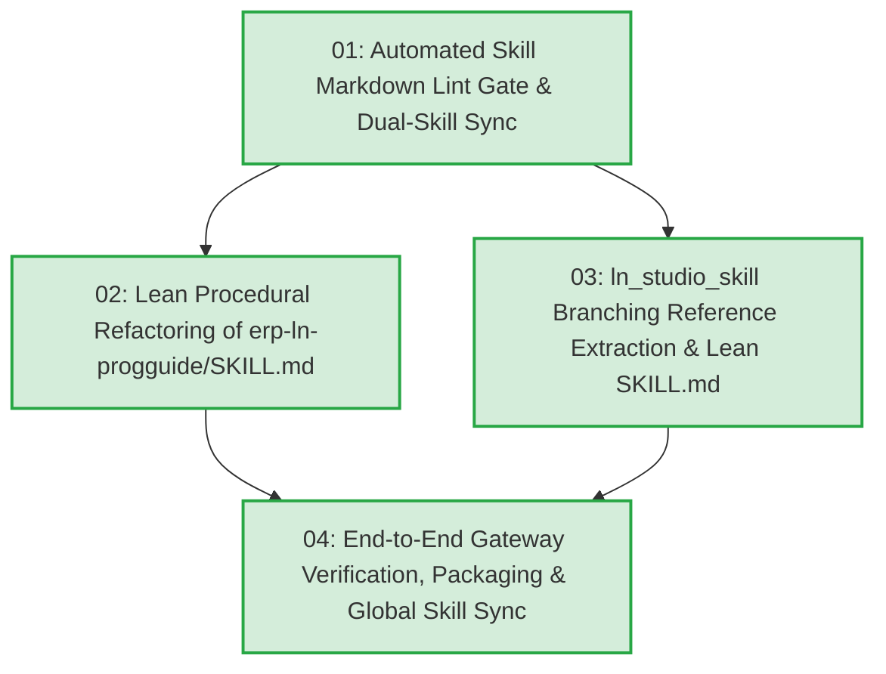

# Task Tickets: Lean Skill Architecture, Progressive Disclosure & Automated Skill Lint Gate

- **Active Specification**: [`docs/plans/SPEC_LEAN_SKILL_ARCHITECTURE.md`](SPEC_LEAN_SKILL_ARCHITECTURE.md) (`.scratch/lean-skill-architecture/spec.md`)
- **Active Implementation Plan**: [`docs/plans/PLAN_LEAN_SKILL_ARCHITECTURE.md`](PLAN_LEAN_SKILL_ARCHITECTURE.md)
- **Architecture Decision Record**: [`docs/adr/0017-lean-skill-architecture-and-progressive-disclosure.md`](../adr/0017-lean-skill-architecture-and-progressive-disclosure.md)
- **Target Skills**: `erp-ln-progguide`, `ln_studio_skill`

---

## Active Batch Dependency Graph (`Batch: Lean Skill Architecture & Progressive Disclosure — ADR 0017`)

---

## Active Ticket Roster

- **Local Issues Directory**: [`.scratch/lean-skill-architecture/issues/`](../../.scratch/lean-skill-architecture/issues/)

| ID | Title | Blocked by | What It Delivers | Status | Ticket File |
|---|---|---|---|---|---|
| **01** | Automated Skill Markdown Lint Gate & Dual-Skill Synchronization | *None (can start immediately)* | Enforces `<= 80` lines, frontmatter validity, and 0 broken relative links for both `SKILL.md` files in `scripts/run_checks.py`, plus dual-skill `--sync-skill` and unit tests | `resolved` | [`01-skill-markdown-lint-gate-and-dual-sync.md`](../../.scratch/lean-skill-architecture/issues/01-skill-markdown-lint-gate-and-dual-sync.md) |
| **02** | Lean Procedural Refactoring of `erp-ln-progguide` Skill | **01** | Refactors `erp-ln-progguide/SKILL.md` from 170 lines to `<= 80` lines with natural Context Pointer (`Do NOT use for...`) and 4-step workflow (`Search-Before-Read` -> `Audit-Before-Deliver`) | `resolved` | [`02-lean-erp-ln-progguide-skill-refactoring.md`](../../.scratch/lean-skill-architecture/issues/02-lean-erp-ln-progguide-skill-refactoring.md) |
| **03** | `ln_studio_skill` Branching Reference Extraction & Lean Procedural Skill | **01** | Extracts `CLI_REFERENCE.md`, `MCP_TOOLS_REFERENCE.md`, and `AUTHORING_SCHEMA_GUIDE.md`, strips implementation sediment, and reduces `ln_studio_skill/SKILL.md` from 430 lines to `<= 80` lines | `resolved` | [`03-ln-studio-branching-references-and-lean-skill.md`](../../.scratch/lean-skill-architecture/issues/03-ln-studio-branching-references-and-lean-skill.md) |
| **04** | End-to-End Gateway Verification, Release Packaging & Global Skill Sync | **02, 03** | Runs full `run_checks.py` gate, verifies release ZIP packaging, and synchronizes both lean skills to `~/.gemini/config/skills/` with 0 drift | `resolved` | [`04-end-to-end-verification-and-global-skill-sync.md`](../../.scratch/lean-skill-architecture/issues/04-end-to-end-verification-and-global-skill-sync.md) |
