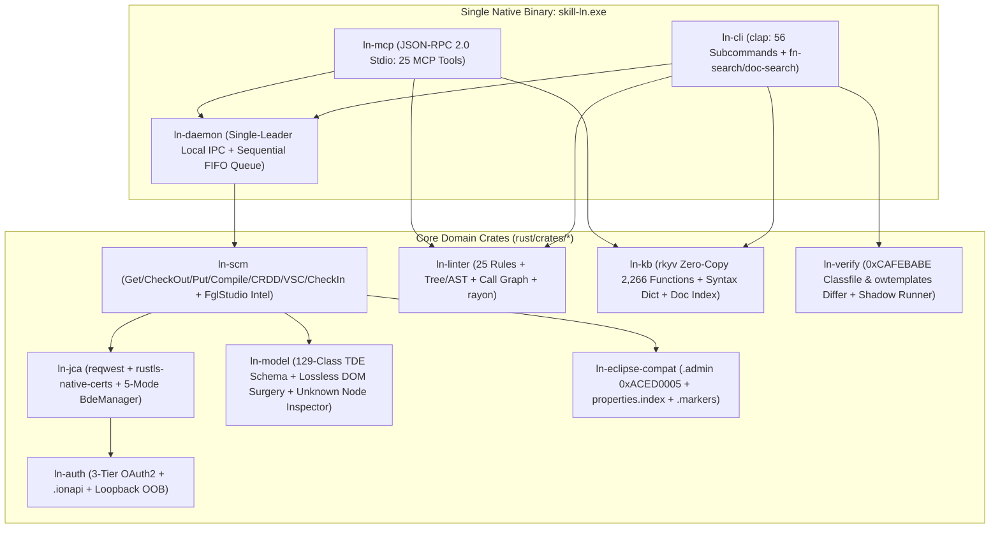
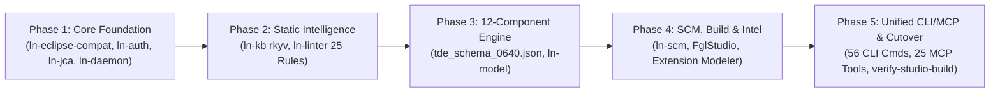

# Master Implementation Plan: 100% Native Rust `skill-ln` Single-Binary Architecture

- **Architecture Decision Record**: [`docs/adr/0021-native-rust-skill-ln-single-binary-architecture.md`](../adr/0021-native-rust-skill-ln-single-binary-architecture.md)
- **Domain Glossary**: [`docs/glossary/GLOSSARY.md`](../glossary/GLOSSARY.md)
- **Target Artifact**: Single Native Binary (`skill-ln.exe` / `skill-ln`) unifying `ln_studio_skill` (56 CLI commands, 25 MCP tools) and `erp-ln-progguide` (25 static 4GL lint rules, 2,266 bshell function index, offline doc search) with **0% Java/JDK and 0% Infor JAR runtime dependencies**.

---

## 1. Executive Summary & Architectural Goals

1. **100% Cutover from Eclipse RCP,Infor JARs, and JDK 11+ at Runtime**:
   - Implement the exact Infor LN JCA HTTP/XML wire protocol (`com.infor.erpln.protocol.HttpClient` + `JcaBdeManager`), Eclipse `.admin` Java Object Serialization (`0xACED0005`), `properties.index` (`PropertyBucket`), and `.markers` (`MarkerReader_3`) directly in safe, native Rust.
   - Run anywhere with **only an `.ionapi` file and a workspace directory** (`Zero-JAR Standalone Runtime`).
2. **Sub-Millisecond Cold Start & Minimal Footprint**:
   - Cold CLI startup `< 5 ms`, background workspace daemon RSS `< 15 MB`, and `0 ms` startup dictionary loading via compile-time `rkyv` zero-copy archives.
3. **100% Eclipse GUI Coexistence & Pre-Commit Safety Boundary**:
   - Preserve byte-exact `.admin`, `properties.index`, and Single-XML TDE layout (`{pkg}/{type}/{mod}/{name}.{ext}`) so engineers can still open Eclipse LN Studio GUI on the same workspace to review or click `End Activity`.
   - Physically hard-block `EndActivity`, `CloseTask`, `FinalizeActivity`, and `<End/>` / `<Deliver/>` at the Rust transport layer (ADR 0007).
4. **Zero-Omission Guarantee (4-Layer Safety Net)**:
   - Mathematical extraction of all 129 TDE classes from `lnstudio_commoncore.jar` into `tde_schema_0640.json` + **Lossless DOM Surgery** + **Unknown Node Inspector (`unmapped_packets.log`)** + **Sanitized Crash Fixture & Auto-Fallback (`LN_FALLBACK_MODE`)** + **Built-in Build Differ (`skill-ln verify-studio-build`)**.

---

## 2. Component & Crate Mapping (Eclipse / Python $\rightarrow$ Native Rust Cargo Workspace)



| Eclipse / Legacy Python Component | Target JAR / Source Inspected via REA | Rust Crate (`rust/crates/*`) | Key Rust Dependencies |
|---|---|---|---|
| **JCA Transport & 5-Mode BDE Client** | `JCAAdapter4ERPln-10.8.10.jar`, `LNStudioJcaBridge.java` | `ln-jca` | `reqwest` (`rustls-tls-native-certs`), `tokio`, `roxmltree`, `quick-xml`, `url` |
| **Single-Leader Persistent Daemon** | `LNStudioJcaBridge --daemon` (ADR 0012) | `ln-daemon` | `tokio::net::TcpListener`, `fs4` (file lock), `serde_json` |
| **OAuth2 & `.ionapi` Lifecycle** | `ln_env_manager.py`, `capture_oob.py`, `cloudenv.prefs` | `ln-auth` | `reqwest`, `serde_json`, `sha2`, `keyring` (optional) |
| **12-Component TDE Models & XML Surgery** | `lnstudio_commoncore.jar` (`model.tde.concrete.*`, 129 classes), `fourglstudio_core.jar` (`.additional.*`) | `ln-model` | `roxmltree`, `quick-xml`, `serde`, `indexmap` |
| **Eclipse Binary Metadata Codecs** | `AdminSyncHelper.java` (`.admin`), `properties_index.py`, `ln_error_reader.py` (`.markers`) | `ln-eclipse-compat` | `byteorder`, `cesu8` (Modified UTF-8 for Java `0xACED0005`) |
| **SCM, Build Pipeline & Code Intelligence** | `ln_scm_engine.py`, `ln_build_pipeline.py`, `ln_code_intelligence.py`, `owtemplates/*.xml` (39 files) | `ln-scm` | `tokio`, `roxmltree`, `quick-xml`, `similar` (structural diff) |
| **25-Rule 4GL Static Linter & Call Graph** | `erp-ln-progguide/scripts/audit_4gl.py`, `check_4gl_script.py` | `ln-linter` | `logos` (lexer), `rowan` / custom AST, `petgraph` (call graph), `rayon` |
| **Zero-Copy Knowledge Base & Search** | `functions_db.json` (2,266 funcs), `studio_syntax_completion.json`, `erp-ln-progguide/scripts/search.py` | `ln-kb` | `rkyv` (zero-copy mmap/static), `zstd`, `regex`, `memchr` |
| **Build Upgrade Differ & Fallback Harness** | New capability (`Strategy #1–#4`) | `ln-verify` | `zip`, custom JVM `.class` (`0xCAFEBABE`) constant-pool reader |
| **Unified CLI & Stdio MCP Entrypoint** | `ln_component_builder.py` (56 cmds), `ln_studio_mcp.py` (25 tools) | `bins/skill-ln` | `clap` (derive), `tokio::io::stdio`, `tracing` |

---

## 3. Ground-Truth Technical Specifications (From REA Bytecode Disassembly)

### 3.1 JCA HTTP/1.1 & BDE Wire Protocol (`ln-jca`)

Disassembly of `com.infor.erpln.protocol.HttpClient`, `HttpSessionLayer`, and `com.infor.erpln.jca.bde.JcaBdeManager` inside `JCAAdapter4ERPln-10.8.10.jar` proved that `http_oauth2` (method `11`) has **no binary framing or custom encryption**:

1. **Base Endpoint**:
   `{gateway_url}/{tenant}/LN/webservice` (from `.ionapi` `iu` + `ti` + `/LN/webservice`).
2. **Standard HTTP Headers on Every Call**:
   - `Authorization: Bearer <access_token>`
   - `User-Agent: JCAWebClient (LNStudio)`
   - `Accept: application/xml`
   - `Cookie: <k1>=<v1>; <k2>=<v2>` (persisted from all `Set-Cookie` headers returned by `?method=connect`).
3. **Wire Operations**:
   - **Connect (`GET`)**:
     `?method=connect[&environment=<bse>][&company=<company>][&command=<cmd>][&clientHost=<host>][&clientIp=<ip>]`
     - Parses `<ConnectResponse><company>...</company><lnuser>...</lnuser><timeout>300</timeout><conid>1</conid><version>1</version></ConnectResponse>`.
     - Starts background keepalive task firing `GET ?method=ping` every `(timeout * 1000) / 2` ms.
   - **Share Multiplexing (`GET`)** *(for `<Project>_dev` and `<devEnv>_admin` with `protocol=bw` / `<alias linkto="ProjectServer">`)*:
     `?method=share[&company=<company>]` using the same HTTP client & cookie jar $\rightarrow$ returns a new `<conid>` inside `<ConnectResponse>` sharing the underlying session.
   - **BDE Call (`POST`)**:
     `?method=bdecall&bdename=<bdeName>&bdemethod=<bdeMethod>&conid=<conid>`
     - Headers: `Content-Type: application/xml;charset=utf-8`, `Content-Length: <len>`
     - Response check: Read HTTP header `X-Infor-BDEException` (integer, default `0`). If `!= 0`, parse `<Result>` / `<InformationArea>` into `BdeExecutionError`.
   - **Disconnect (`GET`)**:
     `?method=disconnect[&conid=<conid>]`
4. **XML Envelope Framing (`<{methodName}Request>`)**:
   ```xml
   <{methodName}Request>
     <ControlArea>
       <Selection>
         <selectionAttribute>...</selectionAttribute>
       </Selection>
       <Filter>
         <!-- ComparisonExpression (eq, ne, lt, le, gt, ge, like) or LogicalExpression (and, or) -->
       </Filter>
       <ActivityID><activityUUID>{labelUUID}</activityUUID></ActivityID>
       <maxNumberOfObjects>...</maxNumberOfObjects>
       <iteratorID>0</iteratorID>
       <iteratorFetchSize>250</iteratorFetchSize>
       <!-- SpecificControlAttributes injected directly when matching methodName & direction in/inout -->
       <{ctrlAttrName}>{ctrlAttrValue}</{ctrlAttrName}>
     </ControlArea>
     <DataArea>
       <{bdeName}>...</{bdeName}>
     </DataArea>
   </{methodName}Request>
   ```
5. **5 Execution Modes & Auto-Pagination (`BdeElementIterator`)**:
   - `Mode 0 (LIST)` & `Mode 4 (BROWSELIST)`: Omit `<DataArea>`, send `<iteratorFetchSize>250</iteratorFetchSize>`, and while response `<ControlArea>` contains `<iteratorID>N</iteratorID>` (`N >= 0`), loop sending follow-up `<{methodName}Request><ControlArea><iteratorFetchSize>250</iteratorFetchSize><iteratorID>N</iteratorID></ControlArea></{methodName}Request>`, concatenating all `<DataArea>` children.
   - `Mode 3 (SPECIALLIST)`: Same `iteratorFetchSize=250` pagination loop as `LIST`, but includes `<DataArea><{bdeName}>...</{bdeName}></DataArea>` on the initial request.
   - `Mode 1 (SHOW)` & `Mode 2 (BDE)`: Single request with `<ControlArea>` + `<DataArea>`; returns the first child element of `<DataArea>`.

---

### 3.2 Eclipse Binary Formats in Pure Rust (`ln-eclipse-compat`)

1. **`.admin` (`java.io.ObjectOutputStream` `0xACED0005`)**:
   - Outer object: `java.util.HashMap` (`serialVersionUID = 362498820763181265L`, `0x0507DAC1C31660D1`, flags `0x03`, `loadFactor = 0.75f`, `threshold`, `TC_BLOCKDATA` 8 bytes `[buckets, size]`, followed by `size` `(Key, Value)` pairs, `TC_ENDBLOCKDATA` `0x78`).
   - Value class descriptor: `com.infor.ln.studio.common.core.cm.administration.AdministrationComponent` (`serialVersionUID = 2L`, `0x0000000000000002`, flags `SC_SERIALIZABLE = 0x02`).
   - Exact field table (7 fields sorted per JVM spec: 6 primitives alphabetically, then 1 object reference):
     1. `Z` `isCheckedout` (`u8`)
     2. `Z` `isCreated` (`u8`)
     3. `Z` `isEvercheckedIn` (`u8`)
     4. `Z` `isExpired` (`u8`)
     5. `Z` `m_isDirty` (`u8`)
     6. `Z` `m_isVSCHappy` (`u8`)
     7. `L` `m_path` (`Ljava/lang/String;`, exact project-relative path e.g. `tx/table/cmg/txcmg011.tbl`)
2. **`properties.index` (`org.eclipse.core.internal.properties.PropertyBucket`, Big-Endian)**:
   - `u8 version = 1`, `u32 entry_count`, followed by entries `[UTF path, u16 prop_count, [u8 qualifier_tag (1=INDEX i32 | 2=QNAME UTF), UTF local_name, UTF value]]`.
3. **`.markers` (`org.eclipse.core.internal.resources.MarkerReader_3`, Big-Endian)**:
   - `u32 version = 3`, loop until EOF `[UTF resource_path, u32 markers_len, [u64 id, u8 type_flag (1=INDEX u32 | 2=QNAME UTF), i16 attr_count, [UTF key, u8 val_type (1=bool, 2=i32, 3=UTF), val], u64 creation_time]]`.

---

### 3.3 12-Component TDE Schema & Lossless DOM Surgery (`ln-model`)

1. **Mathematical Schema Extraction (`rust/schemas/tde_schema_0640.json`)**:
   - `TDEParentNode` and `TDEProperties` in `lnstudio_commoncore.jar` serialize all 12 component types (`DR_Table`, `DR_Controller`, `DR_Domain`, `DR_Label`, `DR_Menu`, `DR_Message`, `DR_Question`, `DR_Report`, `DR_AdditionalFile`, `DR_BusinessObject`, `DR_Module`/`Procedure`, and `DR_Solution`) by reflecting over `public` non-static fields of 129 classes.
   - `scripts/extract_tde_schema.py` inspects the `.class` field tables and generic `Signature` attributes once to emit `rust/schemas/tde_schema_0640.json` (plus `.model.additional.*` from `fourglstudio_core.jar` and all 39 `owtemplates/*.xml`).
2. **Dual-Mode XML Engine**:
   - **Generator Mode (`create-*`)**: Builds new `.tbl`, `.ses`, `.dmn`, `.lib`, `.mnu`, `.lbl`, `.rpt`, `.msg`, `.qst`, `.fnc`, `.add` XML files using the exact field ordering of `TDEProperties.convertFieldsToNodes`.
   - **Lossless Surgery Mode (`inject`, `clone-component`, `put`)**: Parses existing server XML with `roxmltree` / token spans and patches only the target elements (e.g., `<expression><![CDATA[...]]></expression>`, component name/VRC headers) while preserving 100% of untouched XML nodes byte-for-byte.

---

## 4. 4-Layer Anti-Omission & Future Build Verification System

### Layer 1: Shadow / Differential Test Harness (`scripts/run_checks.py`)
- Keep the existing Python + Java code as the **Golden Reference Oracle** during development.
- Automated differential tests run every generator, `.admin` state transition, `properties.index` round-trip, `.markers` parse, and 4GL lint rule through both Python/Java and `skill-ln.exe`, asserting 100% canonical parity.

### Layer 2: Unknown Node Inspector (`~/.ln_studio/unmapped_packets.log`)
- Every XML response from `doBdeCall` and every component file loaded by `ln-model` is validated against `tde_schema_0640.json`.
- Any element or attribute not present in the schema is preserved in-memory (never dropped!) and logged to `~/.ln_studio/unmapped_packets.log` with component coordinates and XML path.

### Layer 3: Sanitized Crash Fixture & Auto-Fallback (`LN_FALLBACK_MODE`)
- Whenever `skill-ln` encounters an unhandled BDE error or XML parse failure:
  1. Redacts `Authorization` / OAuth2 secrets and writes a self-contained JSON/XML test fixture to `~/.ln_studio/unmapped_packets/<timestamp>_<bde>_<method>.json`.
  2. Depending on `LN_FALLBACK_MODE`:
     - `auto` (default during phase-in): Invokes the legacy Python/Java bridge for that single operation so live work succeeds without interruption.
     - `strict` (default in CI): Fails loud with the fixture path so tests catch every gap immediately.
     - `off`: Pure standalone mode.

### Layer 4: Built-In Build Upgrade Differ (`skill-ln verify-studio-build`)
- When Infor releases a new LN Studio build (after Build 0640), running `skill-ln verify-studio-build --studio-home "<path>"` inspects the new `plugins/*.jar` directly in Rust (parsing ZIP entries, JVM `0xCAFEBABE` classfile constant pools/fields/`serialVersionUID`, `owtemplates/*.xml`, and `functions_db`) and outputs a complete diff report against the embedded Build 0640 manifest in `< 1 second`.

---

## 5. 5-Phase Incremental Implementation Roadmap



| Phase | Scope & Deliverables | Parity Verification Gate (100% Pass Required) |
|---|---|---|
| **Phase 1: Core Foundation** | Workspace setup (`rust/Cargo.toml`), `ln-eclipse-compat` (`.admin` `0xACED0005`, `properties.index`, `.markers`), `ln-auth` (3-Tier OAuth2 + `.ionapi`), `ln-jca` (`HttpClient` + 5-Mode `JcaBdeManager`), `ln-daemon` (Single-Leader FIFO queue) | Byte-for-byte round-trip parity between Java `AdminSyncHelper` and Rust `.admin` codec; live `connect`/`ping`/`ShowSoftwareProjectV2` against `SCS_TEST` (`dev_natt_v01108-1`). |
| **Phase 2: Static Intelligence** | `ln-kb` (`rkyv` embedded `functions_db.json` 2,266 funcs + `studio_syntax_completion.json` + doc search), `ln-linter` (all 25 rules from `audit_4gl.py` + `rayon` parallel runner + `.ln_dd_cache.json`) | 100% identical rule findings (Rule ID, line, severity) between `audit_4gl.py` and `skill-ln audit-4gl` across the entire test suite and real `.4gl` corpus. |
| **Phase 3: 12-Component Engine** | `scripts/extract_tde_schema.py` $\rightarrow$ `tde_schema_0640.json` (all 129 TDE classes + `owtemplates`), `ln-model` (12-type XML generators + Lossless DOM Surgery + Unknown Node Inspector) | 100% XML canonical parity against all 11 `generate_ln_*.py` scripts and round-trip preservation of complex server `.tbl`/`.ses`/`.rpt` components. |
| **Phase 4: SCM, Build & Server Intel** | `ln-scm` (`Get`, `CheckOut`, `Put`, `DR_Create`, `Compile`, `CRDD`, `CreateTables`, `VSC`, `CheckIn`, `EndActivity` hard-block), `FglStudio` code intelligence (search, call hierarchy, revisions, diff, ad-hoc compile), Extension Modeler (`EXT001`–`003`) | End-to-end headless lifecycle (`get` $\rightarrow$ `checkout` $\rightarrow$ `inject` $\rightarrow$ `deploy-test` $\rightarrow$ `prepare-end-activity`) verified on `SCS_TEST` (`dev_natt_v01108-1`) and opened cleanly in Eclipse LN Studio. |
| **Phase 5: Unified CLI, MCP & Cutover** | `bins/skill-ln` exposing all 56 CLI subcommands + `skill-ln mcp-stdio` (25 MCP tools) + `LN_FALLBACK_MODE` + `skill-ln verify-studio-build` + CI integration in `scripts/run_checks.py` | All hermetic MCP tests, CLI integration tests, and live server smoke tests pass in `< 1s` with `skill-ln.exe` as the primary engine. |
