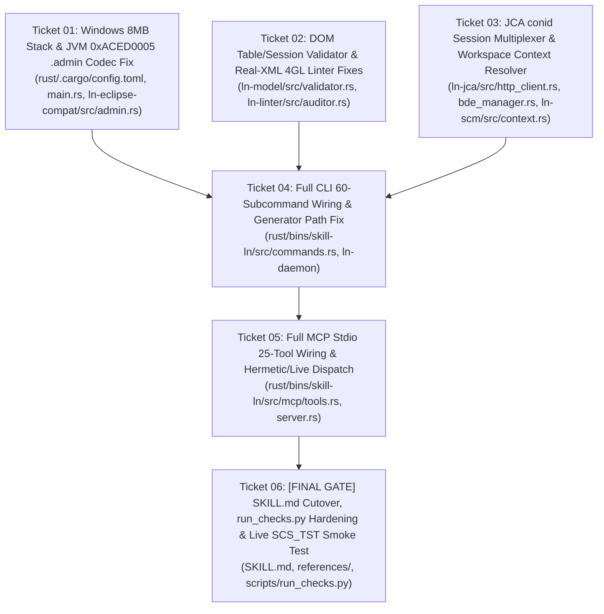

# Implementation Plan: Native Rust `skill-ln` Production Hardening & Live CloudSuite Integration (`Phase 6`)

- **Specification**: [`docs/plans/SPEC_RUST_SKILL_LN_PRODUCTION_HARDENING.md`](SPEC_RUST_SKILL_LN_PRODUCTION_HARDENING.md) ([`.scratch/rust-skill-ln-production-hardening/spec.md`](../../.scratch/rust-skill-ln-production-hardening/spec.md))
- **Parent Plan**: [`docs/plans/native-rust-skill-ln-plan.md`](native-rust-skill-ln-plan.md)
- **ADR**: [`docs/adr/0021-native-rust-skill-ln-single-binary-architecture.md`](../adr/0021-native-rust-skill-ln-single-binary-architecture.md)
- **Tickets**: [`docs/plans/Tickets.md`](Tickets.md) ([`.scratch/rust-skill-ln-production-hardening/issues/`](../../.scratch/rust-skill-ln-production-hardening/issues/))
- **Target Model**: `flash` (Gemini 3.8 Flash High)

---

## Execution Rules for Gemini 3.8 Flash (`flash`)

Every agent or subagent executing this plan MUST obey these 8 hard rules:

1. **Zero Stub Rule**: No CLI subcommand in `rust/bins/skill-ln/src/commands.rs` and no MCP tool in `rust/bins/skill-ln/src/mcp/tools.rs` may print hardcoded fake strings or return static dummy JSON (`"EXTce01107"`, `"revision": 2`) when invoked against a workspace/activity. Every command/tool must call the real implementation in `ln-scm`, `ln-daemon`, `ln-model`, `ln-auth`, `ln-eclipse-compat`, `ln-linter`, `ln-kb`, or `ln-verify`.
2. **Single-XML TDE Zero-Attribute Rule (ADR 0012 & ADR 0021)**:
   - Every generated component XML file MUST be placed at `ln_model::layout::resolve_component_path(...)` (`{pkg}/etable/{mod}/{name}.tbl`, `{pkg}/esess/{mod}/{name}.ses`, `{pkg}/edom/{name}.dmn`, `{pkg}/elib/{mod}/{name}.lib`, `{pkg}/emenu/{mod}/{name}.mnu`, `{pkg}/elabel/{name}.lbl`, `{pkg}/erep/{mod}/{name}.rpt`, `{pkg}/emess/{name}.msg`, `{pkg}/equest/{name}.qst`, `{pkg}/efunc/{mod}/{name}.fnc`, `{pkg}/eaddfile/{name}.add`, `{pkg}/ebod/{name}.bus`).
   - NEVER create plural directories (`messages/`, `questions/`, `functions/`, `additional/`, `reports/`) and NEVER emit XML attributes on TDE domain elements (`<DR_Message name="..."/>` is forbidden; use `<Message><name>...</name>...</Message>`).
3. **Pre-Commit SCM & Extension Modeler Boundaries (ADR 0006, ADR 0007, ADR 0020)**:
   - `EndActivity`, `CloseTask`, `FinalizeActivity`, `<End/>`, and `<Deliver/>` remain physically hard-blocked in `ln-jca`, `ln-scm`, CLI, and MCP.
   - Extension Modeler components (`ess`, `est`, `esb`, `esm`, `esr`) remain `[GET_ONLY_EXTENSION]` for SCM check-out/check-in.
4. **Build & Target Directory**:
   - Cargo outputs live in `C:\Temp\skill_ln_target` (configured in `rust/.cargo/config.toml`).
   - Always test both `C:\Temp\skill_ln_target\debug\skill-ln.exe` and `C:\Temp\skill_ln_target\release\skill-ln.exe` as child processes (`std::process::Command`).
5. **Real Customer Workspace Verification Corpus**:
   - Customer Eclipse Workspace: `C:\Users\nutdo\OneDrive\Documents\workspace_lnstudio\SCS_TST`
   - Real Activity Directory: `C:\Users\nutdo\OneDrive\Documents\workspace_lnstudio\SCS_TST\dev_natt_v01108-1 [EXTce01108]`
   - LN Studio Build 0640 Home: `d:\LN Studio\April-2026\InforLNStudio_10_8_0_build0640-x86_64`
   - In PowerShell (`pwsh`), always pass `-LiteralPath` when referencing `dev_natt_v01108-1 [EXTce01108]` to prevent `[` and `]` wildcard expansion.
6. **Zero Secret Leakage**:
   - Never write `.ionapi` credentials, OAuth2 Bearer tokens, or plaintext passwords into any file inside the Git repository. Load live tokens from `~/.ln_studio/tokens/SCS_TST.json` at runtime.
7. **Lean Skill Markdown Gate (ADR 0018)**:
   - `ln_studio_skill/SKILL.md` and `erp-ln-progguide/SKILL.md` MUST remain `<= 80` lines each.
8. **Unified Verification Command**:
   - Every ticket must finish with `cargo test --workspace --manifest-path rust/Cargo.toml` and `python scripts/run_checks.py` passing 100% (`0` errors, `0` warnings).

---

## 6-Ticket Phased Execution Architecture

---

### Step 1 — Ticket 01: Windows 8MB Stack & JVM `0xACED0005` `.admin` Codec Fix
- **Files Modified**:
  - `rust/.cargo/config.toml`
  - `rust/bins/skill-ln/src/main.rs`
  - `rust/crates/ln-eclipse-compat/src/admin.rs`
  - `rust/crates/ln-eclipse-compat/tests/test_eclipse_codecs.rs`
  - `rust/bins/skill-ln/tests/test_cli.rs`
- **Deliverables**:
  1. Add `[target.x86_64-pc-windows-msvc]` `rustflags = ["-C", "link-arg=/STACK:8388608"]` in `rust/.cargo/config.toml` and wrap `main()` execution in an `8 MB` thread (`std::thread::Builder::new().stack_size(8 * 1024 * 1024)`).
  2. Fix `AdminReader` and `AdminWriter` in `rust/crates/ln-eclipse-compat/src/admin.rs` so `TC_CLASSDESC` registers its handle *before* reading/writing field descriptor strings (`"Ljava/lang/String;"`), `TC_OBJECT` registers its handle *after* `classDesc` and *before* `classdata[]`, and `m_path` (`field 7`) supports both `TC_REFERENCE` (default when `comp.path == key`) and `TC_STRING`.
  3. Add unit and integration tests parsing the exact JVM byte layout and the real `.admin` file in `dev_natt_v01108-1 [EXTce01108]`, plus child-process execution tests via `env!("CARGO_BIN_EXE_skill-ln")`.

### Step 2 — Ticket 02: DOM Table/Session Validator & Real-XML 4GL Linter Fixes
- **Files Modified**:
  - `rust/crates/ln-model/src/validator.rs`
  - `rust/crates/ln-model/tests/test_model.rs`
  - `rust/crates/ln-linter/src/auditor.rs`
  - `rust/crates/ln-linter/tests/test_linter_all_rules.rs`
- **Deliverables**:
  1. In `ln-model/src/validator.rs`, replace regex column/index extraction with `roxmltree::Document::parse` direct-child inspection (`<Column>` direct child `<name>`, `<IndexColumn>` child `<column>` or `<name>`).
  2. In `ln-linter/src/auditor.rs`:
     - Extract and XML-unescape `<expression>` blocks from Single-XML `.lib`, `.tbl`, `.ses`, `.rpt`, `.fnc` files before lexing/auditing, and scan `.tbl`, `.ses`, `.rpt`, `.fnc` during directory walks.
     - Allow `long` return type on `ext.get.form.fields`, `ext.get.session.indices`, `ext.get.command.extensions`, and `ext.get.report.extensions` in `EXT003`.
     - Ensure `DAL003` skips `function` declaration headers and treats `.` before `return` as part of a dotted identifier (`function.ext.gen.return.*`).
  3. Verify `skill-ln.exe validate` and `skill-ln.exe audit-4gl` produce **0 false-positive errors/warnings** on `dev_natt_v01108-1 [EXTce01108]` (`txcmg011.tbl`, `txcmg012.tbl`, `txcmg0512m000.ses`, `txesssli2620m0.lib`).

### Step 3 — Ticket 03: JCA `conid` Session Multiplexer & Workspace Context Resolver
- **Files Modified**:
  - `rust/crates/ln-jca/src/http_client.rs`
  - `rust/crates/ln-jca/src/bde_manager.rs`
  - `rust/crates/ln-jca/tests/test_jca_wire.rs`
  - `rust/crates/ln-scm/src/context.rs` (new)
  - `rust/crates/ln-scm/src/lib.rs`
  - `rust/crates/ln-scm/tests/test_scm_phase4.rs`
- **Deliverables**:
  1. Add `ConnectionRegistry` to `ln_jca::http_client::HttpClient` mapping `"ProjectServer"` to the integer `<conid>` from `?method=connect` (`"0"`) and repository connection points (`"EXTce01108_dev"`, `"EXT_admin"`) to integer `<conid>` values from `?method=share` (`"1"`, ...), with automatic `resolve_conid` inside `JcaBdeManager::execute`.
  2. Harden the mock JCA HTTP servers in `test_jca_wire.rs` and `test_scm_phase4.rs` to return `HTTP 500 POST request failed` if `?method=bdecall` receives a non-numeric `conid` (matching real CloudSuite `SCS_TST`).
  3. Implement `ln_scm::context::WorkspaceContext` to discover workspace paths, parse Eclipse `.metadata` `connectivity.prefs` + `cloudenv.prefs`, enforce `ln_auth::prefetch_gate`, and parse `.project` activity metadata.

### Step 4 — Ticket 04: Full CLI 60-Subcommand Wiring & Generator Path Fix
- **Files Modified**:
  - `rust/bins/skill-ln/src/commands.rs`
  - `rust/bins/skill-ln/src/cli.rs`
  - `rust/bins/skill-ln/tests/test_cli.rs`
- **Deliverables**:
  1. Replace the 5 inline XML stubs (`Message`, `Question`, `Function`, `Additional`, `Report`) in `commands.rs` with `ln_model::generators::{msg, qst, fnc, add, rpt}` and `resolve_component_path` (`{pkg}/emess/{code}.msg`, `{pkg}/equest/{code}.qst`, `{pkg}/efunc/{mod}/{name}.fnc`, `{pkg}/eaddfile/{name}.add`, `{pkg}/erep/{mod}/{name}.rpt`).
  2. Wire all 30+ server/SCM/code-intelligence/daemon/build subcommands in `commands.rs` to `WorkspaceContext`, `ln-scm`, `ln-daemon`, and `ln-auth`.
  3. Expand `test_cli.rs` to test real execution of all 60 subcommands (using a local stateful mock JCA server for server-bound commands and verifying canonical file layouts for all 12 component types).

### Step 5 — Ticket 05: Full MCP Stdio 25-Tool Wiring & Hermetic/Live Dispatch
- **Files Modified**:
  - `rust/bins/skill-ln/src/mcp/tools.rs`
  - `rust/bins/skill-ln/src/mcp/server.rs`
  - `rust/bins/skill-ln/tests/test_mcp_server.rs`
- **Deliverables**:
  1. Wire all 25 MCP tools in `rust/bins/skill-ln/src/mcp/tools.rs` to call the real async implementations in `ln-auth`, `ln-scm`, `ln-model`, `ln-linter`, and `ln-daemon` when invoked against a workspace/activity or endpoint, while supporting `"mock": true` / hermetic fallback when unit tests pass synthetic IDs without a workspace.
  2. Route `ln_create_component` for all 12 component types through `ln_model::generators::*` and `resolve_component_path`.
  3. Verify all 25 MCP tools over `skill-ln.exe mcp-stdio` child process stdin/stdout pipes against both the stateful mock JCA server and local activity workspaces.

### Step 6 — Ticket 06: `[FINAL GATE]` `SKILL.md` Cutover, `run_checks.py` Hardening & Live `SCS_TST` Smoke Verification
- **Files Modified**:
  - `ln_studio_skill/SKILL.md` (`<= 80` lines)
  - `erp-ln-progguide/SKILL.md` (`<= 80` lines)
  - `ln_studio_skill/references/CLI_REFERENCE.md`
  - `ln_studio_skill/references/MCP_TOOLS_REFERENCE.md`
  - `scripts/run_checks.py`
  - `scripts/package_release.py`
- **Deliverables**:
  1. Update `ln_studio_skill/SKILL.md` and `erp-ln-progguide/SKILL.md` (`<= 80` lines each) and `references/` to use `skill-ln`.
  2. Enhance `scripts/run_checks.py` to include a process-level `skill-ln` CLI/MCP smoke check so unwired stubs or stack overflows can never slip past CI again.
  3. Execute live end-to-end verification against `SCS_TST` (`EXTce01108` / `dev_natt_v01108-1`) and Build 0640 (`verify-studio-build`), rebuild the release zip via `python scripts/package_release.py`, and confirm `python scripts/run_checks.py` reports `[ALL CHECKS PASSED]`.
