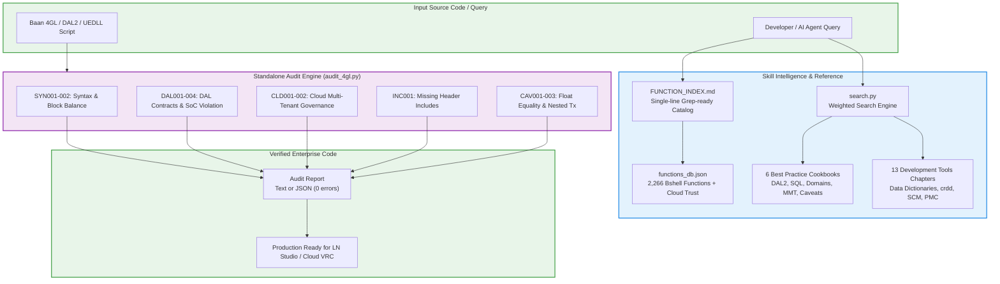

[⬅️ Back to Skill_LN Main Repository](../README.md)

---

# Baan 4GL Programmer's Guide, Dev Tools & Standalone Audit Engine (`erp-ln-progguide`)

[](https://www.infor.com)
[](#knowledge-base-contents)
[](#grep-friendly-single-line-function-index)
[](#standalone-4gl--dal-audit-engine-audit_4glpy)
[](#cloud-extensibility-governance)
[](#automated-test-suite)

> **Comprehensive developer reference, runtime API dictionary, architectural cookbook suite, and static verification engine for Infor ERP LN, Baan 4GL/3GL, DAL 2, Extension Modeler, and Infor Cloud Multi-Tenant governance.**

---

## Table of Contents

- [Overview & Key Metrics](#overview--key-metrics)
- [Workflow Architecture](#workflow-architecture)
- [Standalone 4GL & DAL Audit Engine (`audit_4gl.py`)](#standalone-4gl--dal-audit-engine-audit_4glpy)
  - [Industry-Standard Linter Rule Matrix (14 Rules)](#industry-standard-linter-rule-matrix)
  - [CI/CD Exit Code Behavior](#cicd-exit-code-behavior)
  - [Before & After 4GL Code Showcase](#before--after-4gl-code-showcase)
  - [CLI Syntax & Examples](#cli-syntax--examples)
- [Problem-Driven Architectural Cookbooks Selection Guide](#problem-driven-architectural-cookbooks-selection-guide)
- [Why Single-Line Index? (AI Context Token Optimization)](#why-single-line-index-ai-context-token-optimization)
- [Knowledge Base Contents](#knowledge-base-contents)
- [Coding Standards & Architectural Guardrails](#coding-standards--architectural-guardrails)
- [Fast Search CLI Tool (`search.py`)](#fast-search-cli-tool-searchpy)
- [Automated Test Suite](#automated-test-suite)
- [Directory Layout](#directory-layout)

---

## Overview & Key Metrics

The `erp-ln-progguide` skill converts official Infor documentation, Studio Build 0640 runtime reflection, and decades of enterprise development expertise into structured, grep-ready, token-efficient Markdown:

| Metric | Quantity | Scope / Description |
|---|---|---|
| **Documentation Pages** | **5,700+** | UTF-8 Markdown converted from official Infor manuals & references |
| **Authoritative Bshell Functions** | **2,266** | Complete Build 0640 catalog with Cloud Multi-Tenant Trust ratings |
| **Public Interfaces & Extensions** | **1,833** | Cloud public interfaces, process extensions, and DLL APIs (`tdext*`, `whext*`) |
| **AFS Primitives** | **All `stpapi.*`** | Automated Function Server APIs with signatures and parameters |
| **Development Tools Chapters** | **13** | Software components, Data Dictionaries, `crdd` table reconfiguration, SCM, PMC |
| **Architectural Cookbooks** | **6** | Prescriptive guides covering DAL2, SoC, transactions, domains, MMT, caveats |
| **Official Script Templates** | **9** | Studio templates (`DalTwo.dal`, `UIDatabase.cln`, `UserExitDLL.ue`, etc.) |
| **Audit Engine Rules** | **14** | Zero-dependency static analyzer checking syntax, DAL contracts, cloud trust |

---

## Workflow Architecture



---

## Standalone 4GL & DAL Audit Engine (`audit_4gl.py`)

A high-performance, **zero-dependency** Python static analyzer located at [`scripts/audit_4gl.py`](scripts/audit_4gl.py). Runs in milliseconds on any environment with Python 3.8+ installed (no Eclipse GUI or Java required).

### Industry-Standard Linter Rule Matrix

Modeled after modern static analyzers (Ruff, ESLint, Semgrep), `audit_4gl.py` categorizes rules with clear severities, cloud impacts, and remediation actions:

| Rule ID | Category | Severity & Exit Code | Cloud Multi-Tenant Impact | Description & Recommended Action |
|---|---|---|---|---|
| `SYN001` | Syntax / AST | `ERROR` [Exit 1] | **Critical** (Compile Failure) | AST recursive-descent block balance check (`select/endselect`, `if/endif`, `for/endfor`, `case/endcase`, `{}`). |
| `SYN002` | Syntax | `WARNING` [Exit 0] | Minor | Misspelled 4GL section headers. Compares against official dictionary and suggests nearest valid header. |
| `TBL001` | Semantic | `ERROR` [Exit 1] | **High** (Runtime Fault) | Referenced table (`<pkg><mod><num>.<field>`) missing `table t<table>` declaration in `declaration:` section. |
| `TBL002` | Schema | `ERROR` [Exit 1] | **High** (Schema Mismatch) | Referenced `<table>.<field>` does not exist in `.ln_dd_cache.json`. (Supports `--auto-fetch-dd` server fallback). |
| `DMN001` | Schema | `ERROR` [Exit 1] | **High** (Schema Mismatch) | Declared `domain <domain_name>` does not exist in `.ln_dd_cache.json`. |
| `DAL001` | Contract | `ERROR` [Exit 1] | **Prohibited** (Server Crash) | Interactive dialog calls (`message()`, `ask.enum()`, `box()`) inside DAL2 or Table Extensions. Use `dal.set.error.message()`. |
| `DAL002` | Contract | `ERROR` [Exit 1] | **Critical** (Hook Failure) | Invalid parameter signature in DAL field hooks (e.g. missing `long i.mode` on `.update`, `long has_changed` on `.check`). |
| `DAL003` | Contract | `ERROR` [Exit 1] | **Critical** (Hook Failure) | Invalid hook return type (e.g. `void` when hook must return `long` or returning expression in `void`). |
| `DAL004` | Architecture | `ERROR` [Exit 1] | **Prohibited** (SoC Breach) | Direct database mutation statements (`db.insert`, `db.update`, `db.delete`) in UI scripts. Business logic must reside in DAL2. |
| `CLD001` | Governance | `ERROR` [Exit 1] | **Prohibited** (Cloud Blocked) | Calling untrusted bshell functions (`run.prog()`, `hostname$()`, `shell()`) in Cloud Multi-Tenant mode (`--cloud`). |
| `CLD002` | Governance | `WARNING` [Exit 0] | Deprecation | Using deprecated bshell functions. Recommends modern replacement functions. |
| `INC001` | Semantic | `ERROR` [Exit 1] | **Critical** (Compile Failure) | Calling runtime functions without their required `#include` header (e.g. `Json.*` without `<bic_json>`). |
| `CAV001` | Caveat | `WARNING` [Exit 0] | **High Risk** (Rounding Bug) | Direct float equality comparisons (`== 0.0` or `!= 100.0`). Recommends `double.cmp(a, b, epsilon) == 0`. |
| `CAV003` | Caveat | `ERROR` [Exit 1] | **Critical** (Deadlock Hazard) | Intra-file Call Graph detection of direct or transitive nested transaction boundaries (`db.retry.point()`, `commit.transaction()`). |

### CI/CD Exit Code Behavior
- **Exit Code 0 (Success)**: Clean audit or only warnings emitted (under default non-strict mode).
- **Exit Code 1 (Failure)**: One or more `ERROR` rules triggered, or `--strict` flag enabled with active warnings. **Blocks pull requests and CI pipelines**.

---

### Before & After 4GL Code Showcase

#### 1. Separation of Concerns Violation (`DAL004`)
*Bad: Direct database mutation inside UI session script.*
```diff
 choice.modify.set:
 on.choice:
-    | VIOLATION: DAL004 - Direct db.update in UI Script
-    select txcmg011.*
-    from   txcmg011 for update
-    where  txcmg011.btno = :txcmg011.btno
-    selectdo
-        txcmg011.stat = txcmg.stat.processed
-        db.update(ttxcmg011, db.retry)
-        commit.transaction()
-    endselect

+    | COMPLIANT: Trigger DAL business method from UI Script
+    dal.start.business.method("txcmg011", "process.billing.batch", l.ret)
```

#### 2. Floating-Point Equality Hazard (`CAV001`)
*Bad: Direct equality on IEEE 754 floating-point amounts.*
```diff
 function extern long txcmg011.tamt.is.valid()
 {
-    | VIOLATION: CAV001 - Direct float equality comparison
-    if txcmg011.tamt == 0.0 then
-        dal.set.error.message("@txcmg:zero_amount_not_allowed")
-        return(DALHOOKERROR)
-    endif

+    | COMPLIANT: Epsilon-based comparison via double.cmp()
+    if double.cmp(txcmg011.tamt, 0.0, 0.0001) == 0 then
+        dal.set.error.message("@txcmg:zero_amount_not_allowed")
+        return(DALHOOKERROR)
+    endif
     return(0)
 }
```

#### 3. Extension Modeler `#include` Scope Boundary (`EXT001`)
*Bad: Placing `#include` outside `#context_on "declarations"` in extension source.*
```diff
-| VIOLATION: EXT001 - Direct include outside context block is ignored by LN UI generator
-#include <bic_json>

 #context_on "declarations"
+    | COMPLIANT: Header includes must reside inside declarations context
+    #include <bic_json>
     table ttxcmg011
 #context_off
```

---

### CLI Syntax & Examples

```bash
# 1. Audit a single DAL2 script
python erp-ln-progguide/scripts/audit_4gl.py path/to/txcmg011.dal --mode dal2

# 2. Audit in strict Cloud Multi-Tenant governance mode
python erp-ln-progguide/scripts/audit_4gl.py path/to/txcmg0110m100.cln --cloud --strict

# 3. Audit entire directory and output machine-readable JSON for CI/CD
python erp-ln-progguide/scripts/audit_4gl.py src/ --format json --output audit_report.json
```

---

## Problem-Driven Architectural Cookbooks Selection Guide

Instead of browsing arbitrary files, select the appropriate architectural cookbook based on your current engineering task:

| If You Are Developing... | Your Specific Challenge | Recommended Cookbook | Key Architectural Concepts Covered |
|---|---|---|---|
| **Last-Mile Customizations** | Writing Table (`est`) or Session (`ess`) extensions in Infor Cloud | [`01_extension_hooks_cookbook.md`](references/best_practices/01_extension_hooks_cookbook.md) | Hook lifecycles, CDF recipes, `DALHOOKERROR`, cloud governor limits (5,000ms, 5MB output) |
| **Core Entity Business Logic** | Building new tables, validation hooks, or default values | [`02_dal_architecture_and_business_logic.md`](references/best_practices/02_dal_architecture_and_business_logic.md) | Separation of Concerns (SoC), DAL2 property hooks (`.update`, `.check`), business methods |
| **High-Volume SQL Batch Jobs** | Eliminating slow queries, table scans, or lock deadlocks | [`03_sql_query_optimization_and_transactions.md`](references/best_practices/03_sql_query_optimization_and_transactions.md) | Index leading fields, array fetching (`as prepared set`), `db.retry.point()`, locking hierarchy |
| **Data Models & Database Tables** | Defining domains, foreign keys, or running table `crdd` | [`04_data_model_and_domain_design.md`](references/best_practices/04_data_model_and_domain_design.md) | Domain typing, referential integrity, safe 2-step `crdd` reconfiguration (runtime vs app) |
| **Multi-Table User Interfaces** | Designing parent/child forms with synced grid lines | [`05_session_and_mmt_patterns.md`](references/best_practices/05_session_and_mmt_patterns.md) | Session types 1-4, MMT Controller with Satellites, Form Commands, localized labels |
| **Subshell & 4GL Logic** | Avoiding precision bugs, buffer collisions, or array bounds | [`06_4gl_coding_standards_and_caveats.md`](references/best_practices/06_4gl_coding_standards_and_caveats.md) | Domain vs primitive typing, buffer collision prevention, float equality (`double.cmp`), 1-based arrays |

---

## Why Single-Line Index? (AI Context Token Optimization)

In [`references/FUNCTION_INDEX.md`](references/FUNCTION_INDEX.md), all **2,266 bshell functions** are deliberately constrained to a **single physical line** per function:

```markdown
- **Json.getString** | [Cloud: Trusted] [Scope: all] [Inc: <bic_json>] | `string Json.getString( ... )` -> `references/guide/progguide/functions_json/jsongetstring.md`
```

### Architectural Rationale for AI Coding Agents:
1. **Zero Context Bloat**: Multi-line function documentation consumes thousands of tokens when loaded into LLM prompts. A single physical line allows an AI agent to use `grep` or `ripgrep` to fetch the exact signature, include header, and cloud trust status in **under 50 tokens**.
2. **Sub-Second Lookup**: Agents do not need to parse large JSON files or perform deep AST queries. A simple regex (`grep -i "^- \*\*Json\."`) returns all matching signatures instantly.
3. **Deterministic Cloud Governance**: The `[Cloud: Trusted]` or `[Cloud: Untrusted]` flag is parsed at a glance by agents before generating code for Infor Cloud Multi-Tenant environments.

---

## Knowledge Base Contents

### 1. Authoritative Bshell Functions Database (`functions_db.json`)
Located in [`index/functions_db.json`](index/functions_db.json), indexing all 2,266 bshell functions from Infor LN Studio 10.8 Build 0640.

### 2. Development Tools (13 Complete Chapters)
Located in [`references/DEV_TOOLS_INDEX.md`](references/DEV_TOOLS_INDEX.md), covering the full *Infor LN Development Tools (2016)* manual:
- Data Dictionaries (Application vs Runtime Data Dictionary)
- Table Reconfiguration Procedures (`crdd`)
- Software Component Administration & PMC Packaging

### 3. Public Interfaces & Process Extensions (1,833 Interfaces)
Located in [`references/PUBLIC_INTERFACES_INDEX.md`](references/PUBLIC_INTERFACES_INDEX.md):
- Core DLL libraries: `tdext`, `whext`, `tiext`, `tcext`, `tfext`
- Standard business processes: `Address.Create`, `Item.GetData`, `SalesOrder.Create`, `Inventory.Adjust`

### 4. Application Function Server (AFS `stpapi.*`)
Located in [`references/AFS_INDEX.md`](references/AFS_INDEX.md):
- `stpapi.put.field()`, `stpapi.get.field()`, `stpapi.insert()`, `stpapi.update()`, `stpapi.delete()`, `stpapi.find()`, `stpapi.end.session()`

### 5. Official Studio Script Templates
Located in [`templates/`](templates/):
- `DalTwo.dal`: Modern DAL2 business logic template
- `UIDatabase.cln`: Type 1-3 session script template
- `UserExitDLL.ue`: User exit DLL for intercepting standard transactions

---

## Coding Standards & Architectural Guardrails

### Cardinal Rule: Separation of Concerns (SoC)
- **UI Scripts (`type 1-4`, `main.table.io`, `choice.*`)**: Responsible **only** for form presentation, visual field states, dynamic zooms, and window titles. **Never execute database mutations or business rule validations in UI scripts.**
- **DAL 2 & Table Extensions**: Responsible for **all** validations, defaults, mandatory checks, referential integrity, and database operations.

### Mandatory Prohibited Anti-Patterns
1. ❌ **No Primitive Database Types**: Never use `long`, `string`, `double` for database columns. Always use Data Dictionary domains (e.g. `domain tcorno orno`).
2. ❌ **No Direct Float Equality**: Never compare float amounts using `==` or `!=`. Always use `double.cmp(a, b, epsilon) == 0`.
3. ❌ **No Nested Transactions in Hooks**: Never call `commit.transaction()` inside DAL hooks or reusable helper DLLs.
4. ❌ **No Interactive Dialogs in Headless Code**: Never call `message()`, `ask.enum()`, `box()` in DAL or Extension Modeler code.
5. ❌ **No Table Record Buffer Overwriting**: Never use `select table.*` in loops sharing active UI form buffers.
6. ❌ **No 0-Based Array Access**: 4GL arrays are strictly 1-based (`1..N`).
7. ❌ **No Unstructured Branching**: `goto` is strictly prohibited.

---

## Fast Search CLI Tool (`search.py`)

```bash
# Search by topic keywords
python erp-ln-progguide/scripts/search.py "before.save.object" --dir best_practices

# Search bshell functions with regex
python erp-ln-progguide/scripts/search.py "Json\." --dir guide --max 10

# List all available topic documentation groups
python erp-ln-progguide/scripts/search.py --list-groups
```

---

## Automated Test Suite

Run unit tests for the Standalone Audit Engine:

```bash
python -m unittest discover -s erp-ln-progguide/tests
```

Validate documentation integrity & links:

```bash
python ln_studio_skill/tools/validate_skill.py --skill-dir erp-ln-progguide
```

---

## Directory Layout

```text
erp-ln-progguide/
├── SKILL.md                          # AI agent skill definition & instructions
├── README.md                         # Static Linter & Knowledge Base documentation
├── index/
│   ├── functions_db.json             # 2,266 bshell functions machine-readable database
│   └── INDEX.tsv                     # Full-text path-to-title mapping index
├── references/
│   ├── FUNCTION_INDEX.md             # Grep-friendly single-line bshell function index
│   ├── DEV_TOOLS_INDEX.md            # Master index for Infor LN Development Tools (13 ch)
│   ├── EXTENSIONS_INDEX.md           # Extension Modeler reference index
│   ├── PUBLIC_INTERFACES_INDEX.md    # 1,833 Public interfaces & process extensions index
│   ├── AFS_INDEX.md                  # AFS stpapi.* primitives index
│   ├── STUDIO_SYNTAX_COMPLETION.md   # Studio Build 0640 syntax dictionaries & sections
│   ├── best_practices/               # 6 Prescriptive architectural cookbooks
│   ├── dev_tools/                    # Development Tools chapters (ch01 - ch13)
│   ├── guide/progguide/              # Core Programmer's Guide (~130 function groups)
│   ├── sql/progguide/                # Baan SQL reference & SQLSTATE error codes
│   ├── extensions/                   # Extension Modeler documentation
│   ├── public_interfaces/            # Cloud Public Interfaces up to 25082026
│   └── afs/                          # AFS Developer's Guide
├── templates/                        # 9 Official LN Studio script templates
├── scripts/
│   ├── audit_4gl.py                  # Zero-dependency 4GL/DAL static audit engine
│   └── search.py                     # Fast CLI search engine
└── tests/
    └── test_audit_4gl.py             # Unit tests for audit engine rules
```
