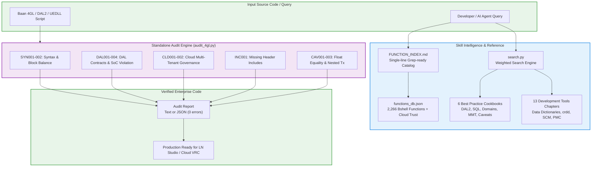

# Baan 4GL Programmer's Guide, Dev Tools & Standalone Audit Engine

[](https://www.infor.com)
[](#knowledge-base-contents)
[](#grep-friendly-function-index)
[](#standalone-4gl--dal-audit-engine)
[](#cloud-extensibility-governance)
[](#automated-test-suite)

> **Comprehensive developer reference, runtime API dictionary, architectural cookbook suite, and static verification engine for Infor ERP LN, Baan 4GL/3GL, DAL 2, Extension Modeler, and Infor Cloud Multi-Tenant governance.**

---

## Table of Contents

- [Overview & Key Metrics](#overview--key-metrics)
- [Workflow Architecture](#workflow-architecture)
- [Knowledge Base Contents](#knowledge-base-contents)
  - [1. Authoritative Bshell Functions Catalog](#1-authoritative-bshell-functions-catalog)
  - [2. Grep-Friendly Function Index](#2-grep-friendly-function-index)
  - [3. Standalone 4GL & DAL Audit Engine](#3-standalone-4gl--dal-audit-engine)
  - [4. Six Architectural Best Practices Cookbooks](#4-six-architectural-best-practices-cookbooks)
  - [5. Development Tools (13 Complete Chapters)](#5-development-tools-13-complete-chapters)
  - [6. Public Interfaces & Process Extensions](#6-public-interfaces--process-extensions)
  - [7. Application Function Server (AFS `stpapi.*`)](#7-application-function-server-afs-stpapi)
  - [8. Official Studio Script Templates](#8-official-studio-script-templates)
- [Standalone 4GL & DAL Audit Engine (`audit_4gl.py`)](#standalone-4gl--dal-audit-engine-audit_4glpy)
  - [Rule Enforcement Matrix](#rule-enforcement-matrix)
  - [CLI Syntax & Examples](#cli-syntax--examples)
  - [Sample Terminal Output](#sample-terminal-output)
- [Coding Standards & Architectural Guardrails](#coding-standards--architectural-guardrails)
  - [Cardinal Rule: Separation of Concerns (SoC)](#cardinal-rule-separation-of-concerns-soc)
  - [Mandatory Prohibited Anti-Patterns](#mandatory-prohibited-anti-patterns)
- [Fast Search CLI Tool (`search.py`)](#fast-search-cli-tool-searchpy)
- [Automated Test Suite](#automated-test-suite)
- [Directory Layout](#directory-layout)

---

## Overview & Key Metrics

The `erp-ln-progguide` skill converts official Infor documentation, Studio Build 0640 runtime reflection, and decades of enterprise development expertise into structured, grep-ready, token-efficient Markdown:

| Metric | Quantity | Scope / Description |
|---|---|---|
| **Documentation Pages** | **5,700+** | UTF-8 Markdown converted from official Infor manuals & references |
| **Authoritative Bshell Functions** | **2,266** | Complete Build 0640 catalog with Cloud Multi-Tenant Trust ratings |
| **Public Interfaces & Extensions** | **1,833** | Cloud public interfaces, process extensions, and DLL APIs (`tdext*`, `whext*`) |
| **AFS Primitives** | **All `stpapi.*`** | Automated Function Server APIs with signatures and parameters |
| **Development Tools Chapters** | **13** | Software components, Data Dictionaries, `crdd` table reconfiguration, SCM, PMC |
| **Architectural Cookbooks** | **6** | Prescriptive guides covering DAL2, SoC, transactions, domains, MMT, caveats |
| **Official Script Templates** | **9** | Studio templates (`DalTwo.dal`, `UIDatabase.cln`, `UserExitDLL.ue`, etc.) |
| **Audit Engine Rules** | **11** | Zero-dependency static analyzer checking syntax, DAL contracts, cloud trust |

---

## Workflow Architecture



---

## Knowledge Base Contents

### 1. Authoritative Bshell Functions Catalog
Located in [`index/functions_db.json`](index/functions_db.json), this machine-readable database indexes all 2,266 bshell functions from Infor LN Studio 10.8 Build 0640 (April 2026 tree). Each entry includes:
- Return type and exact parameter signatures
- Cloud Multi-Tenant Trust classification (`Trusted` vs `Untrusted`)
- Required include header (e.g. `<bic_json>`, `<bic_cmf>`, `<bic_tt>`)
- Deprecation indicators and replacement suggestions
- Relative link to full Markdown documentation page

### 2. Grep-Friendly Function Index
Located in [`references/FUNCTION_INDEX.md`](references/FUNCTION_INDEX.md), designed specifically for high-speed AI agent lookups in a single `grep` call:
```markdown
- **Json.getString** | [Cloud: Trusted] [Scope: all] [Inc: <bic_json>] | `string Json.getString( ... )` -> `references/guide/progguide/functions_json/jsongetstring.md`
- **cmf.create** | [Cloud: Untrusted] [Scope: all] [Inc: <bic_cmf>] | `long cmf.create( )` -> `references/guide/progguide/functions_cmf/cmfcreate.md`
- **dal.set.error.message** | [Cloud: Trusted] [Scope: all] [Inc: <bic_dal>] | `void dal.set.error.message( string msg [, ...] )` -> `references/guide/...`
```

### 3. Standalone 4GL & DAL Audit Engine
Located in [`scripts/audit_4gl.py`](scripts/audit_4gl.py), a standalone, zero-dependency Python script that validates Baan 4GL scripts before they are committed, uploaded, or compiled. See [detailed section below](#standalone-4gl--dal-audit-engine-audit_4glpy).

### 4. Six Architectural Best Practices Cookbooks
Located in [`references/best_practices/`](references/best_practices/):

| Cookbook | Focus Area | Key Topics Covered |
|---|---|---|
| [`01_extension_hooks_cookbook.md`](references/best_practices/01_extension_hooks_cookbook.md) | **Extension Hooks & Cloud Governance** | Table/Session hook lifecycles, CDF recipes, `DALHOOKERROR`, cloud governor limits (5,000ms execution, 5MB output) |
| [`02_dal_architecture_and_business_logic.md`](references/best_practices/02_dal_architecture_and_business_logic.md) | **DAL Architecture & Business Logic** | Separation of Concerns (SoC), DAL1 vs DAL2, property hooks (`.update`, `.check`), business methods |
| [`03_sql_query_optimization_and_transactions.md`](references/best_practices/03_sql_query_optimization_and_transactions.md) | **SQL Optimization & Transactions** | Index alignment, array fetching (`as prepared set`), `db.retry.point()`, locking hierarchies, eliminating N+1 |
| [`04_data_model_and_domain_design.md`](references/best_practices/04_data_model_and_domain_design.md) | **Data Models & Domain Design** | Domain definition, referential integrity rules, safe 2-step `crdd` reconfiguration (runtime vs application) |
| [`05_session_and_mmt_patterns.md`](references/best_practices/05_session_and_mmt_patterns.md) | **Session & MMT Architecture** | Session types 1-4, MMT Controller with Satellites, form commands, label localization |
| [`06_4gl_coding_standards_and_caveats.md`](references/best_practices/06_4gl_coding_standards_and_caveats.md) | **Coding Standards & Runtime Caveats** | Domain vs primitive typing, table buffer collision prevention, float equality (`double.cmp`), 1-based arrays |

### 5. Development Tools (13 Complete Chapters)
Located in [`references/DEV_TOOLS_INDEX.md`](references/DEV_TOOLS_INDEX.md), covering the full *Infor LN Development Tools (2016)* manual:
- **Ch 01**: Introduction to Development Tools
- **Ch 02**: Overview of Software Components (Packages, Modules, Tables, Sessions, Scripts, Reports)
- **Ch 03**: Data Dictionaries (Application Data Dictionary vs Runtime Data Dictionary)
- **Ch 04**: Software Component Administration
- **Ch 05**: Software Development Procedures (Data modeling, Forms, MMT Sessions)
- **Ch 06**: Data Modeling & Table Reconfiguration (`crdd`)
- **Ch 07**: Version & Release Management (VRC hierarchies, SCM)
- **Ch 08**: LN Software Maintenance & PMC (Solutions, Patches, Feature Packs)
- **Ch 09-13**: Menus, Labels, Messages, Questions, and Reporting Systems

### 6. Public Interfaces & Process Extensions
Located in [`references/PUBLIC_INTERFACES_INDEX.md`](references/PUBLIC_INTERFACES_INDEX.md):
- 1,833 public interface references across LN Cloud up to build `25082026`
- Core DLL libraries: `tdext`, `whext`, `tiext`, `tcext`, `tfext`
- Standard business processes: `Address.Create`, `Item.GetData`, `SalesOrder.Create`, `Inventory.Adjust`

### 7. Application Function Server (AFS `stpapi.*`)
Located in [`references/AFS_INDEX.md`](references/AFS_INDEX.md):
- Full coverage of AFS session automation primitives
- `stpapi.put.field()`, `stpapi.get.field()`, `stpapi.insert()`, `stpapi.update()`, `stpapi.delete()`, `stpapi.find()`, `stpapi.end.session()`
- Handling sub-sessions, zoom sessions, and error messages via `stpapi.get.mess.code()`

### 8. Official Studio Script Templates
Located in [`templates/`](templates/), extracted directly from LN Studio Build 0640 `ScriptTemplates/`:
- `DalTwo.dal`: Modern DAL2 business logic template with standard property and object hooks
- `UIDatabase.cln`: Session script for standard Type 1-3 database maintenance sessions
- `UserExitDLL.ue`: User exit DLL for intercepting standard transactions
- `Dal.dal`: Legacy DAL 1 template
- `Bol.cln`: Business Object Layer script
- `Function.cln`: Include function library
- `Integration.cln`: Integration adapter script
- `Report.cln`: Report script with layout events
- `ThreeGL.cln`: 3GL standalone program

---

## Standalone 4GL & DAL Audit Engine (`audit_4gl.py`)

A high-performance, **zero-dependency** Python static analyzer located at [`scripts/audit_4gl.py`](scripts/audit_4gl.py). Runs in milliseconds on any environment with Python 3.8+ installed.

### Rule Enforcement Matrix

| Rule Code | Severity | Description | Target Modes |
|---|---|---|---|
| **`SYN001`** | **ERROR** | Unbalanced block statements (`select/endselect`, `if/endif`, `for/endfor`, `while/endwhile`, `case/endcase`, `{}`) | All |
| **`SYN002`** | **WARNING** | Misspelled 4GL section headers with closest official Studio dictionary suggestion | All |
| **`DAL001`** | **ERROR** | Interactive dialog calls (`message()`, `ask.enum()`, `box()`) inside DAL2 or Table Extensions | `dal2`, `uedll` |
| **`DAL002`** | **ERROR** | Missing or incorrect parameter signature in DAL field hooks (e.g. `long i.mode` on `.update`, `long has_changed` on `.check`) | `dal2` |
| **`DAL003`** | **ERROR** | Invalid hook return type (e.g. `void` when hook must return `long`) | `dal2` |
| **`DAL004`** | **ERROR** | Direct database mutation statements (`db.insert`, `db.update`, `db.delete`) inside UI scripts (SoC Violation) | `general` (UI) |
| **`CLD001`** | **ERROR** | Use of untrusted bshell functions (`run.prog()`, `hostname$()`, `shell()`) in Cloud Multi-Tenant mode | `--cloud` |
| **`CLD002`** | **WARNING** | Use of deprecated bshell functions with replacement guidance | `--cloud` |
| **`INC001`** | **ERROR** | Calling functions without their mandatory `#include` header (e.g. `Json.*` without `<bic_json>`) | All |
| **`CAV001`** | **WARNING** | Direct floating-point equality comparisons (`== 0.0` / `!= 100.0`); recommends `double.cmp()` | All |
| **`CAV003`** | **ERROR** | Nested transaction boundaries (`commit.transaction()`, `db.retry.point()`) inside DAL hooks or DLL subroutines | `dal2`, `uedll` |

### CLI Syntax & Examples

```bash
# 1. Audit a single DAL2 script
python erp-ln-progguide/scripts/audit_4gl.py path/to/txcmg011.dal --mode dal2

# 2. Audit in strict Cloud Multi-Tenant governance mode
python erp-ln-progguide/scripts/audit_4gl.py path/to/txcmg0110m100.cln --cloud --strict

# 3. Audit entire directory and output machine-readable JSON for CI/CD
python erp-ln-progguide/scripts/audit_4gl.py src/ --format json --output audit_report.json
```

### Sample Terminal Output

```text
================================================================================
4GL & DAL STATIC AUDIT REPORT
Target: txcmg011.dal | Mode: dal2 | Cloud Governance: Enabled
================================================================================

[FAIL] txcmg011.dal:42 [DAL001]
  Interactive dialog 'message("Batch is already processed")' is strictly prohibited in DAL2.
  Fix: Use dal.set.error.message("@txcmg:batch_closed") and return(DALHOOKERROR).

[WARN] txcmg011.dal:88 [CAV001]
  Direct float comparison 'txcmg011.tamt == 0.0' detected.
  Fix: Use 'double.cmp(txcmg011.tamt, 0.0, 0.0001) == 0' to avoid precision rounding failures.

[FAIL] txcmg011.dal:105 [CLD001]
  Call to untrusted bshell function 'run.prog()' is prohibited in Cloud Multi-Tenant environments.
  Fix: Replace with trusted Cloud API or ION BOD exchange.

--------------------------------------------------------------------------------
Audit completed: 2 errors, 1 warning in 1 file (0.014s).
Status: REJECTED (Fix errors before committing)
```

---

## Coding Standards & Architectural Guardrails

### Cardinal Rule: Separation of Concerns (SoC)
- **UI Scripts (`type 1-4`, `main.table.io`, `choice.*`)**: Responsible **only** for form presentation, visual field states, dynamic zooms, and window titles. **Never execute database mutations or business rule validations in UI scripts.**
- **DAL 2 & Table Extensions**: Responsible for **all** validations, defaults, mandatory checks, referential integrity, and database operations.
- *Reference*: [DAL Architecture & Business Logic Guide](references/best_practices/02_dal_architecture_and_business_logic.md).

### Mandatory Prohibited Anti-Patterns
When developing Infor LN code, AI agents and developers must strictly prevent:
1. ❌ **No Primitive Database Types**: Never use `long`, `string`, `double` for database columns. Always use Data Dictionary domains (e.g. `domain tcorno orno`).
2. ❌ **No Direct Float Equality**: Never compare float amounts using `==` or `!=`. Always use `double.cmp(a, b, epsilon) == 0`.
3. ❌ **No Nested Transactions in Hooks**: Never call `commit.transaction()` inside DAL hooks or reusable helper DLLs.
4. ❌ **No Interactive Dialogs in Headless Code**: Never call `message()`, `ask.enum()`, `box()` in DAL or Extension Modeler code.
5. ❌ **No Table Record Buffer Overwriting**: Never use `select table.*` in loops sharing active UI form buffers. Use aliases or bind to local host variables (`table.field:l.var`).
6. ❌ **No 0-Based Array Access**: 4GL arrays are strictly 1-based (`1..N`).
7. ❌ **No Unstructured Branching**: `goto` is strictly prohibited.

---

## Fast Search CLI Tool (`search.py`)

A built-in search tool to quickly query across the entire 5,700+ page documentation collection:

```bash
# Search by topic keywords
python erp-ln-progguide/scripts/search.py "before.save.object" --dir best_practices

# Search bshell functions with regex
python erp-ln-progguide/scripts/search.py "Json\." --dir guide --max 10

# List all available topic documentation groups
python erp-ln-progguide/scripts/search.py --list-groups
```

---

## Automated Test Suite

Run the unit test suite for the Standalone Audit Engine:

```bash
python -m unittest discover -s erp-ln-progguide/tests
```

```text
........
----------------------------------------------------------------------
Ran 8 tests in 0.264s

OK
```

Validate documentation integrity & index consistency:

```bash
python ln_studio_skill/tools/validate_skill.py --skill-dir erp-ln-progguide
```

```text
INDEX.tsv: OK (0 missing)
references/FUNCTION_INDEX.md: OK (0 broken)
references/PUBLIC_INTERFACES_INDEX.md: OK (0 broken)
references/EXTENSIONS_INDEX.md: OK (0 broken)
references/DEV_TOOLS_INDEX.md: OK (0 broken)
page links: OK (5010 pages, 0 broken)
validate_skill: PASS (0 problem(s))
```

---

## Directory Layout

```text
erp-ln-progguide/
├── SKILL.md                          # Agent skill definition & workflow guidelines
├── README.md                         # Detailed skill documentation & user guide
├── index/
│   ├── functions_db.json             # 2,266 bshell functions machine-readable database
│   └── INDEX.tsv                     # Full-text path-to-title mapping index
├── references/
│   ├── FUNCTION_INDEX.md             # Grep-friendly single-line bshell function index
│   ├── DEV_TOOLS_INDEX.md            # Master index for Infor LN Development Tools (13 ch)
│   ├── EXTENSIONS_INDEX.md           # Extension Modeler reference index
│   ├── PUBLIC_INTERFACES_INDEX.md    # 1,833 Public interfaces & process extensions index
│   ├── AFS_INDEX.md                  # AFS stpapi.* primitives index
│   ├── STUDIO_SYNTAX_COMPLETION.md   # Studio Build 0640 syntax dictionaries & sections
│   ├── best_practices/               # 6 Prescriptive architectural cookbooks
│   ├── dev_tools/                    # Development Tools chapters (ch01 - ch13)
│   ├── guide/progguide/              # Core Programmer's Guide (~130 function groups)
│   ├── sql/progguide/                # Baan SQL reference & SQLSTATE error codes
│   ├── extensions/                   # Extension Modeler documentation
│   ├── public_interfaces/            # Cloud Public Interfaces up to 25082026
│   └── afs/                          # AFS Developer's Guide
├── templates/                        # 9 Official LN Studio script templates
├── scripts/
│   ├── audit_4gl.py                  # Zero-dependency 4GL/DAL static audit engine
│   └── search.py                     # Fast CLI search engine
└── tests/
    └── test_audit_4gl.py             # Unit tests for audit engine rules
```

---

## Credits & Maintainer

**Created and Maintained by:**
- **Natthaphon Srikasem** — Lead Developer & Senior ERP Technical Consultant
- **Reinvention Co., Ltd.** — Company

Dedicated to advancing autonomous, high-velocity, and safe enterprise development on Infor ERP LN and Infor LN Studio.