# Extension Hooks & Cloud Governance Cookbook

> **Reference Specification**: Infor LN Extensions Development Guide (Release 10.8)  
> **Target Audience**: Infor LN Cloud Developers, Extension Engineers, and AI Coding Agents  
> **Related Guides**: [DAL Architecture & Business Logic](02_dal_architecture_and_business_logic.md) | [SQL Optimization & Transactions](03_sql_query_optimization_and_transactions.md) | [Extension Guide Index](../EXTENSIONS_INDEX.md)

---

## 1. Architectural Principles & Cloud Readiness

Infor LN Extensibility provides non-intrusive customization ("last-mile customization") without modifying standard source code. All extension components reside in customer-specific packages (conventionally `tx` or customer VRCs) and hook into standard business objects at predefined runtime extension points.

### The Cardinal Rules of Cloud Extensibility:
1. **Never Modify Standard Components**: Always use Extension Modeler (`ttext1500m000`) or Infor LN Studio extension points rather than branching standard components.
2. **Deterministic Error Handling**: Always signal business logic failures via `dal.set.error.message("@...")` and return `DALHOOKERROR`. Never display interactive UI dialogs (`message()`, `ask.enum()`) in table hooks.
3. **Comply with Cloud Governance**: Extensions run in a sandboxed runtime subject to execution time limits, query quotas, and trusted function restrictions.

---

## 2. Table Extension Hook Lifecycle & Execution Order

Table extensions extend the Data Access Layer (DAL) of standard or custom tables. Even if the standard table does not implement a DAL or bypasses it for bulk operations, table extension hooks are guaranteed to execute.

### 2.1 Complete CRUD Lifecycle Flow

```mermaid
flowchart TD
    subgraph INSERT ["Insert Operation (DAL_NEW)"]
        I1["before.open.object.set()"] --> I2["set.object.defaults()"]
        I2 --> I3["Field Logic: <field>.update()"]
        I3 --> I4["Field Validation: <field>.check.input() / is.valid()"]
        I4 --> I5["Extension before.save.object(DAL_NEW)"]
        I5 --> I6["Standard DAL before.save.object(DAL_NEW)"]
        I6 --> I7["Database INSERT"]
        I7 --> I8["Extension after.save.object(DAL_NEW)"]
        I8 --> I9["Standard DAL after.save.object(DAL_NEW)"]
    end

    subgraph UPDATE ["Update Operation (DAL_UPDATE)"]
        U1["before.read.object()"] --> U2["Field Change: <field>.update()"]
        U2 --> U3["Field Validation: <field>.is.valid()"]
        U3 --> U4["Extension before.save.object(DAL_UPDATE)"]
        U4 --> U5["Standard DAL before.save.object(DAL_UPDATE)"]
        U5 --> U6["Database UPDATE"]
        U6 --> U7["Extension after.save.object(DAL_UPDATE)"]
        U7 --> U8["Standard DAL after.save.object(DAL_UPDATE)"]
    end

    subgraph DELETE ["Delete Operation (DAL_DESTROY)"]
        D1["method.is.allowed(DAL_DESTROY)"] --> D2["Extension before.destroy.object()"]
        D2 --> D3["Standard DAL before.destroy.object()"]
        D3 --> D4["Database DELETE"]
        D4 --> D5["Extension after.destroy.object()"]
        D5 --> D6["Standard DAL after.destroy.object()"]
    end
```



### 2.2 Execution Ordering Between Extension and Standard DAL

By default, Table Extension hooks execute **before** the corresponding standard DAL hook:
- `before.save.object`: Extension runs first. If the extension returns `DALHOOKERROR`, the standard DAL hook and the database write are aborted.
- `after.save.object`: Extension runs first, followed by the standard DAL `after.save.object`.
- **Calling `table.super()`**: If the extension requires standard DAL logic to complete before executing custom logic, the extension must explicitly call `table.super()`.

### 2.3 Safe Hook Signature Pattern (`table.super` and Optional Mode)

When using `table.super()`, recursive calls may occur if standard logic internally updates the same table. To prevent recursion and signature mismatches, use the optional argument pattern:

```baan
function extern long after.save.object(...)
{
    static long mode
    static long ret
    
    mode = 0
    ret = 0
    if get.argc() >= 1 then
        mode = get.long.arg(1)
    endif

    |* Invoke standard DAL hook first
    table.super()

    on case mode
    case DAL_NEW:
        |* Custom logic for newly inserted record
        break
    case DAL_UPDATE:
        |* Custom logic for modified record
        with.old.object.values.do(check_modifications)
        break
    endcase

    return(0)
}
```

---

## 3. Standardized Error Handling Convention

When an extension validation fails or a business constraint is violated, the extension must notify the 4GL Engine / UI layer cleanly without crashing the bshell.

### 3.1 Syntax & Conventions

```baan
|* 1. Using a predefined message code (Recommended)
dal.set.error.message("@txcom0001", tdsls400.orno)
return(DALHOOKERROR)

|* 2. Using inline message text (Prototyping / Internal)
dal.set.error.message("@%s: Order %s exceeds credit limit", "Order Validation", tdsls400.orno)
return(DALHOOKERROR)
```

### 3.2 Error Handling Best Practices
- **Always return `DALHOOKERROR`**: Returning negative integers other than `DALHOOKERROR` (-1) can lead to unhandled bshell runtime warnings.
- **Never Call Interactive Dialogs**: Do not call `message()`, `ask.enum()`, or `box()` in table hooks. Background processes, BOD exchanges, and REST APIs calling the DAL will hang or crash if an interactive dialog is invoked.
- **Automatic Rollback**: Returning `DALHOOKERROR` causes the current transaction to be aborted (`abort.transaction()`) by the DAL framework automatically.

---

## 4. Customer Defined Field (CDF) Logic Hooks Cookbook

Customer Defined Fields (`<table>.cdf_<name>`) are added via `ttadv4291m000`. Their business behavior is governed by 5 primary logic hooks:

### 4.1 `<cdf>.is.applicable(long mode)`
Controls whether the field is enabled on the form. If `false`, the field is disabled (greyed out) and its value is cleared.

```baan
function extern boolean tdsls400.cdf_pror.is.applicable(long mode)
{
    |* Only applicable for Sales Orders of type Express (EXP)
    if tdsls400.sotp = "EXP" then
        return(true)
    endif
    return(false)
}
```

### 4.2 `<cdf>.is.mandatory(long mode)`
Forces the field to contain a non-blank, non-zero value before the record can be saved.

```baan
function extern boolean tdsls400.cdf_rdat.is.mandatory(long mode)
{
    |* Requested Delivery Date CDF is mandatory if priority > 5
    if tdsls400.prio > 5 then
        return(true)
    endif
    return(false)
}
```

### 4.3 `<cdf>.is.readonly(long mode)`
Controls whether the field is view-only in the UI. Unlike `is.derived()`, the user cannot edit it, but the field retains its value.

```baan
function extern boolean tdsls400.cdf_auth.is.readonly(long mode)
{
    |* Authorization code is read-only once order is Approved
    return(tdsls400.hdst = tdsls.hdst.approved)
}
```

### 4.4 `<cdf>.make.valid(long mode)`
Automatically adjusts or normalizes user input prior to validation (e.g. uppercase conversion, rounding, stripping formatting).

```baan
function extern long tdsls401.cdf_disc.make.valid(long mode)
{
    |* Ensure discount percentage is rounded to 2 decimal places
    tdsls401.cdf_disc = round(tdsls401.cdf_disc, 2, 1)
    return(0)
}
```

### 4.5 `<cdf>.is.valid(long mode)`
Executes custom validation logic against the database or external rules. Returns `true` if valid, or calls `dal.set.error.message` and returns `false`.

```baan
function extern boolean tdsls400.cdf_auth.is.valid(long mode)
{
    select  txcom050.auth
    from    txcom050
    where   txcom050.auth = :tdsls400.cdf_auth
        and txcom050.actv = tcyesno.yes
    as set with 1 rows
    selectdo
        return(true)
    endselect

    dal.set.error.message("@txcom0050", tdsls400.cdf_auth)
    |* Message txcom0050: "Authorization code %1$s is invalid or inactive."
    return(false)
}
```

### 4.6 `<cdf>.update(long mode)`
Calculates or defaults the CDF value based on changes to standard fields or other CDFs. Dependencies are registered automatically by the bshell.

```baan
function extern tdsls401.cdf_tval.update(long mode)
{
    |* Recalculate total line CDF: (Quantity * Price) - Discount
    tdsls401.cdf_tval = (tdsls401.qoor * tdsls401.pric) - tdsls401.cdf_disc
}
```

---

## 5. Standard Field Logic Overrides

Table extensions can override standard table fields to apply stricter business validations without modifying standard DAL code.

> [!NOTE]
> Extension field hooks can only make rules **stricter** (e.g. making an optional field mandatory, or adding extra validations). They cannot override standard DAL restrictions that already reject an operation.

```baan
|* Make standard delivery date mandatory for overseas customers
function extern boolean tdsls400.ddat.is.mandatory(long mode)
{
    if tdsls400.osyn = tcyesno.yes then
        return(true)
    endif
    return(false)
}

|* Restrict standard order status enum values for specific user roles
function extern boolean tdsls400.hdst.approved.is.applicable(long mode)
{
    if not txcomdll001.user_has_approval_role(logname$) then
        return(false)  |* Hides "Approved" option in drop-down list
    endif
    return(true)
}
```

---

## 6. Session Extension Hooks

Session extensions modify standard UI session behavior (`ttext1500m000` -> Session Extension Point).

### 6.1 `before.context.send()`
Used to dynamically push contextual information, modify session title, or initialize custom session variables before the UI is rendered:

```baan
function extern void before.context.send()
{
    string title_suffix(60)

    if tdsls400.hdst = tdsls.hdst.closed then
        title_suffix = " [ARCHIVED ORDER]"
        change.window.title(trim$(get.window.title$()) & title_suffix)
    endif
}
```

### 6.2 Session Field Hooks (`when.field.changes` / `check.input`)

```baan
function extern boolean field.tdsls400.cdf_cust.when.field.changes()
{
    |* Auto-populate customer credit status on field change
    tdsls400.cdf_csts = txcomdll002.get_credit_status(tdsls400.cdf_cust)
    display("tdsls400.cdf_csts")
    return(true)
}
```

---

## 7. Infor Cloud Extensibility Governance Limits

Infor LN Cloud multi-tenant environments enforce strict runtime governors to prevent runaway scripts and security breaches:

| Governor | Limit | Consequence of Breach |
|---|---|---|
| **Max Execution Time** (`governor_elapsed_time`) | `5,000 ms` (5 seconds) per hook | Bshell terminates with runtime governor fault |
| **Max File Output** (`governor_write_file_quotum`) | `5,000,000 bytes` (5 MB) per transaction | File write operation aborted |
| **Untrusted Function Calls** | Prohibited | Compile error or runtime exception |
| **Filesystem Access** | Restricted to `$BSE/tmp` and registered tenant storage | Access denied (`EACCES`) |

### Untrusted Functions to Avoid in Extensions:
- `run.prog()` / `run.baan.prog()`: Untrusted OS process execution.
- `hostname$()`: Infrastructure exposure risk.
- Direct file manipulation outside `$BSE/tmp` (`seq.open` to system paths).
- Standard session automation via `stpapi.*` (AFS is only allowed for custom `tx*` sessions in Cloud).
