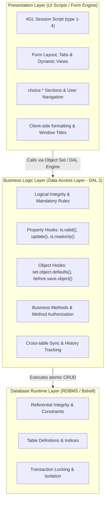

# DAL Architecture & Business Logic Guide

> **Reference Documents**: [Dev Tools Chapter 2: Software Components](../dev_tools/ch02_overview_of_software_components.md) | [Dev Tools Chapter 5: Development Procedures](../dev_tools/ch05_software_development_procedures.md) | [Extension Hooks Cookbook](01_extension_hooks_cookbook.md)  
> **Target Audience**: Infor LN Solution Architects, 4GL Developers, and AI Coding Agents

---

## 1. Architectural Separation of Concerns (SoC)

In Infor ERP LN, application architecture enforces a strict boundary between **presentation logic** and **business data logic**.



### The Cardinal Rule of Infor LN Development:
> [!CAUTION]
> **NEVER perform database insert/update/delete operations or business validation logic inside 4GL UI scripts (`main.table.io`, `choice.*`, or form field sections).**  
> All data validations, default values, dependent field updates, and database modifications MUST reside strictly in the table's **Data Access Layer (DAL)** or **Table Extension**.

#### Why This Rule Is Non-Negotiable:
1. **Multi-Channel Consistency**: A table is updated not only by UI sessions, but also by BOD/BDE integrations, Infor OS ION workflows, Open Data REST APIs, and AFS background jobs. If business rules are placed in UI scripts, those rules are completely bypassed by automated integrations.
2. **Upgrade Safety**: Cloud tenant upgrades overwrite or replace standard session scripts. Logic encapsulated in DAL or Table Extensions remains stable and upgrades cleanly.
3. **Audit & Integrity Guarantee**: Centralizing validations in the DAL guarantees that invalid or corrupted records cannot enter the database under any circumstance.

---

## 2. DAL 1 vs. DAL 2: Architectural Comparison

Infor LN supports two generational architectures for Data Access Layer scripts:

| Feature / Aspect | DAL 1 (Legacy / Baan 5.0) | DAL 2 (Modern Infor LN) |
|---|---|---|
| **Scope of Logic** | Database integrity rules only; UI logic remained in UI scripts | Complete encapsulation of all business rules (DB + Field logic) |
| **Object Model** | Procedural record hooks | Object-oriented state with Property Hooks and Object Sets |
| **Field Logic** | Spread across UI scripts (`when.field.changes`, form checks) | Centralized in DAL 2 (`<field>.is.valid()`, `<field>.is.mandatory()`) |
| **Field Dependencies** | Manual re-execution logic in UI scripts | Registered automatically by bshell dependency engine |
| **Integration Support** | Poor (requires duplicate business logic in BOIs/adapters) | Native (BODs, OData, and APIs inherit DAL 2 logic automatically) |
| **Form Command Wiring** | Hardcoded session commands | Dynamic Business Methods enabled/disabled via `method.is.allowed()` |

### Migration Recommendations:
- **New Tables**: Always write **DAL 2** scripts.
- **Existing DAL 1 Tables**: Migrate to DAL 2 whenever adding significant new business rules, exposing the table to Infor OS (BOD/REST), or building mobile/web integrations.
- **Standard Infor Tables**: Use **Table Extensions** (which adhere to the DAL 2 paradigm) rather than modifying standard DAL 1 scripts.

---

## 3. Object Set Hooks & Record Lifecycle

Object set hooks govern how sets of records are queried, traversed, initialized, and persisted.

### 3.1 `before.open.object.set()`
Executed before the query for the object set is opened. Use this hook to inject query filters (`query.extend.where()`) or restrict data by company/user parameters.

```baan
function extern long before.open.object.set()
{
    |* Ensure only active orders for the current user's department are selected
    query.extend.where("tdsls400.dept = " & quoted.string(user.department))
    return(0)
}
```

### 3.2 `set.object.defaults()`
Initializes default values for newly created records (`DAL_NEW`) before presentation to the user.

```baan
function extern long set.object.defaults()
{
    tdsls400.sotp = "NOR"                       |* Normal sales order
    tdsls400.odat = utc.num()                   |* Current UTC timestamp
    tdsls400.hdst = tdsls.hdst.created          |* Status: Created
    tdsls400.cprj = ""                          |* Clear project code
    tdsls400.crep = logname$                    |* Default sales rep to current user
    return(0)
}
```

### 3.3 `before.save.object(long mode)`
The critical gatekeeper hook before committing changes to the database. Validates cross-field constraints and related table consistency.

```baan
function extern long before.save.object(long mode)
{
    on case mode
    case DAL_NEW:
        if tdsls400.oamt <= 0.0 then
            dal.set.error.message("@txsls001") |* Order amount must be positive
            return(DALHOOKERROR)
        endif
        break
    case DAL_UPDATE:
        |* Prevent changing customer code once order lines exist
        with.old.object.values.do(check_customer_unchanged)
        break
    endcase

    return(0)
}
```

---

## 4. Property Hooks & Dependency Engine

In DAL 2, every table column can have associated property hooks. The bshell automatically maintains a dependency graph: if Field B depends on Field A, changing Field A triggers the hooks for Field B automatically.

### 4.1 Property Hook Roster

| Property Hook | Return Type | Purpose |
|---|---|---|
| `<field>.is.applicable(long mode)` | `boolean` | Determines if field is editable/visible based on record state |
| `<field>.is.mandatory(long mode)` | `boolean` | Enforces mandatory user entry |
| `<field>.is.readonly(long mode)` | `boolean` | Dynamically locks field while keeping it visible |
| `<field>.make.valid(long mode)` | `long` | Normalizes or rounds input value prior to validation |
| `<field>.is.valid(long mode)` | `boolean` | Verifies business validity against database/business rules |
| `<field>.update(long mode)` | `void / long` | Automatically calculates or defaults value when dependencies change |

### 4.2 Comprehensive Property Hook Example

```baan
|* 1. Delivery Date must be in the future
function extern boolean tdsls400.ddat.is.valid(long mode)
{
    if tdsls400.ddat < utc.num() then
        dal.set.error.message("@txsls002") |* Delivery date cannot be in the past
        return(false)
    endif
    return(true)
}

|* 2. Recalculate tax and line total whenever order quantity changes
function extern void tdsls401.tamt.update(long mode)
{
    tdsls401.tamt = (tdsls401.qoor * tdsls401.pric) - tdsls401.disc
}

|* 3. Make Project Code mandatory if Order Type is "PRJ"
function extern boolean tdsls400.cprj.is.mandatory(long mode)
{
    return(tdsls400.sotp = "PRJ")
}
```

---

## 5. Business Methods & Method Authorization

DAL 2 allows developers to expose public business operations directly on the business object, decoupling actions from specific UI session buttons.

### 5.1 Defining a Business Method
A business method performs an operational action on the record (e.g. `release_order`, `calculate_rebates`, `close_order`):

```baan
function extern long release_sales_order()
{
    if tdsls400.hdst <> tdsls.hdst.approved then
        dal.set.error.message("@txsls003") |* Only approved orders can be released
        return(DALHOOKERROR)
    endif

    tdsls400.hdst = tdsls.hdst.released
    tdsls400.rdat = utc.num()
    
    |* Persist state change through DAL framework
    return(dal.update("tdsls400"))
}
```

### 5.2 Method Authorization (`method.is.allowed()`)
Controls whether standard operations (`DAL_NEW`, `DAL_UPDATE`, `DAL_DESTROY`) or custom business methods are permitted based on record status or user privileges:

```baan
function extern boolean method.is.allowed(long method)
{
    on case method
    case DAL_DESTROY:
        |* Deletion forbidden once order is in process or closed
        if tdsls400.hdst >= tdsls.hdst.in.process then
            dal.set.error.message("@txsls004") |* Cannot delete active orders
            return(false)
        endif
        return(true)

    case DAL_UPDATE:
        |* Updates locked for closed orders
        if tdsls400.hdst = tdsls.hdst.closed then
            return(false)
        endif
        return(true)
    endcase

    return(true)
}
```

---

## 6. Anti-Patterns to Avoid

| Anti-Pattern | Why It Fails | Correct Solution |
|---|---|---|
| Calling `db.update()` in a 4GL UI script | Bypasses DAL validations; breaks ION integrations and REST APIs | Call `dal.change.object()` or update via Session DAL bindings |
| Displaying `message()` inside a DAL hook | Hangs background servers, BOD listeners, and bshell engines | Use `dal.set.error.message("@msg_code")` and return `DALHOOKERROR` |
| Writing complex SQL queries inside property hooks | High query overhead on every field keystroke | Cache lookup values in module DLL or use `as set with 1 rows` with leading indices |
| Hardcoding error strings (`"Error occurred"`) | Prevents multi-language translation and automated error triage | Register message codes in `ttadv4150m000` (`@tx...`) |
