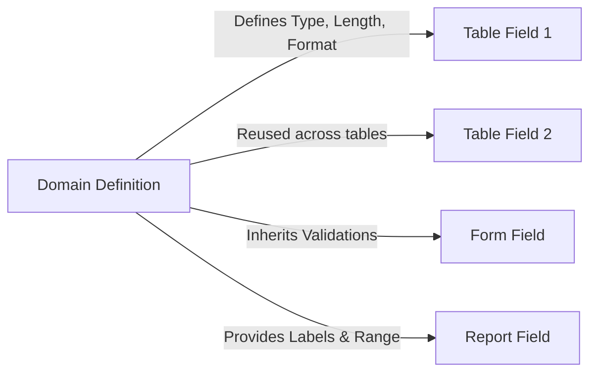
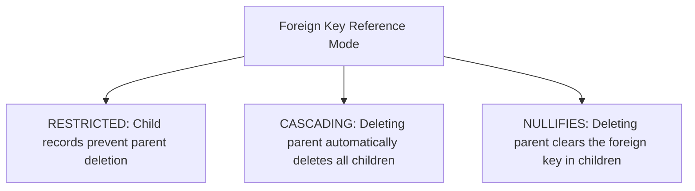
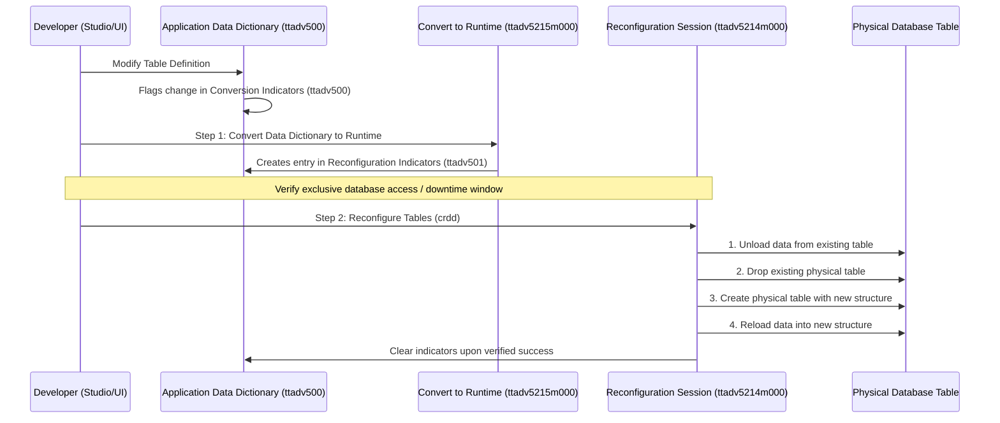

# Data Model & Domain Design Guide

> **Reference Documents**: [Dev Tools Chapter 2: Software Components](../dev_tools/ch02_overview_of_software_components.md) | [Dev Tools Chapter 3: Data Dictionaries](../dev_tools/ch03_data_dictionaries.md) | [Dev Tools Chapter 5: Development Procedures](../dev_tools/ch05_software_development_procedures.md) | [4GL Coding Standards & Truncation Prevention](06_4gl_coding_standards_and_caveats.md)  
> **Target Audience**: Infor LN Data Architects, Database Developers, and AI Coding Agents

---

## 1. Domain Modeling Architecture

In Infor ERP LN, every table column derives its properties from an underlying **Domain** (`ttadv4500m000`). Direct primitive type assignment on table fields is not permitted.

### 1.1 Core Domain Categories

| Category | Typical Usage | Format & Properties | Example Domains |
|---|---|---|---|
| **String / Alphanumeric** | Codes, descriptions, keys | Fixed length or dynamic; uppercase formatting masks | `tcmcs.str30`, `tcorno` |
| **Integer / Long** | Sequence numbers, flags, counters | Integer display format (`ZZZZZ9`) | `tcpono`, `tcyesno` |
| **Double / Amount** | Prices, quantities, financial amounts | Float with decimal positioning and sign masks | `tcamnt`, `tcqoor` |
| **Date / Time (UTC)** | Transaction dates, timestamps | Stored as integer UTC seconds; formatted per user locale | `tcdate`, `tcutc` |
| **List Domain (Enumeration)** | Discrete operational states | List of constants with dedicated language labels | `tdsls.hdst`, `tcyesno` |
| **Combined Domain** | Multi-part structured keys | Composite fields concatenated under single domain | `tckey` |

### 1.2 Domain Design Best Practices:
1. **Maximize Reuse**: Never create duplicate domains for identical semantic entities. Reuse standard domains (e.g. `tcmcs.cmnf` for manufacturer, `tcccty` for country) to ensure cross-module compatibility.
2. **Use List Domains for Fixed States**: Never use free-form string flags (`"Y"` / `"N"`, `"A"` / `"B"`). Always create a List Domain or use `tcyesno`.
3. **Embed Domain Check Expressions**: Define range constraints (`VALUE >= 0.0`) directly on the domain to enforce database-wide sanity checks automatically.
4. **Always Use Domain Variables in 4GL Scripts**: When manipulating database fields in 4GL scripts, always declare host variables using `domain <domain_name> <var>` instead of primitive types (`string`, `long`, `double`). Decoupling 4GL variables from Data Dictionary domains leads to silent data truncation upon dictionary changes. See [Pillar 1: Data Dictionary Domains vs. Primitive Types](06_4gl_coding_standards_and_caveats.md#21-data-dictionary-domains-vs-primitive-types).

---

## 2. Table Definition & Referential Integrity

Tables in Infor LN adhere to the strict naming convention: `<package><module><seq>` (e.g. `tdsls400` = Package `td`, Module `sls`, Sequence `400`).

### 2.1 Primary Keys & Candidate Indices
- **Index 1 (`_index1`)**: The primary key. Must be unique and minimal. Typically combines parent key + sequence number (e.g. `tdsls401._index1 = (orno, pono, sqnb)`).
- **Secondary Indices**: Add indices to support frequent search patterns, MMT satellite synchronizations, and reporting queries. Keep index count balanced to avoid write-amplification during inserts.

### 2.2 Reference Integrity Modes
When defining foreign key relationships in `ttadv4520m000`, choose the appropriate referential action:

- **Restricted (Default)**: Prevents deleting the master record if child records exist (e.g., cannot delete `tccom100` Business Partner if `tdsls400` Sales Orders exist).
- **Cascading**: Automatically deletes dependent child records when the master record is deleted (e.g., deleting `tdsls400` deletes associated `tdsls401` order lines).
- **Nullifies**: Sets the foreign key field to empty/zero when the parent is deleted.

---

## 3. Table Reconfiguration (`crdd`) & Runtime Safety

Infor LN separates design-time metadata (**Application Data Dictionary** in `ttadv*` tables) from the binary engine files (**Runtime Data Dictionary** in `$BSE/dict/` and `ttadv999`).

### 3.1 When is Table Reconfiguration Required?
Whenever changes are made to:
- Adding, removing, or reordering table fields.
- Changing field domains, data types, or lengths.
- Adding, modifying, or removing table indices.

### 3.2 The Safe 2-Step `crdd` Reconfiguration Procedure

### 3.3 Critical Safety Safeguards:
> [!WARNING]
> **Data Loss Risk**: Table reconfiguration (`crdd`) drops the physical database table!  
> 1. Always execute a database backup before running `crdd` in staging or production.  
> 2. Ensure exclusive table access: no background jobs or active users can hold locks on the table during reconfiguration.  
> 3. Never terminate the bshell process while `crdd` is in progress.
