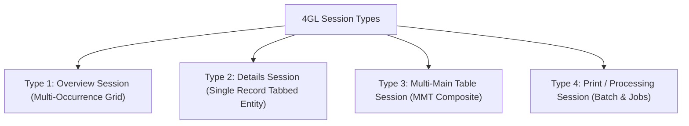
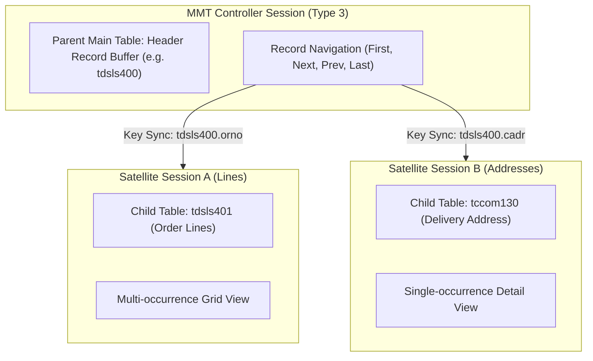

# Session & MMT Patterns Guide

> **Reference Documents**: [Dev Tools Chapter 2: Software Components](../dev_tools/ch02_overview_of_software_components.md) | [Dev Tools Chapter 5: Development Procedures](../dev_tools/ch05_software_development_procedures.md) | [DAL Architecture Guide](02_dal_architecture_and_business_logic.md)  
> **Target Audience**: Infor LN UI/UX Developers, Session Engineers, and AI Coding Agents

---

## 1. 4GL Session Types & Architecture

Infor ERP LN categorizes interactive programs into 4 standardized session types (`ttadv2500m000`):



### 1.1 Summary of Session Types

| Type | Name | Purpose | Primary Controls & Form Structure |
|---|---|---|---|
| **Type 1** | **Overview** | Browsing, filtering, sorting, and selecting multiple records | Multi-occurrence grid table with column filters, search bar, and action buttons |
| **Type 2** | **Details** | Deep editing of a single entity and its attributes | Single occurrence form with tabbed group views, header fields, and field prompts |
| **Type 3** | **Multi-Main Table (MMT)** | Simultaneous viewing/editing of parent header and multiple related child tables | Controller frame managing embedded Satellite sessions with synchronized key passing |
| **Type 4** | **Print / Processing** | Running reports, batch updates, interfaces, and background tasks | Parameter input form with range filters (e.g. `item.f` to `item.t`) and Device Selection |

---

## 2. Multi-Main Table (MMT) Architecture & Synchronization

The Multi-Main Table (MMT) pattern solves the problem of presenting complex aggregate entities (such as a Sales Order header and its Lines, Deliveries, and Invoices) on a single unified screen.

### 2.1 The Controller & Satellite Pattern



### 2.2 Key Synchronization Mechanics:
1. **Controller Session**:
   - Bound to the parent main table (e.g. `tdsls400`).
   - Does not contain full editable fields directly; coordinates the layout and hosts Satellite views.
2. **Satellite Sessions**:
   - Independent Type 1 or Type 2 sessions assigned to the Controller in session relations (`ttadv2500m000`).
   - The bshell automatically filters each satellite's main table query using the parent record's foreign key index.
3. **Parent-Child Synchronization**:
   - When the user scrolls or selects a new record in the Controller, the 4GL Engine automatically refreshes all linked Satellites without requiring custom 4GL event code.

---

## 3. Form Commands & Dynamic Controls

Form commands wire user interactions (ribbon buttons, context menus, shortcuts) to 4GL logic.

### 3.1 Standard vs Custom Form Commands
- **Standard Form Commands**: Handled automatically by the 4GL Engine (`first.view`, `next.view`, `find.data`, `modify.set`, `save`, `exit`).
- **Custom Form Commands**: Developer-defined actions (e.g. `release.order`, `recalculate.prices`, `print.packing.slip`).

### 3.2 Activating & Controlling Form Commands
In DAL 2 and modern 4GL, custom form commands are bound to DAL business methods. The session framework enables or disables them automatically based on `method.is.allowed()`:

```baan
|* UI Script: Invoking a custom command
choice.user.0:
on.choice:
    if not dal.is.method.allowed("tdsls400", "release_order") then
        return
    endif
    dal.start.business.method("tdsls400", "release_order")
```

---

## 4. Internationalization & Multi-Language Standards

Infor LN software components must remain completely language-agnostic. Hardcoding string literals in scripts or form layouts is strictly prohibited.

### 4.1 The Three Pillars of Infor LN Localization

| Component | Management Session | Naming & Syntax | Usage |
|---|---|---|---|
| **Labels** | `ttadv1540m000` | `<table>.<field>` or `<pkg><mod>...` | Used on form prompts, grid column headers, and report column titles |
| **Messages** | `ttadv4150m000` | `@<pkg><mod><num>` (e.g. `@txsls001`) | Used in `dal.set.error.message()` and warning notifications |
| **Questions** | `ttadv1500m000` | `@<pkg><mod>q<num>` | Used in interactive confirmation dialogs (`ask.enum()`) |

### 4.2 Multi-Language Translation Best Practices:
1. **Never Hardcode Text in 4GL**: Always create a label code or message code in the Data Dictionary.
2. **Parameterized Messages**: Use `%1$s`, `%2$d` tokens in messages to allow translators to adjust word order across languages without breaking format strings.
3. **Convert to Runtime After Translation**: Run `ttadv5215m000` to dump runtime label files (`$BSE/dict/`) so translations take effect in the bshell.
