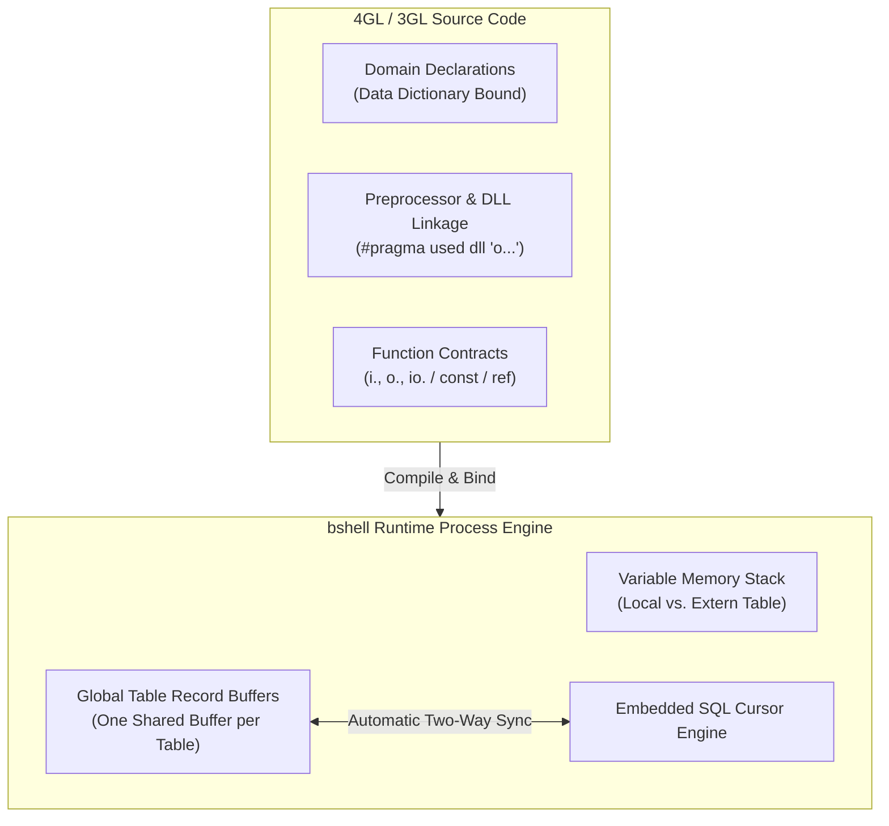
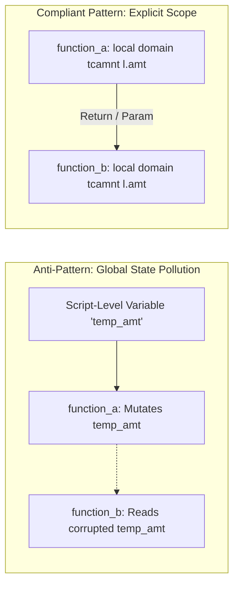
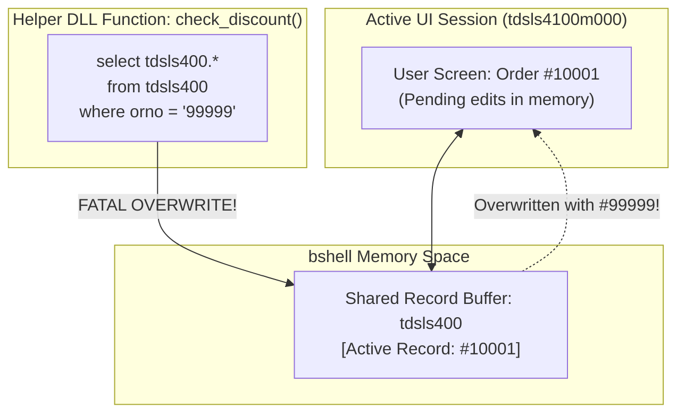
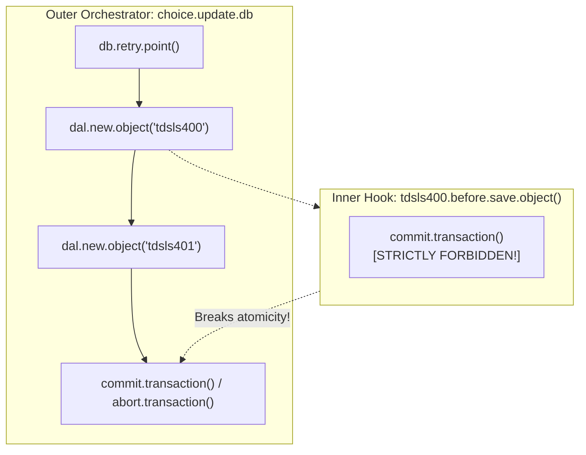

# Baan 4GL Coding Standards, Anti-Patterns & Runtime Caveats Guide

> **Reference Documents**: [Dev Tools Chapter 2: Software Components](../dev_tools/ch02_overview_of_software_components.md) | [Dev Tools Chapter 3: Data Dictionaries](../dev_tools/ch03_data_dictionaries.md) | [Dev Tools Chapter 5: Development Procedures](../dev_tools/ch05_software_development_procedures.md) | [SQL Query Optimization & Transactions](03_sql_query_optimization_and_transactions.md) | [Data Model & Domain Design](04_data_model_and_domain_design.md)  
> **Target Audience**: Infor ERP LN Developers, Backend Engineers, and AI Coding Agents  
> **Scope**: Language-level 4GL fundamentals, defensive coding contracts, table buffer safety, and bshell runtime caveats for LN Cloud and On-Premises environments.

---

## Table of Contents

1. [Architectural Overview & Engineering Principles](#1-architectural-overview--engineering-principles)
2. [Pillar 1: Domain, Variable, and Scope Declaration](#2-pillar-1-domain-variable-and-scope-declaration)
   - [2.1 Data Dictionary Domains vs. Primitive Types](#21-data-dictionary-domains-vs-primitive-types)
   - [2.2 Enumeration and Set Domain Binding](#22-enumeration-and-set-domain-binding)
   - [2.3 Function-Local Scope Confinement](#23-function-local-scope-confinement)
   - [2.4 Prescriptive Criteria for `extern` Variables](#24-prescriptive-criteria-for-extern-variables)
3. [Pillar 2: DLL Linkage, Preprocessor Directives, and Macros](#3-pillar-2-dll-linkage-preprocessor-directives-and-macros)
   - [3.1 External Shared Library Linkage (`#pragma used dll`)](#31-external-shared-library-linkage-pragma-used-dll)
   - [3.2 System vs. Application Header Include Directives](#32-system-vs-application-header-include-directives)
   - [3.3 Macro Hygiene and Reserved Keyword Protection](#33-macro-hygiene-and-reserved-keyword-protection)
4. [Pillar 3: Function Architecture and Parameter Passing](#4-pillar-3-function-architecture-and-parameter-passing)
   - [4.1 Directional Hungarian Parameter Notation](#41-directional-hungarian-parameter-notation)
   - [4.2 Immutability Enforcement with `const`](#42-immutability-enforcement-with-const)
   - [4.3 Reference Semantics with `ref`](#43-reference-semantics-with-ref)
   - [4.4 Standardized Return Status Conventions](#44-standardized-return-status-conventions)
5. [Pillar 4: Embedded SQL & Table Record Buffer Protection](#5-pillar-4-embedded-sql--table-record-buffer-protection)
   - [5.1 The Shared Table Record Buffer Overwrite Vulnerability](#51-the-shared-table-record-buffer-overwrite-vulnerability)
   - [5.2 Column-to-Local Host Variable Binding](#52-column-to-local-host-variable-binding)
   - [5.3 Cursor Isolation via Table Aliases](#53-cursor-isolation-via-table-aliases)
   - [5.4 Point Lookup Optimization (`as set with 1 rows`)](#54-point-lookup-optimization-as-set-with-1-rows)
   - [5.5 Explicit Field Predicates vs. Legacy Index Identifiers](#55-explicit-field-predicates-vs-legacy-index-identifiers)
   - [5.6 DAL Delegation over Raw Database Mutations](#56-dal-delegation-over-raw-database-mutations)
6. [Pillar 5: Domain Arrays and Dimension Mechanics](#6-pillar-5-domain-arrays-and-dimension-mechanics)
   - [6.1 1-Based Indexing and Zero-Index Prohibition](#61-1-based-indexing-and-zero-index-prohibition)
   - [6.2 Declaring Dimensioned Domain Arrays](#62-declaring-dimensioned-domain-arrays)
   - [6.3 Passing Arrays Across Function Signatures (`fixed` and `()`)](#63-passing-arrays-across-function-signatures-fixed-and-)
7. [Pillar 6: Critical Syntax Caveats & Anti-Patterns](#7-pillar-6-critical-syntax-caveats--anti-patterns)
   - [7.1 Precision-Safe Floating-Point Comparisons (`double.cmp`)](#71-precision-safe-floating-point-comparisons-doublecmp)
   - [7.2 Outer-Boundary Transaction Orchestration](#72-outer-boundary-transaction-orchestration)
   - [7.3 4GL Reserved Keywords Reference](#73-4gl-reserved-keywords-reference)
   - [7.4 Mandatory `selectempty` State Handling](#74-mandatory-selectempty-state-handling)
   - [7.5 Elimination of Unstructured `goto` Statements](#75-elimination-of-unstructured-goto-statements)
   - [7.6 Scoped Row-Locking Windows and Rollbacks](#76-scoped-row-locking-windows-and-rollbacks)
8. [Summary: Quick Reference Checklist](#8-summary-quick-reference-checklist)

---

## 1. Architectural Overview & Engineering Principles

The Infor ERP LN 4GL execution engine (**bshell**) compiles 4GL and 3GL source code into portable object files executed within a stateful, event-driven virtual runtime. While 4GL provides deep native integration with the database catalog and session forms, its execution architecture has fundamental characteristics that distinguish it from general-purpose languages:



### The Six Pillars of Defensive 4GL Engineering:
1. **Strict Domain Typing**: Bind all business and database-interfacing variables to Data Dictionary domains to eliminate silent data truncation.
2. **Deterministic Preprocessor Linkage**: Link libraries with explicit object prefixes (`o`) and segregate system vs. application header imports.
3. **Explicit Parameter Contracts**: Document and enforce data flow direction (`i.`, `o.`, `io.`), parameter immutability (`const`), and output reference semantics (`ref`).
4. **Table Buffer Collision Protection**: Prevent accidental UI form data corruption by isolating queries into local variables or explicit table aliases.
5. **1-Based Array Indexing Discipline**: Guard against bshell memory access violations by enforcing 1-based indexing and explicit dimension passing.
6. **Robust Runtime Precision & Transaction Boundaries**: Eliminate floating-point comparison errors using epsilon functions (`double.cmp()`), eliminate nested transaction commits in subroutines/DAL hooks, and enforce strict error rollback handling.

---

## 2. Pillar 1: Domain, Variable, and Scope Declaration

### 2.1 Data Dictionary Domains vs. Primitive Types

In Infor LN, table columns and business entity attributes are bound to centralized **Domains** defined in the Application Data Dictionary (`ttadv4500m000`). Domains define data types, byte storage sizes, decimal positions, display formatting masks, and validation expressions.

#### The Truncation Hazard:
When a developer declares a variable using primitive language types (such as `long`, `double`, or a fixed-length `string`), the variable is decoupled from the centralized data dictionary. If an enterprise increases a field length (e.g., order numbers expanding from 9 to 12 characters, or item codes expanding from 30 to 47 characters), compiled code using primitive types will silently truncate strings or overflow numeric limits during runtime assignments and SQL binding.

| Data Category | Forbidden Primitive Declaration | Mandatory Domain Declaration | Purpose |
|---|---|---|---|
| Sales Order Number | `string orno(9)` | `domain tcorno orno` | Adapts to enterprise key length alterations |
| Order Line Position | `long pono` | `domain tcpono pono` | Guarantees alignment with table key indexing |
| Currency Amount | `double amt` | `domain tcamnt amt` | Enforces standard monetary precision & rounding |
| Business Partner Code | `string bp(9)` | `domain tccom.bpid bp` | Prevents truncation of enterprise master partner IDs |
| Item Code | `string item(30)` | `domain tcitem item` | Aligns with extended item code definitions |
| Generic Text / Remarks | `string desc(30)` | `domain tcdsca desc` | Preserves international multilingual text sizes |

> [!IMPORTANT]
> Primitive types (`long`, `double`, `string`) are permissible **only** for transient technical counters (e.g., `long i`, `long ret`), system file pointers (`long fp`), or generic low-level scratch buffers (e.g., `string buffer(1024)`). Every variable holding business data or database column values **must** use a `domain` declaration.

#### Anti-Pattern vs. Compliant Pattern:
```baan
|* ========================================================================
|* ANTI-PATTERN: Hardcoded primitives cause silent data truncation on upgrade
|* ========================================================================
function void calculate_discount()
{
    string  order_number(9)     |* DANGEROUS: Will truncate if tcorno expands
    long    line_sequence       |* DANGEROUS: Decoupled from tcpono domain rules
    double  line_amount         |* DANGEROUS: May lose precision vs tcamnt domain
    string  cust_name(30)       |* DANGEROUS: Infor LN standard name domain is tcnm35

    order_number = tdsls400.orno
    line_amount  = tdsls401.amnt
}

|* ========================================================================
|* COMPLIANT PATTERN: Centralized domain binding with zero truncation risk
|* ========================================================================
function void calculate_discount()
{
    domain tcorno       order_number
    domain tcpono       line_sequence
    domain tcamnt       line_amount
    domain tcnm35       cust_name

    order_number = tdsls400.orno
    line_sequence = tdsls401.pono
    line_amount  = tdsls401.amnt
}
```

---

### 2.2 Enumeration and Set Domain Binding

In Infor LN, discrete business states and multi-option configurations are modeled using **List Domains** (`ttadv4501m000`) and **Set Domains** (`ttadv4502m000`).

#### 1. List Domains (Single-Choice Enumerations):
List domains represent mutually exclusive states (e.g. `tdsls.hdst.created`, `tdsls.hdst.approved`, `tcyesno.yes`, `tcyesno.no`).
- **Never use raw integer literals** (e.g., `1`, `2`) or string flags (`"Y"`, `"N"`).
- Always declare host variables using the specific List Domain name.
- Always evaluate states against symbolic domain constants.

#### 2. Set Domains (Multi-Choice Bitmask Sets):
Set domains store multiple simultaneously active options in a single integer column (e.g. document output destinations, processing option sets).
- Declare host variables with the set domain name: `domain <set_domain> l.active_options`.
- Use the 4GL `in` operator to test for element membership: `if <set_constant> in l.active_options then ... endif`.
- Never use raw bit shifts (`l.opts & 4`) or independent boolean flags.

```baan
|* ========================================================================
|* ANTI-PATTERN: Magic numbers, primitive flags, and bitwise manipulation
|* ========================================================================
function long check_order_options(domain tcorno i.orno)
{
    long status                     |* WRONG: Primitive integer used for enum
    long print_flags                |* WRONG: Primitive integer used for set

    select tdsls400.hdst, tdsls400.prnt
    from   tdsls400
    where  tdsls400.orno = :i.orno
    selectdo
        status = tdsls400.hdst
        print_flags = tdsls400.prnt
        if status == 1 then         |* WRONG: Magic number instead of domain constant
            if (print_flags & 2) != 0 then |* WRONG: Low-level bitmask arithmetic
                return(0)
            endif
        endif
    endselect
    return(-1)
}

|* ========================================================================
|* COMPLIANT PATTERN: List & Set domain constants with safe local binding
|* ========================================================================
function long check_order_options(
    const domain tcorno i.orno,
    ref   boolean       o.is_printable)
{
    domain tdsls.hdst   l.order_status
    domain tdsls.prnt   l.print_options

    o.is_printable = false
    l.order_status = tdsls.hdst.created
    l.print_options = 0

    select tdsls400.hdst:l.order_status,
           tdsls400.prnt:l.print_options
    from   tdsls400
    where  tdsls400.orno = :i.orno
    as set with 1 rows
    selectdo
        |* Evaluate List Domain via symbolic constant
        if l.order_status = tdsls.hdst.approved then
            |* Evaluate Set Domain via 4GL 'in' operator
            if tdsls.prnt.invoice in l.print_options then
                o.is_printable = true
                return(0)
            endif
        endif
    selectempty
        o.is_printable = false
        return(-1)
    endselect

    return(0)
}
```

---

### 2.3 Function-Local Scope Confinement

4GL allows variables to be declared outside of functions at the top of a script. Unless marked with `extern`, these variables have script-level global scope. 

#### Scope Confinement Rules:
1. **Enforce Local Scope**: All scratch variables, calculation accumulators, loop indices, and intermediate state must be declared **inside the function body**.
2. **Prevent Global Leakage**: Never rely on script-level variables to pass state between helper subroutines. Global state leakage introduces non-reentrant logic, concurrency race conditions, and side effects across nested function calls.



---

### 2.4 Prescriptive Criteria for `extern` Variables

The `extern` storage class declares that a variable resides in the bshell process's external symbol table. 

#### Permitted Use Cases for `extern`:
1. **UI Form Field Binding**: Variables displayed on dynamic session forms or prompts that do not map directly to a database table field (`form.field`).
2. **Report Layout Binding**: Variables passed into 4GL report layouts to be rendered in headers, details, or footers.
3. **Cross-Session IPC (`import()` / `export()`)**: Variables exchanged across separate bshell process instances via `export("var.name", val)` and `import("var.name", val)`.
4. **Table Record Declarations**: Tables declared via `table tt<pkg><mod><seq>` are implicitly external symbols shared across the session.

#### Prohibited Use Cases for `extern`:
- Never declare `extern` variables in shared business library DLLs (`tccomdll...`, `tdslsdll...`).
- Never declare `extern` variables as calculation temps, loop counters, or function-internal accumulators.
- Never use `extern` to avoid declaring formal function parameters.

---

## 3. Pillar 2: DLL Linkage, Preprocessor Directives, and Macros

### 3.1 External Shared Library Linkage (`#pragma used dll`)

In Infor LN, shared business logic is compiled into 3GL/4GL shared dynamic link libraries (DLLs). To enable compile-time symbol resolution and runtime dynamic linking, calling scripts must declare the library dependency using `#pragma used dll`.

#### The Mandatory Object Prefix Rule:
In the LN runtime filesystem, compiled library object files are stored with a lowercase `o` prefix before the library code (e.g., source library `tdsls0001` compiles to object `otdsls0001`).

```baan
|* ========================================================================
|* ANTI-PATTERN: Missing 'o' prefix causes runtime unresolved DLL errors
|* ========================================================================
#pragma used dll "tdsls0001"     |* FATAL: bshell looks for 'tdsls0001', fails to load!

|* ========================================================================
|* COMPLIANT PATTERN: Explicit 'o' prefix for object resolution
|* ========================================================================
#pragma used dll "otdsls0001"    |* CORRECT: Links to compiled bshell object otdsls0001
#pragma used dll "otccom0010"    |* CORRECT: Links to Business Partner shared DLL
```

> [!WARNING]
> Omitting the `o` prefix may allow compilation in some legacy environments if symbols are loosely linked, but will trigger runtime fatal errors (`Error: Cannot load dynamic library`) when executed in modern Infor LN Cloud environments.

---

### 3.2 System vs. Application Header Include Directives

4GL distinguishes between standard system platform headers and application-specific header files:

| Syntax | Target Category | Resolution Path | Examples |
|---|---|---|---|
| `#include <header>` | System / Platform Runtime Headers | Standard bshell system include directories (`$BSE/include`) | `#include <bic_dam>`<br/>`#include <bic_text>`<br/>`#include <bic_desktop>` |
| `#include "header"` | Application & Data Dictionary Includes | Application package include directories (`$BSE/application/...`) | `#include "itdsls400"`<br/>`#include "itccom001"`<br/>`#include "otxxyzcommon"` |

#### Rules:
1. Always wrap standard bshell API headers in angle brackets: `<bic_dam>`, `<bic_cmf>`, `<bic_audit>`.
2. Always wrap application table definition includes or custom customer headers in double quotes: `"itdsls400"`, `"itdpur001"`.
3. Never mix the two syntaxes or specify absolute operating system paths.

---

### 3.3 Macro Hygiene and Reserved Keyword Protection

Constants declared via `#define` perform lexical token replacement prior to compilation. Poor macro naming causes catastrophic compilation errors and subtle AST mutations.

#### Rules for Macro Definitions:
1. **Mandatory Uppercase**: All macro identifiers must be uppercase alphanumeric with underscores: `#define MAX_RETRY_COUNT 5`.
2. **Strict Reserved Word Avoidance**: Never define macros that match or shadow 4GL keywords, predefined bshell variables, choice sections, or common domain names.
3. **Wrap Replacement Expressions**: Always parenthesize mathematical or logical expressions in macro definitions: `#define CALC_TOTAL(a, b) ((a) + (b))`.

```baan
|* ========================================================================
|* ANTI-PATTERN: Lowercase macros colliding with 4GL reserved keywords
|* ========================================================================
#define status      1           |* FATAL: Corrupts variable names and table fields!
#define date        20261022    |* FATAL: Shadows predefined variable 'date'
#define commit      0           |* FATAL: Collides with 4GL statement 'commit.transaction()'
#define add(x, y)   x + y * 2   |* DANGEROUS: Unparenthesized expression causes operator precedence bugs

|* ========================================================================
|* COMPLIANT PATTERN: Scoped, capitalized, protected macro definitions
|* ========================================================================
#define C_STATUS_INITIAL    1
#define C_DEFAULT_RUN_DATE  20261022
#define C_COMMIT_BATCH_SIZE 50
#define CALC_WEIGHTED(x, y) (((x) + (y)) * 2)
```

---

## 4. Pillar 3: Function Architecture and Parameter Passing

Modern Infor LN 4GL functions require explicit parameter contracts to ensure data flow transparency, caller safety, and deterministic error propagation.

### 4.1 Directional Hungarian Parameter Notation

Because 4GL functions often process complex business data across library boundaries, every formal parameter must indicate its data flow direction using standard prefixes:

| Prefix | Semantic Flow | Mutability & Lifetime | Responsibility |
|---|---|---|---|
| `i.` | **Input parameter** | Read-only (`const`) | Supplied by caller; must never be modified by the callee. |
| `o.` | **Output parameter** | Write-only reference (`ref`) | Calculated or populated by the callee; returned to caller. |
| `io.` | **Input/Output parameter** | Mutable reference (`ref`) | Initialized by caller, modified or transformed in-place by callee. |

---

### 4.2 Immutability Enforcement with `const`

To guarantee that a subroutine does not accidentally overwrite input arguments passed from calling business logic, decorate all input parameters (`i.`) with the `const` keyword.

- `const` instructs the 4GL compiler to disallow assignments to the parameter within the function body.
- It prevents side-effect mutations on variables passed by reference from caller scopes.

---

### 4.3 Reference Semantics with `ref`

In 4GL, primitive and domain arguments are passed **by value** by default unless the receiving signature specifies `ref`. 
- If an output parameter (`o.`) or in-place parameter (`io.`) omits `ref`, the callee only mutates a local copy on the stack, and the caller's variable remains unchanged upon return.
- Always declare all `o.` and `io.` parameters with `ref`.

---

### 4.4 Standardized Return Status Conventions

Functions that perform operations, validations, or state mutations must return a status of type `long`. Standardize on the following uniform convention across all libraries and scripts:

| Return Code | Meaning | Action / Interpretation |
|---|---|---|
| `0` | **Success / OK** | Operation completed successfully with zero validation errors. |
| `< 0` | **Error / Failure** | Standard negative failure code (e.g. `-1` generic error, `-2` not found, or `DALHOOKERROR`). Caller must abort or rollback. |
| `> 0` | **Count / Metric** | (Optional) Number of records processed or positive handle identifier. |

> [!CAUTION]
> Never design functions where `1` indicates failure and `0` indicates success inconsistently. Standardizing strictly on `0 = SUCCESS` and `< 0 = ERROR` ensures reliable integration with DAL hooks and bshell runtime checks.

#### Anti-Pattern vs. Compliant Pattern:
```baan
|* ========================================================================
|* ANTI-PATTERN: Undefined directions, mutable inputs, missing ref, ad-hoc status
|* ========================================================================
function int calc_tax(orno, discount, final_amt)    |* DANGEROUS: Untyped, no directions
    string orno(9)                                  |* DANGEROUS: Primitives
    double discount
    double final_amt
{
    discount = discount + 5.0                       |* BUG: Caller's discount is mutated!
    final_amt = 100.0 - discount                    |* BUG: Without 'ref', caller sees 0!
    return(1)                                       |* AMBIGUOUS: Does 1 mean success or error?
}

|* ========================================================================
|* COMPLIANT PATTERN: Strict directional contracts, const/ref, standard status
|* ========================================================================
function long calc_tax(
    const domain tcorno  i.orno,
    const domain tcamnt  i.discount,
    ref   domain tcamnt  o.final_amt)
{
    domain tcamnt l.base_amount

    if isspace(i.orno) then
        return(-1)                                  |* Standard negative error code
    endif

    l.base_amount = get_order_base_amount(i.orno)
    if l.base_amount <= 0.0 then
        return(-2)                                  |* Specific validation failure
    endif

    o.final_amt = l.base_amount - i.discount
    return(0)                                       |* Standard 0 for SUCCESS
}
```

---

## 5. Pillar 4: Embedded SQL & Table Record Buffer Protection

### 5.1 The Shared Table Record Buffer Overwrite Vulnerability

In the bshell architecture, when a script declares a table (e.g. `table ttdsls400`), the engine allocates **exactly one shared memory record buffer** for that table across the entire process:



#### The Catastrophe:
When a user is modifying Order `#10001` on screen, the shared `tdsls400` buffer holds `#10001`. If a form event or helper function executes:
```baan
select tdsls400.* from tdsls400 where tdsls400.orno = :other.orno selectdo ...
```
The bshell query engine **silently overwrites** the active `tdsls400` buffer with Order `#99999`. When the user clicks "Save", bshell writes `#99999` over Order `#10001`, or fails with concurrency conflicts. **This is one of the most severe data-corruption bugs in 4GL development.**

---

### 5.2 Column-to-Local Host Variable Binding

To read database fields in subroutines, batch loops, or helper functions without corrupting the table record buffer, bind the queried columns directly into **local host variables**:

```baan
|* ========================================================================
|* ANTI-PATTERN: Overwrites global tdsls400 table record buffer
|* ========================================================================
function long get_order_type(
    const domain tcorno i.orno,
    ref   domain tcsotp o.sotp)
{
    select tdsls400.sotp
    from   tdsls400
    where  tdsls400.orno = :i.orno
    selectdo
        return(tdsls400.sotp)   |* FATAL: Overwrites active session tdsls400 buffer!
    endselect
    return("")
}

|* ========================================================================
|* COMPLIANT PATTERN: Direct local variable binding (Buffer Safe)
|* ========================================================================
function long get_order_type(
    const domain tcorno i.orno,
    ref   domain tcsotp o.sotp)
{
    domain tcsotp l.sotp

    l.sotp = ""
    select tdsls400.sotp:l.sotp
    from   tdsls400
    where  tdsls400.orno = :i.orno
    as set with 1 rows
    selectdo
        o.sotp = l.sotp
        return(0)
    selectempty
        o.sotp = ""
        return(-1)
    endselect

    return(0)
}
```

---

### 5.3 Cursor Isolation via Table Aliases

When multiple records from the same table must be inspected simultaneously (e.g., self-joins or secondary lookups), use a **Table Alias**. An alias instructs bshell to allocate an isolated query cursor:

```baan
|* ========================================================================
|* COMPLIANT PATTERN: Table Alias isolates cursor and buffer
|* ========================================================================
function long find_parent_order(
    const domain tcorno i.child_orno,
    ref   domain tcorno o.parent_orno)
{
    domain tcorno l.parent_orno

    l.parent_orno = ""
    select parent_sls.orno:l.parent_orno
    from   tdsls400 parent_sls
    where  parent_sls.orno in (
        select tdsls401.orno
        from   tdsls401
        where  tdsls401.corn = :i.child_orno
    )
    as set with 1 rows
    selectdo
        o.parent_orno = l.parent_orno
        return(0)
    selectempty
        o.parent_orno = ""
        return(-1)
    endselect

    return(0)
}
```

---

### 5.4 Point Lookup Optimization (`as set with 1 rows`)

When retrieving a single record by its unique primary key or unique index, always append `as set with 1 rows`.
- Informs the query optimizer that at most one record matches.
- Closes the cursor immediately upon fetching the single row, preventing cursor leaks and minimizing database network round trips.

---

### 5.5 Explicit Field Predicates vs. Legacy Index Identifiers

Legacy 4GL scripts occasionally used index references in where clauses: `where tdsls400._index1 = {:i.orno}`.
- **Rule**: Always write explicit field names in query filters: `where tdsls400.orno = :i.orno`.
- Explicit predicates guarantee that if Data Dictionary indices are reconfigured, restructured, or expanded, the query semantics remain 100% stable.

---

### 5.6 DAL Delegation over Raw Database Mutations

Under modern Infor LN Cloud architecture, direct database write statements (`db.insert()`, `db.update()`, `db.delete()`) are strictly prohibited in session scripts and business subroutines.

#### Why Raw `db.*` is Forbidden:
1. Bypasses Data Access Layer (DAL 2) property checks and business validations (`is.valid()`, `check.input()`).
2. Bypasses Table Extension hooks (`before.save.object()`, `after.save.object()`).
3. Bypasses Infor ION Business Object Document (BOD) event generation and enterprise audit logging.

```baan
|* ========================================================================
|* ANTI-PATTERN: Raw database update bypassing business rules and DAL
|* ========================================================================
function void approve_order(domain tcorno i.orno)
{
    db.retry.point()
    select tdsls400.*
    from   tdsls400 for update
    where  tdsls400.orno = :i.orno
    as set with 1 rows
    selectdo
        tdsls400.hdst = tdsls.hdst.approved
        db.update(ttdsls400, db.retry)   |* FORBIDDEN: Bypasses DAL, audit, & hooks!
        commit.transaction()
    endselect
}

|* ========================================================================
|* COMPLIANT PATTERN: DAL 2 Object Mutation
|* ========================================================================
function long approve_order(const domain tcorno i.orno)
{
    long ret

    ret = dal.change.object("tdsls400")
    if ret != 0 then
        return(-1)
    endif

    dal.set.field("tdsls400.orno", i.orno)
    dal.set.field("tdsls400.hdst", tdsls.hdst.approved)

    ret = dal.save.object("tdsls400")
    if ret != 0 then
        dal.reset.object("tdsls400")
        return(-2)
    endif

    return(0)
}
```

---

## 6. Pillar 5: Domain Arrays and Dimension Mechanics

Arrays in Baan 4GL operate within fixed bshell runtime memory blocks. Violating array boundary rules causes silent memory corruption or unrecoverable bshell process terminations.

### 6.1 1-Based Indexing and Zero-Index Prohibition

Unlike C or Java, Baan 4GL arrays are strictly **1-based**. The first valid element of an array is at index `1`, and the last element is at index `N` (where `N` is the declared dimension size).

```baan
|* Declared dimension: 5 elements (indices 1, 2, 3, 4, 5)
domain tcitem item_list(5)
```

#### The Zero-Index Catastrophe:
- Accessing `item_list(0)` is an out-of-bounds memory access.
- In some bshell versions, index 0 does not immediately throw a bounds error, but reads or writes into adjacent variable memory on the execution stack, corrupting neighboring variables.
- In modern Infor LN Cloud, accessing index 0 or index > N triggers fatal process termination: `bshell error: Array index out of bounds`.

#### Rules:
1. Always iterate starting at `1`: `for i = 1 to max_elements`.
2. Never iterate from `0`: `for i = 0 to max_elements - 1` is strictly forbidden.
3. Guard all dynamic index calculations with boundary checks: `if idx >= 1 and idx <= MAX_DIM then ... endif`.

---

### 6.2 Declaring Dimensioned Domain Arrays

When declaring arrays, always combine centralized Data Dictionary domains with explicit dimension sizes:

```baan
|* Single-dimensional domain array
domain tcorno   recent_orders(10)       |* Holds 10 Sales Order numbers (1..10)

|* Multi-dimensional domain array
domain tcamnt   period_totals(12, 5)    |* 12 months, 5 cost categories (1..12, 1..5)
```

For Data Dictionary domains that themselves have predefined array dimensions (configured in `ttadv4500m000`), declaring `domain <array_domain> var_name` automatically allocates all elements defined by the domain.

---

### 6.3 Passing Arrays Across Function Signatures (`fixed` and `()`)

Passing arrays across function boundaries requires explicit signature conventions in 4GL:

1. **Unbounded Dimension Notation (`()`)**:
   Use empty parentheses in the function parameter signature to accept single-dimensional arrays of any declared length:
   ```baan
   function long summarize_amounts(
       const domain tcamnt i.amounts(),
       const long          i.num_elements,
       ref   domain tcamnt o.total_sum)
   ```

2. **Multi-Dimensional Notation with `fixed`**:
   For multi-dimensional arrays, use the `fixed` keyword for each dimension dimensioned by the caller:
   ```baan
   function long process_matrix(
       domain tcamnt io.grid(fixed, fixed),
       const long    i.rows,
       const long    i.cols)
   ```

3. **Invocation Syntax**:
   When invoking a function that takes an array parameter, pass the array identifier **without subscript brackets**:
   ```baan
   summarize_amounts(l.order_amounts, 5, l.total)
   ```

#### Anti-Pattern vs. Compliant Pattern:
```baan
|* ========================================================================
|* ANTI-PATTERN: 0-based iteration and subscript passing syntax errors
|* ========================================================================
function void process_buffer()
{
    domain tcitem items(5)
    long i

    for i = 0 to 4                      |* FATAL: items(0) corrupts stack memory!
        items(i) = "ITEM" & str$(i)
    endfor

    send_items(items(1))                |* ERROR: Passes only element 1 instead of whole array!
}

|* ========================================================================
|* COMPLIANT PATTERN: 1-based bounds and valid array signature passing
|* ========================================================================
function void process_buffer()
{
    domain tcitem items(5)
    long i

    for i = 1 to 5                      |* CORRECT: Clean 1-based loop
        items(i) = "ITEM" & str$(i)
    endfor

    send_items(items, 5)                |* CORRECT: Passes entire array symbol
}

function long send_items(
    const domain tcitem i.items(),
    const long          i.count)
{
    long i
    for i = 1 to i.count
        log_item(i.items(i))
    endfor
    return(0)
}
```

---

## 7. Pillar 6: Critical Syntax Caveats & Anti-Patterns

### 7.1 Precision-Safe Floating-Point Comparisons (`double.cmp`)

Due to IEEE 754 binary floating-point representation, numbers with decimal fractions (such as `0.1` or `0.05`) cannot be represented exactly in machine registers. Consequently, evaluating equality with `==` or `!=` on `double`, `domain tcamnt`, or `domain tcqoor` produces intermittent, machine-dependent logical errors.

#### The Built-in `double.cmp()` Function:
Always use the built-in 4GL routine:
```baan
long double.cmp(double val1, double val2, double epsilon)
```
- Returns `-1` if `val1 < val2 - epsilon`
- Returns `0` if `|val1 - val2| <= epsilon` (values are equal within tolerance)
- Returns `1` if `val1 > val2 + epsilon`
- Returns `-2` if an error occurs.

Standard recommended epsilon value for currency and quantity amounts is `0.0001` (or domain-specific rounding precision).

```baan
|* ========================================================================
|* ANTI-PATTERN: Direct floating-point equality check
|* ========================================================================
function boolean is_balance_cleared(const domain tcamnt i.balance)
{
    if i.balance == 0.0 then            |* FATAL: 0.000000000000001 fails equality!
        return(true)
    endif
    return(false)
}

|* ========================================================================
|* COMPLIANT PATTERN: Precision-safe epsilon comparison via double.cmp()
|* ========================================================================
#define C_AMOUNT_EPSILON 0.0001

function boolean is_balance_cleared(const domain tcamnt i.balance)
{
    if double.cmp(i.balance, 0.0, C_AMOUNT_EPSILON) = 0 then
        return(true)                    |* ACCURATE: Within enterprise decimal tolerance
    endif
    return(false)
}
```

---

### 7.2 Outer-Boundary Transaction Orchestration

Infor LN enforces strict atomic transaction control. A transaction begins with `db.retry.point()` and concludes with either `commit.transaction()` or `abort.transaction()`.

#### The Nested Commit Violation:
- **Transactions must be orchestrated exclusively at outer application boundaries** (such as session command buttons `choice.update.db`, scheduled batch orchestrators, or integration API endpoints).
- **STRICT PROHIBITION**: Never execute `commit.transaction()` or `db.retry.point()` inside:
  - Table Extension hooks (`before.save.object()`, `after.save.object()`)
  - DAL property hooks or method hooks
  - Reusable helper DLL subroutines
- **Why**: The session engine and DAL already execute inside an ambient transaction. Calling `commit.transaction()` inside a hook commits an incomplete unit of work prematurely, destroys the caller's ability to rollback on later errors, and triggers fatal bshell error: `Commit transaction without transaction started` or leaves orphan records.



---

### 7.3 4GL Reserved Keywords Reference

Never declare local variables, function arguments, macro names, or custom table fields that match Baan 4GL reserved tokens or predefined system identifiers. Doing so causes compiler parse failures or shadows system state.

#### Core 4GL Reserved Words Checklist:
- **SQL Clauses**: `select`, `from`, `where`, `order`, `by`, `group`, `having`, `as`, `set`, `with`, `rows`, `selectdo`, `selectempty`, `selecterror`, `selecteos`, `endselect`
- **Data Types & Scopes**: `domain`, `table`, `extern`, `global`, `local`, `const`, `ref`, `fixed`, `static`, `void`, `long`, `string`, `double`
- **Control Flow**: `if`, `then`, `else`, `endif`, `case`, `when`, `default`, `endcase`, `while`, `do`, `endwhile`, `repeat`, `until`, `for`, `to`, `step`, `endfor`, `break`, `continue`, `return`, `goto`
- **Transaction Commands**: `commit`, `abort`, `transaction`, `retry`, `point`
- **Predefined System Identifiers**: `date`, `time`, `pid`, `status`, `error`, `record`, `message`, `prompt`, `zoom`, `choice`, `fatconn`, `curr.key`

```baan
|* ========================================================================
|* ANTI-PATTERN: Shadowing reserved words and predefined variables
|* ========================================================================
function void update_data()
{
    long    status          |* FATAL: Collides with predefined variable 'status'
    long    date            |* FATAL: Collides with predefined variable 'date'
    string  table(20)       |* FATAL: Collides with 4GL keyword 'table'
    long    commit          |* FATAL: Collides with transaction statement 'commit'
}

|* ========================================================================
|* COMPLIANT PATTERN: Clear, prefixed, semantic identifiers
|* ========================================================================
function void update_data()
{
    long            l.status_code
    domain tcdate   l.order_date
    string          l.table_name(20)
    long            l.commit_flag
}
```

---

### 7.4 Mandatory `selectempty` State Handling

When querying the database for a point record or subset, queries that return zero rows do not execute `selectdo`. Omitting `selectempty` causes local variables to retain stale values from previous loop iterations or uninitialized defaults, leading to phantom data processing.

```baan
|* ========================================================================
|* ANTI-PATTERN: Missing selectempty leaves variables in stale state
|* ========================================================================
function long get_bp_name(
    const domain tccom.bpid i.bpid,
    ref   domain tcnm35     o.nama)
{
    domain tcnm35 l.nama

    |* If BP does not exist, l.nama is NOT cleared or handled!
    select tccom100.nama:l.nama
    from   tccom100
    where  tccom100.bpid = :i.bpid
    as set with 1 rows
    selectdo
        |* Found
    endselect

    return(l.nama)  |* BUG: Returns undefined or previous memory value!
}

|* ========================================================================
|* COMPLIANT PATTERN: Mandatory selectempty with deterministic fallback
|* ========================================================================
function long get_bp_name(
    const domain tccom.bpid i.bpid,
    ref   domain tcnm35     o.nama)
{
    domain tcnm35 l.nama

    l.nama = ""
    select tccom100.nama:l.nama
    from   tccom100
    where  tccom100.bpid = :i.bpid
    as set with 1 rows
    selectdo
        |* Found
        o.nama = l.nama
        return(0)
    selectempty
        o.nama = ""
        log_warning("Business partner not found: " & i.bpid)
        return(-1)
    endselect

    return(0)
}
```

---

### 7.5 Elimination of Unstructured `goto` Statements

The `goto` statement is strictly prohibited in modern 4GL engineering. Unstructured jumping produces unmaintainable spaghetti logic, circumvents local variable cleanups, and introduces subtle control flow bugs.

#### Refactoring Rules:
1. Replace forward jumps with structured `if/else` branching or early function `return(status)`.
2. Replace backward loops with standard `for`, `while`, or `repeat/until` constructs.
3. Replace error jump blocks with standardized negative return codes and error propagation.

---

### 7.6 Scoped Row-Locking Windows and Rollbacks

When updating records using `select ... for update`, database engines place exclusive row-level locks on the selected records.

#### Locking Best Practices:
1. **Minimize Lock Window**: Execute all external API calls, complex calculations, and text formatting **before** acquiring the lock. Never perform long-running operations inside a `for update` loop.
2. **Hierarchical Locking**: Always acquire locks in parent-then-child sequence (e.g. `tdsls400` header before `tdsls401` line) to avoid cross-session deadlocks.
3. **Immediate Abort on Error**: If any calculation or update fails while holding locks, immediately execute `abort.transaction()` to release locks.

```baan
|* ========================================================================
|* COMPLIANT PATTERN: Minimal lock window and deterministic error rollback
|* ========================================================================
function long execute_order_approval_orchestrator(const domain tcorno i.orno)
{
    domain tcamnt l.calculated_discount
    long ret

    |* STEP 1: Compute all complex logic and external integrations OUTSIDE the transaction
    ret = compute_order_discounts(i.orno, l.calculated_discount)
    if ret != 0 then
        return(-1)
    endif

    |* STEP 2: Outer transaction boundary orchestrator
    db.retry.point()

    |* STEP 3: Delegate mutation to DAL 2 (never use raw db.update)
    ret = dal.change.object("tdsls400")
    if ret != 0 then
        abort.transaction()             |* IMMEDIATE ROLLBACK: Releases all locks
        return(-2)
    endif

    dal.set.field("tdsls400.orno", i.orno)
    dal.set.field("tdsls400.hdst", tdsls.hdst.approved)

    ret = dal.save.object("tdsls400")
    if ret != 0 then
        dal.reset.object("tdsls400")
        abort.transaction()             |* IMMEDIATE ROLLBACK: Prevents dirty state
        return(-3)
    endif

    |* STEP 4: Commit transaction immediately after mutation completes
    commit.transaction()                |* FREES LOCKS IMMEDIATELY
    return(0)
}
```

---

## 8. Summary: Quick Reference Checklist

| Pillar | DO (Mandatory Standard) | DON'T (Strictly Forbidden) |
|---|---|---|
| **1. Domains & Scope** | Declare variables with Data Dictionary `domain <name> <var>`. Use list domain constants (`tdsls.hdst.created`). Confine scratch variables inside functions. | Never use raw primitives (`long`, `string`) for database data. Never use magic integers for enums. Never leak scratch variables into script globals. |
| **2. Preprocessor & DLLs** | Link shared libraries via `#pragma used dll "o<pkg><mod><seq>"`. Use `<...>` for system headers and `"..."` for application headers. Capitalize macros. | Never omit the `"o"` prefix in DLL pragmas. Never use lowercase macros or keywords in `#define`. |
| **3. Function Contracts** | Use directional notation (`i.`, `o.`, `io.`). Decorate inputs with `const`. Decorate outputs with `ref`. Standardize on `0 = OK`, `< 0 = ERROR`. | Never mutate input parameters in-place without `io.`. Never omit `ref` on outputs. Never use ambiguous ad-hoc return status codes. |
| **4. Buffer Protection** | Bind query columns into local variables (`table.field:l.var`). Use table aliases for secondary queries. Use `as set with 1 rows`. Mutate via DAL 2. | Never execute `select table.*` in helper functions (overwrites UI form record buffer). Never use raw `db.update` in UI session scripts. |
| **5. Array Dimensions** | Use 1-based indexing (`1..N`). Use empty `()` or `fixed` in function parameters. Pass array symbol without brackets. | Never access index `0` (causes stack corruption or crash). Never iterate with `for i = 0 to N-1`. |
| **6. Runtime Caveats** | Compare floats with `double.cmp(v1, v2, epsilon) = 0`. Manage transactions at outer orchestrator. Handle `selectempty`. Eliminate `goto`. Keep locks minimal. | Never use `==` or `!=` on floating-point values. Never call `commit.transaction()` inside DAL hooks or DLL helpers. Never use `goto`. |


