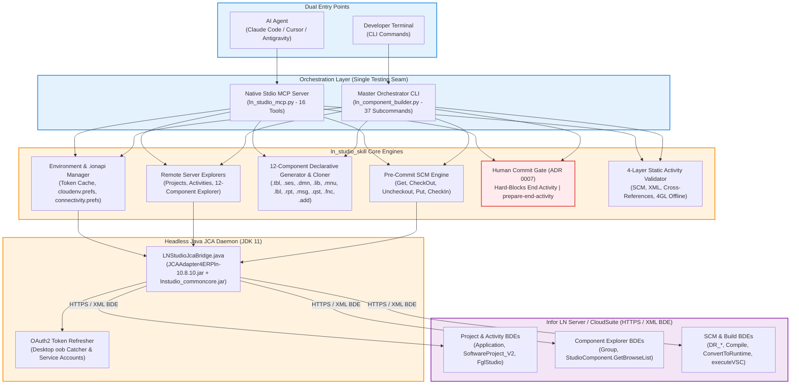

# Infor LN Studio Automation Toolset & Assistant Skill (`ln_studio_skill`)

[](https://www.infor.com)
[-FF6F00?style=for-the-badge&logo=anthropic&logoColor=white)](#native-stdio-mcp-server-ln_studio_mcppy)
[-4CAF50?style=for-the-badge&logo=openjdk&logoColor=white)](#headless-jca-architecture)
[](#complete-12-component-declarative-generators)
[](#strict-human-in-the-loop-commit-gate-adr-0007)
[](#automated-test-suite)

> **Self-contained, production-grade intelligence, headless JCA connectivity, declarative 12-component modeling, pre-commit SCM engine, and native Model Context Protocol (MCP) server for Infor LN Studio 10.8 (Build 0640, April 2026 tree, Eclipse RCP).**

---

## Table of Contents

- [Overview & What's New](#overview--whats-new)
- [Headless JCA Architecture](#headless-jca-architecture)
- [Dual Entry Points (Single Testing Seam)](#dual-entry-points-single-testing-seam)
- [Native Stdio MCP Server (`ln_studio_mcp.py`)](#native-stdio-mcp-server-ln_studio_mcppy)
  - [Registered MCP Tools (16 Tools)](#registered-mcp-tools-16-tools)
  - [AI Agent Configuration (Claude Desktop, Cursor, Antigravity)](#ai-agent-configuration-claude-desktop-cursor-antigravity)
- [Core Capabilities Breakdown](#core-capabilities-breakdown)
  - [1. Headless JCA Connectivity & `.ionapi` Credentials Lifecycle](#1-headless-jca-connectivity--ionapi-credentials-lifecycle)
  - [2. Remote Server Explorers (Projects, Activities, Components)](#2-remote-server-explorers-projects-activities-components)
  - [3. Complete 12-Component Declarative Generators & Server Cloner](#3-complete-12-component-declarative-generators--server-cloner)
  - [4. Pre-Commit SCM Engine & Automated `deploy-test` Pipeline](#4-pre-commit-scm-engine--automated-deploy-test-pipeline)
  - [5. Strict Human-in-the-Loop Commit Gate (ADR 0007)](#5-strict-human-in-the-loop-commit-gate-adr-0007)
  - [6. Extension Modeler Boundary & Local Hook Workflow (ADR 0006)](#6-extension-modeler-boundary--local-hook-workflow-adr-0006)
  - [7. Four-Layer Static Activity Verification (`validate` & Safe `--fix`)](#7-four-layer-static-activity-verification-validate--safe---fix)
- [Master CLI Reference (`ln_component_builder.py`)](#master-cli-reference-ln_component_builderpy)
- [Declarative YAML Schema Examples](#declarative-yaml-schema-examples)
- [Automated Test Suite](#automated-test-suite)
- [Directory Layout](#directory-layout)

---

## Overview & What's New

Historically, developing applications and extensions in Infor LN Studio required repetitive manual clicks across heavy Eclipse RCP wizards, modal dialogs, and fragile UI keystrokes. 

`ln_studio_skill` transforms Infor LN Studio into a **headless-capable, fully automated development ecosystem**:

### 🌟 Major Upgrades in Latest Release:
1. **Headless JCA 1.6 Connectivity & BYOJ (`ln_server_client.py`)**: Direct BDE XML communication over HTTPS via auto-discovered local Eclipse JARs (`JCAAdapter4ERPln-10.8.10.jar` + `lnstudio_commoncore.jar` from `LN_STUDIO_HOME`, zero proprietary JARs tracked in Git) and JDK 11 (~150MB RAM footprint for Python CLI + Headless JVM Daemon).
2. **3-Tier Automated OAuth2 Token Lifecycle (`ln_env_manager.py`)**: Persistent per-workspace token cache at `~/.ln_studio/tokens/<workspace>.json` with a 5-minute safety buffer, silent refresh via `refresh_token` or Service Account (`saak`/`sask`), and interactive browser login (`webbrowser.open`) + `--manual-auth` paste fallback for headless/SSH/WSL environments.
3. **Remote Server Explorers & Workspace Reference Sync (`ln_component_explorer.py`)**: Browse remote Applications, Software Projects, Activities, and Components across all 12 types, or pull Read-Only reference copies (`sync-reference`) into `.reference/<type>/` while automatically indexing `.tbl` and `.dmn` XMLs into `.ln_dd_cache.json`.
4. **Complete 12-Component Ecore Generators & Report Cloning**: Declarative generation for Tables (`.tbl`), Sessions (`.ses`), Domains (`.dmn`), Libraries (`.lib`), Menus (`.mnu`), Labels (`.lbl`), Messages (`.msg`), Questions (`.qst`/`.que`), Include Functions (`.fnc`/`.fun`), and Additional Files (`.add`), plus baseline report/component cloning (`clone-component --source-type report`).
5. **Pre-Commit SCM Engine & Split `deploy-test` (`ln_scm_engine.py`, `ln_build_pipeline.py`)**: Safe `--mode compile-only` (default: `Put -> Compile -> VSC -> CheckIn`) and `--mode schema-crdd` (`Put -> Compile -> CRDD -> CreateTables -> VSC -> CheckIn` with `--dry-run` pre-check and active LN UI session lock warning).
6. **Strict Human-in-the-Loop Commit Gate (ADR 0007 & ADR 0008)**: Hard-blocks `End Activity` / `CloseTask` / `FinalizeActivity` in CLI, MCP, and at the Java protocol level inside `LNStudioJcaBridge.java`.
7. **Native Stdio MCP Server (`ln_studio_mcp.py`)**: Exposes all capabilities via JSON-RPC 2.0 stdio with 18 tools (including `ln_sync_reference`), ready for Claude Desktop, Cursor, Antigravity, and AI Agents.

---

## Headless JCA Architecture



---

## Dual Entry Points (Single Testing Seam)

Both the Master CLI (`ln_component_builder.py`) and the Stdio MCP Server (`ln_studio_mcp.py`) invoke the identical underlying Python functions, ensuring 100% behavioral parity between human terminal usage and autonomous AI agent operations:

```
                  +----------------------------------------------+
                  |         Unified Underlying Python API        |
                  +----------------------------------------------+
                         ^                                ^
                         |                                |
       +-----------------+----------------+               |
       |                                  |               |
+---------------+                +----------------+       |
|  Master CLI   |                | Native Stdio   |       |
|  (37 Subcmds) |                | MCP Server     |       |
|               |                | (16 Tools)     |       |
+---------------+                +----------------+       |
       ^                                  ^               |
       |                                  |               |
   [Developer]                    [AI Coding Agent]       |
```

---

## Native Stdio MCP Server (`ln_studio_mcp.py`)

A pure-Python JSON-RPC 2.0 Model Context Protocol (MCP) server communicating over standard input/output (`stdio`), requiring zero external pip dependencies.

### Registered MCP Tools (16 Tools)

| Tool Name | Category | Description | Guardrails Enforced |
|---|---|---|---|
| `ln_list_environments` | Environment | Lists configured Infor LN workspaces, tenant IDs, Gateway URLs, and connection status | Read-only |
| `ln_connect` | Environment | Imports `.ionapi` credentials, performs OAuth2 authentication, and synchronizes Eclipse preferences | Safe sync |
| `ln_explore_projects` | Explorer | Browses remote Applications and Software Projects (`SoftwareProject_V2`) | Read-only |
| `ln_explore_activities` | Explorer | Queries open activities, tasks, owners, and modified components under a Software Project | Read-only |
| `ln_explore_components` | Explorer | Queries server components across all 12 types with wildcard filters (`tx*`) | Read-only |
| `ln_create_activity` | Activity | Creates a remote Activity on the server and bootstraps local `.project` and `.admin` files | SCM tracking |
| `ln_clean_activity` | Activity | Recovers stuck workarea locks or components for an Activity on the server | Server cleanup |
| `ln_get_component` | SCM | Fetches component from server (inspects in-memory or downloads Read-Only into local activity) | Read-Only |
| `ln_checkout_component` | SCM | Locks component on server into active Activity and downloads editable XML | **ADR 0006**: Hard-blocks `tx*` Extension Modeler objects |
| `ln_uncheckout_component`| SCM | Reverts server lock and restores local read-only copy | SCM rollback |
| `ln_checkin_component` | SCM | Puts component to server and checks in with comment for LN UI testing | SCM tracking |
| `ln_create_component` | Generator | Declaratively generates any of the 12 LN Studio component types and updates `.admin` | Ecore validation |
| `ln_clone_component` | Generator | Fetches server component, renames packages/modules, and registers as new custom component | Safe renaming |
| `ln_validate_activity` | Quality | Executes 4-layer static activity validation (`.admin`, XML facets, references, 4GL scripts) | Offline check |
| `ln_deploy_test` | Pipeline | Composite test deployment: Put -> Compile -> CRDD -> CreateTables -> VSC -> CheckIn | Server test loop |
| `ln_prepare_end_activity`| Pipeline | Validates activity readiness, workspace sync, and outputs human commit handoff report | Pre-commit check |
| `ln_end_activity` | Safety Gate | Pre-commit boundary gate: **Hard-blocked**; directs developer to finalize in LN Studio | **ADR 0007**: Human-in-the-Loop |

### AI Agent Configuration (Claude Desktop, Cursor, Antigravity)

Use the built-in setup command to register the MCP server automatically:
```bash
python ln_studio_skill/tools/ln_component_builder.py mcp-setup --target claude-desktop
python ln_studio_skill/tools/ln_component_builder.py mcp-setup --target cursor
python ln_studio_skill/tools/ln_component_builder.py mcp-setup --target antigravity
```

#### Manual Configuration Snippet:

**Claude Desktop** (`%APPDATA%\Claude\claude_desktop_config.json`):
```json
{
  "mcpServers": {
    "ln-studio": {
      "command": "python",
      "args": [
        "c:/Users/nutdo/OneDrive/Documents/Gitlab/Skill_LN/ln_studio_skill/tools/ln_studio_mcp.py"
      ]
    }
  }
}
```

**Cursor / Antigravity** (`.cursor/mcp.json` or Antigravity config):
```json
{
  "mcpServers": {
    "infor-ln-studio": {
      "command": "python",
      "args": [
        "c:/Users/nutdo/OneDrive/Documents/Gitlab/Skill_LN/ln_studio_skill/tools/ln_studio_mcp.py"
      ],
      "env": {
        "PYTHONIOENCODING": "utf-8"
      }
    }
  }
}
```

---

## Core Capabilities Breakdown

### 1. Headless JCA Connectivity & `.ionapi` Credentials Lifecycle
- **Multi-Environment Support**: Connects to customer workspaces (`SCS_TST`, `DNT_TRN`, `RDT_TST`, `RPA_REIN`, `Team`, `ZAP`, etc.).
- **Automatic OAuth2 Token Refresh**: Captures `oob://localhost/lnstudio` authorization codes and refreshes tokens silently outside Git tracking (`.ionapi_token_cache.json`).
- **Service Account Ready**: Native support for headless Service Accounts (`saak`/`sask`) with zero browser popups.
- **Eclipse Synchronization**: Keeps Eclipse's global `cloudenv.prefs` and per-workspace `connectivity.prefs` 100% in sync.

### 2. Remote Server Explorers (Projects, Activities, Components)
- **Software Project Explorer**: Inspect applications, VRC versions (`workSet`, `baseVRC`), and runtime servers.
- **Activity Explorer**: List open tasks, activity owners, and modified component lists.
- **Component Explorer**: Filter across all 12 component types by package (`tc`, `td`, `wh`, `tf`, `tx`) and name range.

### 3. Complete 12-Component Declarative Generators & Server Cloner
Full XML Ecore modeling matching official Infor LN Studio Build 0640 schemas:
- **Tables (`.tbl`)**: Native Ecore datatypes (Byte, Double, Long, Numeric, String, Enum, Date, UTC), primary/secondary indices, table properties.
- **Sessions (`.ses`)**: Multi-archetype sessions (Type 1-4, MMT Controllers with satellites, Dialogs, Print Sessions, Form Commands).
- **Domains (`.dmn`)**: Standalone domain definitions with string lengths, numeric formats, and enum values.
- **Libraries (`.lib`)**: Reusable DLL libraries and extension libraries with `#context_on`/`#context_off`.
- **Menus (`.mnu`)**: Menu hierarchies and localized menu items.
- **Labels (`.lbl`)**: Multi-language label XML generator.
- **Reports (`.rpt` & `.rptdsrc`)**: Input fields, sort sequences, layouts, and 4GL report scripts.
- **Messages (`.msg`)**: Severity levels, domains, and translation payloads.
- **Questions (`.qst`/`.que`)**: Question definitions, default answers, and domain bindings.
- **Include Functions (`.fnc`/`.fun`)**: Reusable `#include` modules.
- **Additional Files (`.add`)**: Binary and text resource payloads.
- **Component Cloner (`clone-component`)**: Clones any standard object into a renamed custom `tx` object with all references updated.

### 4. Pre-Commit SCM Engine & Automated `deploy-test` Pipeline
The `deploy-test` command automates the entire inner loop of Infor LN development:
```
[Local 4GL / XML Changes]
         |
         v
1. Put / DR_Create (Upload XML and 4GL sources to server workarea)
         |
         v
2. Remote Compile (Extract line-accurate errors from server XML response)
         |
         v
3. Convert to Runtime (crdd) & Create Tables (Reconfigure DB)
         |
         v
4. Execute VSC (Verify Software Components on server)
         |
         v
5. Check-In (Upload with commit comment for live testing on Activity VRC in LN UI)
```

### 5. Strict Human-in-the-Loop Commit Gate (ADR 0007)
To ensure maximum safety in enterprise environments:
- Calling `end-activity` in CLI or MCP raises `PreCommitBoundaryError` and is **hard-blocked**.
- AI agents cannot finalize or permanently deliver activities to higher VRCs.
- `prepare-end-activity` runs all pre-commit verifications, synchronizes `.project` and `.admin`, and generates a handoff summary for human review.
- The human developer opens Infor LN Studio for final inspection and clicks "End Activity".

### 6. Extension Modeler Boundary & Local Hook Workflow (ADR 0006)
- **Problem**: Extension Modeler components (`ttext1500m000`, `tx*` in `ess`, `est`, `esb`, `esm`, `esr`) cannot be checked out via Studio SCM. Attempting to do so corrupts the workarea.
- **Solution**: The toolchain intercepts writes to extension components (`ReadOnlyComponentError`) and treats them as `[GET_ONLY_EXTENSION]`.
- **Workflow**:
  - `new-extension`: Scaffolds a local extension 4GL file with `#context_on` blocks.
  - `import-extension`: Ingests standard extension hooks from Studio "Get" cache.
  - `extension-hooks`: Extracts hooks and copies them to the clipboard for 1-click delivery into LN UI.

### 7. Four-Layer Static Activity Verification (`validate` & Safe `--fix`)
Performs thorough offline verification before touching the server:
- **Layer 1 (SCM)**: Verifies `.admin` cache registration and OS Read-Only file states.
- **Layer 2 (XML Structure)**: Validates XML root tags, Ecore facets, and Session `<FormGroup>` hierarchy trees.
- **Layer 3 (Cross-References)**: Resolves `.lbl` label codes, table-session column bindings, and index definitions.
- **Layer 4 (4GL Code)**: Statically verifies section headers, block balance (`select`, `if`, `case`, `for`, `while`, `repeat`), hook signatures, and Cloud Multi-Tenant rules (`--cloud`).
- **Safe `--fix`**: Automatically generates missing `.lbl` files and synchronizes `.admin` without modifying Read-Only files.

---

## Master CLI Reference (`ln_component_builder.py`)

```bash
# -------------------------------------------------------------
# 1. Environment & Workspace Management
# -------------------------------------------------------------
python ln_studio_skill/tools/ln_component_builder.py environments
python ln_studio_skill/tools/ln_component_builder.py connect --ionapi path/to/credentials.ionapi --workspace SCS_TST
python ln_studio_skill/tools/ln_component_builder.py workspace --list-workspaces

# -------------------------------------------------------------
# 2. Remote Server Explorers
# -------------------------------------------------------------
python ln_studio_skill/tools/ln_component_builder.py project --list
python ln_studio_skill/tools/ln_component_builder.py activity --list --project EXTce01107
python ln_studio_skill/tools/ln_component_builder.py activity --create task_101 --project EXTce01107 --desc "New Feature" --bootstrap
python ln_studio_skill/tools/ln_component_builder.py clean-activity --project EXTce01107 --activity-id task_101
python ln_studio_skill/tools/ln_component_builder.py explorer --type table --filter "tx*" --project EXTce01107

# -------------------------------------------------------------
# 3. Component Generation & Cloning
# -------------------------------------------------------------
# Generate from declarative YAML spec:
python ln_studio_skill/tools/ln_component_builder.py table --spec schema.yaml --output-dir .
python ln_studio_skill/tools/ln_component_builder.py session --spec schema.yaml --output-dir .
python ln_studio_skill/tools/ln_component_builder.py domain --spec schema.yaml --output-dir .
python ln_studio_skill/tools/ln_component_builder.py library --spec schema.yaml --output-dir .
python ln_studio_skill/tools/ln_component_builder.py menu --spec schema.yaml --output-dir .
python ln_studio_skill/tools/ln_component_builder.py message --code txcmg0001 --desc "Invalid State" --activity <act>
python ln_studio_skill/tools/ln_component_builder.py question --code txcmg0002 --desc "Proceed?" --activity <act>
python ln_studio_skill/tools/ln_component_builder.py function --code txcmgfnc01 --desc "Helper" --activity <act>
python ln_studio_skill/tools/ln_component_builder.py additional --code txcmgcfg --desc "Config" --activity <act>
python ln_studio_skill/tools/ln_component_builder.py report --code txcmg041101000 --desc "Billing Report" --activity <act>

# Clone server component (recommended for complex Reports and standard customizations) into custom tx activity:
python ln_studio_skill/tools/ln_component_builder.py clone-component --source-type report --source-name tdsls440101000 --target-name txsls440101000 --activity <act>
python ln_studio_skill/tools/ln_component_builder.py clone-component --source-type table --source-name whwmd400 --target-name txwmd400 --activity <act>

# -------------------------------------------------------------
# 4. SCM, Reference Sync & Automated Remote Build Pipeline
# -------------------------------------------------------------
python ln_studio_skill/tools/ln_component_builder.py sync-reference --type table --name "tdsls40*" --workspace SCS_TST
python ln_studio_skill/tools/ln_component_builder.py get-component --type table --name whwmd400 --inspect
python ln_studio_skill/tools/ln_component_builder.py get-component --type table --name whwmd400 --activity <act>
python ln_studio_skill/tools/ln_component_builder.py checkout-component --type table --name txcmg011 --activity <act> --comment "Modify batch"
python ln_studio_skill/tools/ln_component_builder.py uncheckout-component --type table --name txcmg011 --activity <act>
python ln_studio_skill/tools/ln_component_builder.py checkin-component --type table --name txcmg011 --activity <act> --comment "Updated"

# Safe Script-Only Deploy & Test (Default --mode compile-only: Put -> Compile -> VSC -> CheckIn):
python ln_studio_skill/tools/ln_component_builder.py deploy-test --type table --name txcmg011 --activity <act> --mode compile-only --comment "Deploy script"

# Full Schema Reconfiguration (--mode schema-crdd: Put -> Compile -> CRDD -> CreateTables -> VSC -> CheckIn):
python ln_studio_skill/tools/ln_component_builder.py deploy-test --type table --name txcmg011 --activity <act> --mode schema-crdd --dry-run
python ln_studio_skill/tools/ln_component_builder.py deploy-test --type table --name txcmg011 --activity <act> --mode schema-crdd --comment "Deploy schema"

# Prepare End-Activity pre-commit verification & handoff:
python ln_studio_skill/tools/ln_component_builder.py prepare-end-activity --activity <act>

# -------------------------------------------------------------
# 5. Local Code Synchronization & 4-Layer Verification
# -------------------------------------------------------------
python ln_studio_skill/tools/ln_component_builder.py inject --source txcmg011.dal --target txcmg011.tbl
python ln_studio_skill/tools/ln_component_builder.py extract --source txcmg011.tbl --target txcmg011.dal
python ln_studio_skill/tools/ln_component_builder.py check-script txcmg011.dal --cloud
python ln_studio_skill/tools/ln_component_builder.py sync-admin --activity <act>
python ln_studio_skill/tools/ln_component_builder.py validate <act> --strict --fix
python ln_studio_skill/tools/ln_component_builder.py diagnose --activity <act> --errors-only

# -------------------------------------------------------------
# 6. Extension Modeler Local Workflow (ADR 0006)
# -------------------------------------------------------------
python ln_studio_skill/tools/ln_component_builder.py new-extension --type table --component whwmd400 --output extensions/
python ln_studio_skill/tools/ln_component_builder.py import-extension --activity <act> --component whwmd400
python ln_studio_skill/tools/ln_component_builder.py extension-hooks --file extensions/table/whwmd400_ext.4gl --copy-to-clipboard

# -------------------------------------------------------------
# 7. MCP Setup
# -------------------------------------------------------------
python ln_studio_skill/tools/ln_component_builder.py mcp-setup --target claude-desktop
```

---

## Declarative YAML Schema Examples

### Multi-Component Specification (`schema.yaml`)

```yaml
version_id: B61O_a_ext
application: EXTce01107

tables:
  - code: txcmg011
    description: Billing Batch Header
    package: tx
    module: cmg
    fields:
      - name: btno
        domain: tcmcs.long
        type: long
        mandatory: true
      - name: bild
        domain: tfgld.date
        type: date
      - name: tamt
        domain: tcamnt
        type: amount
      - name: stat
        domain: txcmg.stat
        type: enum
    indices:
      - id: 1
        columns: [btno]
        primary_key: true

sessions:
  - code: txcmg0110m100
    description: Billing Batch Maintenance
    type: mmt_controller
    table: txcmg011
    satellites: [txcmg0510m000]
    form_commands:
      - name: exec.user.0
        function: generate.billing
        label_code: txcmg0110m100.cmd1
        description: Generate Billing
```

---

## Automated Test Suite

Run the full unit test suite:

```bash
python -m unittest discover -s ln_studio_skill/tools/tests
```

```text
................................s.............................................................................................................................
----------------------------------------------------------------------
Ran 158 tests in 7.825s

OK (skipped=1)
```

Validate skill documentation and links:

```bash
python ln_studio_skill/tools/validate_skill.py --skill-dir ln_studio_skill
```

```text
INDEX.tsv: OK (0 missing)
references/STUDIO_INDEX.md: OK (0 broken)
page links: OK (17 pages, 0 broken)
validate_skill: PASS (0 problem(s))
```

---

## Directory Layout

```text
ln_studio_skill/
├── SKILL.md                          # Agent skill definition & execution instructions
├── README.md                         # Detailed toolset documentation & guides
├── references/
│   ├── STUDIO_INDEX.md               # Master index for Infor LN Studio manual (17 ch)
│   └── studio_guide/                 # Studio guide chapters (Cloud & On-premises)
└── tools/
    ├── ln_component_builder.py       # Master CLI orchestrator (37 subcommands)
    ├── ln_studio_mcp.py              # Native Stdio MCP Server (16 tools)
    ├── ln_env_manager.py             # .ionapi & OAuth2 credentials lifecycle manager
    ├── ln_server_client.py           # Headless JCA server client & Java bridge
    ├── ln_project_activity_manager.py# Software Projects & Activity Explorer manager
    ├── ln_component_explorer.py      # 12-component explorer, get, inspect, clone
    ├── ln_scm_engine.py              # Pre-Commit SCM Engine (Check-Out, Put, Check-In)
    ├── ln_build_pipeline.py          # Remote build, CRDD, CreateTables, deploy-test
    ├── ln_extension_manager.py       # Extension Modeler local project workflow (ADR 0006)
    ├── validate_ln_activity.py       # 4-Layer static activity validator & safe --fix
    ├── check_4gl_script.py           # Offline 4GL script syntax inspector
    ├── scm_guardrails.py             # SCM Read-Only & Extension protection rules
    ├── admin_sync.py                 # 12-extension .admin SCM cache synchronizer
    ├── generate_ln_table.py          # Table, domain, and label XML generator
    ├── generate_ln_session.py        # Multi-archetype session XML generator
    ├── generate_ln_domain.py         # Standalone domain XML generator
    ├── generate_ln_library.py        # Library (DLL, extension) XML generator
    ├── generate_ln_menu.py           # Menu XML generator
    ├── generate_ln_message.py        # Message (.msg) XML generator
    ├── generate_ln_question.py       # Question (.qst) XML generator
    ├── generate_ln_function.py       # Include function (.fnc) XML generator
    ├── generate_ln_additional.py     # Additional file (.add) XML generator
    ├── generate_ln_report.py         # Report (.rpt) XML generator
    ├── inject_ln_script.py           # 4GL source synchronizer (with guardrails)
    ├── extract_studio_dictionaries.py# LN Studio reflection & syntax extractor
    ├── ln_workspace_manager.py       # Eclipse workspace & activity resolver
    ├── ln_error_reader.py            # Eclipse .markers error parser
    ├── ln_studio_bridge.py           # Win32 GUI bridge (optional fallback)
    ├── validate_skill.py             # Documentation link & index validator
    └── tests/                        # 158 automated unit tests
```

---

## Credits & Maintainer

**Created and Maintained by:**
- **Natthaphon Srikasem** — Lead Developer & Senior ERP Technical Consultant
- **Reinvention Co., Ltd.** — Company

Dedicated to advancing autonomous, high-velocity, and safe enterprise development on Infor ERP LN and Infor LN Studio.