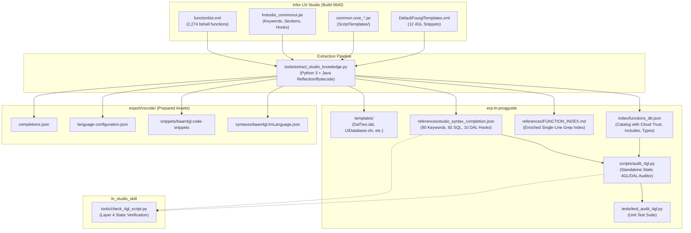

# Master Architecture & Implementation Plan: Infor LN Studio Build 0640 Dictionaries Extraction, Cloud Governance & Standalone 4GL Audit Engine

## 1. Executive Summary

This architecture and implementation blueprint defines the systematic extraction of authoritative language dictionaries, Data Access Layer (DAL) contracts, code templates, and Cloud Governance catalogs from the pinned **Infor LN Studio 10.8 build 0640** (`d:\LN Studio\April-2026\InforLNStudio_10_8_0_build0640-x86_64`) into **`skill erp-ln-progguide`**.

Additionally, this initiative builds a zero-dependency **Standalone 4GL & DAL Audit Engine** (`scripts/audit_4gl.py`) in `erp-ln-progguide`, enriches `references/FUNCTION_INDEX.md` with Cloud Multi-Tenant badges, synchronizes static script verification with `ln_studio_skill`, and pre-packages ready-to-use **VS Code Extension assets** (`export/vscode/`).

---

## 2. Architecture & Data Flow

---

## 3. Work Breakdown Structure (Tickets 01 - 06)

| Ticket | Phase / Title | Target Deliverables | Key Responsibilities |
|---|---|---|---|
| **01** | **Multi-Tier Knowledge Extractor** | `tools/extract_studio_knowledge.py` `erp-ln-progguide/index/functions_db.json` `erp-ln-progguide/references/studio_syntax_completion.json` `erp-ln-progguide/templates/` | Parse 2,274 functions from `functionlist.xml` with Cloud/Trusted and include tags; reflectively extract keywords, SQL keywords, and DAL hooks from `lnstudio_commonui.jar`; extract official script templates. |
| **02** | **Enriched Grep-Friendly Function Index** | `erp-ln-progguide/references/FUNCTION_INDEX.md` | Rebuild function index with single-line badges: `[Cloud: Trusted\|Untrusted]`, `[Deprecated]`, `[Scope: ...]`, and `[Inc: <header>]` for instant AI grep discovery. |
| **03** | **Standalone 4GL & DAL Audit Engine** | `erp-ln-progguide/scripts/audit_4gl.py` | Standalone Python CLI tool auditing 4GL, DAL2, and UEDLL files for block balance, DAL2 contracts (prohibiting `message()`, checking `long i.mode`), Cloud Multi-Tenant governance (`--cloud`), missing includes, and 4GL caveats (`==` on doubles). |
| **04** | **Synchronized Rule Alignment** | `ln_studio_skill/tools/check_4gl_script.py` | Synchronize Layer 4 static script inspector in `ln_studio_skill` with the newly extracted dictionaries and Cloud/Include verification rules. |
| **05** | **Export VS Code Extension Assets Package** | `export/vscode/syntaxes/baan4gl.tmLanguage.json` `export/vscode/snippets/baan4gl.code-snippets` `export/vscode/language-configuration.json` `export/vscode/completions.json` `export/vscode/README.md` | Pre-package production-grade TextMate grammar, snippets, and language configuration files ready for future VS Code extension development. |
| **06** | **Test Suite, Documentation & Catalog Indexing** | `erp-ln-progguide/tests/test_audit_4gl.py` `erp-ln-progguide/SKILL.md` `erp-ln-progguide/index/INDEX.tsv` `GLOSSARY.md` `Tickets.md` | Implement comprehensive unit test suite covering positive and negative audit cases; document audit commands in `SKILL.md`; register assets in `INDEX.tsv`. |

---

## 4. Key Architectural Decisions Recorded

1. **Architecture Decision Record**: Recorded in [`docs/adr/0005-progguide-studio-dictionaries-and-audit-engine.md`](file:///c:/Users/nutdo/OneDrive/Documents/Gitlab/Skill_LN/docs/adr/0005-progguide-studio-dictionaries-and-audit-engine.md).
2. **Technical Specification**: Recorded in [`docs/SPEC_PROGGUIDE_STUDIO_EXTRACTION_AND_AUDIT.md`](file:///c:/Users/nutdo/OneDrive/Documents/Gitlab/Skill_LN/docs/SPEC_PROGGUIDE_STUDIO_EXTRACTION_AND_AUDIT.md).
3. **Execution Plan**: Recorded in [`docs/PLAN_PROGGUIDE_STUDIO_EXTRACTION_AND_AUDIT.md`](file:///c:/Users/nutdo/OneDrive/Documents/Gitlab/Skill_LN/docs/PLAN_PROGGUIDE_STUDIO_EXTRACTION_AND_AUDIT.md).
4. **Domain Glossary**: Updated in [`GLOSSARY.md`](file:///c:/Users/nutdo/OneDrive/Documents/Gitlab/Skill_LN/GLOSSARY.md) with definitions for *Cloud Trusted Function*, *VSC*, *DAL2 Field Hook Suffixes*, *TextMate Grammar*, and *Standalone 4GL Auditor*.
5. **Active Task Tracking**: Updated in [`Tickets.md`](file:///c:/Users/nutdo/OneDrive/Documents/Gitlab/Skill_LN/Tickets.md).
